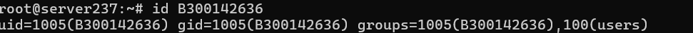
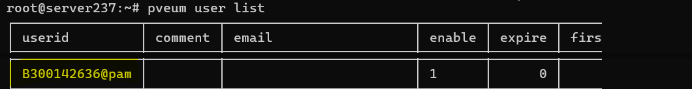
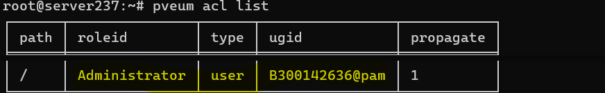

# 🔐 INF1085 — Sécuriser l'administration de Proxmox VE 9 avec des comptes individuels

> **Projet / TP** — Gestion des comptes administrateurs, des permissions Proxmox (ACL), de l'accès SSH et des clés publiques.

> Prenom et Nom : Ndiogou DIOUM | Matricule : 300142636
> Machine virtuelle : 101 — B300142636

> 
> **État de la documentation :** les trois vérifications ont été réalisées : compte Linux `B300142636` existant, compte Proxmox `B300142636@pam` activé, ACL `Administrator` attribuée sur `/` avec propagation active. Les captures correspondantes sont intégrées. Les connexions Web, SSH et SSH par clé **restent à confirmer**. Les commandes de création figurent uniquement à titre de référence.

## 1. Contexte et objectif

L'utilisation quotidienne du compte partagé `root@pam` ne permet pas d'attribuer facilement les actions à un administrateur précis et encourage le partage d'un secret sensible. Le but de ce laboratoire est de **gérer Proxmox avec un compte nominatif**, tout en réservant `root@pam` aux interventions exceptionnelles.

**Objectifs :**

- Vérifier l'existence du compte Linux personnel et sa correspondance dans le domaine d'authentification `pam` de Proxmox.
- Comprendre et vérifier l'attribution d'un rôle Proxmox avec une liste de contrôle d'accès (**ACL**).
- Accéder à l'interface Web avec un compte individuel.
- Configurer et tester l'authentification SSH par clé publique, sans partager de mot de passe administrateur.
- Conserver des preuves de configuration pour une documentation reproductible.

## 2. Environnement du laboratoire

| Composant | Valeur / état |
|---|---|
| Hyperviseur | Proxmox VE 9 (serveur du laboratoire) |
| Nœud | `server237` |
| Adresse de gestion | `10.7.236.237` |
| Interface Web | `https://10.7.236.237:8006/` (accès depuis le réseau autorisé) |
| Compte nominatif utilisé dans les exemples | `B300142636` **— casse exacte confirmée** |
| Domaine d'authentification | `pam` (authentification Linux) |
| Compte d'urgence | `root@pam` |
| Rôle étudié | `Administrator` (privilèges Proxmox complets) |
| Terminal distant | SSH depuis un poste client Windows / Linux |

> **Attention à la casse :** la commande `id B300142636` confirme l'identifiant avec un `B` majuscule. Linux distingue `B300142636` et `b300142636` : conserver cette casse dans toutes les commandes.

### Distinction essentielle : Linux, Proxmox et `sudo`

| Mécanisme | Ce qu'il permet |
|---|---|
| Compte **Linux** | Session SSH ou console système, selon les politiques SSH/PAM |
| Utilisateur **Proxmox `@pam`** | Connexion à l'interface Proxmox en réutilisant l'authentification PAM du compte Linux |
| **ACL Proxmox** | Autorise les opérations dans l'interface Web et l'API selon un rôle et un chemin |
| **`sudo` / root Linux** | Autorise les commandes nécessitant les privilèges du système hôte |

> Le rôle Proxmox **`Administrator` ne confère pas automatiquement les droits root Linux ni l'accès à `qm` sans privilèges**. Ces droits sont gérés séparément.

## 3. Vérifier le compte Linux existant

Ce TP est adapté à un utilisateur **déjà créé** : il n'est pas nécessaire de lancer `adduser` sans vérifier.

Sur la console Proxmox, l’administrateur a exécuté :

```bash
id B300142636
```

**Résultat réellement obtenu :**

```text
uid=1005(B300142636) gid=1005(B300142636) groups=1005(B300142636),100(users)
```



La sortie confirme que le compte Linux existe, que son UID et son GID sont `1005`, et qu’il est membre des groupes `B300142636` et `users`. **Aucune appartenance au groupe `sudo` n’apparaît** dans cette sortie : il ne faut donc pas en déduire un accès administrateur au système Linux.

**Commande de création de référence (non nécessaire dans notre cas)** :

```bash
# Uniquement si le compte n’existe pas déjà :
adduser B300142636
```

## 4. Vérifier ou enregistrer le compte dans Proxmox (`pam`)

Proxmox et Linux disposent d’entrées de comptes distinctes. La commande suivante a été exécutée :

```bash
pveum user list
```

L’utilisateur **`B300142636@pam` est présent et activé** (`enable = 1`, `expire = 0`).



> **Respect de la vie privée :** la capture est recadrée pour ne montrer que la ligne du compte étudié ; les identifiants et l’adresse e-mail des autres utilisateurs du laboratoire ne sont pas publiés.

**Commande de création de référence (non nécessaire ici)** :

```bash
# Uniquement si le compte est absent de pveum user list :
pveum user add B300142636@pam
```

## 5. Gérer les rôles et les permissions ACL

Les autorisations Proxmox sont attribuées à un **utilisateur ou groupe**, pour un **rôle**, sur un **chemin**. Le chemin `/` couvre l'ensemble du datacenter et ses ressources héritées lorsque la propagation est activée.

### Vérification de l’ACL réellement effectuée

```bash
pveum acl list
```

La capture confirme les valeurs suivantes pour **`B300142636@pam`** :

| Champ | Valeur relevée |
|---|---|
| `path` | `/` |
| `roleid` | `Administrator` |
| `type` | `user` |
| `ugid` | `B300142636@pam` |
| `propagate` | `1` |



L’ACL attribue des permissions **d’administration Proxmox sur le chemin racine `/`**, héritées par les ressources enfants grâce à `propagate = 1`. Cela ne correspond **pas** à une élévation des privilèges Linux en SSH.

> **Respect de la vie privée :** capture recadrée sur l’ACL de notre compte ; les identifiants des autres membres du laboratoire ne sont pas publiés.

Pour examiner la permission calculée du compte :

```bash
pveum user permissions B300142636@pam
```

### Attribution de rôle — référence uniquement

**Il n’est pas nécessaire de réexécuter cette commande puisque l’ACL existe déjà.** En cas de création d’un nouveau compte, et uniquement avec autorisation du responsable :

```bash
pveum aclmod / -user B300142636@pam -role Administrator
```

> **Principe de moindre privilège :** `Administrator` est un rôle très étendu. Pour une utilisation limitée à certaines VM, préférer des permissions restreintes sur le chemin approprié lorsque le laboratoire l’autorise.

## 6. Connexion à l'interface Web

Depuis un ordinateur ayant accès au réseau du laboratoire :

1. Ouvrir `https://10.7.236.237:8006/`.
2. Saisir l'identifiant **`B300142636`** dans le champ utilisateur.
3. Choisir le domaine **Linux PAM standard authentication** (`pam`).
4. Saisir le **mot de passe individuel** de cet utilisateur, pas celui de `root`.
5. Confirmer que les ressources autorisées sont visibles et que les opérations prévues par le TP sont accessibles.

> Éviter de publier une capture contenant un mot de passe, des jetons de session, des informations personnelles inutiles ou des éléments sensibles du réseau.

**Preuve à joindre :** `preuves/04-session-web.png` (après authentification, données sensibles masquées).

## 7. Connexion SSH avec le compte individuel

### Vérifier la connexion par mot de passe (état initial)

Depuis un ordinateur Windows (PowerShell) ou Linux :

```bash
ssh B300142636@10.7.236.237
```

L’identifiant Linux avec **`B` majuscule** a été confirmé par la commande `id`. Si la connexion fonctionne, tester :

```bash
whoami
hostname
id
```

> Une **ACL Proxmox ne donne pas les privilèges d'administration système**. Il faut distinctement une politique `sudo` ou une autre forme d'élévation pour les commandes système qui l'exigent. Ne pas ajouter l'utilisateur au groupe `sudo` sans besoin ni autorisation.

**Preuve à joindre :** `preuves/05-connexion-ssh.png`.

## 8. Renforcer SSH avec une clé publique Ed25519

### 8.1. Créer la clé sur le **poste client**, pas sur le serveur

Depuis le poste du titulaire du compte :

```bash
ssh-keygen -t ed25519 -C "proxmox-lab"
```

Si une clé existe déjà, **ne pas l'écraser**. La clé privée doit rester sur le poste client ; seule la clé publique (`.pub`) est transférée vers Proxmox.

### 8.2. Installer la clé publique sur le serveur

Sur un poste Linux ou macOS, si `ssh-copy-id` est disponible :

```bash
ssh-copy-id B300142636@10.7.236.237
```

Sur Windows PowerShell, si `ssh-copy-id` est indisponible et que la clé publique est à l'emplacement standard :

```powershell
Get-Content "$env:USERPROFILE\.ssh\id_ed25519.pub" | ssh B300142636@10.7.236.237 "umask 077; mkdir -p ~/.ssh; cat >> ~/.ssh/authorized_keys"
```

Adapter l'identifiant et le chemin si nécessaire. La commande peut demander **une dernière fois le mot de passe Linux** pour installer la clé.

### 8.3. Vérifier les permissions côté serveur

Connecté sur le serveur en tant que compte personnel :

```bash
chmod 700 ~/.ssh
chmod 600 ~/.ssh/authorized_keys
ls -ld ~/.ssh
ls -l ~/.ssh/authorized_keys
```

Vérifier que la fonctionnalité est active :

```bash
sudo sshd -T | grep pubkeyauthentication
```

Résultat **attendu** : `pubkeyauthentication yes` (à confirmer par la sortie réelle).

### 8.4. Tester l'authentification par clé

Sur le poste client :

```bash
ssh -o PreferredAuthentications=publickey -o PasswordAuthentication=no B300142636@10.7.236.237
```

Résultat attendu : connexion sans mot de passe **du compte serveur** (une **phrase secrète locale** de clé privée peut toujours être demandée).

**Preuves à joindre :** `preuves/06-cle-publique-permissions.png` et `preuves/07-test-ssh-cle.png`.

> Pour éviter les alertes de changement de clé hôte, vérifier l'empreinte SSH du serveur depuis une console de confiance avant d'accepter une nouvelle empreinte. Ne pas désactiver `StrictHostKeyChecking` pour contourner un avertissement.

## 9. Conserver `root@pam` comme compte de secours

Le compte `root@pam` reste disponible selon les règles du laboratoire pour :

- récupération d'accès ou réinitialisation d'un compte ;
- dépannage d'urgence ;
- maintenance requérant des privilèges système particuliers.

**Bonnes pratiques complémentaires :** mot de passe administrateur fort et non partagé, authentification multifacteur sur l'interface Web lorsque possible, limitation de l'accès réseau au port 8006 et à SSH, et revue périodique des ACL. Ne pas désactiver l'accès root avant d'avoir testé et conservé une méthode de récupération autorisée.

## 10. Tests de validation et preuves

| Contrôle | Commande / action | Statut documenté |
|---|---|---|
| Compte Linux présent | `id B300142636` | ✅ Confirmé — UID/GID 1005 |
| Compte PAM activé dans Proxmox | `pveum user list` | ✅ Confirmé — `enable = 1` |
| Rôle Administrator et ACL `/` | `pveum acl list` | ✅ Confirmé — `propagate = 1` |
| Accès Web par compte individuel | Connexion PAM à `:8006` | ⏳ Pas encore prouvé par capture |
| Connexion SSH individuelle | `ssh B300142636@10.7.236.237` | ⏳ Pas encore prouvée |
| Clé publique individuelle installée | `~/.ssh/authorized_keys` | ⏳ Pas encore documentée |
| Authentification SSH par clé uniquement | `ssh -o PasswordAuthentication=no ...` | ⏳ Pas encore testée |
| `root@pam` conservé | Vérification de la méthode de secours | ⏳ À confirmer dans la procédure de sécurité |

Les trois premières validations sont étayées par des **captures fournies lors de ce TP**. Il ne faut pas considérer la configuration de la clé SSH comme terminée avant un test réel depuis le poste client.

## 11. Difficultés possibles et solutions

| Symptôme | Cause possible | Vérification recommandée |
|---|---|---|
| `Permission denied` lors du SSH | Mauvais nom d'utilisateur, casse, mot de passe ou politique SSH | `getent passwd`, `id`, journaux SSH |
| Connexion Web refusée | Compte absent dans `pveum`, mauvais domaine `pam` ou mot de passe | `pveum user list`, vérifier le domaine de connexion |
| Accès Web mais droits insuffisants | ACL manquante ou rôle trop limité | `pveum acl list`, `pveum user permissions` |
| Accès Web autorisé mais `qm` refusé en SSH | Les droits Proxmox ne sont pas les privilèges root Linux | Vérifier `sudo -l` avec les droits autorisés |
| SSH demande toujours le mot de passe serveur | Clé absente, permissions incorrectes ou clé privée non présentée | `ssh -v`, `ls -ld ~/.ssh`, `ls -l ~/.ssh/authorized_keys` |
| `REMOTE HOST IDENTIFICATION HAS CHANGED` | Changement réel de clé serveur ou risque d'interception | Comparer l'empreinte avec une source fiable avant toute correction |

## 12. Questions de réflexion

**Pourquoi éviter les comptes administrateurs partagés ?** Pour préserver la traçabilité des actions, limiter l'exposition des secrets et faciliter le retrait des accès d'un administrateur.

**Quelle différence entre `user@pam` et un utilisateur Linux ?** Le compte Linux fournit l'identité PAM et l'accès au système ; l'entrée `@pam` dans Proxmox et ses ACL contrôlent les accès à l'interface de gestion.

**Une ACL `Administrator` permet-elle automatiquement d'exécuter `qm` par SSH ?** Non. Les droits du système hôte sont administrés séparément.

**Pourquoi préférer les clés SSH ?** Elles évitent de transmettre le mot de passe du compte serveur à chaque connexion et permettent de révoquer une clé précise ; une phrase secrète sur la clé privée reste recommandée.

**Faut-il supprimer `root@pam` ?** Non : le garder pour la récupération et les interventions d'urgence, conformément aux règles de l'établissement.

## 13. Conclusion

Ce laboratoire présente une méthode de gestion plus responsable des accès à Proxmox VE 9 : chaque administrateur utilise une identité individuelle, les autorisations sont contrôlées par les ACL de Proxmox et les accès SSH peuvent être protégés par des clés publiques. Dans ce laboratoire, l'existence du compte Linux, son activation dans Proxmox et la présence du rôle `Administrator` sur `/` ont été confirmées par trois captures. Les accès individuels à l'interface Web et à SSH, notamment l'authentification par clé, doivent encore être validés pour clore l'ensemble du TP. Cette organisation favorise la traçabilité, le contrôle des privilèges et l'administration sécurisée du serveur.

## 14. Sources et documentation

- [Proxmox VE — User Management (documentation officielle)](https://github.com/proxmox/pve-docs/blob/master/pveum.adoc)
- [Proxmox VE — Référence de la commande `pveum`](https://github.com/proxmox/pve-docs/blob/master/generated/pveum.1-synopsis.adoc)
- Consignes du laboratoire communiquées dans le cadre du TP « Comptes administrateurs Proxmox : bonnes pratiques ».

