# Rapport 2 – ROOT : sécuriser l'accès à Proxmox VE avec des comptes administrateurs individuels

> **Cours :** INF1085-201 – Administration Linux
> **Étudiante :** Ariane Maeva Diffo – 300145955
> **Serveur :** server237 – Proxmox VE 9.2.2 – adresse **10.7.236.237**
> **Mon compte :** Linux **B300145955** / Proxmox **B300145955@pam**
> **Poste de travail :** portable Windows (PowerShell)

---


## 1. Objectif du laboratoire

Apprendre à **sécuriser l'accès** à un serveur Proxmox VE en appliquant trois principes :

1. **Un compte personnel par administrateur**, au lieu d'un compte `root` partagé.
2. **Des droits donnés par Proxmox (ACL et rôles)**, et non par le compte root.
3. **Une connexion SSH par clé**, plus sûre qu'un mot de passe.

À la fin du laboratoire, je dois pouvoir administrer Proxmox **avec mon propre compte**, me connecter en SSH **sans mot de passe**, et le professeur doit pouvoir accéder à mon compte avec **sa propre clé**.

---

## 2. Pourquoi ne pas utiliser root ? Le contexte

Le compte **root** est le « super-administrateur » de Linux : il a **tous les droits**, sans aucune limite. Sur un serveur partagé comme **server237**, utilisé par toute la classe, laisser tout le monde travailler avec root crée de vrais problèmes.

###  Mauvaise pratique : tout le monde se connecte avec `root@pam`

| Problème | Conséquence concrète |
|---|---|
| Impossible de savoir **qui** a fait une modification | Si une VM est supprimée par erreur, le journal indique seulement « root » |
| Le mot de passe root est **partagé** | Plus il circule, plus il risque de fuiter, et il faut le changer pour tout le monde au départ d'une seule personne |
| **Moins sécuritaire** | Une seule commande erronée avec root peut casser tout le serveur |
| **Dépannage plus difficile** | On ne peut pas retrouver l'auteur d'un changement pour comprendre une panne |

###  Bonne pratique : un compte par administrateur

| Avantage | Exemple sur server237 |
|---|---|
| **Traçabilité** | Dans Proxmox, la colonne *User name* des tâches affiche `B300145955@pam` quand c'est moi qui agis |
| **Pas de partage de mot de passe** | Chacun a son propre mot de passe, ou mieux, sa propre **clé SSH** |
| **Droits ajustables** | On peut donner à chacun **seulement** le rôle dont il a besoin |
| **Révocation facile** | Si un étudiant quitte le cours, on désactive **son** compte sans toucher aux autres |

---

## 3. Environnement de travail

```
💻 Mon portable Windows (PowerShell)
   │  clé privée : C:\Users\hp\.ssh\id_ed25519
   │
   │  SSH (port 22) ou navigateur web (port 8006)
   ▼
🖥️ server237 – Proxmox VE 9.2.2 – 10.7.236.237
   ├── 👤 Compte Linux : B300145955 (uid 1001)
   │     └── ~/.ssh/authorized_keys → ma clé + la clé du professeur
   ├── 🔐 Compte Proxmox : B300145955@pam → rôle Administrator sur /
   └── 👑 root : réservé aux urgences
```

| Élément | Valeur |
|---|---|
| Serveur | HP ProLiant DL360 G7 – **server237** |
| Hyperviseur | Proxmox VE **9.2.2** (Debian, noyau 7.0.2-6-pve) |
| Adresse IP | **10.7.236.237** |
| Interface web | https://10.7.236.237:**8006** |
| Poste client | Windows, **PowerShell** avec le client OpenSSH intégré |

---

## 4. Étape 1 – Connexion au serveur avec mon compte personnel

** But :** prouver que j'ai un compte personnel sur le serveur, et m'y connecter **sans utiliser root**.

** Commande (sur mon portable) :**
```
ssh B300145955@10.7.236.237
```

| Partie | Signification |
|---|---|
| `ssh` | Le client **Secure Shell**, pour ouvrir un terminal **chiffré** sur une machine distante |
| `B300145955` | **Mon** nom d'utilisateur Linux sur le serveur |
| `@10.7.236.237` | L'adresse IP du serveur Proxmox |

** Résultat observé :**
- Le serveur demande **mon** mot de passe (à cette étape, je n'ai pas encore de clé).
- Il affiche sa version : `Linux server237 7.0.2-6-pve … x86_64`.
- L'invite devient **`B300145955@server237:~$`**.

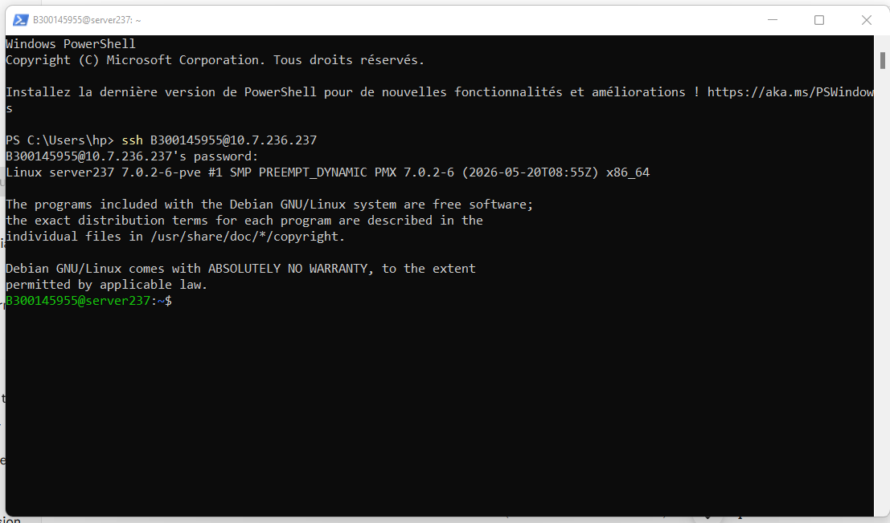

** Analyse :** l'invite se lit ainsi : `utilisateur@machine:dossier$`. Le **`~`** désigne mon dossier personnel (`/home/B300145955`) et le **`$`** final indique un **utilisateur normal**. Je suis connectée **avec mon compte**, et non avec root 

---

## 5. Étape 2 – Vérification de mon compte Linux

** But :** vérifier que mon compte Linux existe et voir **quels droits** il a.

** Commande :**
```bash
id B300145955
```

** Résultat observé :**
```
uid=1001(B300145955) gid=1001(B300145955) groups=1001(B300145955),100(users)
```

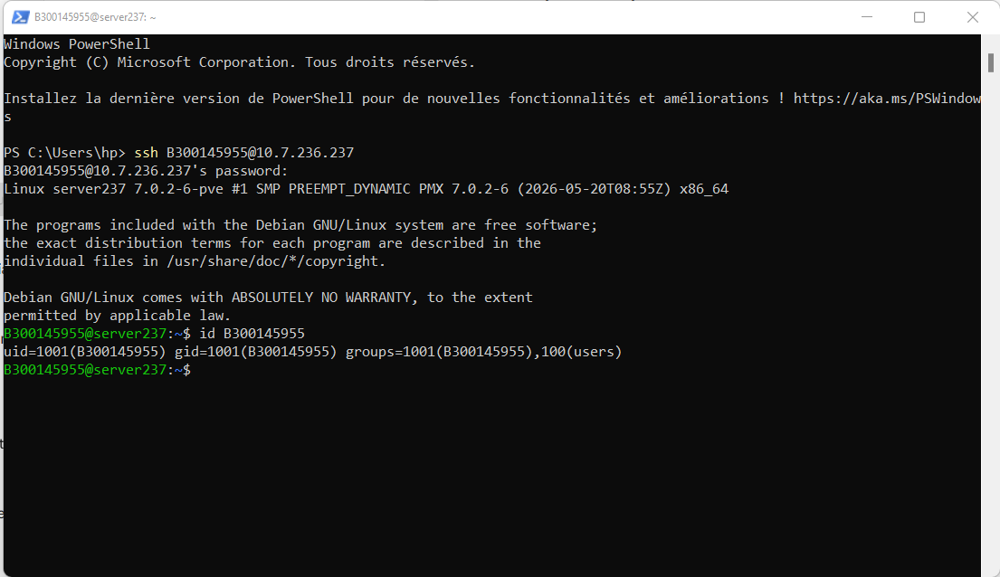

** Analyse détaillée :**

| Élément | Valeur | Signification |
|---|---|---|
| **uid** | 1001 (B300145955) | Mon **numéro d'utilisateur**. Linux identifie les comptes par ce numéro. Root a toujours l'uid **0**, et les comptes créés ensuite commencent à **1000** |
| **gid** | 1001 (B300145955) | Mon **groupe principal**, créé automatiquement avec le même nom que mon compte |
| **groups** | 1001 (B300145955), **100 (users)** | Les groupes dont je fais partie : mon groupe personnel et le groupe général **users** |

>  **Ce qui est important :** je ne suis **pas** dans le groupe **`sudo`**. Mon compte Linux est donc un compte **ordinaire**, qui ne peut pas administrer le système Linux. C'est **voulu** : mes droits d'administratrice viennent de **Proxmox** (étape 5), pas de Linux. C'est le principe de **séparation des droits**.

>  **Comment ce compte a été obtenu :** un compte administrateur Proxmox se crée en **trois commandes**, exécutées par root :
> ```bash
> adduser B300145955                                        # 1. créer le compte Linux (avec son mot de passe)
> pveum user add B300145955@pam                             # 2. déclarer ce compte dans Proxmox
> pveum aclmod / -user B300145955@pam -role Administrator   # 3. lui donner le rôle Administrator sur tout le serveur
> ```
> Mon compte existait déjà à ce laboratoire. Les étapes 2, 4 et 5 de ce rapport **vérifient** que ces trois commandes ont bien été appliquées.

---

## 6. Étape 3 – Passage temporaire en root

### 6.1 Les commandes d'administration sont protégées

** Commande (avec mon compte normal) :**
```bash
pveum user list
```

** Résultat observé :**
```
-bash: pveum: command not found
```

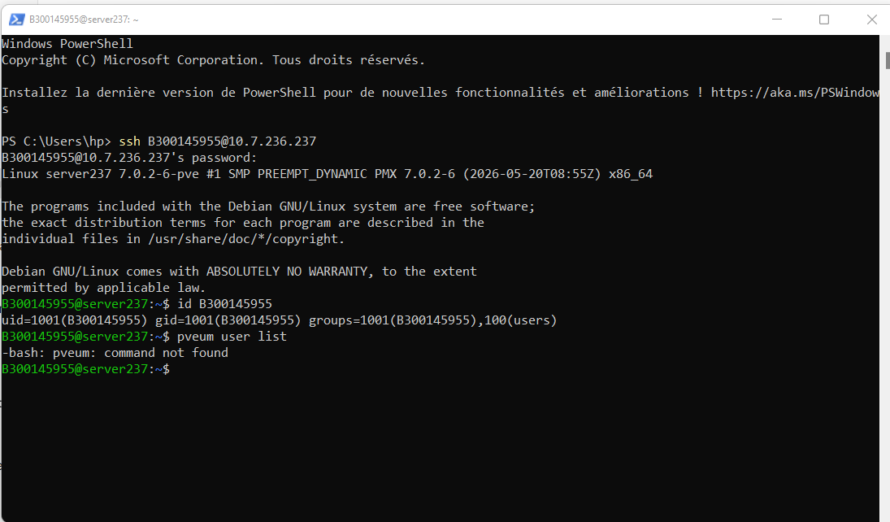

** Analyse :** la commande `pveum` (**P**roxmox **VE** **U**ser **M**anager) **existe bien** sur le serveur, mais elle est rangée dans **`/usr/sbin`**, le dossier des commandes **d'administration**. Ce dossier n'est **pas** dans le **PATH** (la liste des dossiers où Linux cherche les commandes) d'un utilisateur normal. Mon compte ne trouve donc pas la commande : c'est une **protection** 

### 6.2 Devenir root avec `su -`

** Commande :**
```bash
su -
```

| Partie | Signification |
|---|---|
| `su` | *Substitute User* : prendre l'identité d'un autre utilisateur, root par défaut |
| `-` | Charger **tout l'environnement** de root, notamment son PATH qui contient `/usr/sbin` |

**👀 Résultat observé :** après le **mot de passe root**, l'invite devient **`root@server237:~#`**.

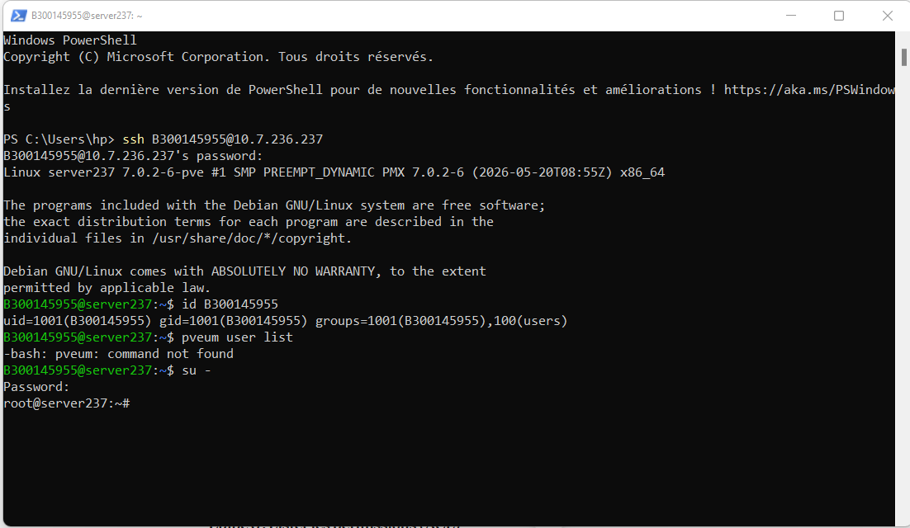

** Analyse :** le **`$`** est devenu **`#`**, le symbole de root. Je n'utilise root que **le temps** de faire les vérifications Proxmox.

### 6.3 Incident : connexion coupée et mot de passe refusé

Après une longue période d'inactivité, la session s'est fermée (`client_loop: send disconnect: Connection reset`). Après m'être reconnectée, `su -` a d'abord répondu **deux fois** :
```
su: Authentication failure
```
Le mot de passe root était **mal tapé**. Sous Linux, **rien ne s'affiche** quand on tape un mot de passe, pas même des étoiles, donc une faute de frappe passe inaperçue. Au **3ᵉ essai**, tapé lentement, l'accès a été accordé.

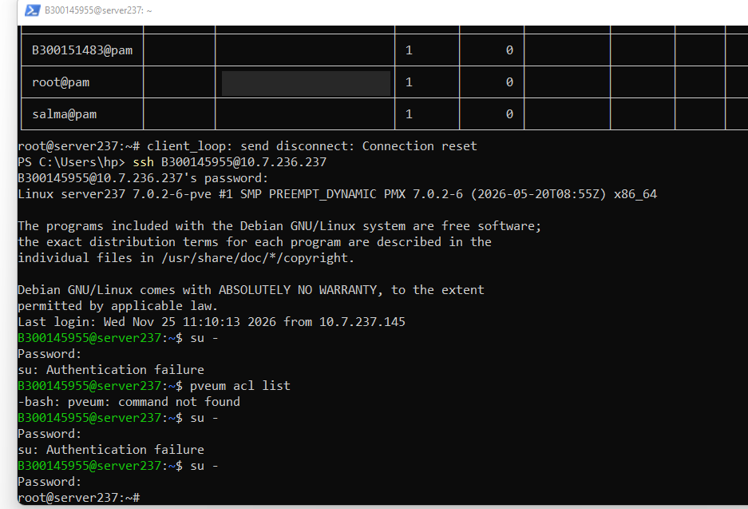

>  **Ce que ça montre :** sans le **bon** mot de passe, Linux refuse catégoriquement l'accès à root. Chaque échec est aussi **enregistré** dans les journaux du système.

---

## 7. Étape 4 – Les utilisateurs Proxmox (`pveum user list`)

** But :** vérifier que mon compte est bien **déclaré dans Proxmox**.

** Commande (en root) :**
```bash
pveum user list
```

** Résultat observé :** un tableau de **9 comptes** : les 7 comptes étudiants (`B300142542@pam`, `B300142636@pam`, **`B300145955@pam`**, `B300150410@pam`, `B300150468@pam`, `B300150470@pam`, `B300151483@pam`), `salma@pam` et `root@pam`.

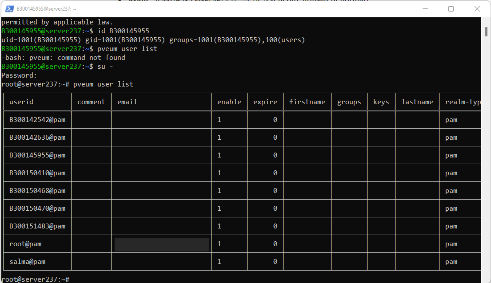
*(L'adresse courriel d'un autre étudiant a été masquée.)*

** Analyse de chaque colonne, pour ma ligne :**

| Colonne | Ma valeur | Signification |
|---|---|---|
| **userid** | `B300145955@pam` | Mon identifiant Proxmox, sous la forme `utilisateur@realm` |
| **comment** | (vide) | Champ libre pour une description |
| **email** | (vide) | Courriel pour les alertes du serveur |
| **enable** | **1** | Le compte est **activé** (0 = désactivé, sans connexion possible) |
| **expire** | **0** | Le compte **n'expire jamais** (sinon, une date d'expiration) |
| **firstname / lastname** | (vides) | Prénom et nom, facultatifs |
| **groups** | (vide) | Groupes Proxmox. Ici, les droits sont donnés **directement** à l'utilisateur |
| **keys** | (vide) | Clés de double authentification (2FA), non utilisées |
| **realm-type** | **pam** | Le type d'authentification utilisé |

>  **Le realm `@pam` :** **PAM** (*Pluggable Authentication Modules*) signifie que Proxmox vérifie le mot de passe **avec le compte Linux du même nom**. C'est pour ça qu'il faut à la fois un compte **Linux** (`adduser`) **et** un compte **Proxmox** (`pveum user add`). Mon mot de passe Proxmox est donc **le même** que mon mot de passe Linux.

>  **Conclusion de l'étape :** chaque étudiant a **son propre compte**. C'est exactement la bonne pratique demandée.

---

## 8. Étape 5 – Les permissions (`pveum acl list`)

** But :** vérifier **quels droits** mon compte a dans Proxmox.

** Commande (en root) :**
```bash
pveum acl list
```

**👀 Résultat observé :** 8 lignes, une par administrateur. La mienne :

| path | roleid | type | ugid | propagate |
|---|---|---|---|---|
| `/` | **Administrator** | user | **B300145955@pam** | 1 |

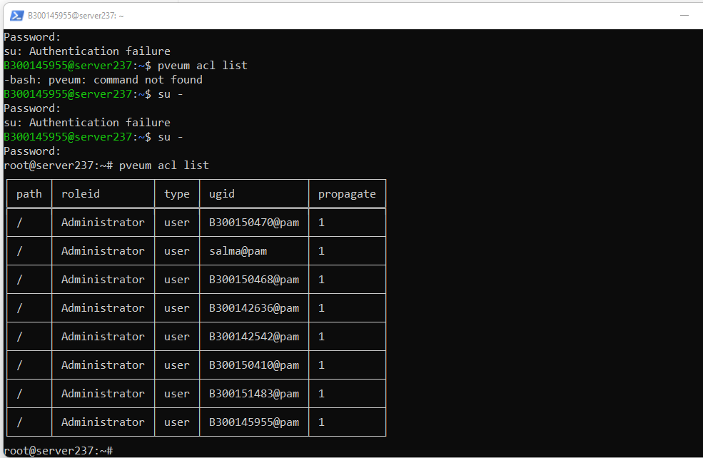

** Analyse de chaque colonne :**

| Colonne | Valeur | Signification |
|---|---|---|
| **path** | `/` | **Où** s'applique le droit. `/` est la **racine** : tout Proxmox (serveur, VM, stockages). On pourrait limiter le droit à une seule VM, par exemple `/vms/107` |
| **roleid** | `Administrator` | **Quel rôle** est donné, ici le rôle le plus complet |
| **type** | `user` | Le droit est donné à un **utilisateur** (il pourrait aussi être donné à un **groupe**) |
| **ugid** | `B300145955@pam` | **À qui** le droit est donné |
| **propagate** | `1` | Le droit **se transmet** à tout ce qui se trouve sous `/` (toutes les VM, tous les stockages) |

>  **Une ACL** (*Access Control List*) répond à trois questions : **QUI** (`ugid`) a **QUEL rôle** (`roleid`) **SUR QUOI** (`path`). Cette ligne est le résultat de la commande `pveum aclmod / -user B300145955@pam -role Administrator`.

>  **Conclusion de l'étape :** je suis **administratrice de Proxmox** grâce à une ACL, **sans** avoir besoin du compte root.

---

## 9. Étape 6 – Les rôles (`pveum role list`)

** But :** comprendre ce que contient le rôle **Administrator** et quels autres rôles existent.

** Commande (en root) :**
```bash
pveum role list
```

** Résultat observé :** chaque **rôle** (`roleid`) est une liste de **privilèges** (`privs`).

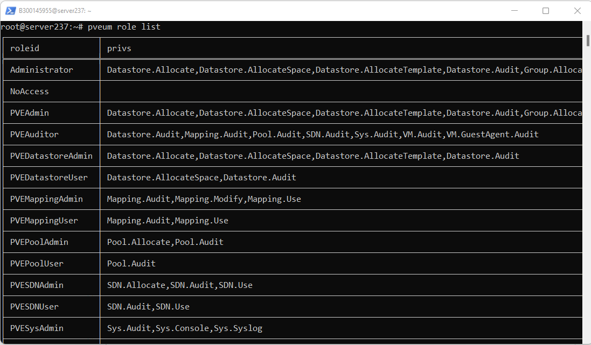

** Analyse des principaux rôles :**

| Rôle | Privilèges (extraits) | Pour qui ? |
|---|---|---|
| **Administrator** | **Tous** les privilèges | Les administrateurs du serveur (mon cas) |
| **NoAccess** | Aucun | Bloquer volontairement l'accès à une ressource |
| **PVEAdmin** | Presque tout, sauf certains réglages système | Un administrateur adjoint |
| **PVEAuditor** | `*.Audit` uniquement | **Consulter** sans rien modifier (ex. : un auditeur, un stagiaire) |
| **PVEDatastoreAdmin** | `Datastore.Allocate`, `Datastore.Audit`… | Gérer les **stockages** |
| **PVEDatastoreUser** | `Datastore.AllocateSpace`, `Datastore.Audit` | Utiliser l'espace des stockages |
| **PVEVMAdmin** | `VM.Allocate`, `VM.Backup`, `VM.Clone`, `VM.Config.*`… | Gérer complètement les **machines virtuelles** |
| **PVETemplateUser** | `VM.Audit`, `VM.Clone` | Cloner des modèles de VM |
| **PVEUserAdmin** | `User.Modify`, `Group.Allocate`… | Gérer les **utilisateurs** |
| **PVESysAdmin** | `Sys.Audit`, `Sys.Console`, `Sys.Syslog` | Accéder à la console et aux journaux |

>  **Comment lire un privilège :** `VM.Backup` = **catégorie**.**action**, c'est-à-dire « faire des sauvegardes de VM ». Le suffixe **`.Audit`** veut toujours dire « **consulter seulement** ».

>  **Le principe du moindre privilège :** on donne à chaque personne **seulement** les droits dont elle a besoin. En entreprise, un technicien qui gère seulement les VM recevrait **PVEVMAdmin**, et non **Administrator**.

---

## 10. Étape 7 – Retour à mon compte normal

** Commande :**
```bash
exit
```

** Résultat observé :** `logout`, puis l'invite redevient **`B300145955@server237:~$`**.

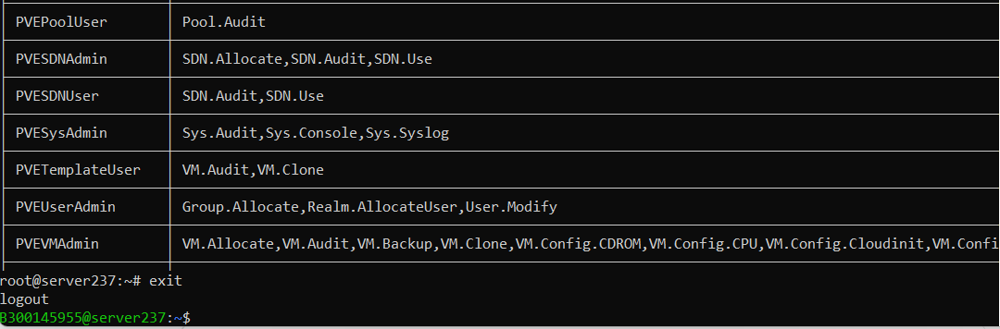

** Analyse :** le **`#`** est redevenu **`$`**. **Bonne pratique : ne jamais rester root plus longtemps que nécessaire.** Une erreur de frappe en root peut avoir des conséquences graves pour tout le serveur.

---

## 11. Étape 8 – Connexion à l'interface web

** But :** vérifier que mon compte personnel permet d'administrer Proxmox depuis le **navigateur**.

** Adresse :** **https://10.7.236.237:8006**

| Champ | Valeur | Explication |
|---|---|---|
| User name | **B300145955** | Mon nom d'utilisateur, **sans** `@pam` |
| Password | (mon mot de passe Linux) | Vérifié par PAM avec mon compte Linux |
| Realm | **Linux PAM standard authentication** | Correspond à la partie `@pam` de mon identifiant |

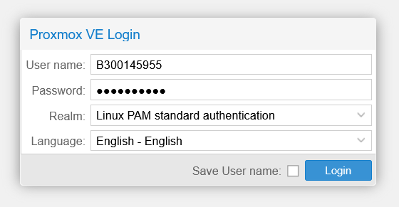

**👀 Résultat observé :** après **Login**, **B300145955@pam** apparaît en haut à droite.

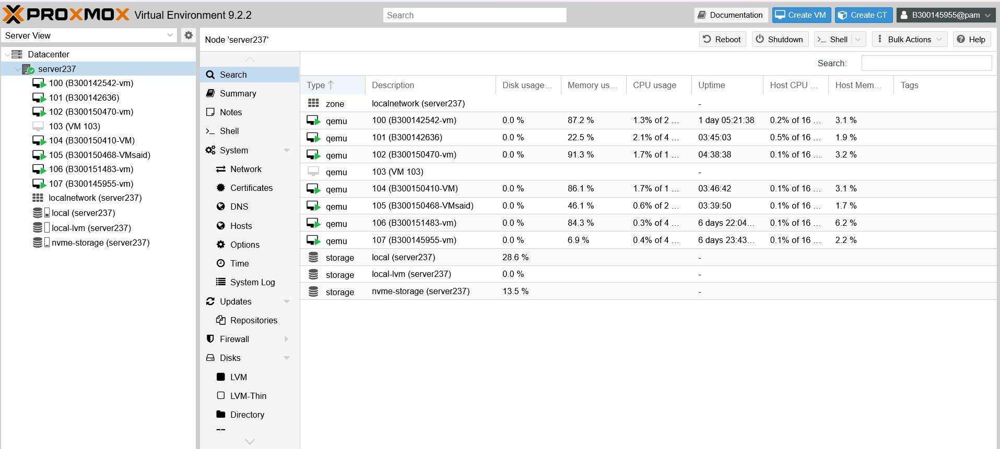

** Analyse :** grâce à mon rôle **Administrator** sur `/`, je vois **toutes** les ressources du serveur :
- les **8 VM** (100 à 107), dont **ma VM 107 – B300145955-vm**, en marche depuis plus de 6 jours ;
- les **3 stockages** : `local`, `local-lvm` et `nvme-storage` ;
- tous les menus d'administration (Shell, System, Network, Disks…).

>  **Conclusion de l'étape :** j'administre Proxmox **avec mon propre compte**. Si je fais une modification, elle apparaîtra **sous mon nom** dans la liste des tâches.

---

## 12. Étape 9 – Création de ma paire de clés SSH

### 12.1 Le principe de la clé SSH

Au lieu d'un mot de passe, on utilise une **paire de clés** :

| Clé | Analogie | Où elle se trouve |
|---|---|---|
| **Clé publique** (`.pub`) | 🔒 Un **cadenas**, qu'on peut distribuer à tout le monde | Copiée sur **les serveurs** (`authorized_keys`) |
| **Clé privée** | 🔑 La **seule clé** qui ouvre ce cadenas | Reste **uniquement** sur mon portable, **jamais partagée** |

```
💻 Portable                                  🖥️ server237
 🔑 clé privée  ── « Prouve-moi qui tu es » ──▶  🔒 clé publique (authorized_keys)
               ◀── défi chiffré ──────────────
 signe le défi ─── réponse signée ──────────▶  vérifie avec la clé publique ✅
                    (la clé privée ne voyage JAMAIS sur le réseau)
```

### 12.2 Création de la clé

** Commande (sur mon portable, dans PowerShell) :**
```powershell
ssh-keygen -t ed25519
```

| Partie | Signification |
|---|---|
| `ssh-keygen` | L'outil qui **génère** des clés SSH |
| `-t ed25519` | Le **type** d'algorithme : **ED25519**, moderne, rapide et très sûr |

Trois questions sont posées, et j'ai répondu **Entrée** à chacune :
1. **Emplacement du fichier** : par défaut, `C:\Users\hp\.ssh\id_ed25519` ;
2. **Passphrase** : aucune (une phrase secrète protégerait la clé privée, au prix d'une saisie à chaque connexion) ;
3. **Confirmation** de la passphrase.

**👀 Résultat observé :**

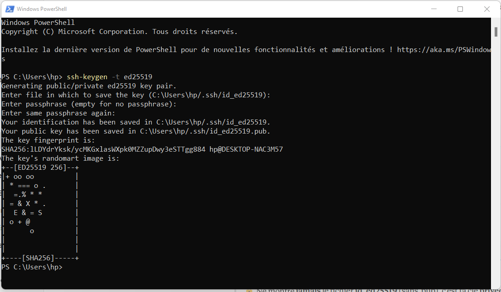

| Ligne affichée | Signification |
|---|---|
| `Your identification has been saved in C:\Users\hp/.ssh/id_ed25519` | 🔑 La **clé privée** a été créée |
| `Your public key has been saved in C:\Users\hp/.ssh/id_ed25519.pub` | 🔒 La **clé publique** a été créée |
| `SHA256:lLDYdrYksk/…  hp@DESKTOP-NAC3M57` | L'**empreinte** (*fingerprint*) unique de la clé, et le **commentaire** (utilisateur@ordinateur) |
| Le dessin `[ED25519 256]` | Le **randomart** : une représentation visuelle de l'empreinte, pour reconnaître une clé d'un coup d'œil |

### 12.3 Affichage de la clé publique

** Commande :**
```powershell
type $env:USERPROFILE\.ssh\id_ed25519.pub
```

**👀 Résultat observé :**
```
ssh-ed25519 AAAAC3NzaC1lZDI1NTE5AAAAIBRm9WkFpwuhY7R2eYZM8lRA+RiNIXi4eM/NenbGCTmD hp@DESKTOP-NAC3M57
```

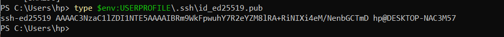

** Analyse :** une clé publique a toujours **3 parties** :

| Partie | Valeur | Rôle |
|---|---|---|
| Type | `ssh-ed25519` | L'algorithme |
| Clé | `AAAAC3Nz…GCTmD` | La clé elle-même, encodée en base64 |
| Commentaire | `hp@DESKTOP-NAC3M57` | Pour savoir **à qui** appartient la clé |

>  Cette clé est **publique** : la montrer dans ce rapport est **sans danger**. Le fichier `id_ed25519` (sans `.pub`) ne doit **jamais** être montré ni copié.

---

## 13. Étape 10 – Installation de ma clé publique sur le serveur

** But :** déposer ma clé publique dans le fichier **`~/.ssh/authorized_keys`** de mon compte sur le serveur.

** Difficulté :** la consigne utilise `ssh-copy-id`, mais **cette commande n'existe pas sous Windows**. J'ai donc utilisé son **équivalent PowerShell** :

** Commande (sur mon portable) :**
```powershell
type $env:USERPROFILE\.ssh\id_ed25519.pub | ssh B300145955@10.7.236.237 "mkdir -p ~/.ssh && cat >> ~/.ssh/authorized_keys && chmod 700 ~/.ssh && chmod 600 ~/.ssh/authorized_keys"
```

** Explication de chaque partie :**

| Partie | Rôle |
|---|---|
| `type …\id_ed25519.pub` | Lit le contenu de ma **clé publique** |
| `\|` (pipe) | **Envoie** ce contenu à la commande suivante |
| `ssh B300145955@10.7.236.237 "…"` | Se connecte au serveur et y **exécute** les commandes entre guillemets |
| `mkdir -p ~/.ssh` | Crée le dossier caché **`.ssh`** dans mon dossier personnel, s'il n'existe pas |
| `&&` | Passe à la commande suivante **seulement si** la précédente a réussi |
| `cat >> ~/.ssh/authorized_keys` | **Ajoute** la clé reçue à la fin du fichier des clés autorisées |
| `chmod 700 ~/.ssh` | Dossier accessible **uniquement** par moi (lecture, écriture, accès) |
| `chmod 600 ~/.ssh/authorized_keys` | Fichier lisible et modifiable **uniquement** par moi |

**👀 Résultat observé :** le serveur demande mon mot de passe **une dernière fois**, puis revient à l'invite **sans message d'erreur**, ce qui veut dire que l'opération a réussi.

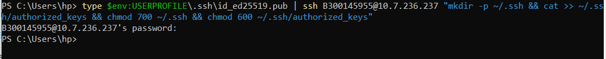

>  **Pourquoi `chmod` est obligatoire :** le serveur SSH **refuse** d'utiliser un fichier `authorized_keys` que d'autres utilisateurs pourraient modifier. Sinon, quelqu'un pourrait y ajouter **sa** clé et entrer dans mon compte.

---

## 14. Étape 11 – Test de la connexion sans mot de passe

** But :** prouver que la clé fonctionne.

** Commande (sur mon portable) :**
```powershell
ssh B300145955@10.7.236.237
```

** Résultat observé :** **aucun mot de passe n'est demandé**. J'arrive directement sur **`B300145955@server237:~$`** 

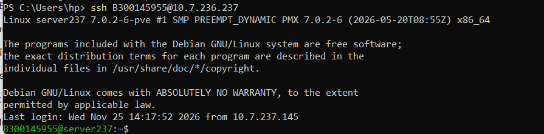

** Analyse – comparaison avant / après :**

| | Avant (étape 1) | Après (étape 11) |
|---|---|---|
| Ce qui est demandé | `B300145955@10.7.236.237's password:` | **Rien** |
| Méthode | Mot de passe | **Clé ED25519** |
| Risque | Un mot de passe peut être deviné ou volé | La clé privée ne quitte **jamais** mon portable |

>  **Conclusion de l'étape :** l'authentification par clé fonctionne. C'est le **résultat attendu** de la consigne : « Aucun mot de passe ne devrait être demandé ».

---

## 15. Étape 12 – Ajout de la clé du professeur

** But :** permettre au professeur de se connecter à **mon compte** pour vérifier mon travail, **sans** que je lui donne mon mot de passe.

** Commande (sur le serveur, connectée avec mon compte) :**
```bash
echo "ssh-rsa AAAAB3NzaC1yc2EAAAADAQABAAABAQD2pLhMq…LRP5N b300098957@ramena" >> ~/.ssh/authorized_keys
```
*(La clé complète a été copiée-collée. Elle est abrégée ici pour la lisibilité.)*

| Partie | Rôle |
|---|---|
| `echo "…"` | Affiche le texte de la clé du professeur |
| `>>` | **Ajoute** ce texte **à la fin** du fichier `authorized_keys` |

>  **Attention à `>>` et `>` :** `>>` **ajoute** une ligne, alors que `>` **remplace tout** le fichier. Avec `>`, ma propre clé aurait été **effacée**, et je n'aurais plus pu me connecter sans mot de passe.

** Vérification :**
```bash
cat ~/.ssh/authorized_keys
```

** Résultat observé :** le fichier contient maintenant **2 clés**, une par ligne :

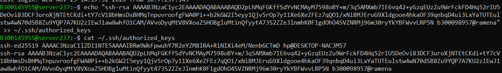

| Ligne | Type | Commentaire | Propriétaire |
|---|---|---|---|
| 1 | `ssh-ed25519` | `hp@DESKTOP-NAC3M57` | **Moi** (mon portable) |
| 2 | `ssh-rsa` | `b300098957@ramena` | **Le professeur** |

** Analyse :** le professeur peut maintenant se connecter avec `ssh B300145955@10.7.236.237` **sans mot de passe**, grâce à **sa** clé privée. 
---

## 16. Le compte root : réservé aux urgences

Le compte `root@pam` est **conservé** (on ne le supprime jamais), mais il n'est utilisé que pour :

| Situation | Exemple |
|---|---|
|  **Dépannage** | Un service Proxmox ne démarre plus |
|  **Réinitialisation de mots de passe** | Un administrateur a oublié le sien |
|  **Maintenance d'urgence** | Une mise à jour critique du système |
|  **Récupération du système** | Le serveur ne démarre plus correctement |

Dans ce laboratoire, je n'ai utilisé root que **quelques minutes**, pour les trois commandes `pveum`, puis je l'ai quitté avec `exit`.

### Recommandations

| Méthode | Recommandation |
|---|---|
| Utiliser seulement `root@pam` | ❌ |
| Créer un compte par administrateur | ✅ |
| SSH avec mot de passe | ⚠️ (acceptable, mais moins sûr) |
| SSH avec clé publique | ✅ |
| Partager le compte root | ❌ |
| Utiliser les ACL Proxmox | ✅ |

---

## 17. Problèmes rencontrés et solutions

| # | Problème | Cause | Solution appliquée |
|---|---|---|---|
| 1 | `pveum: command not found` | `/usr/sbin` n'est pas dans le PATH d'un utilisateur normal | Passer en root avec **`su -`**, qui charge le PATH de root |
| 2 | `client_loop: send disconnect: Connection reset` | Session SSH inactive trop longtemps | Se reconnecter avec `ssh` |
| 3 | `su: Authentication failure` (2 fois) | Faute de frappe dans le mot de passe root, invisible à l'écran | Retaper lentement, vérifier Verr. Maj et la langue du clavier. Réussi au 3ᵉ essai |
| 4 | `ssh-copy-id` introuvable | Cette commande n'existe pas sous Windows | Équivalent PowerShell : `type … \| ssh … "cat >> ~/.ssh/authorized_keys"` |

---

## 18. Bilan du laboratoire

| # | Tâche | Commande ou outil | Résultat |
|---|---|---|---|
| 1 | Connexion SSH avec mon compte personnel | `ssh B300145955@10.7.236.237` | ✅ Réussie |
| 2 | Vérification du compte Linux | `id B300145955` | ✅ uid 1001, groupe `users`, pas de `sudo` |
| 3 | Vérification de la protection des outils d'administration | `pveum user list` (compte normal) | ✅ Accès refusé (`command not found`) |
| 4 | Passage temporaire en root | `su -` | ✅ Réussi (après 2 fautes de frappe) |
| 5 | Vérification du compte Proxmox | `pveum user list` | ✅ `B300145955@pam` actif, sans expiration |
| 6 | Vérification du rôle Administrator | `pveum acl list` | ✅ `/` – Administrator – B300145955@pam |
| 7 | Étude des rôles disponibles | `pveum role list` | ✅ Rôles et privilèges analysés |
| 8 | Sortie de root | `exit` | ✅ Retour au compte normal |
| 9 | Connexion à l'interface web | https://10.7.236.237:8006 | ✅ Connectée en `B300145955@pam` |
| 10 | Création d'une clé SSH | `ssh-keygen -t ed25519` | ✅ Paire de clés ED25519 créée |
| 11 | Installation de ma clé publique | Équivalent PowerShell de `ssh-copy-id` | ✅ Clé ajoutée à `authorized_keys` |
| 12 | Connexion SSH par clé | `ssh B300145955@10.7.236.237` | ✅ **Aucun mot de passe demandé** |
| 13 | Ajout de la clé du professeur | `echo "…" >> ~/.ssh/authorized_keys` | ✅ 2 clés présentes |

---

## 19. Conclusion

### Ce qui a été réalisé

À la fin de ce laboratoire, l'accès au serveur **server237** est organisé selon les bonnes pratiques de sécurité :

- **J'administre Proxmox avec mon propre compte**, `B300145955@pam`, et non avec root. Mes actions sont donc **identifiables** dans l'historique des tâches.
- **Mes droits viennent d'une ACL Proxmox** (`/` → Administrator), et non du compte root. Mon compte Linux reste un compte ordinaire, sans `sudo`.
- **Je me connecte en SSH par clé ED25519, sans mot de passe.** Ma clé privée ne quitte jamais mon portable.
- **Le professeur peut accéder à mon compte avec sa propre clé**, sans que j'aie à partager mon mot de passe.
- **Le compte root n'a servi que quelques minutes**, pour les vérifications, puis il a été quitté immédiatement.

### Ce que j'ai appris

1. **La différence entre un compte Linux et un compte Proxmox** : il faut les deux (`adduser`, puis `pveum user add`), reliés par le realm **PAM**.
2. **Comment fonctionnent les droits dans Proxmox** : une **ACL** associe **un utilisateur**, **un rôle** et **un chemin**, et chaque rôle est un ensemble de **privilèges**. On peut ainsi appliquer le **principe du moindre privilège**.
3. **Pourquoi les outils d'administration sont protégés** : `/usr/sbin` est hors du PATH des utilisateurs normaux, et root exige son mot de passe.
4. **Comment fonctionne une clé SSH** : la clé publique est le cadenas, la clé privée est la clé. Les permissions `700` et `600` sont **obligatoires**, et il faut utiliser `>>` (ajouter) et non `>` (remplacer).
5. **Comment m'adapter à Windows** : `ssh-copy-id` n'existe pas, mais la même chose se fait avec `type`, `|` et `ssh`.

### Pourquoi c'est important en entreprise

Dans une vraie entreprise, plusieurs administrateurs gèrent les mêmes serveurs. Avec des comptes personnels, des ACL et des clés SSH :
- on sait **qui** a fait **quoi** et **quand** ;
- on peut **retirer l'accès** d'une seule personne (désactiver son compte ou effacer sa clé) sans déranger les autres ;
- on réduit les risques liés aux **mots de passe** (vol, partage, mots de passe faibles) ;
- le compte root reste un **outil de secours**, utilisé rarement et consciemment.

**Les objectifs du laboratoire sont atteints** : chaque administrateur a son compte, les actions sont traçables, l'accès SSH est sécurisé par clé, et le compte root est réservé aux urgences. 


