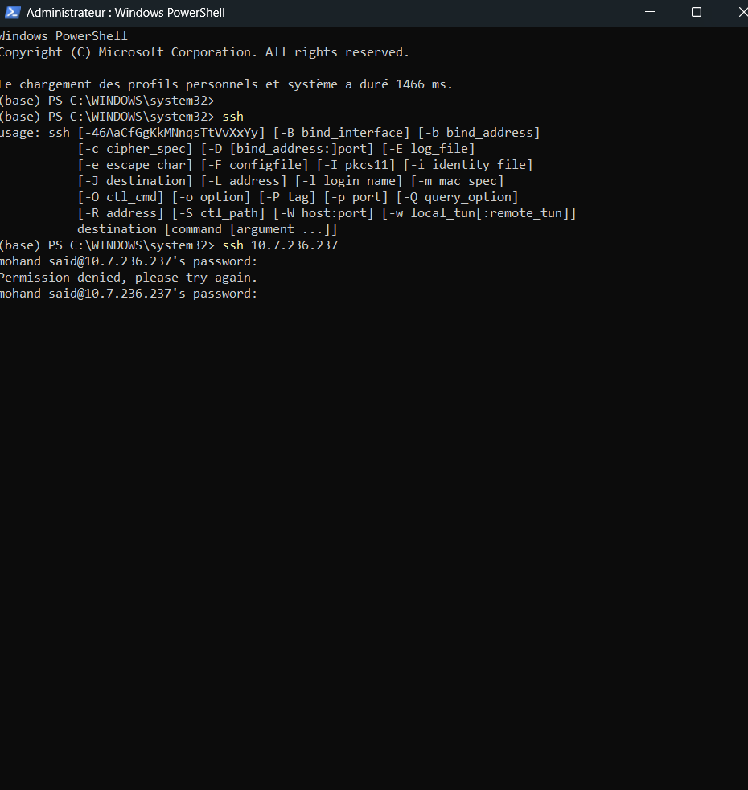
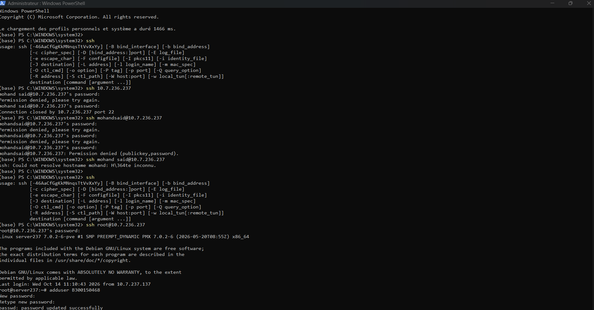
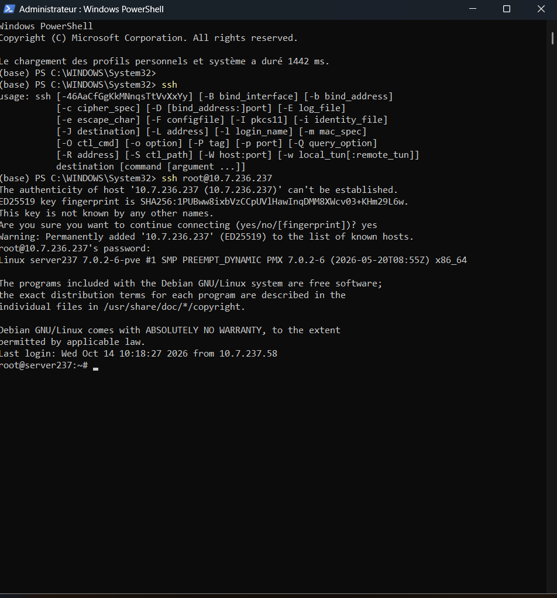
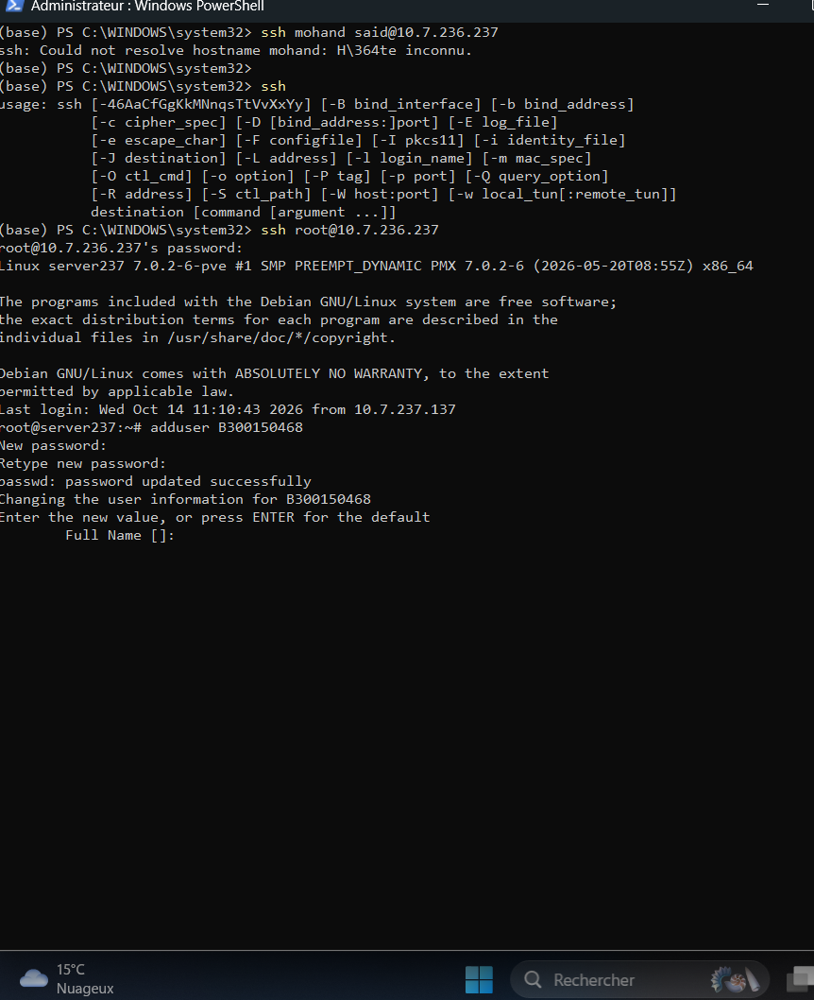
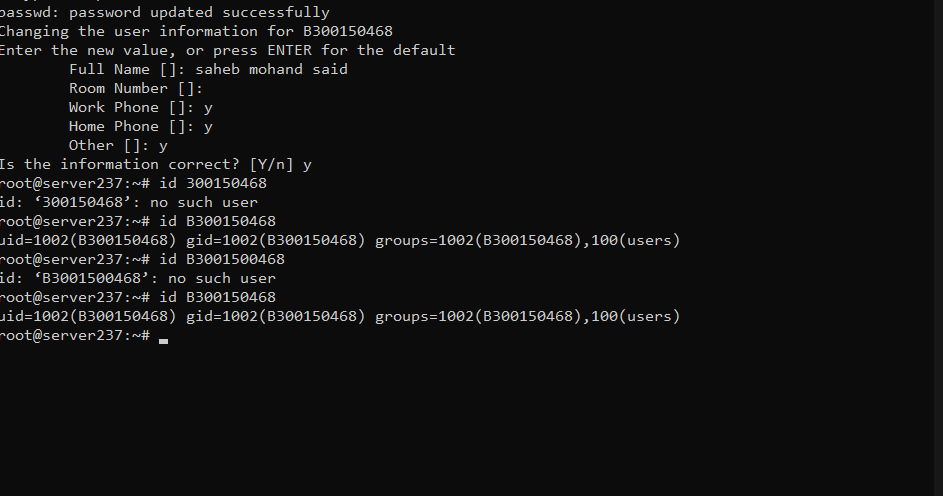
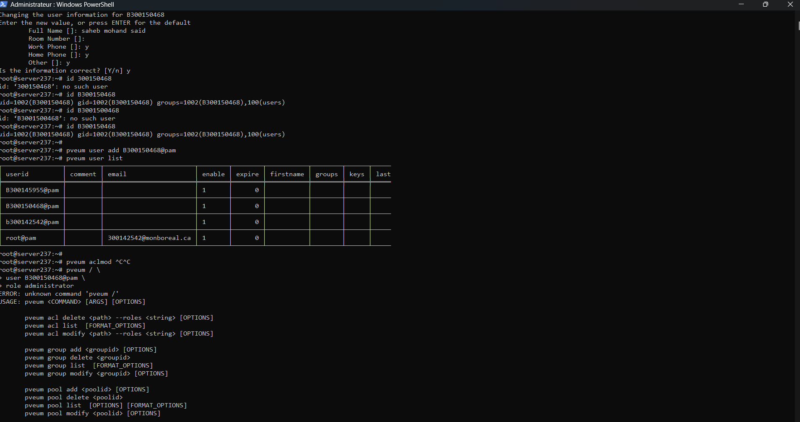
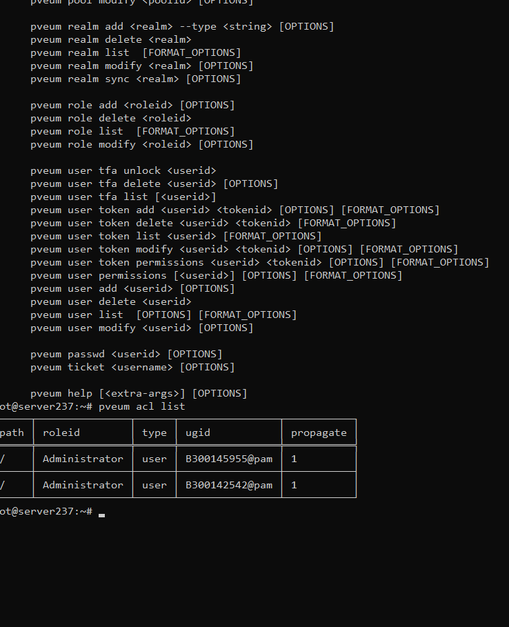
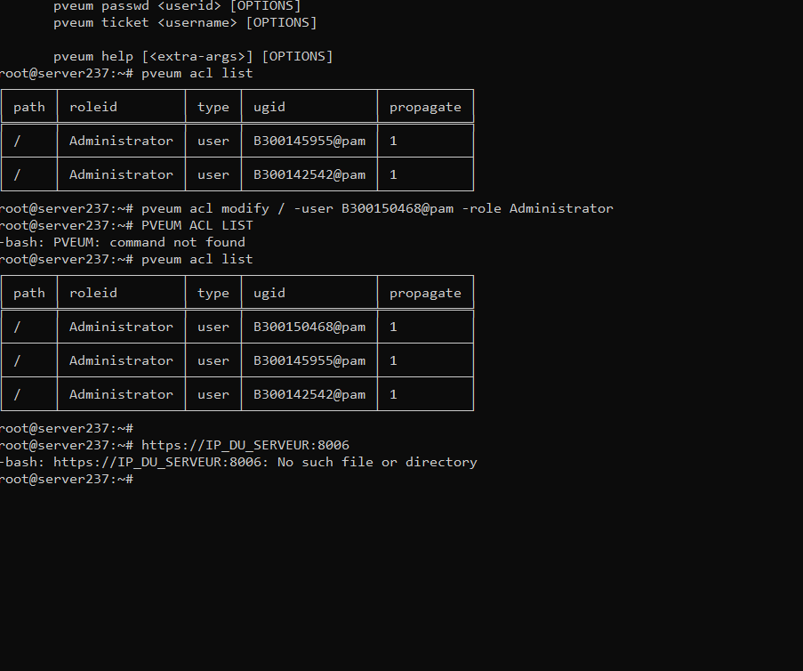

# Administration Proxmox VE : Gestion des Utilisateurs, Permissions (ACL) et Accès SSH

* **Auteur :** Mohand Said Saheb
* **Identifiant :** 300150468
* **Cours :** Administration des systèmes Linux (INF1085) — Collège Boréal
* **Serveur cible :** `server237` (`10.7.236.237`)
* **Système :** Proxmox Virtual Environment (Debian GNU/Linux, noyau `7.0.2-6-pve`)

---

## 1. Objectif du laboratoire

Ce document présente la procédure complète d'administration d'un serveur hyperviseur **Proxmox VE** en ligne de commande (CLI) via SSH. L'objectif est de configurer un compte administrateur personnel authentifié via **Linux PAM** et de sécuriser ses accès distants :

1. Diagnostic de connexion et accès initial en tant que superutilisateur (`root`).
2. Création d'un compte utilisateur au niveau du système d'exploitation Debian (`adduser`).
3. Déclaration de l'utilisateur dans le gestionnaire d'accès Proxmox (`pveum`).
4. Attribution des droits d'administration complets sur la racine (`/`) via les listes de contrôle d'accès (ACL).
5. Validation de la connexion SSH avec le nouvel utilisateur et génération d'une paire de clés cryptographiques `ED25519`.

---

## 2. Connexion initiale et diagnostic SSH

Depuis le terminal **Windows PowerShell**, les premières tentatives de connexion directe avec le nom d'utilisateur local échouent (`Permission denied` ou erreur de résolution d'hôte liée à l'espace dans le nom `mohand said`), car le compte personnel n'a pas encore été créé sur le serveur distant.





Pour administrer le serveur et créer les comptes nécessaires, la connexion est établie avec le compte superutilisateur `root` :

```powershell
ssh root@10.7.236.237
```

Lors de la première connexion à l'hôte `10.7.236.237`, l'empreinte de clé cryptographique **ED25519** (`SHA256:1PUBww8ixbVzCCpUVlHawInqDMM8XWcv03+KHm29L6w`) est vérifiée et acceptée (`yes`), ce qui ajoute le serveur à la liste des hôtes connus (`known_hosts`).




---

## 3. Création de l'utilisateur système Linux (PAM)

Pour utiliser le royaume d'authentification **Linux PAM** (`@pam`) dans Proxmox VE, l'utilisateur doit d'abord exister en tant que compte système standard sous Debian GNU/Linux.

La commande `adduser` est exécutée pour créer l'utilisateur `B300150468`, configurer son mot de passe et renseigner ses informations d'identité (`saheb mohand said`) :

```bash
adduser B300150468
```



Une fois l'assistant terminé, la commande `id` permet de vérifier l'existence effective du compte ainsi que ses identifiants système (`uid=1002`, `gid=1002`, groupe `100(users)`) :

```bash
id B300150468
```

*(Note : Les tests `id 300150468` et `id B3001500468` retournent `no such user`, confirmant l'importance de respecter la syntaxe exacte de l'identifiant `B300150468`).*



---

## 4. Intégration dans Proxmox User Manager (`pveum`)

Une fois le compte Linux créé, il faut l'enregistrer dans la base de données d'authentification de Proxmox VE à l'aide de l'utilitaire **Proxmox VE User Manager (`pveum`)** :

```bash
pveum user add B300150468@pam
pveum user list
```

La commande `pveum user list` affiche la table des utilisateurs inscrits sur le cluster/nœud et confirme que l'identifiant `B300150468@pam` est actif (`enable = 1`). Une tentative de commande mal formatée (`pveum / ...`) déclenche l'affichage de l'aide intégrée (`USAGE: pveum <COMMAND> [ARGS] [OPTIONS]`), permettant d'identifier la sous-commande exacte pour gérer les listes de contrôle d'accès (`pveum acl`).



---

## 5. Attribution des privilèges Administrateur (ACL)

Par défaut, un nouvel utilisateur ajouté dans `pveum` ne possède aucun privilège sur les ressources de l'hyperviseur. On consulte d'abord l'état actuel des permissions avec la commande suivante :

```bash
pveum acl list
```



Pour accorder les privilèges d'administration complets sur l'ensemble de l'arborescence Proxmox (chemin racine `/`), on applique le rôle `Administrator` à l'utilisateur `B300150468@pam` :

```bash
pveum acl modify / -user B300150468@pam -role Administrator
pveum acl list
```

*(Remarque : L'environnement Bash étant sensible à la casse, la saisie en majuscules `PVEUM ACL LIST` renvoie `command not found`. La commande doit obligatoirement être saisie en minuscules).*



Le tableau final confirme que `B300150468@pam