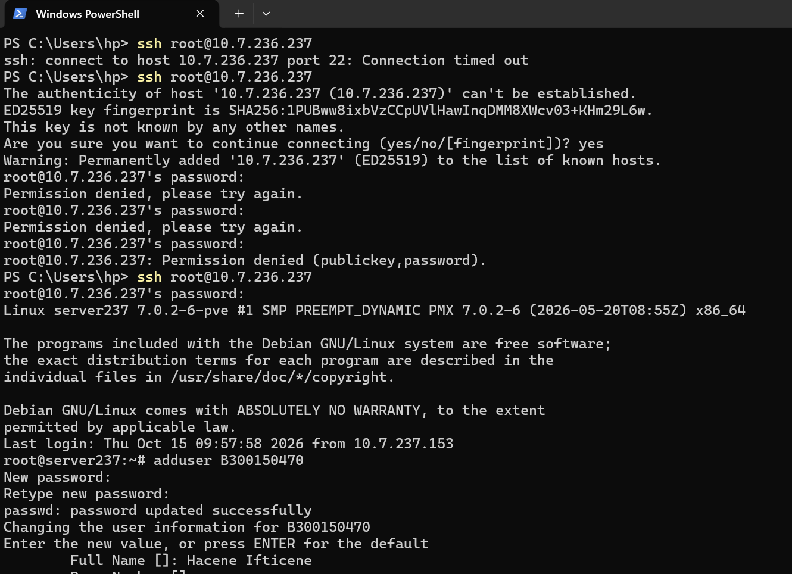
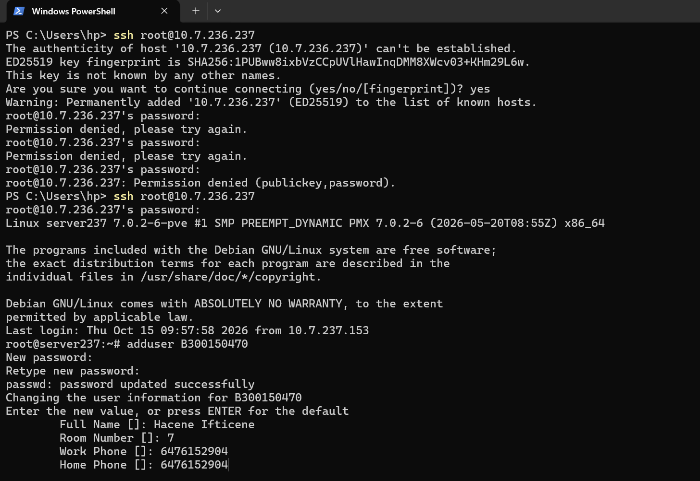
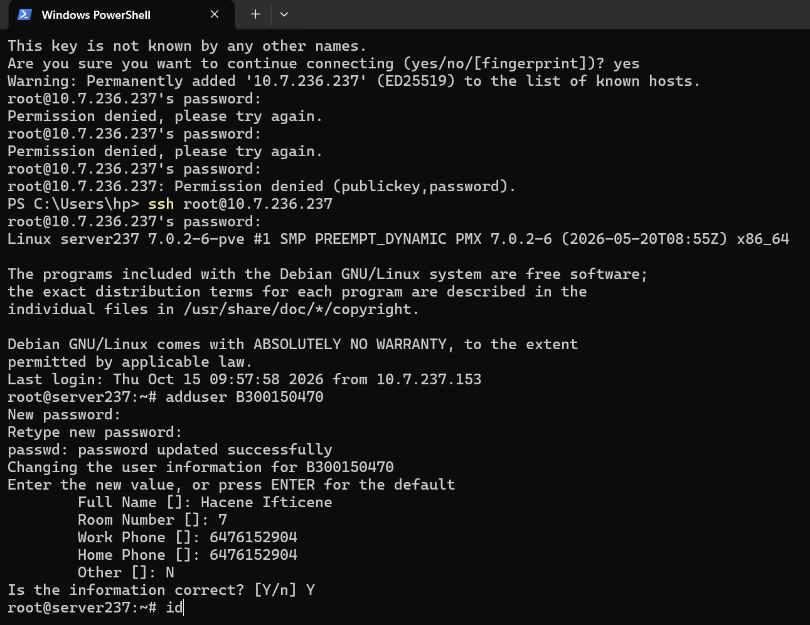
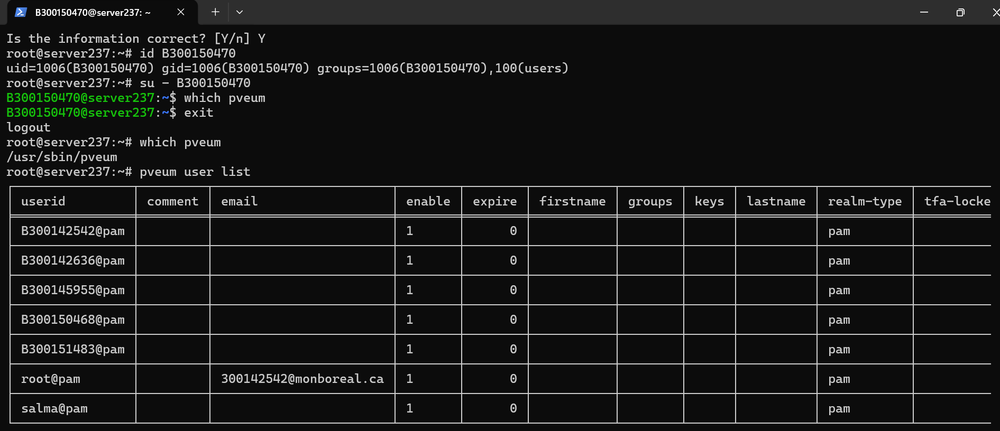
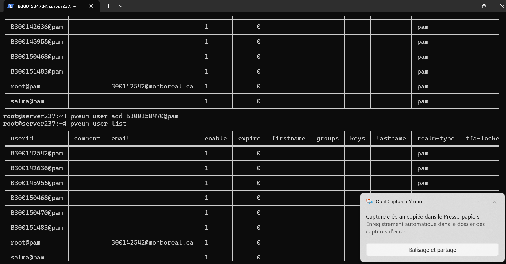
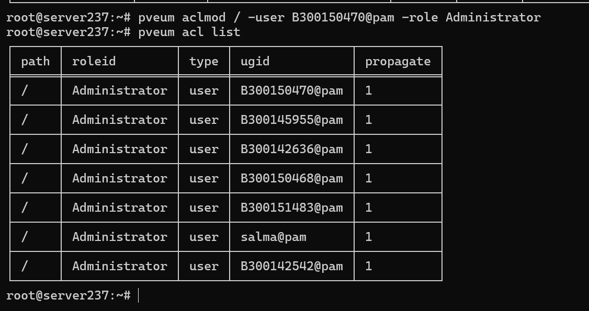

# 🔐 4.Root — Comptes administrateurs Proxmox : bonnes pratiques

[](https://www.debian.org)
[](https://www.proxmox.com)
[](https://10.7.236.237:8006)
[](https://10.7.236.237:8006)

---

## ✨ Introduction

> Ce projet consiste à sécuriser l'accès à Proxmox server237 en créant un compte administrateur individuel, au lieu d'utiliser le compte `root` partagé par tout le monde.

📛 **Nom du projet :** 4.Root — Comptes administrateurs Proxmox : bonnes pratiques

👤 **Nom et prénom :** Ifticene Hacene

🎓 **Numéro étudiant :** 300150470

📚 **Cours :** INF1085 — Administration Linux

👥 **Groupe :** 1

🏙️ B300150470@10.7.236.237

---

## ❌ Mauvaise pratique

Tous les administrateurs utilisent :

```text
root@pam
```

Problèmes :

- ❌ Impossible de savoir qui a effectué une modification
- ❌ Partage du mot de passe
- ❌ Moins sécuritaire
- ❌ Plus difficile à dépanner

---

## ✅ Bonne pratique

Créer un compte par administrateur :

```text
B300150470@pam
```

Chaque administrateur possède son propre compte, et chaque action est traçable.

---

## 📸 Explication des images

### 🔐 1. Créer un utilisateur Linux

```bash
adduser B300150470
```

#### Capture 1 — Connexion SSH et création du compte



*Connexion SSH à server237 en root, compte B300150470 créé avec adduser.*

#### Capture 2 — Informations du compte



*Informations du compte pendant adduser.*

#### Capture 3 — Confirmation



*Compte confirmé avec Y.*

### 🔍 2. Vérifier le compte

```bash
id B300150470
```

#### Capture 4 — Vérification



*Vérification avec id : uid=1006(B300150470), et liste des utilisateurs Proxmox.*

### 🖥️ 3. Ajouter l'utilisateur à Proxmox

```bash
pveum user add B300150470@pam
```

#### Capture 5 — Ajout Proxmox



*Compte Proxmox B300150470@pam ajouté, il apparaît dans la liste.*

### 🔑 4. Donner les droits administrateur

```bash
pveum aclmod / -user B300150470@pam -role Administrator
```

#### Capture 6 — Rôle Administrator



*Rôle Administrator donné au compte sur /, vérifié avec pveum acl list.*

---

## 🧪 Vérifications

```bash
pveum user list
pveum acl list
```

---

## 🎓 Résultat attendu

✅ Chaque administrateur possède son propre compte
✅ Les actions sont traçables
✅ Le compte `root` est réservé aux urgences
✅ L'environnement Proxmox est plus sécuritaire

---

## ✅ Conclusion

> Le compte B300150470@pam est créé, activé et administrateur de Proxmox. Chaque action est traçable, et le compte `root` reste réservé aux urgences.

*INF1085 • Collège Boréal • 2026-10-15*
