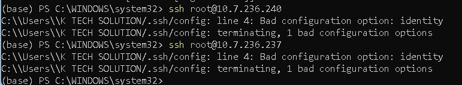
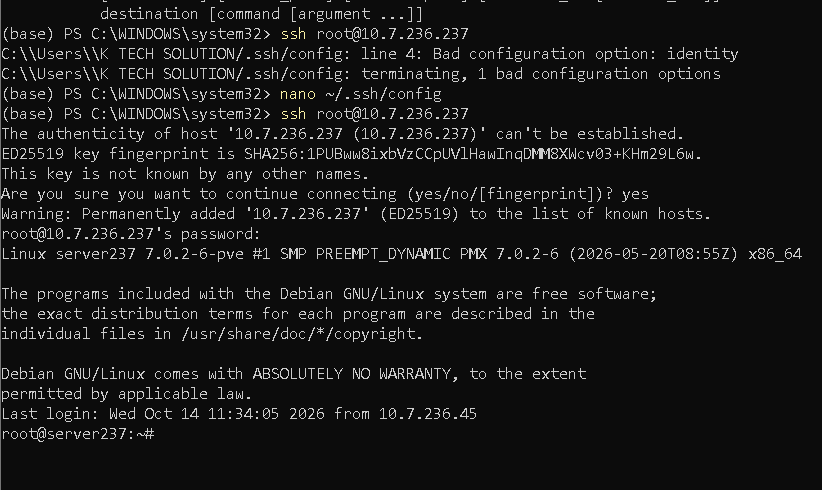
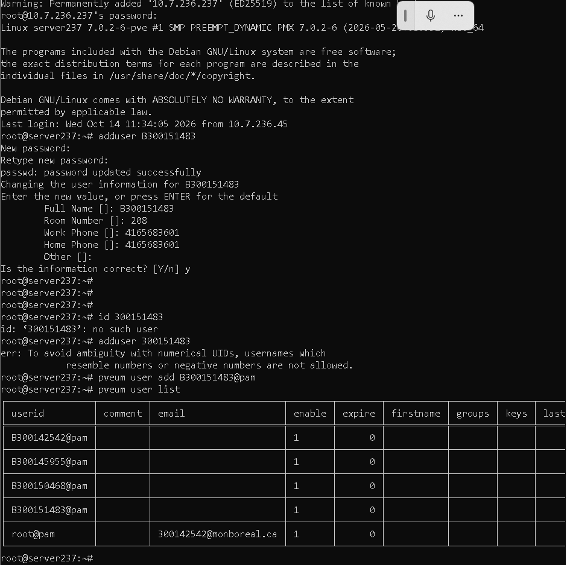
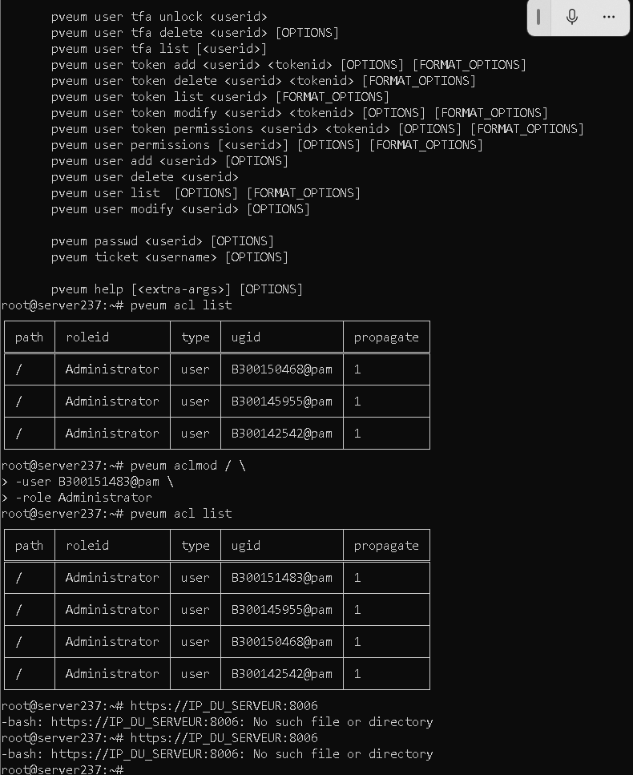
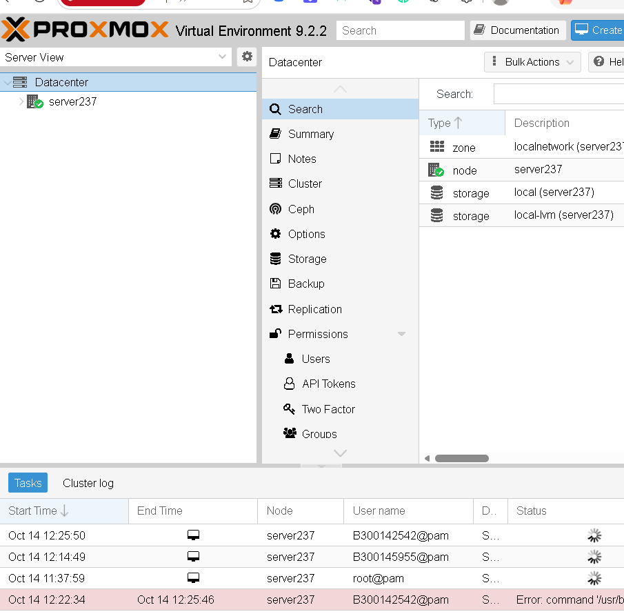
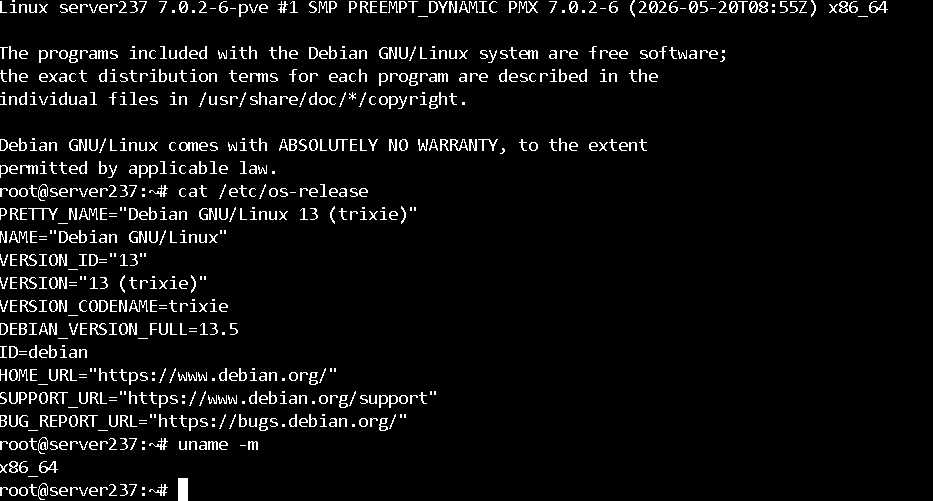

# 🔐 Root - Comptes administrateurs Proxmox

| Champ | Valeur |
|-------|--------|
| Nom | Arnauld Tchumno |
| Numéro étudiant | 300151483 |
| Serveur Proxmox | `server237` - [10.7.236.237](https://10.7.236.237:8006) |
| Compte créé | `B300151483@pam` |
| Date | 14 octobre 2026 |

## 🎯 Objectif

Ne plus utiliser le compte partagé `root@pam` pour administrer Proxmox, et créer un compte administrateur personnel. Ainsi, chaque action sur le serveur peut être attribuée à la bonne personne.

## Travail réalisé

- [x] Connexion SSH au serveur Proxmox
- [x] Création de l'utilisateur Linux `B300151483`
- [x] Ajout de l'utilisateur à Proxmox (`B300151483@pam`)
- [x] Attribution du rôle `Administrator`
- [x] Vérification des utilisateurs et des permissions
- [x] Vérification dans l'interface Web

---

## 1. Connexion SSH au serveur

### Problème rencontré

Ma première tentative de connexion a échoué à cause d'une erreur dans mon fichier `~/.ssh/config` :

```text
C:\Users\K TECH SOLUTION/.ssh/config: line 4: Bad configuration option: identity
```



*Figure 1 : `identity` n'est pas une option valide du client OpenSSH.*

### Correction

J'ai ouvert le fichier avec `nano ~/.ssh/config` et j'ai corrigé la ligne 4. La bonne option est `IdentityFile`. Exemple de bloc valide :

```text
Host server237
    HostName 10.7.236.237
    User root
    IdentityFile ~/.ssh/id_ed25519
```

La connexion a ensuite fonctionné. À la première connexion, SSH demande de confirmer l'empreinte ED25519 du serveur :

```bash
ssh root@10.7.236.237
```



*Figure 2 : Connexion réussie à `server237` (noyau `7.0.2-6-pve`).*

---

## 2. Créer l'utilisateur Linux

```bash
adduser B300151483
```

La commande demande un mot de passe puis les informations de l'utilisateur (nom complet, salle 208, etc.).

> ⚠️ **Remarque** : `adduser 300151483` est refusé :
> `err: To avoid ambiguity with numerical UIDs, usernames which resemble numbers or negative numbers are not allowed.`
> Linux interdit les noms d'utilisateur purement numériques, car ils se confondent avec des UID. C'est pour cela qu'on ajoute la lettre **B** devant le numéro étudiant.

Pour la même raison, `id 300151483` répond `no such user`. Il faut vérifier avec le bon nom :

```bash
id B300151483
```

---

## 3. Ajouter l'utilisateur à Proxmox

```bash
pveum user add B300151483@pam
pveum user list
```

Le domaine `@pam` indique que Proxmox utilise l'authentification Linux (PAM). C'est donc le mot de passe défini avec `adduser` qui sert.



*Figure 3 : Création de l'utilisateur. `B300151483@pam` apparaît dans `pveum user list`, avec `enable = 1`.*

---

## 4. Donner les droits administrateur

```bash
pveum aclmod / \
    -user B300151483@pam \
    -role Administrator
```

Vérification :

```bash
pveum acl list
```

| path | roleid | type | ugid | propagate |
|------|--------|------|------|-----------|
| `/` | Administrator | user | **B300151483@pam** | 1 |
| `/` | Administrator | user | B300145955@pam | 1 |
| `/` | Administrator | user | B300150468@pam | 1 |
| `/` | Administrator | user | B300142542@pam | 1 |



*Figure 4 : Avant `aclmod`, mon compte n'avait aucun droit. Après, il a le rôle `Administrator` sur `/`, et `propagate = 1` étend ce droit à tous les objets en dessous (nœuds, VM, stockage).*

> 💡 Dans la figure 4, `https://IP_DU_SERVEUR:8006` a été tapé dans le terminal, ce qui provoque `No such file or directory`. Cette adresse doit être ouverte dans un **navigateur Web**, pas dans le shell.

---

## 5. Interface Web

Adresse : [https://10.7.236.237:8006](https://10.7.236.237:8006). On se connecte avec `B300151483` et le realm **Linux PAM standard authentication**.



*Figure 5 : Datacenter → Permissions → Users. On voit le nœud `server237` et le stockage `local` / `local-lvm`. Le journal des tâches montre que chaque étudiant apparaît avec son propre compte (`B300142542@pam`, `B300145955@pam`) au lieu de `root@pam` : les actions sont traçables.*

---

## 6. Vérification du système

```bash
cat /etc/os-release
uname -m
```



*Figure 6 : Proxmox VE 9.2 repose sur **Debian GNU/Linux 13 (trixie)**, version 13.5, architecture `x86_64`.*

---

## 🔑 Prochaine étape : clé SSH

Pour éviter de saisir un mot de passe à chaque connexion :

```bash
ssh-keygen -t ed25519
ssh-copy-id B300151483@10.7.236.237
ssh B300151483@10.7.236.237
```

Si tout fonctionne, aucun mot de passe n'est demandé.

---

## ✅ Bilan

| Méthode | Recommandation |
|---------|----------------|
| Utiliser seulement `root@pam` | ❌ |
| Un compte par administrateur (`B300151483@pam`) | ✅ |
| SSH avec mot de passe | ⚠️ |
| SSH avec clé publique | ✅ |
| Rôles via les ACL Proxmox | ✅ |

Le compte `root@pam` doit être réservé au dépannage, aux réinitialisations de mot de passe et à la maintenance d'urgence.
