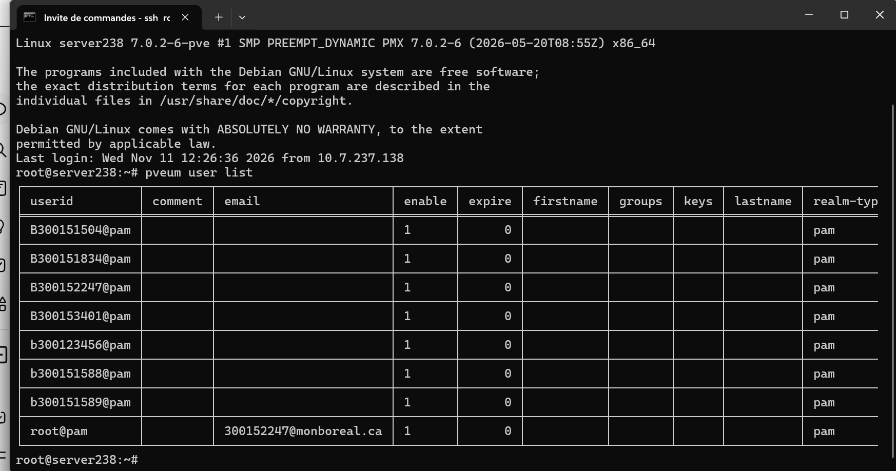
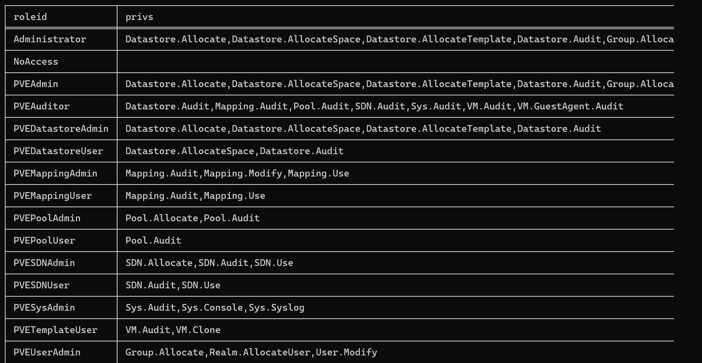
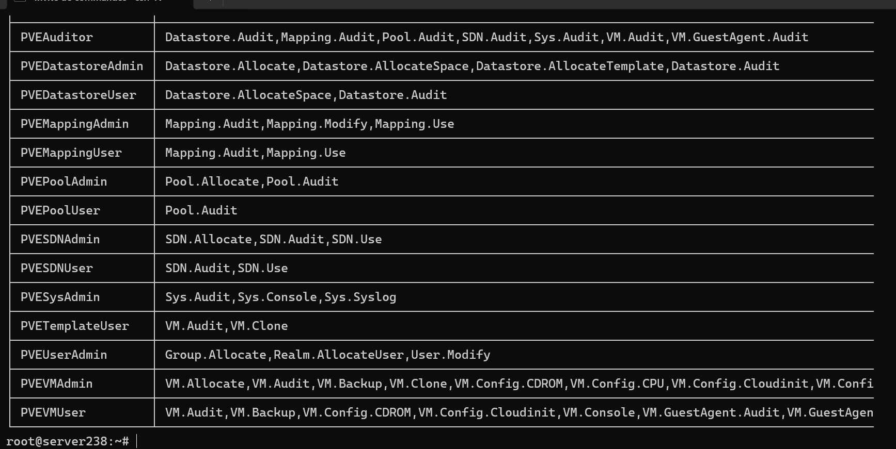
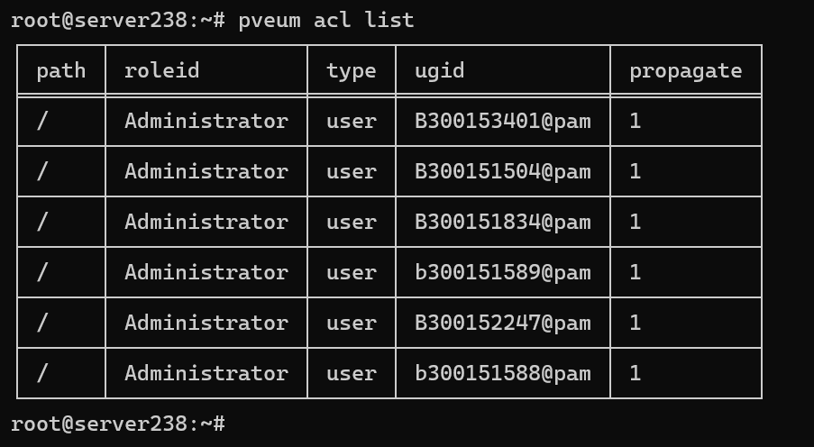
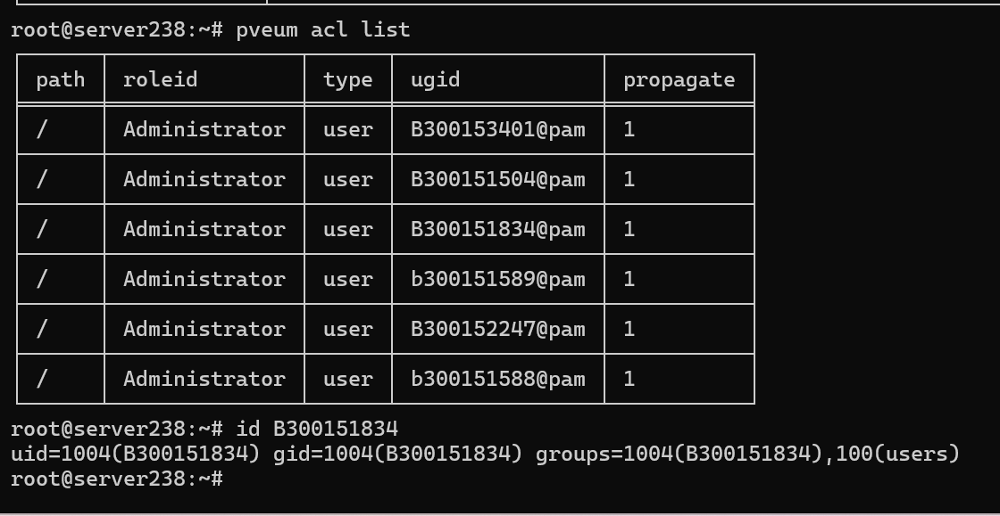
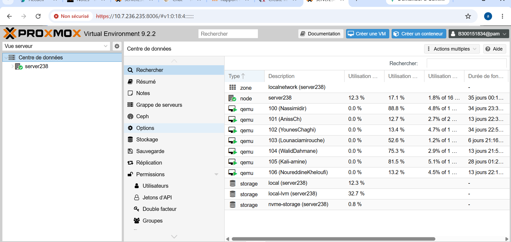
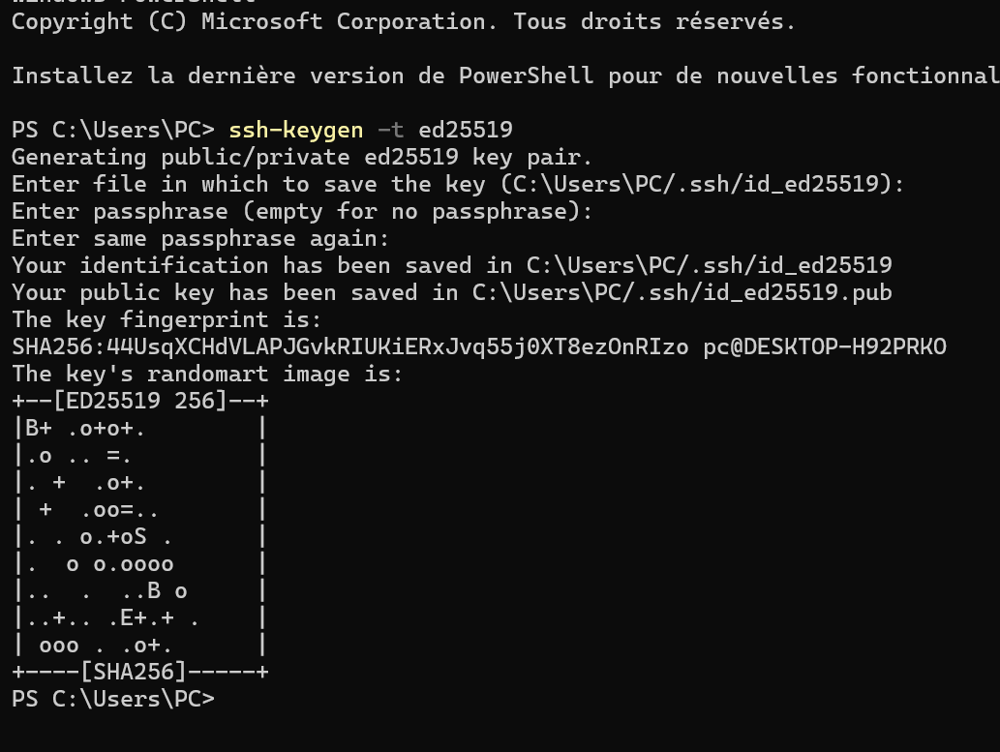
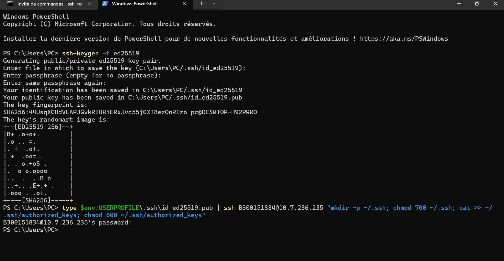
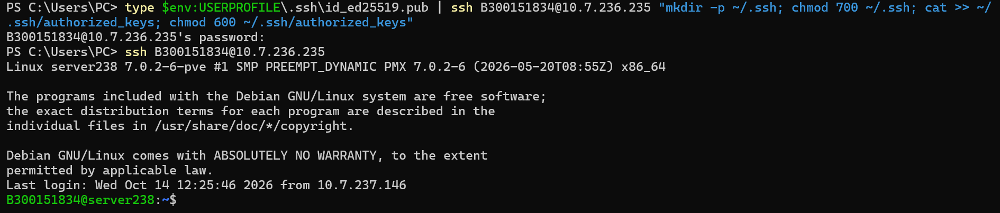

# INF1085 – Administration Linux

## Rapport de laboratoire – 4.Root : Un compte par administrateur

## ID : 300151834

## 1. Présentation

Ce laboratoire porte sur une bonne pratique de l'administration d'un serveur Proxmox : un compte par administrateur. Au lieu de travailler tous les jours avec le compte root, chaque administrateur a son propre compte, avec ses propres droits. Le compte root reste réservé aux urgences.

Mon compte, `B300151834@pam`, avait déjà été créé le 14 octobre, avec le rôle Administrator. Dans ce laboratoire, j'ai vérifié que le compte existe bien, que ses droits sont corrects, que je peux me connecter avec à l'interface Web, puis j'ai créé une clé SSH pour me connecter sans mot de passe.

## 2. Environnement

- Nœud Proxmox : server238
- Adresse Proxmox : https://10.7.236.235:8006
- Mon compte : B300151834@pam
- Rôle : Administrator
- Mon PC : Windows, terminal PowerShell

Attention : dans les exemples du cours, l'adresse du serveur est 10.7.237.200. Ce n'est pas la mienne. Mon nœud est server238, à l'adresse 10.7.236.235.

Je me suis connecté au nœud en SSH comme root :

```
ssh root@10.7.236.235
```

## 3. Vérifier les utilisateurs

J'ai d'abord affiché la liste des utilisateurs du nœud avec :

```
pveum user list
```

Mon compte `B300151834@pam` est bien dans la liste, avec `enable` à 1, donc activé. On voit aussi les comptes des autres étudiants du groupe et le compte `root@pam`.



## 4. Vérifier les rôles

Ensuite, j'ai affiché la liste des rôles avec :

```
pveum role list
```

Le rôle `Administrator` est bien présent, avec tous les droits (Datastore, Group, Pool, Sys, VM, etc.). La liste est longue, elle tient sur deux captures : le début avec le rôle Administrator, puis la suite avec les autres rôles comme PVEAuditor, PVEDatastoreAdmin ou PVEVMUser.





## 5. Vérifier les droits de mon compte

J'ai vérifié les droits appliqués avec :

```
pveum acl list
```

Mon compte `B300151834@pam` a bien le rôle `Administrator` sur le chemin `/`, avec propagation à 1. Cela veut dire que mes droits s'appliquent à tout le nœud.



## 6. Vérifier l'utilisateur Linux derrière le compte

Le compte Proxmox `B300151834@pam` correspond à un utilisateur Linux du serveur. Je l'ai vérifié avec :

```
id B300151834
```

Le résultat est : `uid=1004(B300151834) gid=1004(B300151834) groups=1004(B300151834),100(users)`. L'utilisateur Linux existe bien, avec l'identifiant 1004, et il fait partie du groupe `users`.



## 7. Tester la connexion Web avec mon compte

J'ai ouvert l'interface Web du nœud dans mon navigateur :

```
https://10.7.236.235:8006
```

Je me suis connecté avec le nom d'utilisateur `B300151834@pam`, le domaine « Linux PAM standard authentication » et mon mot de passe. La connexion a fonctionné : je vois le centre de données, le nœud server238, mes machines virtuelles et les stockages, dont `nvme-storage`.



## 8. Créer la clé SSH

Pour me connecter en SSH sans mot de passe, j'ai créé une clé sur mon PC, dans une nouvelle fenêtre PowerShell (pas dans la session SSH du serveur) :

```
ssh-keygen -t ed25519
```

J'ai appuyé sur Entrée pour accepter l'emplacement par défaut (`C:\Users\PC\.ssh\id_ed25519`) et Entrée deux fois pour laisser la phrase de passe vide. La clé a été créée : la clé privée dans `id_ed25519` et la clé publique dans `id_ed25519.pub`.



## 9. Copier la clé publique sur le serveur

Ensuite, j'ai copié ma clé publique dans le fichier `authorized_keys` de mon compte sur le serveur. La commande `ssh-copy-id` du cours n'existe pas sous Windows, alors j'ai utilisé l'équivalent en PowerShell :

```
type $env:USERPROFILE\.ssh\id_ed25519.pub | ssh B300151834@10.7.236.235 "mkdir -p ~/.ssh; chmod 700 ~/.ssh; cat >> ~/.ssh/authorized_keys; chmod 600 ~/.ssh/authorized_keys"
```

La commande m'a demandé une dernière fois le mot de passe de B300151834, puis elle s'est terminée sans erreur. Ma clé publique est maintenant dans `~/.ssh/authorized_keys` sur le serveur, avec les bonnes permissions (700 pour le dossier `.ssh`, 600 pour le fichier).



## 10. Tester la connexion SSH avec la clé

Pour finir, j'ai testé la connexion SSH avec mon compte :

```
ssh B300151834@10.7.236.235
```

Cette fois, le serveur ne m'a pas demandé de mot de passe : je suis arrivé directement sur l'invite `B300151834@server238:~$`. La clé fonctionne. La dernière connexion avec mot de passe datait du 14 octobre, c'est maintenant la clé qui me connecte.



## 11. Difficultés rencontrées

J'ai eu trois difficultés pendant ce laboratoire.

D'abord, j'avais oublié le mot de passe de mon compte B300151834. Comme j'étais connecté en root sur le nœud, je l'ai réinitialisé avec la commande `passwd B300151834`, en choisissant un nouveau mot de passe. Ensuite, la connexion Web avec mon compte a fonctionné.

Ensuite, pour le test Web, je me suis d'abord connecté avec le compte root par erreur. Je me suis déconnecté et reconnecté avec B300151834@pam pour faire le test avec mon propre compte.

Enfin, la commande `ssh-copy-id` du cours n'existe pas sous Windows. J'ai utilisé une commande PowerShell équivalente pour envoyer ma clé publique sur le serveur. J'ai aussi hésité sur la phrase de passe demandée par `ssh-keygen` : ce n'était pas un mot de passe à deviner, c'était à moi de choisir, et je l'ai laissée vide en appuyant sur Entrée.

## 12. Résultat

Le laboratoire est terminé et tout fonctionne :

- Mon compte B300151834@pam existe et il est activé.
- Il a le rôle Administrator sur tout le nœud.
- L'utilisateur Linux correspondant existe (uid 1004).
- La connexion Web avec mon compte fonctionne.
- La connexion SSH avec ma clé fonctionne, sans mot de passe.

Je travaille maintenant avec mon propre compte, comme le demande la bonne pratique. Le compte root reste réservé aux urgences.

