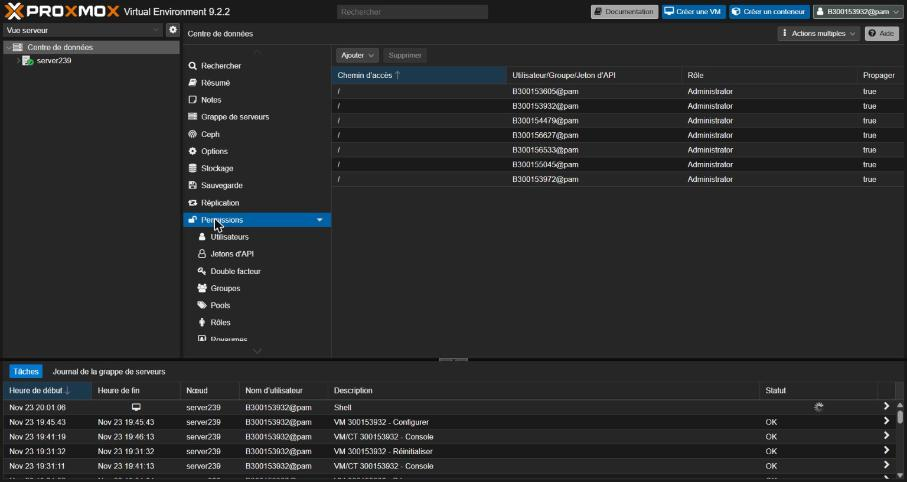

# Comptes administrateurs Proxmox

Un compte individuel permet d’associer les actions à un administrateur. Le compte root reste disponible pour les interventions de maintenance et de récupération. Dans le laboratoire, le rôle doit correspondre aux tâches autorisées par le professeur.

Sur le nœud attribué, créer le compte Linux individuel puis enregistrer le même compte dans le domaine PAM de Proxmox. Remplacer `BIDENTIFIANT` par le compte demandé.

```bash
adduser BIDENTIFIANT
id BIDENTIFIANT
pveum user add BIDENTIFIANT@pam
pveum user list
pveum role list
pveum acl list
```

Faire vérifier l’attribution du rôle demandé pour le périmètre du laboratoire. Tester la connexion web sur le domaine **Linux PAM**. Pour SSH, utiliser une clé publique ED25519 et vérifier que la session ouverte correspond au compte individuel avec `whoami`. 
## Captures et résultats de référence

Le rapport source montre le rôle Administrator sur /. Le rapport vérifie l’attribution dans **Centre de données → Permissions**.



[README source](https://github.com/CollegeBoreal/INF1085-201-26A-04/tree/main/4.Root/300153932)
