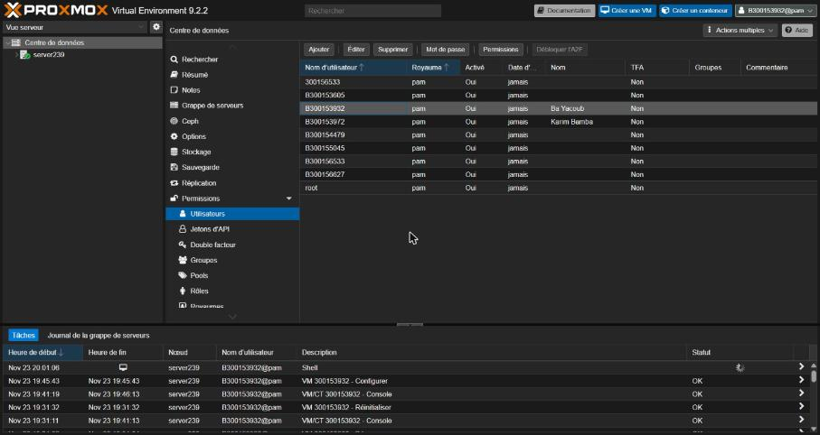
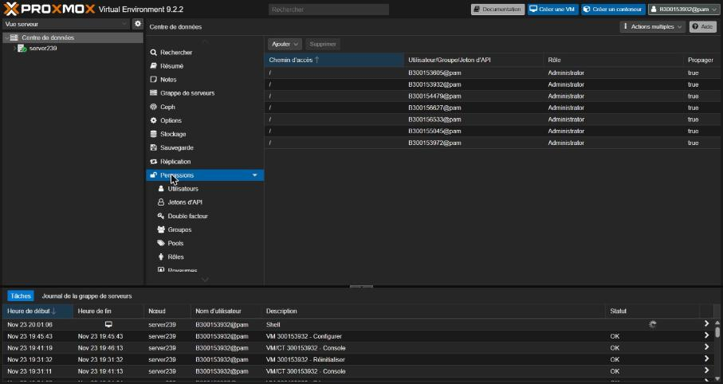
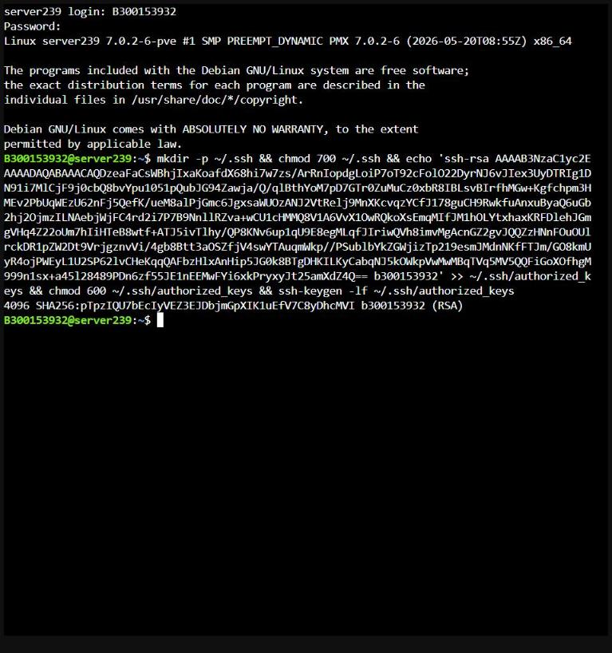

# 🔐 Lab 4 - Mon compte administrateur Proxmox

| Champ | Valeur |
|-------|--------|
| Nom | Yacoub Bâ |
| Numéro étudiant | 300153932 |
| Serveur | `server239` - [10.7.236.239](https://10.7.236.239:8006) (Proxmox VE 9.2.2) |
| Compte | `B300153932@pam` |

## 🎯 Objectif

Utiliser un compte administrateur personnel au lieu du compte partagé `root@pam`, pour que chaque action soit traçable.

## 1. Utilisateur Linux

Le compte a été créé avec les commandes du lab (en `root`, sur le serveur) :

```bash
adduser B300153932
id B300153932
```

```text
uid=1001(B300153932) gid=1001(B300153932) groups=1001(B300153932),100(users)
```

## 2. Utilisateur Proxmox et droits

```bash
pveum user add B300153932@pam
pveum aclmod / -user B300153932@pam -role Administrator
```

Vérification (`pveum user list` / `pveum acl list`, ou dans l'interface web **Centre de données → Permissions**) :

| Utilisateur | Royaume | Activé | Expire |
|-------------|---------|--------|--------|
| `B300153932` | `pam` | Oui | jamais |

| Chemin | Utilisateur | Rôle | Propager |
|--------|-------------|------|----------|
| `/` | `B300153932@pam` | Administrator | true |

> 💡 Mon compte n'a pas `sudo` sur le serveur : `pveum` demande les droits root (`Unable to load access control list`). Les vérifications ont donc été faites avec l'interface web, avec mon compte `B300153932@pam`.



*Figure 1 : Centre de données → Permissions → Utilisateurs. `B300153932` (royaume `pam`) est activé.*



*Figure 2 : Centre de données → Permissions. `B300153932@pam` a le rôle `Administrator` sur `/`.*

## 3. Connexion à l'interface web

```text
https://10.7.236.239:8006
Utilisateur : B300153932
Royaume     : Linux PAM standard authentication
```

Toutes mes actions apparaissent sous mon nom dans le journal des tâches (par exemple le déplacement du disque de ma VM au lab 5), et non sous `root@pam`.

## 4. Clé SSH

Création de la paire de clés, comme dans [X.Linux/3.keys](../../X.Linux/3.keys) :

```bash
ssh-keygen -t rsa -b 4096
mv ~/.ssh/id_rsa     ~/.ssh/b300153932
mv ~/.ssh/id_rsa.pub ~/.ssh/b300153932.pub
```

Copie de la clé publique sur le serveur. Sous Windows, `ssh-copy-id` n'existe pas ; je me suis connecté une fois avec mon mot de passe (Shell du nœud dans Proxmox) et j'ai ajouté la clé :

```bash
mkdir -p ~/.ssh && chmod 700 ~/.ssh
echo 'ssh-rsa AAAA...Z4Q== b300153932' >> ~/.ssh/authorized_keys
chmod 600 ~/.ssh/authorized_keys
ssh-keygen -lf ~/.ssh/authorized_keys
```

```text
4096 SHA256:pTpzIQU7bEcIyVEZ3EJDbjmGpXIK1uEfV7C8yDhcMVI b300153932 (RSA)
```



*Figure 3 : Ajout de ma clé publique dans `~/.ssh/authorized_keys` sur `server239`.*

## 5. Test SSH

```powershell
ssh -i ~/.ssh/b300153932 B300153932@10.7.236.239
```

```text
$ whoami
B300153932
$ pveversion
pve-manager/9.2.2/b9984c6d90a4bd80 (running kernel: 7.0.2-6-pve)
```

✅ Aucun mot de passe n'est demandé.

## ✅ Recommandations appliquées

| Méthode | Mon cas |
|----------|----------|
| Utiliser seulement `root@pam` | ❌ non, j'utilise `B300153932@pam` |
| Un compte par administrateur | ✅ |
| SSH avec clé publique | ✅ |
| ACL Proxmox | ✅ `Administrator` sur `/` |
| `root@pam` réservé aux urgences | ✅ |
