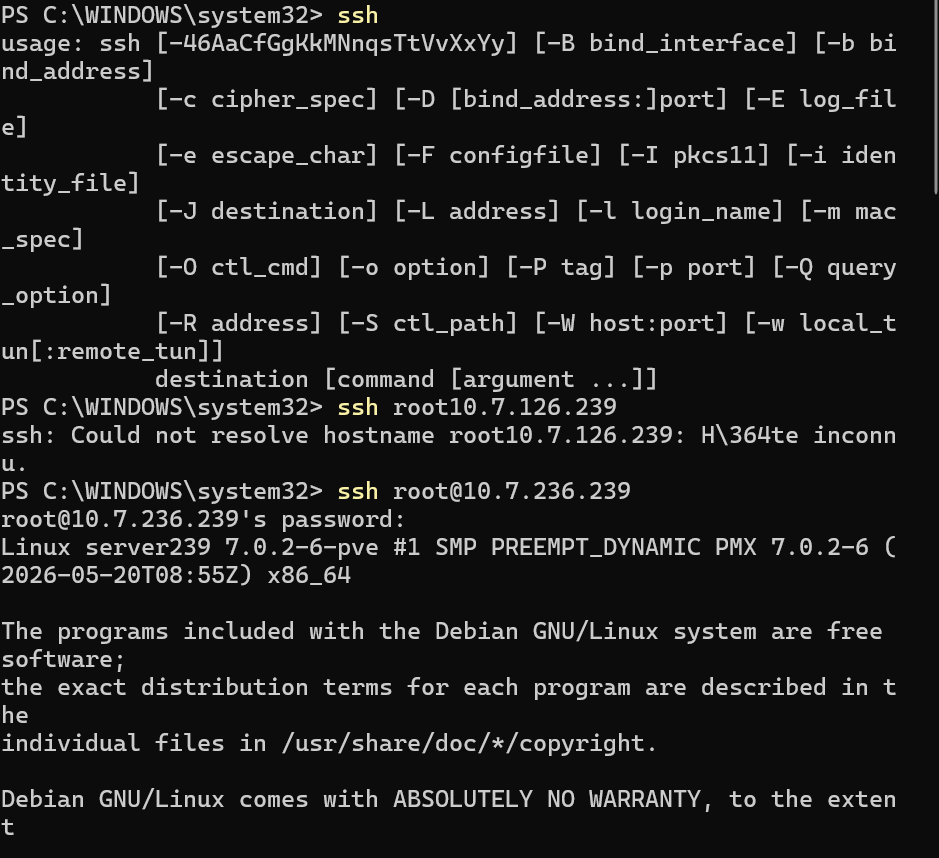
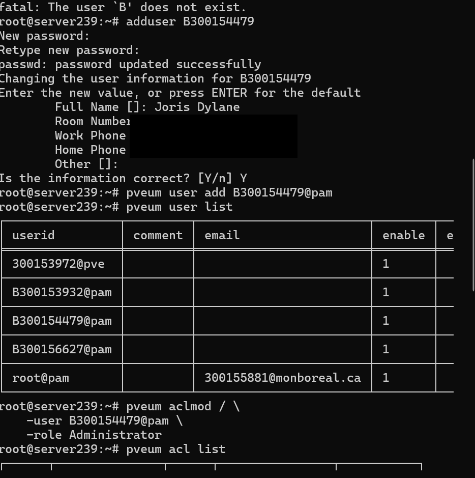
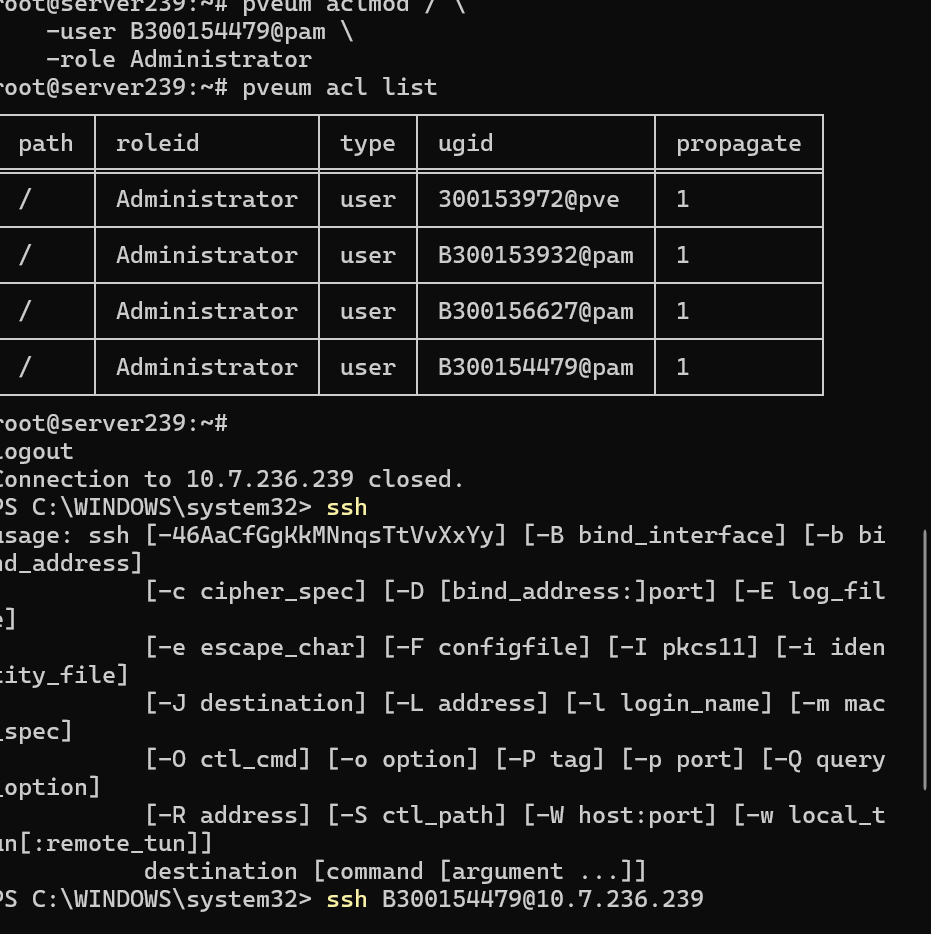
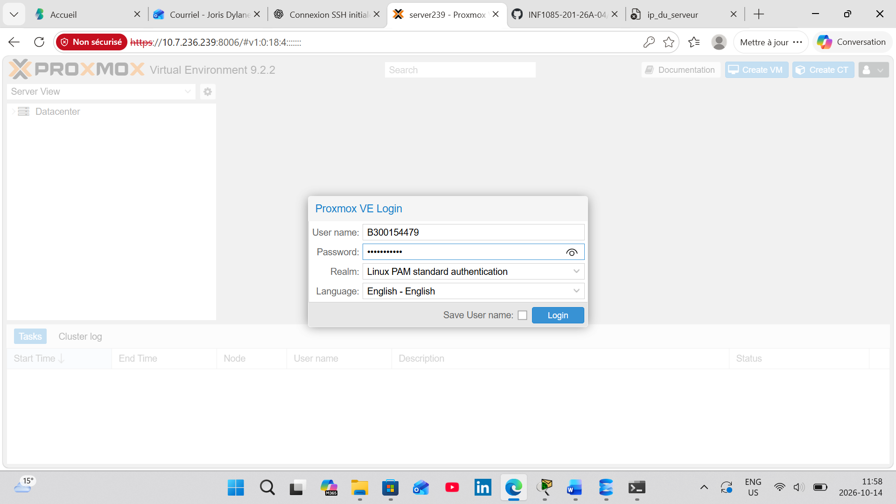
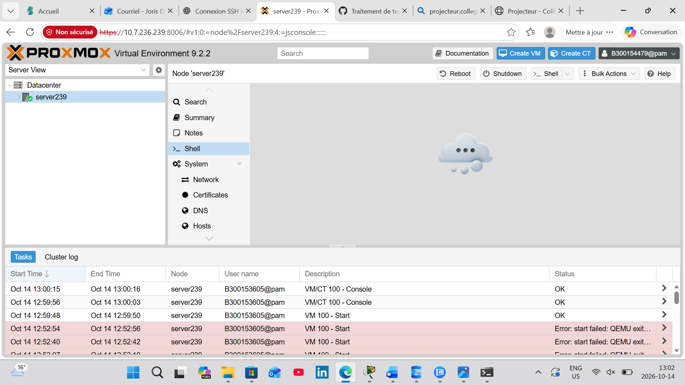
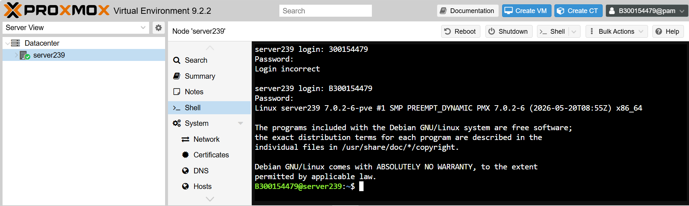
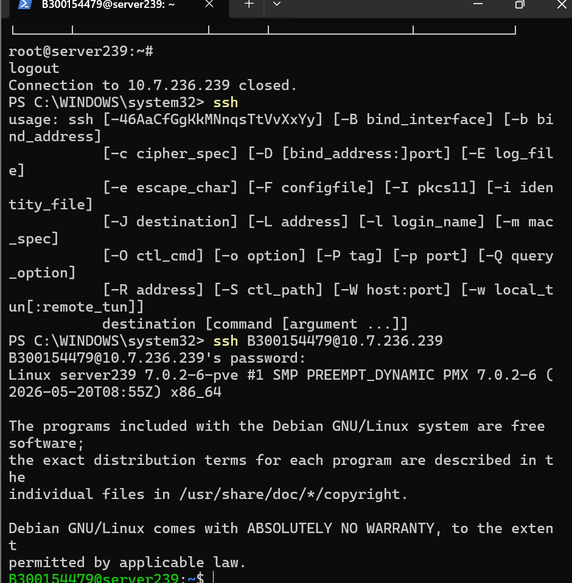
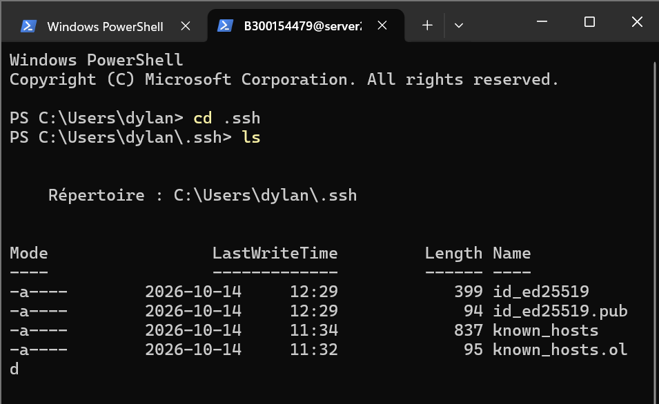
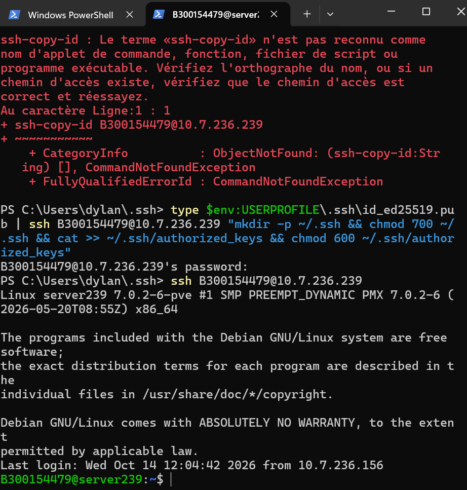

# 🔐 Root - Compte administrateur personnel sur Proxmox VE

| Champ | Valeur |
|-------|--------|
| Prénom | Joris Dylane |
| Nom | Touossock Ngabou |
| Numéro étudiant | 300154479 |
| Serveur | `server239` - [10.7.236.239](https://10.7.236.239:8006) |
| Compte créé | `B300154479` (Linux) / `B300154479@pam` (Proxmox) |
| Date du laboratoire | 14 octobre 2026 |

## 🎯 Objectif

Ne plus utiliser le compte partagé `root@pam` au quotidien : chaque administrateur
a son propre compte, ce qui rend les actions traçables et évite de partager le mot de passe root.

---

## 1. Connexion SSH en `root` (une seule fois, pour créer le compte)



*Figure 1 : Première tentative `ssh root10.7.126.239` → « Could not resolve hostname » : il manquait le `@` et l'adresse était fausse (126 au lieu de 236). Avec `ssh root@10.7.236.239`, la connexion fonctionne.*

## 2. Créer l'utilisateur Linux et l'ajouter à Proxmox

```bash
adduser B300154479
pveum user add B300154479@pam
pveum user list
```



*Figure 2 : `adduser B300154479` crée le compte Linux (mot de passe + nom complet). `pveum user add B300154479@pam` le déclare dans Proxmox. `pveum user list` montre mon compte à côté de ceux de mes coéquipiers et de `root@pam`. (Mes informations personnelles sont masquées.)*

> 💡 Le message `fatal: The user 'B' does not exist.` en haut de la capture vient d'une commande précédente où l'identifiant était incomplet. Le realm `@pam` signifie que Proxmox utilise le compte Linux du serveur pour l'authentification : il faut donc créer le compte Linux **avant**.

## 3. Donner le rôle Administrator

```bash
pveum aclmod / -user B300154479@pam -role Administrator
pveum acl list
```



*Figure 3 : `pveum acl list` : `B300154479@pam` a le rôle **Administrator** sur le chemin `/` (tout le datacenter), avec `propagate = 1` (le droit s'applique aussi aux sous-éléments : nœuds, VMs, stockages).*

## 4. Connexion à l'interface Web avec mon compte



*Figure 4 : Page de connexion de Proxmox VE 9.2.2 : utilisateur `B300154479`, realm **Linux PAM standard authentication**.*



*Figure 5 : Connecté en tant que `B300154479@pam` (en haut à droite). Le journal des tâches montre qui a fait quoi : chaque action est associée au compte de l'étudiant (ici `B300153605@pam` qui démarre la VM 100). C'est exactement l'intérêt des comptes individuels.*



*Figure 6 : Le **Shell** du nœud dans l'interface web. `300154479` sans le `B` donne « Login incorrect » ; avec `B300154479` la connexion réussit.*

## 5. Connexion SSH avec mon compte



*Figure 7 : `logout` de la session root, puis `ssh B300154479@10.7.236.239` : le mot de passe est demandé et j'obtiens le prompt `B300154479@server239:~$` (le `$` indique un utilisateur normal, le `#` indique root).*

## 6. Connexion SSH par clé publique

La clé `ed25519` avait déjà été créée avec `ssh-keygen -t ed25519` :



*Figure 8 : `C:\Users\dylan\.ssh` contient la clé privée `id_ed25519`, la clé publique `id_ed25519.pub` et `known_hosts`.*

`ssh-copy-id` n'existe pas dans PowerShell. J'ai donc envoyé la clé publique manuellement :

```powershell
type $env:USERPROFILE\.ssh\id_ed25519.pub | ssh B300154479@10.7.236.239 "mkdir -p ~/.ssh && chmod 700 ~/.ssh && cat >> ~/.ssh/authorized_keys && chmod 600 ~/.ssh/authorized_keys"
```



*Figure 9 : Erreur `ssh-copy-id : Le terme n'est pas reconnu`, puis la commande équivalente. Le mot de passe est demandé une dernière fois ; au `ssh B300154479@10.7.236.239` suivant, **aucun mot de passe n'est demandé** ✅.*

| Commande | Rôle |
|----------|------|
| `mkdir -p ~/.ssh` | Crée le dossier `.ssh` s'il n'existe pas |
| `chmod 700 ~/.ssh` | Seul le propriétaire peut y accéder (sinon SSH refuse la clé) |
| `cat >> ~/.ssh/authorized_keys` | Ajoute la clé publique reçue à la fin du fichier |
| `chmod 600 ~/.ssh/authorized_keys` | Fichier lisible et modifiable par le propriétaire seulement |

---

## 🧪 Vérifications

| Vérification | Commande | Résultat |
|--------------|----------|----------|
| Compte Linux | `adduser B300154479` | ✅ créé |
| Compte Proxmox | `pveum user list` | ✅ `B300154479@pam` |
| Droits | `pveum acl list` | ✅ Administrator sur `/` |
| Interface web | `https://10.7.236.239:8006` | ✅ connecté en `B300154479@pam` |
| SSH mot de passe | `ssh B300154479@10.7.236.239` | ✅ |
| SSH par clé | `ssh B300154479@10.7.236.239` | ✅ sans mot de passe |

## ✅ Bonnes pratiques retenues

| Méthode | Recommandation |
|---------|----------------|
| Utiliser seulement `root@pam` | ❌ |
| Un compte par administrateur | ✅ |
| SSH avec mot de passe | ⚠️ |
| SSH avec clé publique | ✅ |
| Partager le compte root | ❌ |
| Utiliser les ACL Proxmox | ✅ |

Le compte `root@pam` reste réservé au dépannage, à la réinitialisation des mots de passe et à la récupération du système.
