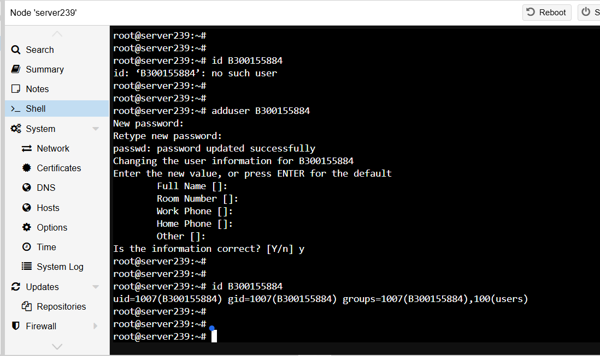
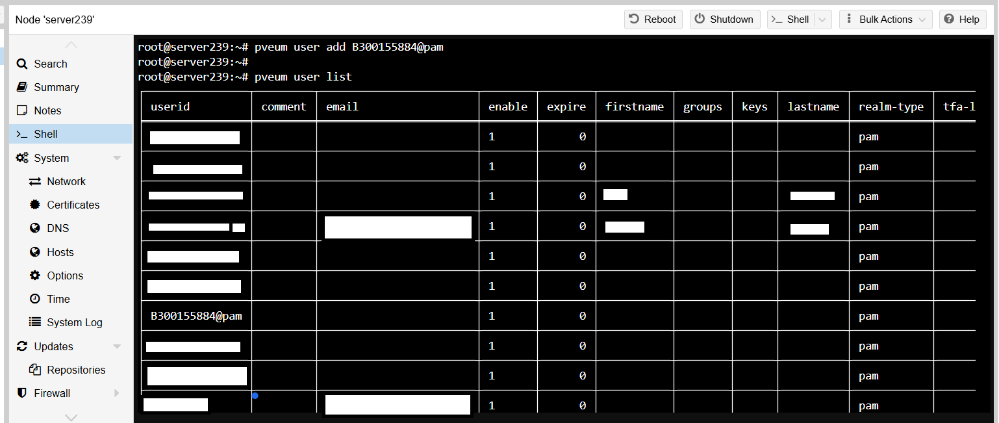
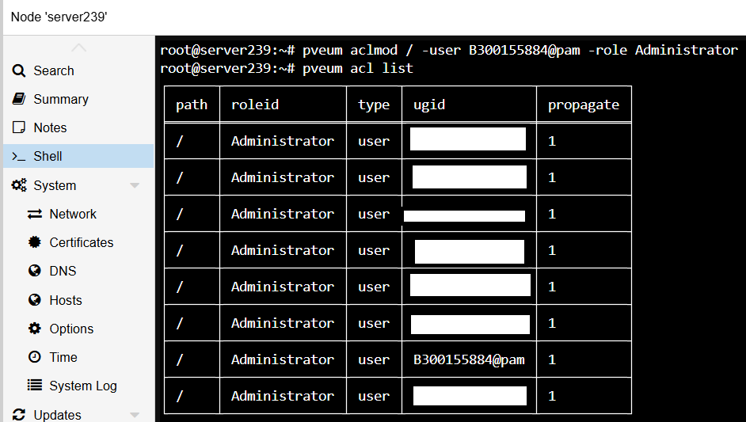
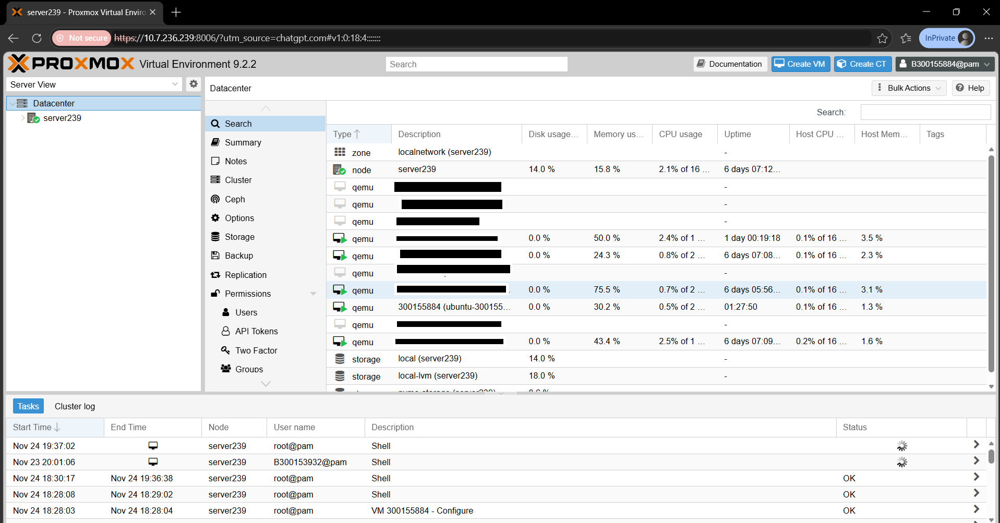
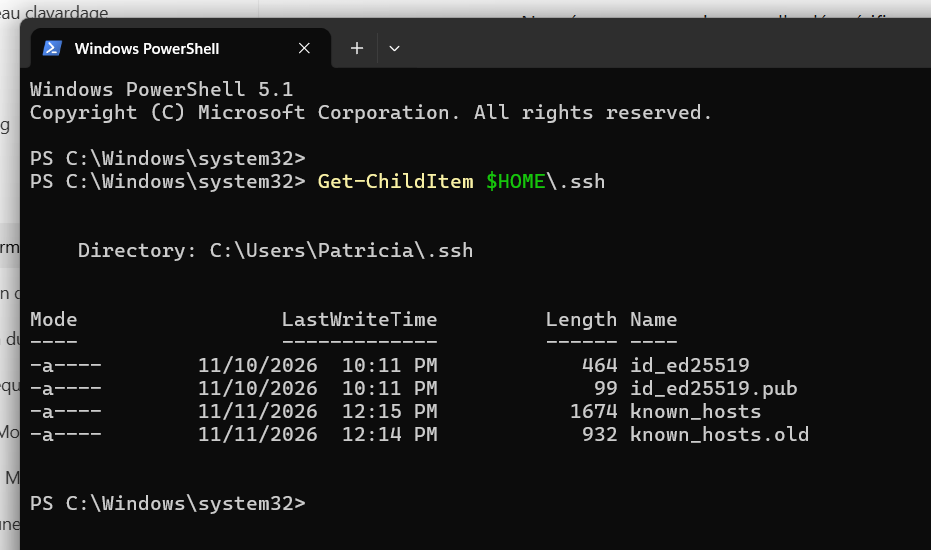
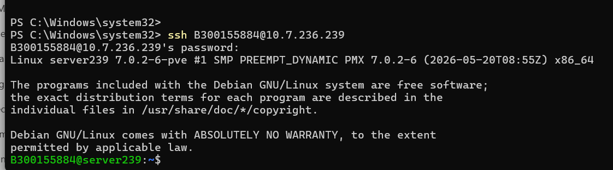
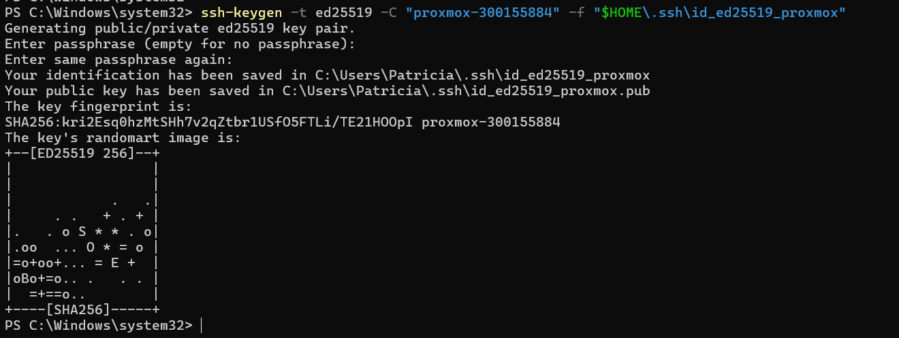
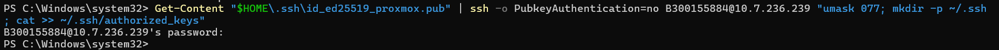
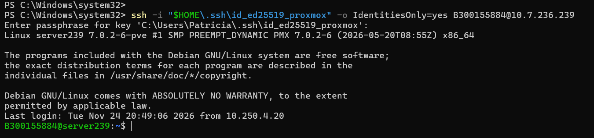

# 🔐 Laboratoire 4 — Comptes administrateurs Proxmox : bonnes pratiques

## 1. Informations générales

| Information | Description |
|---|---|
| Établissement | Collège Boréal |
| Programme | Technologies des systèmes informatiques et de réseaux |
| Cours | INF1085 — Administration Linux |
| Identifiant étudiant | 300155884 |
| Serveur Proxmox | server239 |
| Adresse IP | 10.7.236.239 |
| Version Proxmox | 9.2.2 |
| Compte administrateur | B300155884@pam |
| Date | 24 novembre 2026 |

---

## 2. Objectif du laboratoire

L'objectif de ce laboratoire est de sécuriser l'accès à Proxmox VE en utilisant un compte administrateur individuel plutôt que le compte root partagé.

Les principales tâches sont :

- Créer un utilisateur Linux.
- Ajouter cet utilisateur à Proxmox.
- Lui attribuer le rôle Administrator.
- Tester la connexion à l'interface Web.
- Configurer une authentification SSH par clé publique.
- Vérifier le bon fonctionnement des accès.

---

## 3. Création de l'utilisateur Linux

Avant de créer mon utilisateur, j'ai vérifié son existence avec la commande suivante :

```bash
id B300155884
```

Résultat :

```text
id: ‘B300155884’: no such user
```

L'utilisateur n'existait pas encore sur le serveur.

J'ai donc créé mon compte Linux :

```bash
adduser B300155884
```

J'ai défini un mot de passe personnel et laissé les informations facultatives vides.

### Vérification

```bash
id B300155884
```

Résultat :

```text
uid=1007(B300155884) gid=1007(B300155884) groups=1007(B300155884),100(users)
```

Le compte Linux a été créé avec succès.



---

## 4. Ajout de l'utilisateur à Proxmox

Après avoir créé mon utilisateur Linux, je l'ai ajouté à Proxmox avec le domaine d'authentification PAM.

```bash
pveum user add B300155884@pam
```

### Vérification

```bash
pveum user list
```

Mon compte B300155884@pam apparaît dans la liste des utilisateurs Proxmox.



Le domaine PAM permet à Proxmox d'utiliser les comptes du système Linux pour l'authentification.

---

## 5. Attribution du rôle Administrator

J'ai attribué le rôle Administrator à mon compte, conformément aux consignes du laboratoire.

```bash
pveum aclmod / -user B300155884@pam -role Administrator
```

### Vérification

```bash
pveum acl list
```

| Paramètre | Valeur |
|---|---|
| Path | / |
| Role | Administrator |
| Type | user |
| Utilisateur | B300155884@pam |
| Propagate | 1 |

Le rôle Administrator a été attribué avec succès.



Cette configuration permet à mon compte de disposer des permissions administratives dans Proxmox.

---

## 6. Connexion à l'interface Web Proxmox

J'ai ouvert l'interface Web du serveur à l'adresse suivante :

```text
https://10.7.236.239:8006
```

J'ai utilisé les informations suivantes :

| Paramètre | Valeur |
|---|---|
| Utilisateur | B300155884 |
| Realm | Linux PAM standard authentication |
| Mot de passe | Confidentiel |

La connexion a été effectuée avec succès.

Mon compte B300155884@pam apparaît en haut à droite de l'interface Proxmox.



Je peux désormais accéder à Proxmox avec mon propre compte plutôt qu'avec root@pam.

---

## 7. Vérification de la clé SSH existante

Depuis Windows PowerShell, j'ai vérifié les clés SSH présentes sur mon ordinateur.

```powershell
Get-ChildItem $HOME\.ssh
```

J'ai constaté la présence des fichiers suivants :

| Fichier | Description |
|---|---|
| id_ed25519 | Clé privée |
| id_ed25519.pub | Clé publique |
| known_hosts | Liste des serveurs SSH connus |



Une paire de clés SSH existait déjà sur mon ordinateur.

---

## 8. Connexion SSH avec mot de passe

J'ai testé la connexion SSH au serveur Proxmox avec mon compte personnel.

Depuis Windows PowerShell :

```powershell
ssh B300155884@10.7.236.239
```

Après avoir saisi mon mot de passe, la connexion a été établie.

Résultat :

```text
B300155884@server239:~$
```



Cette étape confirme que mon compte Linux est fonctionnel et accessible à distance.

---

## 9. Création d'une nouvelle clé SSH

Lors de l'utilisation de mon ancienne clé SSH, une phrase secrète était demandée.

Comme je ne retrouvais plus cette phrase secrète, j'ai décidé de créer une nouvelle paire de clés spécialement destinée à Proxmox.

J'ai conservé l'ancienne paire de clés afin de ne pas perturber les accès déjà configurés.

### Création de la nouvelle paire de clés

```powershell
ssh-keygen -t ed25519 -C "proxmox-300155884" -f "$HOME\.ssh\id_ed25519_proxmox"
```

J'ai protégé cette nouvelle clé privée avec une phrase secrète.

Les fichiers suivants ont été générés :

| Fichier | Description |
|---|---|
| id_ed25519_proxmox | Nouvelle clé privée |
| id_ed25519_proxmox.pub | Nouvelle clé publique |



L'algorithme Ed25519 permet de générer des clés SSH modernes et sécurisées.

---

## 10. Installation de la nouvelle clé publique

Depuis Windows PowerShell, j'ai copié ma nouvelle clé publique sur le serveur Proxmox.

```powershell
Get-Content "$HOME\.ssh\id_ed25519_proxmox.pub" | ssh -o PubkeyAuthentication=no B300155884@10.7.236.239 "umask 077; mkdir -p ~/.ssh; cat >> ~/.ssh/authorized_keys"
```

Cette commande permet de :

- Créer le répertoire .ssh si nécessaire.
- Appliquer des permissions restrictives aux nouveaux fichiers.
- Ajouter la clé publique au fichier authorized_keys.
- Autoriser l'authentification avec la clé correspondante.



La clé privée reste sur mon ordinateur et n'est pas transférée au serveur.

---

## 11. Vérification de la connexion SSH par clé

J'ai testé la connexion en indiquant explicitement ma nouvelle clé privée.

```powershell
ssh -i "$HOME\.ssh\id_ed25519_proxmox" -o IdentitiesOnly=yes B300155884@10.7.236.239
```

Le système m'a demandé la phrase secrète de ma clé privée.

Après avoir saisi cette phrase secrète, la connexion a été établie sans demander le mot de passe du compte Linux.

Résultat :

```text
B300155884@server239:~$
```



### Différence entre le mot de passe et la phrase secrète

| Élément | Fonction |
|---|---|
| Mot de passe Linux | Permet de s'authentifier auprès du serveur |
| Phrase secrète SSH | Protège la clé privée sur mon ordinateur |
| Clé publique | Permet au serveur de vérifier mon authentification |
| Clé privée | Permet de prouver mon identité |

La connexion SSH par clé a été réalisée avec succès.

---

## 12. Bonnes pratiques de sécurité

| Bonne pratique | Avantage |
|---|---|
| Utiliser un compte individuel | Assurer la traçabilité des actions |
| Éviter le partage du compte root | Réduire les risques de sécurité |
| Utiliser les ACL Proxmox | Contrôler les permissions |
| Utiliser une clé SSH | Renforcer l'authentification |
| Protéger la clé privée | Empêcher son utilisation non autorisée |
| Garder les mots de passe confidentiels | Protéger les comptes |
| Appliquer le principe du moindre privilège | Limiter les permissions au nécessaire |

### Utilisation du compte root

Le compte root doit être réservé principalement aux opérations suivantes :

- Dépannage.
- Maintenance d'urgence.
- Réinitialisation des mots de passe.
- Récupération du système.

---

## 13. Bilan du laboratoire

| Tâche | Résultat |
|---|---|
| Création de l'utilisateur Linux | ✅ Réussie |
| Création du compte Proxmox | ✅ Réussie |
| Attribution du rôle Administrator | ✅ Réussie |
| Connexion à l'interface Web | ✅ Réussie |
| Connexion SSH avec mot de passe | ✅ Réussie |
| Vérification des clés existantes | ✅ Réussie |
| Création d'une nouvelle clé SSH | ✅ Réussie |
| Installation de la clé publique | ✅ Réussie |
| Connexion SSH par clé | ✅ Réussie |

---

## 14. Conclusion

Ce laboratoire m'a permis de comprendre l'importance des comptes administrateurs individuels dans Proxmox VE.

J'ai créé mon propre compte Linux, configuré ses permissions dans Proxmox et sécurisé mon accès SSH à l'aide d'une paire de clés Ed25519.

Je peux désormais accéder au serveur Proxmox avec mon compte personnel sans utiliser systématiquement le compte root.

Les objectifs du laboratoire ont été atteints avec succès.
