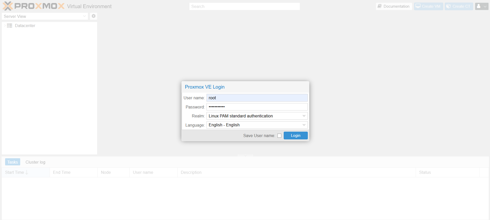
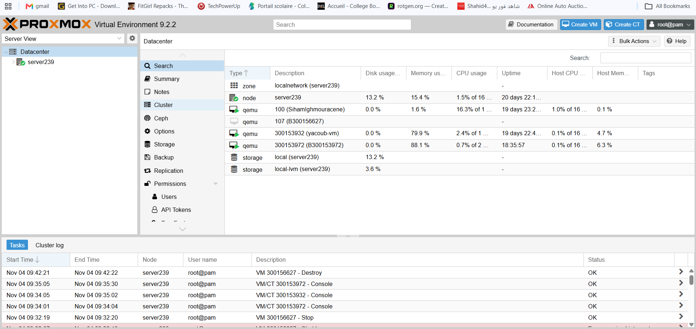
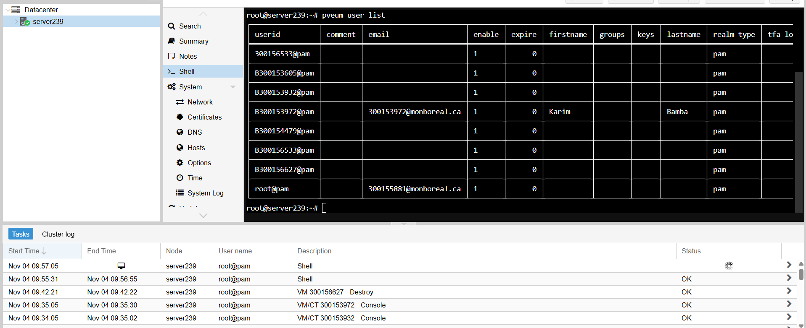
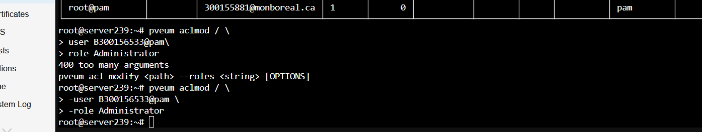
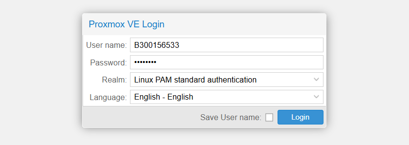

# 🔐 INF1085 - Gestion des comptes administrateurs Proxmox
# 👨‍💻 Auteur
Nom : Abderraouf Moulla
Cours : INF1085

# 🎯 Objectif

L'objectif de ce laboratoire est de remplacer l'utilisation du compte partagé root@pam par un compte administrateur personnel afin d'améliorer la sécurité et la traçabilité des actions dans Proxmox VE.

# 🖥️ Informations du serveur
Paramètre	Valeur
Serveur	server239
Adresse IP	10.7.236.239
Plateforme	Proxmox VE
# 🔐 Étape 1 - Connexion au serveur Proxmox

Connexion à l'interface Proxmox à l'aide du compte administrateur principal.

# 🖥️ Étape 2 - Vérification du serveur

Après l'authentification, le serveur server239 est visible dans le Datacenter Proxmox.

Cette étape permet de vérifier l'accès au serveur ainsi qu'aux ressources disponibles.

# 👤 Étape 3 - Vérification des utilisateurs Proxmox

Affichage de la liste des utilisateurs configurés sur le serveur.

Commande utilisée
Shell
pveum user list
 

Cette commande permet de confirmer la présence du compte :

Plain Text
B300156533@pam
 

# 🔑 Étape 4 - Attribution des droits administrateur

Le rôle Administrator a été attribué au compte utilisateur afin de permettre l'administration du serveur sans utiliser directement le compte root.

Commande utilisée
Shell
pveum aclmod / \
--user B300156533@pam \
--role Administrator

Cette commande accorde les privilèges d'administration à l'utilisateur.

# 👨‍💻 Étape 5 - Connexion avec le compte personnel

Connexion à Proxmox avec le compte utilisateur personnel.

Plain Text
B300156533@pam

Cette étape confirme que le compte dispose des droits nécessaires pour administrer Proxmox.

# 📋 Commandes utilisées
Afficher les utilisateurs
Shell
pveum user list
Attribuer le rôle Administrator
Shell
pveum aclmod / \
--user B300156533@pam \
--role Administrator
# ✅ Résultats obtenus
✅ Vérification des utilisateurs Proxmox
✅ Attribution des droits administrateur
✅ Connexion avec un compte personnel
✅ Réduction de l'utilisation du compte root
✅ Amélioration de la sécurité du serveur
✅ Meilleure traçabilité des actions administratives
