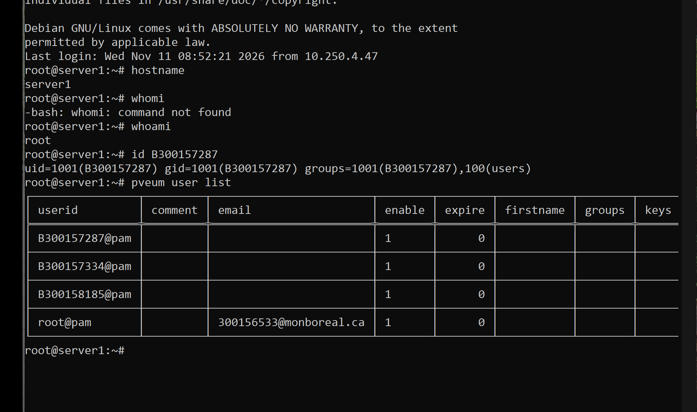
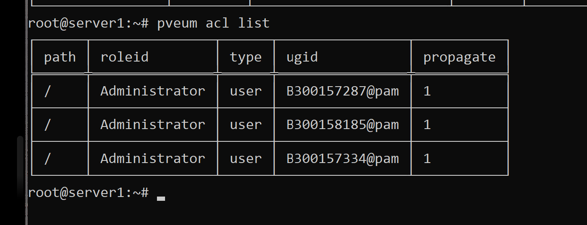
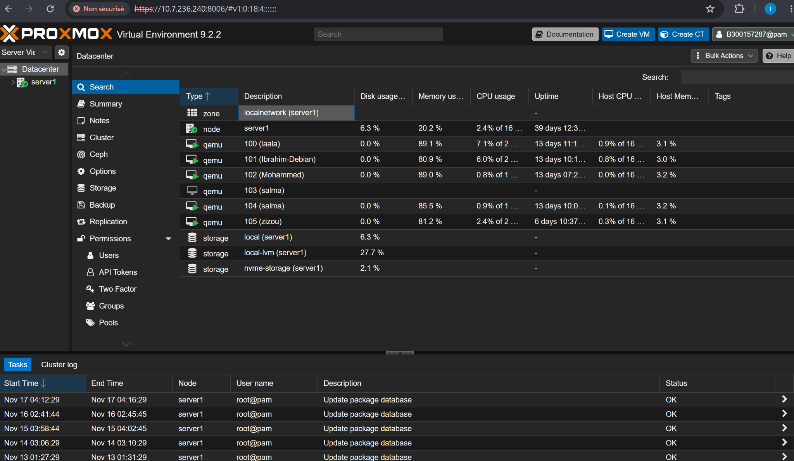
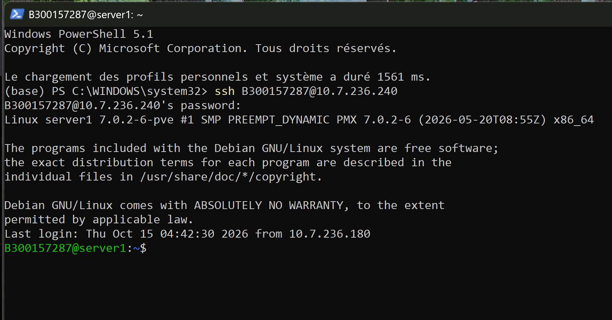
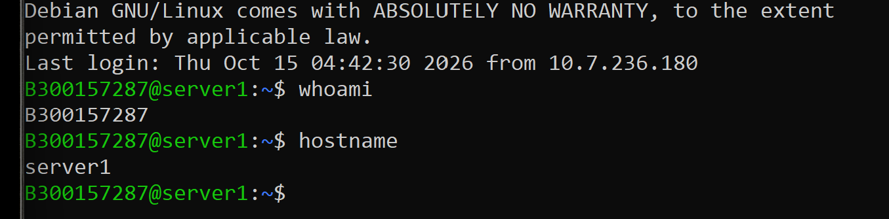
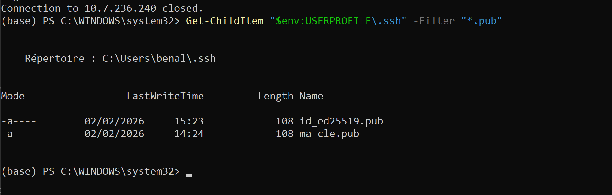
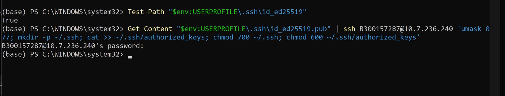
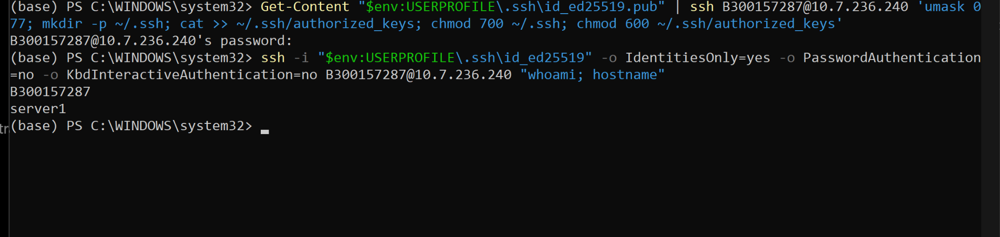
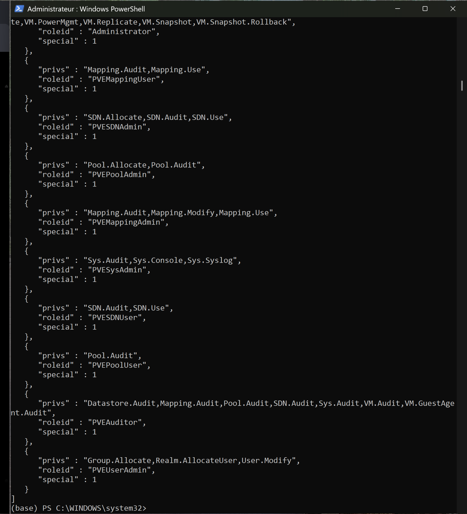

# Comptes administrateurs Proxmox : bonnes pratiques

**Étudiant :** Ibrahim Hamdan Alhamed  
**Numéro étudiant :** 300157287  
**Cours :** INF1085 – Administration Linux  
**Travail :** 4.Root

## 1. Objectif

Ce laboratoire porte sur l'utilisation d'un compte personnel pour administrer Proxmox VE. Le but est d'éviter le partage du compte `root`, de mieux identifier les personnes qui se connectent et de sécuriser les connexions SSH avec une clé publique.

J'ai vérifié mon compte Linux et son inscription dans Proxmox, ses permissions et son accès à l'interface Web. J'ai ensuite installé une clé publique existante dans mon compte personnel et testé la connexion SSH par clé.

## 2. Environnement utilisé

| Élément | Valeur observée |
| --- | --- |
| Serveur | `server1` |
| Adresse IP | `10.7.236.240` |
| Interface Web | `https://10.7.236.240:8006` |
| Version affichée dans l'interface | Proxmox VE 9.2.2 |
| Poste client | Windows avec PowerShell |
| Compte Linux personnel | `B300157287` |
| Identifiant Proxmox | `B300157287@pam` |
| Rôle Proxmox attribué | `Administrator` sur `/`, avec propagation |

Le compte Linux, son inscription dans Proxmox et son attribution au rôle Administrator étaient déjà présents au moment des vérifications. Les captures ci-dessous montrent leur état. Je n'ai donc pas eu à recréer ces éléments pendant cette séance.

## 3. Vérification du compte Linux

Dans la session du serveur ouverte avec `root`, j'ai vérifié le nom du serveur et l'identité de la session :

```bash
hostname
whoami
```

Les résultats étaient respectivement `server1` et `root`. J'ai ensuite vérifié l'existence de mon compte personnel :

```bash
id B300157287
```

Résultat observé :

```text
uid=1001(B300157287) gid=1001(B300157287) groups=1001(B300157287),100(users)
```

Ce résultat confirme l'existence du compte Linux, son identifiant utilisateur et ses groupes.



## 4. Vérification du compte dans Proxmox

Sur le serveur Proxmox, j'ai exécuté :

```bash
pveum user list
```

La liste contient `B300157287@pam`. La valeur `enable` est à `1` : le compte est activé. La valeur `expire` est à `0`, ce qui indique qu'aucune date d'expiration n'est définie. La capture précédente présente aussi ce résultat.

Le compte utilise le domaine d'authentification `pam`, associé à l'authentification Linux du serveur.

## 5. Vérification des droits administrateur

J'ai affiché les permissions configurées :

```bash
pveum acl list
```

| Champ | Résultat pour mon compte |
| --- | --- |
| Chemin | `/` |
| Rôle | `Administrator` |
| Type | `user` |
| Utilisateur | `B300157287@pam` |
| Propagation | `1` |

Mon compte dispose donc du rôle Administrator au niveau racine de l'arborescence Proxmox, avec propagation aux chemins descendants. Ces droits concernent Proxmox : ils ne transforment pas automatiquement mon compte Linux en compte `root`.



## 6. Connexion à l'interface Web

J'ai ouvert l'adresse suivante dans le navigateur :

```text
https://10.7.236.240:8006
```

Je me suis connecté avec mon compte personnel. L'identifiant `B300157287@pam` apparaît en haut à droite de l'interface. Le serveur, les machines virtuelles et les stockages sont visibles.

Cette capture confirme que la connexion à l'interface Web fonctionne avec mon identité personnelle.



## 7. Connexion SSH avec le compte personnel

Depuis PowerShell sur Windows, j'ai lancé :

```powershell
ssh B300157287@10.7.236.240
```

Après la saisie du mot de passe du compte personnel, l'invite du serveur est apparue :

```text
B300157287@server1:~$
```



Dans cette session Linux, j'ai exécuté :

```bash
whoami
hostname
```

Les résultats étaient :

```text
B300157287
server1
```

Ils confirment que j'étais connecté au bon serveur avec mon compte personnel.



## 8. Utilisation d'une clé SSH existante

### 8.1 Vérification des clés sur Windows

Après avoir quitté la session SSH avec `exit`, j'ai vérifié les clés publiques présentes sur mon poste Windows :

```powershell
Get-ChildItem "$env:USERPROFILE\.ssh" -Filter "*.pub"
```

Deux fichiers publics étaient présents : `id_ed25519.pub` et `ma_cle.pub`. J'ai choisi de réutiliser la clé `id_ed25519`.



J'ai vérifié que le fichier privé correspondant existait, sans afficher son contenu :

```powershell
Test-Path "$env:USERPROFILE\.ssh\id_ed25519"
```

Le résultat était `True`. Il n'était donc pas nécessaire de générer une nouvelle paire de clés.

### 8.2 Installation de la clé publique

Depuis PowerShell sur Windows, j'ai exécuté :

```powershell
Get-Content "$env:USERPROFILE\.ssh\id_ed25519.pub" | ssh B300157287@10.7.236.240 'umask 077; mkdir -p ~/.ssh; cat >> ~/.ssh/authorized_keys; chmod 700 ~/.ssh; chmod 600 ~/.ssh/authorized_keys'
```

Cette commande transmet la clé publique au serveur et l'ajoute au fichier `authorized_keys` de mon compte. Elle applique aussi les permissions `700` au dossier `.ssh` et `600` au fichier `authorized_keys`. La clé privée reste sur mon poste Windows.

Le mot de passe de mon compte a été demandé pour cette installation. La commande s'est terminée sans message d'erreur.



### 8.3 Test de l'authentification par clé

J'ai ensuite exécuté ce test depuis PowerShell :

```powershell
ssh -i "$env:USERPROFILE\.ssh\id_ed25519" -o IdentitiesOnly=yes -o PasswordAuthentication=no -o KbdInteractiveAuthentication=no B300157287@10.7.236.240 "whoami; hostname"
```

Résultat :

```text
B300157287
server1
```

Le test a réussi alors que le recours au mot de passe du compte et à l'authentification interactive était désactivé pour cette commande. Cela confirme le fonctionnement de l'authentification par clé SSH.

Ces options s'appliquent uniquement au test lancé depuis le client. Je n'ai pas désactivé globalement l'authentification par mot de passe sur le serveur.



## 9. Affichage des rôles Proxmox

Pour consulter les rôles depuis PowerShell, j'ai exécuté la commande à distance sur le serveur :

```powershell
ssh root@10.7.236.240 "pveum role list"
```

L'affichage du tableau était très large dans le terminal. J'ai ensuite utilisé une présentation JSON :

```powershell
ssh root@10.7.236.240 "pveum role list --output-format json-pretty"
```

La liste s'est affichée correctement. Le champ `roleid` donne le nom du rôle et `privs` présente ses privilèges. Cette liste décrit les rôles disponibles; l'attribution de mon rôle personnel est prouvée séparément par `pveum acl list`.



## 10. Difficultés rencontrées et corrections

| Difficulté | Correction apportée |
| --- | --- |
| Saisie de `whomi` au lieu de `whoami` | Correction de l'orthographe de la commande. |
| Exécution de `Get-ChildItem` dans une session SSH Linux | Sortie de la session avec `exit`, puis exécution dans PowerShell sur Windows. |
| Exécution directe de `pveum role list` dans PowerShell | Exécution de la commande sur le serveur Proxmox à travers SSH. |
| Tableau des rôles difficile à lire | Utilisation du format `json-pretty`. |

Ces difficultés m'ont permis de mieux distinguer l'environnement Windows local et la session Linux distante. L'invite `PS C:\...>` correspond à PowerShell; l'invite `B300157287@server1:~$` correspond à ma session Linux sur le serveur.

## 11. Bonnes pratiques retenues

- Utiliser un compte personnel pour les opérations courantes dans Proxmox.
- Éviter le partage du compte et du mot de passe `root`.
- Privilégier l'authentification SSH par clé et conserver la clé privée sur le poste client.
- Contrôler les droits accordés à chaque utilisateur avec les ACL Proxmox.
- Réserver l'utilisation de `root` au dépannage et aux interventions qui le nécessitent.

Les comptes individuels permettent d'associer les connexions et les opérations à une identité distincte. Dans ce laboratoire, j'ai vérifié mon identité de connexion dans l'interface Web et en SSH. Je n'ai pas réalisé un audit complet des journaux d'activité.

## 12. Bilan des résultats

| Vérification | Résultat |
| --- | --- |
| Existence du compte Linux personnel | Confirmée par `id` |
| Compte personnel activé dans Proxmox | Confirmé par `pveum user list` |
| Rôle Administrator sur `/` avec propagation | Confirmé par `pveum acl list` |
| Connexion Web avec le compte personnel | Réussie |
| Connexion SSH avec le compte personnel | Réussie |
| Réutilisation d'une clé SSH existante | Effectuée |
| Installation de la clé publique | Effectuée sans erreur affichée |
| Authentification par clé SSH | Réussie, sans recours au mot de passe du compte pendant le test |
| Affichage des rôles | Réussi |

Ce laboratoire m'a permis de vérifier les accès de mon compte personnel et de mettre en place son authentification SSH par clé. Je peux me connecter au serveur avec une identité individuelle et utiliser l'interface Proxmox avec les permissions prévues dans le laboratoire.
