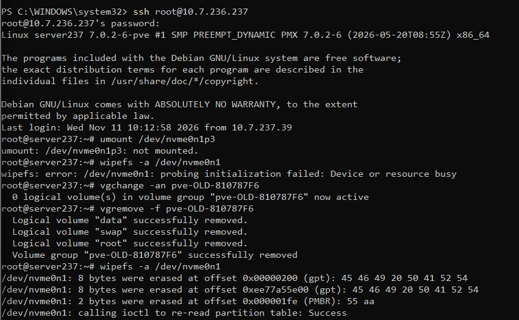
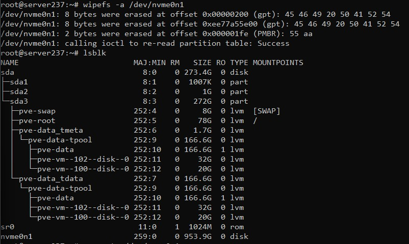
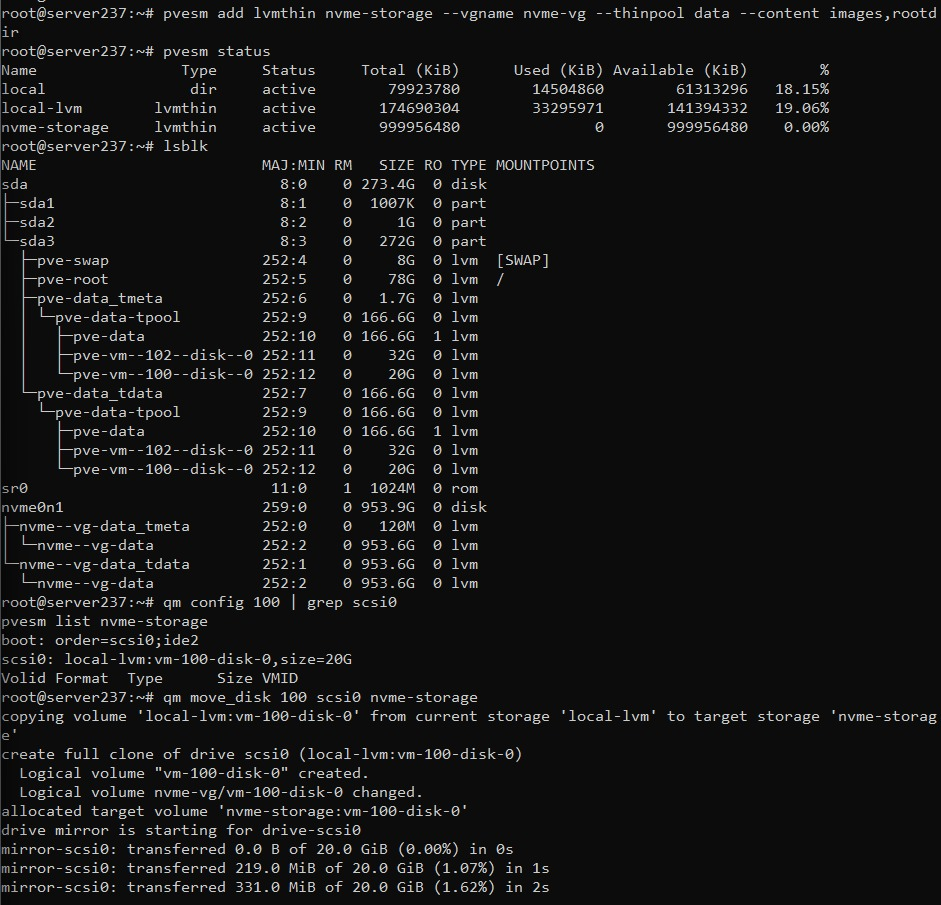
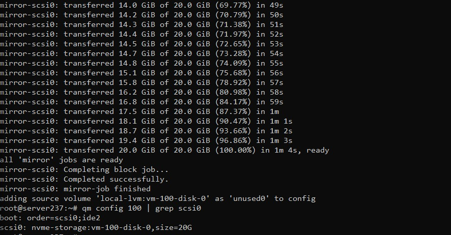
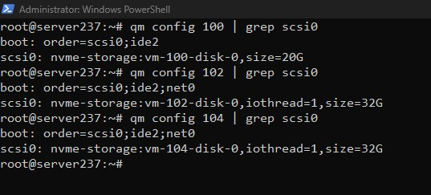
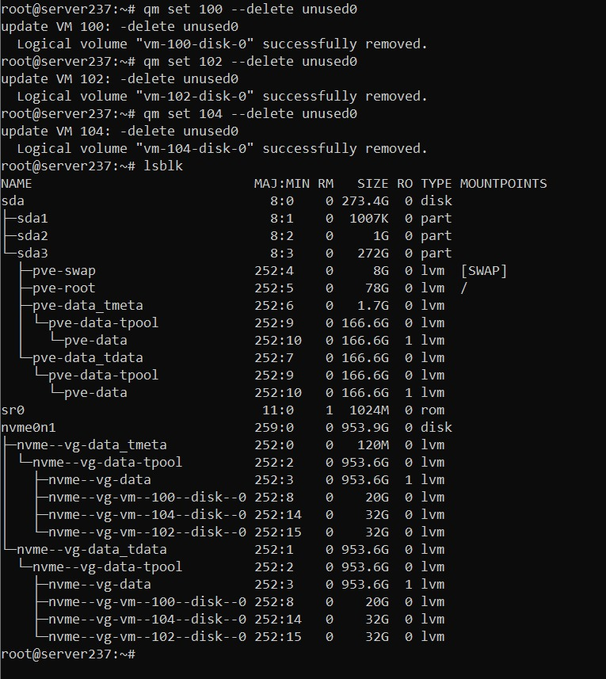

# 💾 INF1085 — Administration du stockage Linux et migration des VM vers NVMe sous Proxmox VE

> **Laboratoire pratique · Proxmox VE 9 · Nœud `server237` · Identifiant `B300142636`**
>
> **Objet :** préparer un disque NVMe, créer un stockage **LVM-Thin** dans Proxmox et migrer les disques virtuels existants vers ce stockage.

## 📑 Sommaire

1. [Contexte et objectifs](#1--contexte-et-objectifs)
2. [Matériel et architecture de stockage](#2--matériel-et-architecture-de-stockage)
3. [Notions essentielles](#3--notions-essentielles)
4. [État initial et diagnostic](#4--état-initial-et-diagnostic)
5. [Résolution du conflit LVM sur le NVMe](#5--résolution-du-conflit-lvm-sur-le-nvme)
6. [Création et enregistrement de `nvme-storage`](#6--création-et-enregistrement-de-nvme-storage)
7. [Migration des disques virtuels](#7--migration-des-disques-virtuels)
8. [Nettoyage et validation](#8--nettoyage-et-validation)
9. [Problèmes rencontrés et bonnes pratiques](#9--problèmes-rencontrés-et-bonnes-pratiques)
10. [Questions de réflexion](#10--questions-de-réflexion)
11. [Bilan et conclusion](#11--bilan-et-conclusion)
12. [Captures et traçabilité](#12--captures-et-traçabilité)

---

## 1. 🎯 Contexte et objectifs

Dans le cadre du cours **INF1085**, ce TP porte sur l'organisation du stockage sous Linux et son intégration dans **Proxmox Virtual Environment**. Le serveur `server237` possède un disque système et un SSD NVMe destiné à héberger les disques des machines virtuelles.

L'objectif est de savoir :

- distinguer HDD, SSD SATA et SSD NVMe ;
- identifier les disques, partitions et volumes Linux ;
- comprendre **PV**, **VG**, **LV** et **LVM-Thin** ;
- ajouter un stockage de type `lvmthin` à Proxmox ;
- déplacer le disque d'une VM de `local-lvm` vers `nvme-storage` ;
- contrôler les résultats et nettoyer les anciennes copies devenues inutiles.

> **Méthode de rédaction :** les lignes intitulées **« Observé »** correspondent aux captures du laboratoire. Les autres séquences sont une **procédure pédagogique de référence** fournie par le TP ; leur exécution n'est pas systématiquement visible sur les captures.

## 2. 🧰 Matériel et architecture de stockage

| Élément | Configuration observée |
|---|---|
| Hyperviseur | Proxmox VE sur `server237` |
| Session d'administration | `root@server237` par SSH depuis Windows |
| Adresse du serveur | `10.7.236.237` |
| Disque système Linux | `/dev/sda` — **273,4 Gio** |
| Disque additionnel | `/dev/nvme0n1` — **953,9 Gio** |
| Stockage système des VM | `local-lvm` — thin pool LVM sur `/dev/sda` |
| Stockage NVMe ajouté | `nvme-storage` — type `lvmthin` |
| Groupe LVM cible | `nvme-vg` |
| Thin pool cible | `data` |
| VM illustrées | **100** (20 Gio), **102** (32 Gio), **104** (32 Gio) |

**Architecture constatée après configuration :**

```text
Serveur Proxmox : server237
│
├── /dev/sda (273,4 Gio)  — disque système
│   └── LVM « pve »
│       ├── pve-root      → /
│       ├── pve-swap      → SWAP
│       └── pve-data      → local-lvm
│
└── /dev/nvme0n1 (953,9 Gio) — stockage VM
    └── PV LVM sur le disque entier (sans partition visible après nettoyage)
        └── VG nvme-vg
            └── Thin pool data
                └── Stockage Proxmox « nvme-storage »
                    ├── vm-100-disk-0  → 20 Gio
                    ├── vm-102-disk-0  → 32 Gio
                    └── vm-104-disk-0  → 32 Gio
```

> Le cours montre aussi un exemple avec une partition `/dev/nvme0n1p1`. **Dans les captures de ce laboratoire, le résultat final montre un LVM directement sur `/dev/nvme0n1`**, sans partition NVMe visible. Ce sont deux stratégies possibles, mais leurs commandes ne doivent pas être mélangées.

## 3. 📖 Notions essentielles

### 3.1. HDD, SSD SATA et SSD NVMe

| Technologie | Interface habituelle | Caractéristique |
|---|---|---|
| HDD | SATA ou SAS | Capacité importante, pièces mécaniques, accès aléatoires plus lents |
| SSD SATA | SATA | Mémoire flash, sans pièces mécaniques, débit limité par SATA |
| SSD NVMe | PCI Express / NVMe | Faible latence et nombreuses opérations d'E/S, intéressant pour plusieurs VM |

La migration vers NVMe **peut améliorer les temps d'accès**. Aucun benchmark avant/après n'a toutefois été fourni ; ce TP ne quantifie donc pas le gain réel.

### 3.2. Disques, partitions et systèmes de fichiers

```text
Disque physique → table de partitions (facultative) → partition
                                   ├── système de fichiers (ext4, XFS...)
                                   └── PV LVM → VG → LV
```

Commandes utiles :

```bash
lsblk                 # périphériques, partitions et volumes
lsblk -f              # types de systèmes de fichiers
fdisk -l              # tables de partitions (lecture)
blkid                 # identifiants et signatures
```

### 3.3. LVM : PV, VG, LV

- **PV — Physical Volume :** disque ou partition préparé pour LVM.
- **VG — Volume Group :** ensemble d'un ou plusieurs PV constituant un réservoir d'espace.
- **LV — Logical Volume :** volume logique alloué depuis ce groupe.
- **LVM-Thin :** espace géré dans un *thin pool* ; les volumes virtuels consomment progressivement les blocs réellement écrits, avec possibilité de surallocation contrôlée.

```text
/dev/nvme0n1
     │
     ▼
   PV LVM
     │
     ▼
  nvme-vg (VG)
     │
     ▼
  data (Thin pool)
     │
     ├── vm-100-disk-0
     ├── vm-102-disk-0
     └── vm-104-disk-0
```

### 3.4. Les différents stockages Proxmox

| Stockage | Type | Utilisation habituelle |
|---|---|---|
| `local` | Répertoire (`dir`) | ISO, sauvegardes, modèles, selon la configuration |
| `local-lvm` | `lvmthin` | Images de disques des VM et volumes LXC |
| `nvme-storage` | `lvmthin` | Images de disques des VM et volumes LXC sur NVMe |

Commande : `pvesm status`.

---

## 4. 🔍 État initial et diagnostic

**Observé :** connexion SSH à `root@10.7.236.237` depuis Windows et présence d'anciens volumes LVM sur le NVMe. Le groupe de volumes historique, nommé `pve-OLD-810787F6`, empêchait de réinitialiser directement le périphérique.



Une première tentative de nettoyage affichait :

```text
wipefs: error: /dev/nvme0n1: probing initialization failed: Device or resource busy
```

Ce message indique que le périphérique était encore utilisé, notamment par les volumes logiques de l'ancienne installation. Il fallait donc comprendre les dépendances avant toute modification.

**Vérifications adaptées avant une intervention destructive :**

```bash
lsblk -f
pvs
vgs
lvs -a -o +devices
findmnt
pvesm status
```

> ⚠️ **Sécurité :** ne jamais lancer les commandes de suppression ci-dessous sur un disque contenant des données à conserver, un volume de VM actif ou le disque système. Les commandes présentées reproduisent une intervention de laboratoire sur un disque destiné à être réutilisé. Un inventaire et une sauvegarde sont indispensables en environnement réel.

## 5. 🧹 Résolution du conflit LVM sur le NVMe

### 5.1. Retirer les anciens volumes après confirmation

**Observé dans la capture :**

```bash
umount /dev/nvme0n1p3
vgchange -an pve-OLD-810787F6
vgremove -f pve-OLD-810787F6
```

La première commande a répondu que la partition n'était pas montée ; la désactivation du groupe a ensuite été demandée, puis la suppression de l'ancien VG a réussi (volumes `data`, `swap` et `root`).

**Important :** `vgremove -f` supprime les volumes du groupe concerné. La suppression ne doit pas être reproduite sans certitude que le groupe est ancien et inutile.

### 5.2. Effacer les signatures de l'ancien partitionnement

**Observé :**

```bash
wipefs -a /dev/nvme0n1
```

Résultat : effacement des signatures **GPT** et **PMBR**, puis relecture de la table de partitions réussie.



**Précision :** `wipefs` efface les signatures connues, **pas l'intégralité des données du support** ; ce n'est pas une méthode d'effacement sécurisé.

---

## 6. 📦 Création et enregistrement de `nvme-storage`

### 6.1. Préparer un PV, un VG et un thin pool

Le support de cours présente la préparation de `/dev/nvme0n1p1` (partition GPT) avec `fdisk`, `pvcreate`, `vgcreate`, puis `lvcreate`.

**Variante cohérente avec l'état final observé : disque entier utilisé comme PV.** Les commandes ci-dessous décrivent la configuration correspondante, mais **leur exécution exacte n'apparaît pas sur les captures** :

```bash
# EXEMPLE DE RECONSTRUCTION — NE PAS RELANCER SUR LE STOCKAGE ACTUEL
pvcreate /dev/nvme0n1
vgcreate nvme-vg /dev/nvme0n1
lvcreate -l 100%FREE -T nvme-vg/data
```

Dans une autre méthode, après avoir créé une partition GPT, on emploierait **`/dev/nvme0n1p1` à la place du disque entier**, sans mélanger les deux approches.

Pour vérifier sans modifier les données :

```bash
pvs
vgs
lvs -a
lsblk
```

### 6.2. Enregistrer le stockage dans Proxmox

**Commande réellement visible :**

```bash
pvesm add lvmthin nvme-storage --vgname nvme-vg --thinpool data --content images,rootdir
```

Ensuite :

```bash
pvesm status
lsblk
```

**Observé :** `nvme-storage` figure dans `pvesm status` avec le type `lvmthin`, l'état **active**, et une capacité proche de **953,6 Gio** ; `lsblk` montre `nvme--vg-data` sur le disque NVMe.



> `pvesm add` ne prépare pas à lui seul le disque physique. Il **enregistre dans la configuration Proxmox un thin pool LVM déjà créé**.

---

## 7. 🚀 Migration des disques virtuels

### 7.1. Vérifier le stockage d'origine

**Avant la migration de la VM 100**, la capture montre :

```bash
qm config 100 | grep scsi0
```

```text
scsi0: local-lvm:vm-100-disk-0,size=20G
```

Le disque de la VM 100 était donc hébergé dans `local-lvm`.

### 7.2. Déplacer le disque de la VM 100

**Commande réellement visible :**

```bash
qm move_disk 100 scsi0 nvme-storage
```

Le transfert de **20,0 Gio** est allé jusqu'à **100 %** et la console a affiché `Completed successfully`, suivi de l'ajout de l'ancien disque à la liste `unused0`.



Après migration :

```bash
qm config 100 | grep scsi0
```

```text
scsi0: nvme-storage:vm-100-disk-0,size=20G
```

Le résultat montre le **changement effectif du stockage associé à `scsi0`**.

### 7.3. Vérifier les autres VM

Les captures finales documentent également ces configurations :

| VM | Disque vérifié | Stockage cible | Taille |
|---|---|---|---|
| **100** | `scsi0` | `nvme-storage` | 20 Gio |
| **102** | `scsi0` | `nvme-storage` | 32 Gio |
| **104** | `scsi0` | `nvme-storage` | 32 Gio |

```bash
qm config 100 | grep scsi0
qm config 102 | grep scsi0
qm config 104 | grep scsi0
```



**Limite des preuves :** les captures montrent la commande de migration de la VM 100 et l'emplacement final des disques des VM 102 et 104. Elles ne montrent pas le déroulement complet des deux autres copies ; aucune commande supplémentaire n'est présentée comme « exécutée » sans preuve.

---

## 8. ✅ Nettoyage et validation

### 8.1. Supprimer les anciennes références inutilisées

Après une migration, Proxmox peut conserver une **ancienne copie** sous la forme `unused0`. La capture montre les commandes suivantes, exécutées après migration :

```bash
qm set 100 --delete unused0
qm set 102 --delete unused0
qm set 104 --delete unused0
```

Les trois commandes ont signalé la suppression réussie des volumes `vm-100-disk-0`, `vm-102-disk-0` et `vm-104-disk-0` depuis **`local-lvm`**.



> ⚠️ Ces commandes **suppriment les anciennes copies** référencées par `unused0`. Avant de les utiliser, vérifier `qm config <VMID>`, l'identité du volume et l'existence d'une sauvegarde. Ne pas supprimer un disque si un retour arrière est encore nécessaire.

### 8.2. Vérifications en lecture seule

```bash
pvesm status                       # stockages actifs
pvesm list nvme-storage             # images de disques disponibles
lsblk                               # topologie de disques / LVM
pvs                                 # volumes physiques
vgs                                 # groupes de volumes
lvs -a                              # volumes logiques et thin pools
qm config 100                       # configuration VM 100
qm config 102                       # configuration VM 102
qm config 104                       # configuration VM 104
qm list                              # état des VM
```

### 8.3. Résultats observés et limites

| Contrôle | Conclusion |
|---|---|
| `wipefs` | Signatures GPT/PMBR effacées après retrait des anciennes références LVM |
| `pvesm status` | `nvme-storage` **active** |
| `lsblk` | Thin pool `nvme--vg-data` visible sur NVMe |
| VM 100 `scsi0` | Stockage `nvme-storage`, 20 Gio |
| VM 102 `scsi0` | Stockage `nvme-storage`, 32 Gio |
| VM 104 `scsi0` | Stockage `nvme-storage`, 32 Gio |
| `unused0` | Anciennes références supprimées pour les VM 100, 102 et 104 |
| Démarrage / accès aux VM après migration | **Non montré dans les captures — à tester** |
| Comparaison de performance SATA/HDD vs NVMe | **Non mesurée** |

> **Test complémentaire recommandé :** démarrer chaque VM après migration, contrôler son disque avec `lsblk` dans l'invité et tester ses services. Cela permettra de valider le fonctionnement, pas seulement la présence du disque virtuel.

---

## 9. 🛠️ Problèmes rencontrés et bonnes pratiques

| Difficulté | Diagnostic / explication | Solution documentée |
|---|---|---|
| NVMe signalé `Device or resource busy` | Anciennes structures LVM encore référencées | Identifier, désactiver puis retirer **uniquement** le VG devenu inutile |
| Anciennes signatures GPT présentes | Réutilisation d'un disque portant une installation antérieure | `wipefs -a` après validation et sauvegarde |
| Création du stockage Proxmox | Il faut un VG et un thin pool existants | Enregistrer le thin pool avec `pvesm add lvmthin` |
| Migration à ne pas interrompre | Copie des blocs vers un autre support | Attendre la fin et vérifier `qm config` |
| Ancienne copie `unused0` | Proxmox conserve la source à l'issue du transfert | Vérifier la destination avant de supprimer la source |
| Gains de vitesse supposés | NVMe offre des performances théoriques supérieures | Réaliser un benchmark pour démontrer le gain |

**Bonnes pratiques :** sauvegarder avant toute suppression, identifier le disque par son modèle et son numéro de série (ex. `lsblk -o NAME,SIZE,MODEL,SERIAL`), garder la console Proxmox accessible, vérifier l'espace libre du thin pool et éviter toute surallocation non surveillée.

---

## 10. 🧠 Questions de réflexion

**1. HDD, SSD SATA et NVMe : quelles différences ?** Le HDD utilise un mécanisme rotatif ; les SSD utilisent de la mémoire flash. Un SSD SATA utilise la liaison SATA, tandis qu'un NVMe communique typiquement via PCIe avec une latence et une parallélisation plus favorables.

**2. À quoi sert une partition ?** À découper logiquement un disque en zones pouvant recevoir des systèmes de fichiers, des volumes LVM ou d'autres usages.

**3. À quoi sert un système de fichiers ?** À organiser les fichiers, dossiers, métadonnées et accès aux données sur un volume.

**4. Que signifient PV, VG et LV ?** Physical Volume, Volume Group et Logical Volume.

**5. Pourquoi LVM-Thin dans Proxmox ?** Pour créer des disques virtuels dont l'espace physique est attribué au fur et à mesure de l'écriture, avec une gestion souple des capacités et des instantanés selon les fonctionnalités disponibles.

**6. Comment afficher les stockages configurés ?** `pvesm status`.

**7. Quel avantage pour les VM sur NVMe ?** Un meilleur potentiel d'IOPS et de latence pour des charges sollicitant le stockage, sans garantie de gain sans mesure et selon les autres composants du serveur.

---

## 11. 🎓 Bilan et conclusion

Ce TP nous a permis d'étudier l'organisation du stockage Linux et la gestion des disques virtuels dans Proxmox VE. Nous avons diagnostiqué la présence d'une ancienne configuration LVM sur le SSD NVMe, nettoyé les signatures après retrait de volumes devenus inutiles, mis en service un stockage **`nvme-storage` de type LVM-Thin**, puis migré les disques des machines virtuelles vers ce nouvel espace.

Les captures confirment la **migration complète du disque de la VM 100**, la présence des disques des VM **100, 102 et 104** sur `nvme-storage` et le nettoyage des anciennes références `unused0`. Le redémarrage des VM et la mesure d'éventuels gains de performance restent des vérifications complémentaires.

**Compétences mobilisées :** Linux CLI, diagnostic de stockage, LVM, LVM-Thin, `pvesm`, `qm`, gestion des volumes, migration de disques virtuels, documentation technique et dépannage.

---

## 12. 📸 Captures et traçabilité

| Fichier | Preuve |
|---|---|
| [`01-acces-ssh-et-lvm-ancien.jpeg`](images/01-acces-ssh-et-lvm-ancien.jpeg) | Connexion SSH et ancien VG bloquant |
| [`02-nettoyage-signatures-nvme.jpeg`](images/02-nettoyage-signatures-nvme.jpeg) | `wipefs` réussi et `lsblk` |
| [`03-creation-stockage-et-migration.jpeg`](images/03-creation-stockage-et-migration.jpeg) | `pvesm add`, `pvesm status` et début du transfert |
| [`04-migration-vm100-terminee.jpeg`](images/04-migration-vm100-terminee.jpeg) | Migration de la VM 100 achevée à 100 % |
| [`05-verification-disques-vm100-102-104.jpeg`](images/05-verification-disques-vm100-102-104.jpeg) | Disques `scsi0` des trois VM sur NVMe |
| [`06-nettoyage-anciens-volumes.jpeg`](images/06-nettoyage-anciens-volumes.jpeg) | Suppression de `unused0` et topologie LVM finale |

> **Confidentialité :** les captures illustrent le réseau interne du laboratoire et des noms de VM. Vérifier l'autorisation de publication de ces informations avant de rendre le dépôt public. Aucune clé privée ni aucun mot de passe ne doit être déposé dans GitHub.

**Référence pédagogique :** consignes « Introduction au stockage sous Linux et Proxmox VE » et « Lab – Déplacer une machine virtuelle vers le stockage NVMe », fournies dans le cadre du cours INF1085.
