# Rapport 3 – Storage : le stockage sous Linux et Proxmox VE

**Cours :** INF1085-201 – Administration Linux
**Étudiante :** Ariane Maeva Diffo – 300145955
**Serveur :** server237 – Proxmox VE 9.2.2 – 10.7.236.237
**Ma machine virtuelle :** VM 107 – B300145955-vm (64 Go)

---

## 1. Objectif

Comprendre les différents types de stockage, identifier les disques d'un système Linux, comprendre les partitions, les systèmes de fichiers et LVM, puis utiliser un disque NVMe comme stockage pour les machines virtuelles dans Proxmox VE.

---

## 2. Organisation du stockage sur server237

```
server237
 ├── sda – 273,4 Go – RAID 5 de 3 disques SAS (HDD)
 │     └── sda3 → VG « pve » → root (Proxmox), swap, data → stockage « local-lvm »
 │
 └── nvme0n1 – 953,9 Go – SSD NVMe SK hynix PC811
        └── VG « nvme-vg » → thin pool « data » → stockage « nvme-storage »
               └── disques des VM 100 à 107, dont vm-107-disk-0 (ma VM)
```

| Type | Fonctionnement | Vitesse | Sur le serveur |
|---|---|---|---|
| HDD | Mécanique (plateaux qui tournent) | Lente | sda : RAID 5 de disques SAS |
| SSD SATA | Mémoire flash, interface SATA | Rapide | – |
| SSD NVMe | Mémoire flash, interface PCI Express | Très rapide | nvme0n1 : SK hynix PC811 1 To |

Le NVMe est le meilleur choix pour les machines virtuelles, qui font beaucoup d'accès disque.

---

## 3. Connexion au serveur

```
ssh B300145955@10.7.236.237
su -
```

La connexion se fait sans mot de passe, grâce à la clé SSH du laboratoire ROOT. Les commandes de ce laboratoire demandent les droits root.

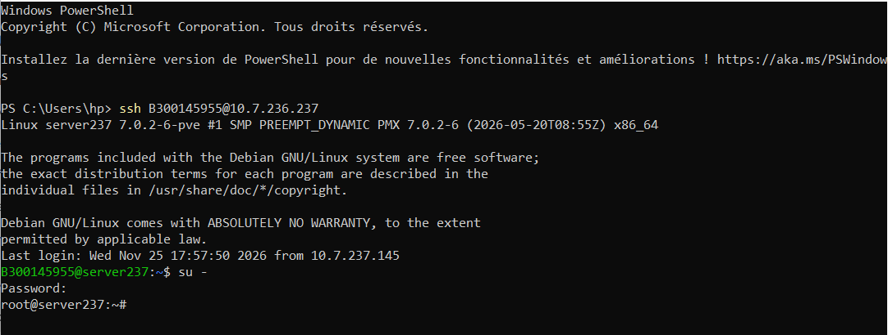

---

## 4. Identifier les disques

### lsblk

```bash
lsblk
```

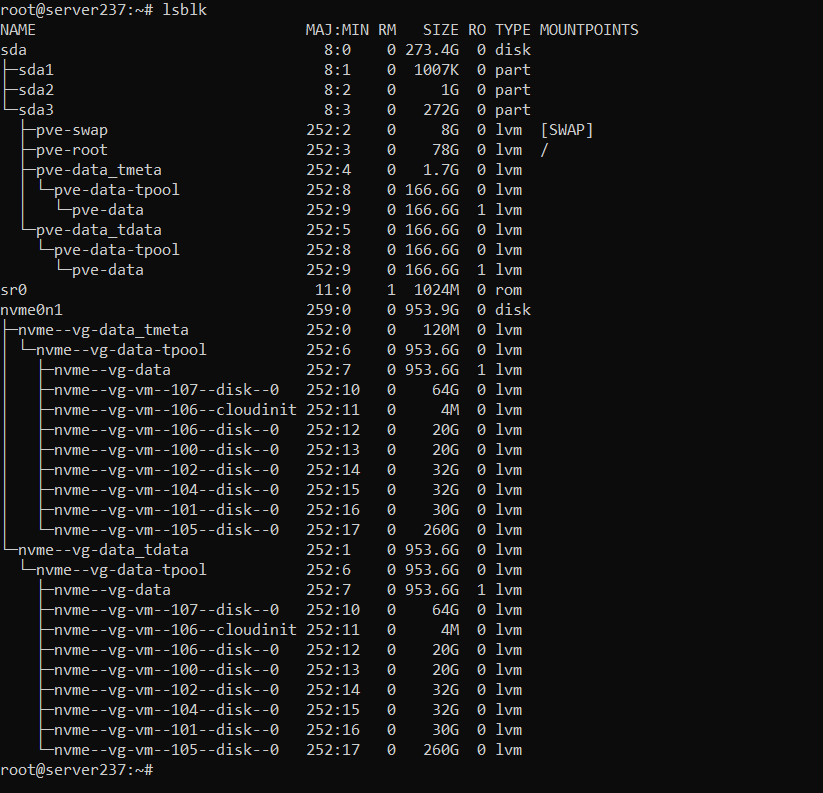

On voit les deux disques : **sda** (273,4G) et **nvme0n1** (953,9G). Sous nvme0n1 se trouve le thin pool `nvme--vg-data-tpool`, qui contient les disques des VM, dont **`nvme--vg-vm--107--disk--0` (64G), le disque de ma VM**. Le thin pool de sda (local-lvm) ne contient plus aucun disque de VM.

### fdisk -l

```bash
fdisk -l /dev/sda /dev/nvme0n1
```

L'option `-l` affiche seulement les informations, sans rien modifier.

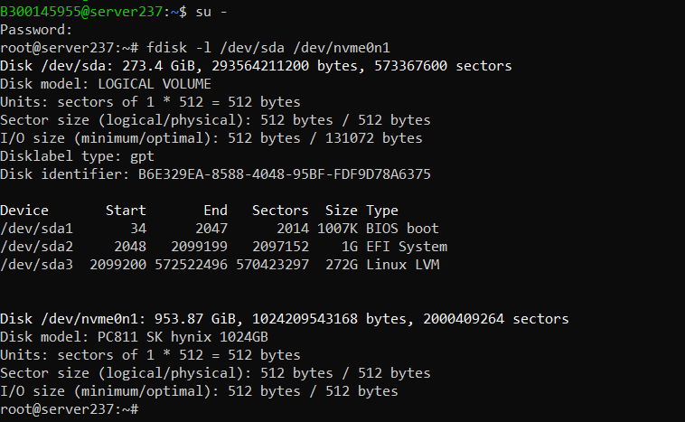

| | /dev/sda | /dev/nvme0n1 |
|---|---|---|
| Taille | 273,4 GiB | 953,87 GiB |
| Modèle | LOGICAL VOLUME (volume RAID du contrôleur HP) | PC811 SK hynix 1024GB |
| Table de partitions | GPT | Aucune |
| Partitions | sda1 (BIOS boot), sda2 (EFI System), sda3 (Linux LVM, 272G) | Aucune |

---

## 5. Les partitions

Une partition divise un disque en zones indépendantes. La leçon montre comment en créer une avec `fdisk /dev/nvme0n1` : `g` (créer une table GPT), `n` (nouvelle partition), puis `w` (écrire sur le disque).

Je n'ai **pas** exécuté ces commandes. Le NVMe était déjà préparé et contient les VM de toute la classe, donc `fdisk` suivi de `w` les aurait détruites. De plus, en classe, le NVMe a été utilisé **en entier** comme volume LVM, sans partition. C'est pour ça que `fdisk -l` n'affiche aucune partition sur nvme0n1.

---

## 6. Les systèmes de fichiers

Un système de fichiers organise les données sur un volume (ext4, xfs, ntfs, fat32…).

```bash
blkid
```

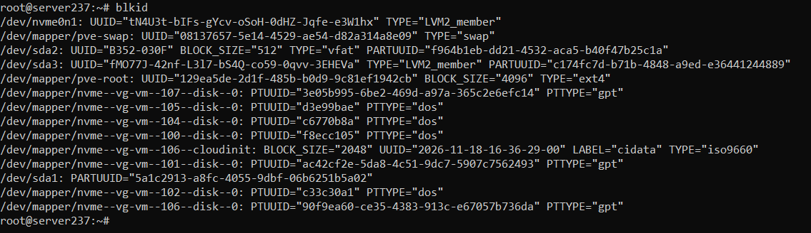

| Périphérique | Type |
|---|---|
| /dev/nvme0n1 | LVM2_member : le disque NVMe entier est un volume physique LVM |
| /dev/sda3 | LVM2_member |
| /dev/mapper/pve-root | ext4 : le système de fichiers de Proxmox |
| /dev/mapper/pve-swap | swap |
| /dev/sda2 | vfat : la partition EFI |
| nvme--vg-vm--107--disk--0 | PTTYPE="gpt" : la table de partitions créée par Ubuntu **dans** ma VM |

---

## 7. LVM : PV, VG et LV

LVM (Logical Volume Manager) permet de gérer l'espace disque de façon souple.

- **PV (Physical Volume)** : un disque ou une partition préparé pour LVM.
- **VG (Volume Group)** : un groupe qui réunit un ou plusieurs PV.
- **LV (Logical Volume)** : un volume découpé dans un VG, utilisé comme un disque.

En classe, le NVMe a été préparé avec ces commandes :

```bash
pvcreate /dev/nvme0n1                 # créer le PV
vgcreate nvme-vg /dev/nvme0n1         # créer le VG nvme-vg
lvcreate -l 100%FREE -T nvme-vg/data  # créer le thin pool « data » avec tout l'espace libre
```

### pvs et vgs

```bash
pvs
vgs
```

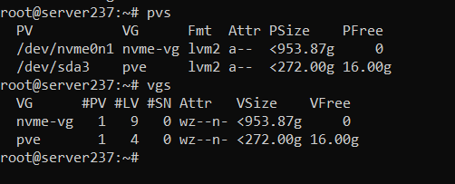

- Le PV **/dev/nvme0n1** appartient au VG **nvme-vg** (953,87g) et n'a plus d'espace libre, car tout a été donné au thin pool.
- Le PV **/dev/sda3** appartient au VG **pve** (272g), avec 16g libres.
- **nvme-vg** contient **9 LV** : le thin pool `data` et les 8 disques des VM.

### lvs

```bash
lvs
```

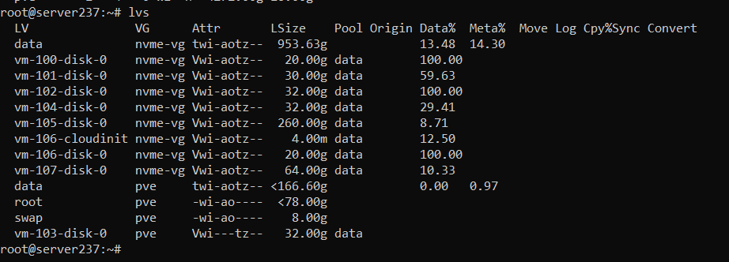

On y trouve le thin pool **data** (953,63g, rempli à 13,48 %) et **vm-107-disk-0** (64,00g) dans le pool **data** du VG **nvme-vg**. Dans la colonne Attr, `t` désigne un thin pool, `V` un volume thin (un disque de VM) et `a` un volume actif.

---

## 8. Le thin provisioning (LVM-Thin)

Avec LVM-Thin, l'espace n'est pris sur le disque qu'au fur et à mesure de son utilisation réelle.

Exemple avec ma VM : elle voit un disque de **64 Go**, mais `lvs` indique **Data% = 10,33**. Elle n'occupe donc réellement qu'environ **6,6 Go** sur le NVMe.

C'est pour ça que Proxmox utilise LVM-Thin : il économise l'espace, il crée les disques instantanément, et il permet de faire des snapshots facilement.

---

## 9. Les stockages Proxmox

```bash
pvesm status
```

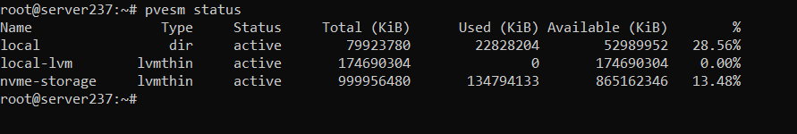

| Stockage | Type | Contenu | Utilisation |
|---|---|---|---|
| local | dir | ISO, sauvegardes, templates | 28,56 % |
| local-lvm | lvmthin (sur sda) | Disques de VM | 0,00 % |
| nvme-storage | lvmthin (sur le NVMe) | Disques de VM | 13,48 % |

Juste après sa création en classe, nvme-storage était à 0 %. Tous les disques des VM y sont maintenant, et local-lvm est vide.

---

## 10. Ajout du NVMe à Proxmox (fait en classe)

### Nettoyage du NVMe

Le NVMe contenait encore l'ancienne installation de Proxmox (`pve-OLD-810787F6`, voir le rapport Proxmox).

```bash
wipefs -a /dev/nvme0n1                 # échec : « Device or resource busy »
vgchange -an pve-OLD-810787F6          # désactiver l'ancien VG
vgremove -f pve-OLD-810787F6           # le supprimer
wipefs -a /dev/nvme0n1                 # réussi : le disque est vide
```

Le premier `wipefs` a échoué parce que l'ancien VG utilisait encore le disque. Il a fallu le désactiver et le supprimer d'abord.

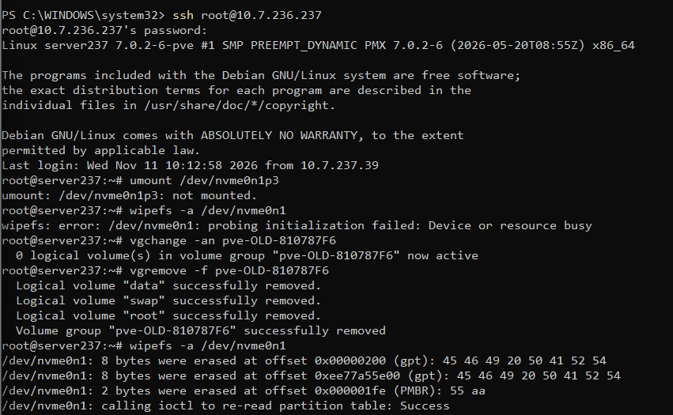

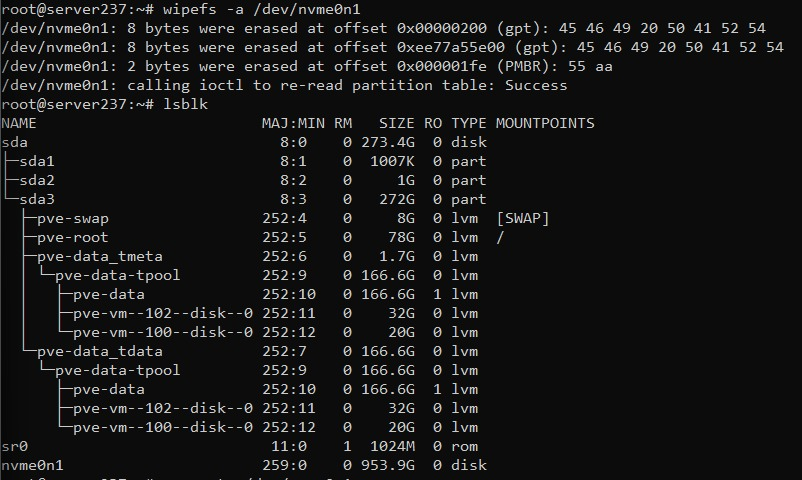

### Création du stockage

Après `pvcreate`, `vgcreate` et `lvcreate` (section 7), le stockage a été ajouté à Proxmox :

```bash
pvesm add lvmthin nvme-storage --vgname nvme-vg --thinpool data --content images,rootdir
```

`--content images,rootdir` autorise ce stockage à contenir des disques de VM et de conteneurs. `pvesm status` montre ensuite **nvme-storage** actif, à 0 %.

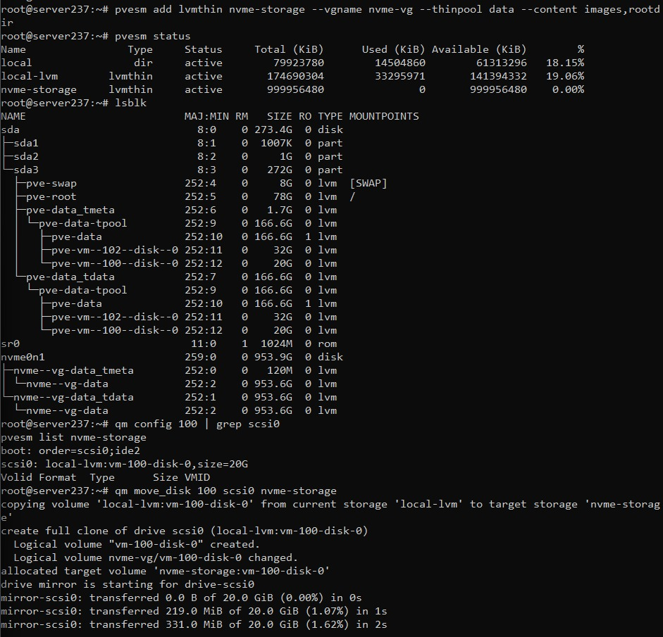

---

## 11. Lab : déplacer une VM vers le stockage NVMe

### Identifier les VM

```bash
qm list
```

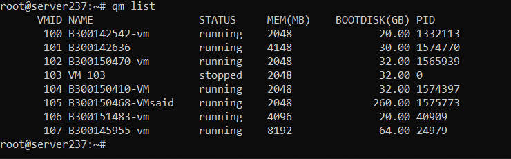

Huit VM sont présentes. Ma VM **107 (B300145955-vm)** est en marche, avec 8192 Mo de mémoire et un disque de 64 Go.

### Déplacer le disque (fait en classe avec la VM 100)

Avant le déplacement, `qm config 100` indiquait `scsi0: local-lvm:vm-100-disk-0,size=20G`, donc un disque sur le HDD.

```bash
qm move_disk 100 scsi0 nvme-storage
```

Le disque est copié en direct (mirror), sans arrêter la VM : 20 Go ont été copiés en 1 min 4 s. L'ancien disque est gardé sous le nom `unused0`.

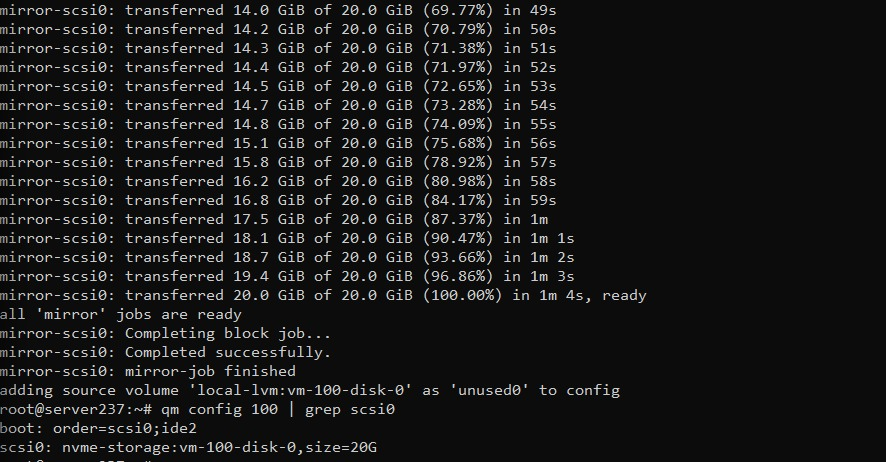

Les VM 100, 102 et 104 ont été déplacées de la même façon. `qm config` confirme qu'elles sont maintenant sur **nvme-storage** :

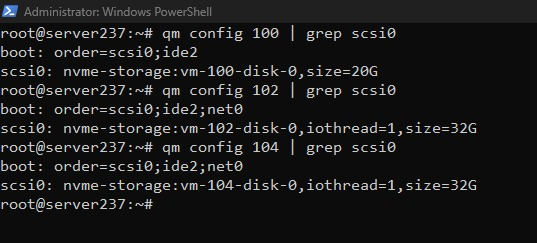

Les anciens disques ont ensuite été supprimés de local-lvm :

```bash
qm set 100 --delete unused0
```

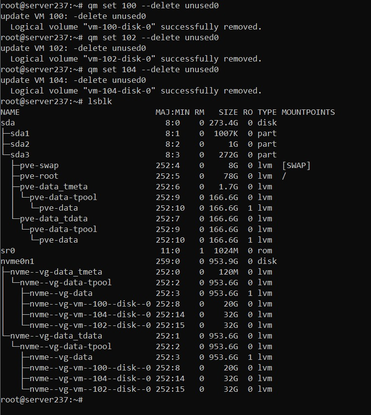

---

## 12. Ma VM 107 : créée directement sur le NVMe

Ma VM n'a pas eu besoin d'être déplacée, puisque je l'ai créée directement sur nvme-storage (voir le rapport 1). Voici les preuves.

```bash
qm config 107 | grep scsi0
```

Le résultat est `scsi0: nvme-storage:vm-107-disk-0,iothread=1,size=64G`.

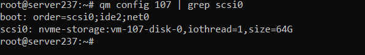

```bash
pvesm list nvme-storage
```

Le disque **nvme-storage:vm-107-disk-0** (raw, 64 Gio, VMID 107) apparaît dans le stockage NVMe.

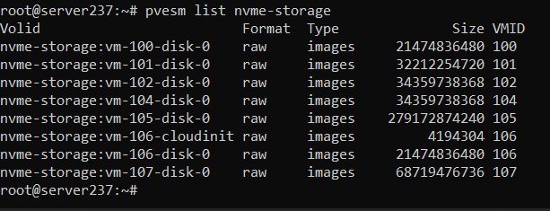

Pour finir, `exit` permet de quitter le compte root.

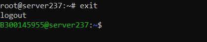

---

## 13. Questions de réflexion

**1. Quelle est la différence entre un HDD, un SSD SATA et un NVMe ?**
Le HDD est mécanique, lent et peu coûteux. Le SSD SATA utilise de la mémoire flash, il est plus rapide mais limité par l'interface SATA. Le NVMe utilise aussi de la mémoire flash, mais il est branché sur PCI Express : c'est le plus rapide.

**2. Quel est le rôle d'une partition ?**
Elle divise un disque en zones indépendantes, chacune avec son rôle (par exemple sda1 pour le démarrage et sda3 pour LVM).

**3. À quoi sert un système de fichiers ?**
Il organise les données sur un volume : les noms des fichiers, les dossiers, leur emplacement et les permissions (par exemple ext4 pour pve-root).

**4. Que signifient les acronymes PV, VG et LV ?**
Physical Volume, Volume Group et Logical Volume.

**5. Pourquoi Proxmox utilise-t-il souvent LVM-Thin ?**
Parce que l'espace n'est consommé que lorsqu'il est réellement utilisé (ma VM de 64 Go n'occupe qu'environ 6,6 Go), et que les disques et les snapshots se créent rapidement.

**6. Quelle commande permet d'afficher les stockages configurés dans Proxmox ?**
`pvesm status`.

**7. Quel est l'avantage d'utiliser un NVMe pour les machines virtuelles ?**
Il est beaucoup plus rapide qu'un HDD : les VM démarrent plus vite et sont plus réactives. Sur server237, il offre aussi plus d'espace (953 Go contre 166 Go pour local-lvm).

---

## 14. Bilan

| Tâche | Commande | Résultat |
|---|---|---|
| Identifier les disques | lsblk, fdisk -l | Réussi |
| Identifier les systèmes de fichiers | blkid | Réussi |
| Vérifier les PV, VG et LV | pvs, vgs, lvs | Réussi |
| Vérifier les stockages Proxmox | pvesm status | Réussi |
| Ajouter le NVMe à Proxmox (en classe) | pvcreate, vgcreate, lvcreate, pvesm add | Réussi |
| Identifier les VM | qm list | Réussi |
| Déplacer un disque vers le NVMe (en classe) | qm move_disk | Réussi |
| Vérifier ma VM sur le NVMe | qm config 107, pvesm list nvme-storage | Réussi |

---

## 15. Conclusion

Ce laboratoire m'a permis de comprendre comment le stockage est organisé, du disque physique jusqu'au disque d'une VM : disque, PV, VG, thin pool, stockage Proxmox, puis disque de VM. J'ai identifié les deux disques du serveur et vérifié chaque couche avec les commandes `lsblk`, `fdisk -l`, `blkid`, `pvs`, `vgs`, `lvs` et `pvesm status`.

En classe, le NVMe a été nettoyé, transformé en stockage LVM-Thin (nvme-storage), puis les disques des VM ont été déplacés du HDD vers le NVMe avec `qm move_disk`, sans arrêter les VM. Ma VM 107 a été créée directement sur ce stockage NVMe, comme le confirment `qm config 107` et `pvesm list nvme-storage`.

J'ai aussi retenu qu'il faut être prudent sur un serveur partagé : les commandes comme `fdisk` (avec `w`), `wipefs` ou `pvcreate` effacent des données. Pour observer, il faut utiliser les commandes de lecture.

Les objectifs du laboratoire sont atteints.
