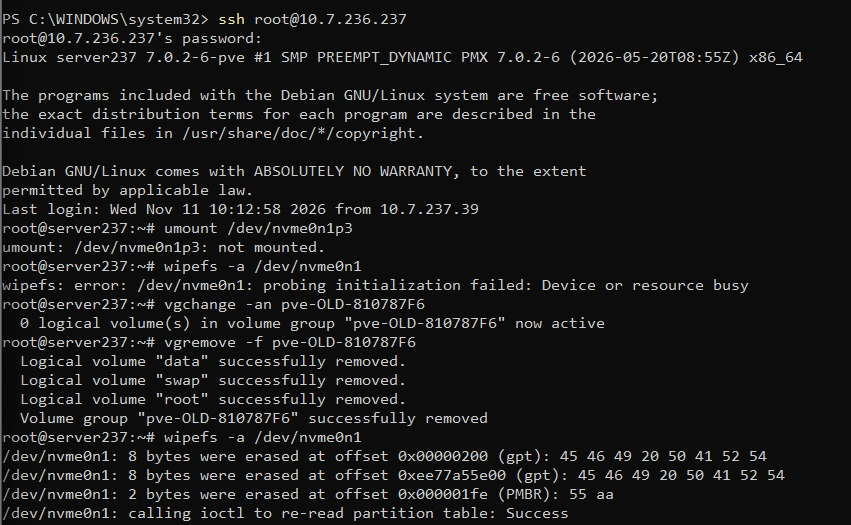
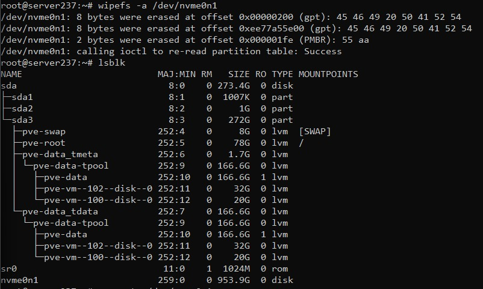
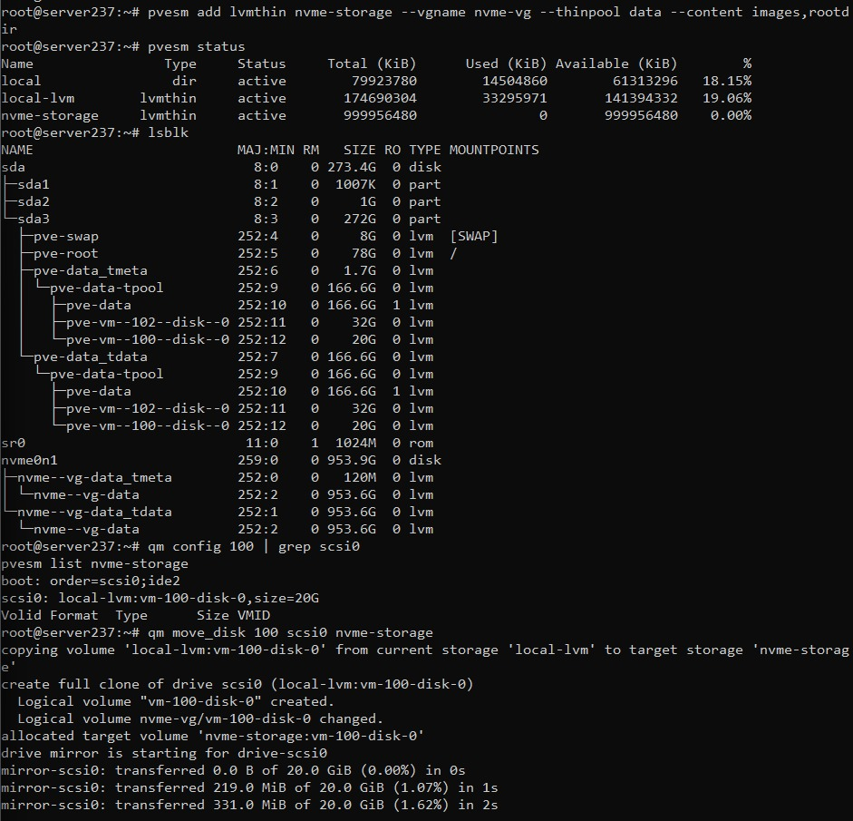
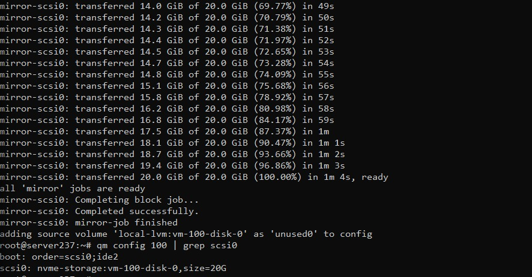
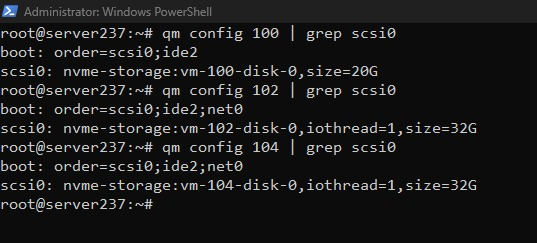
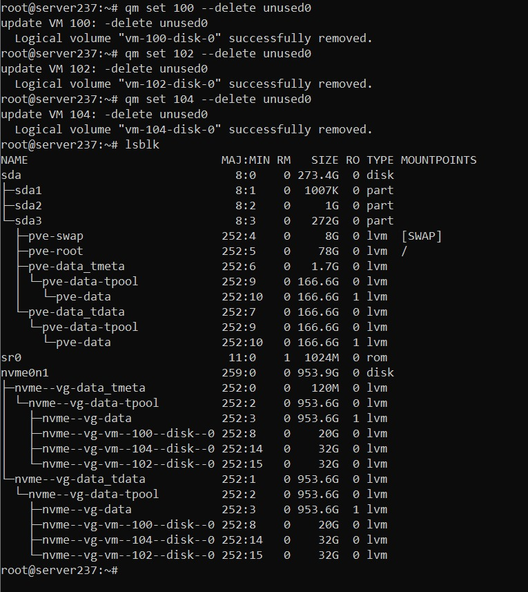
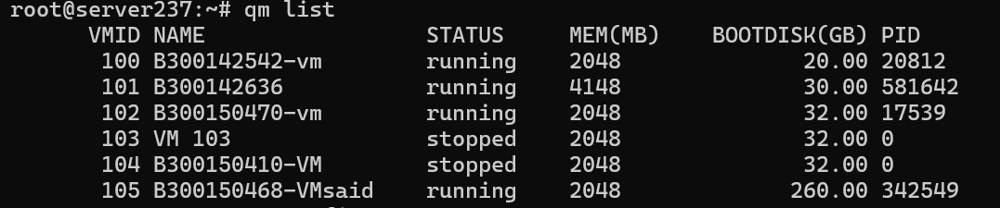
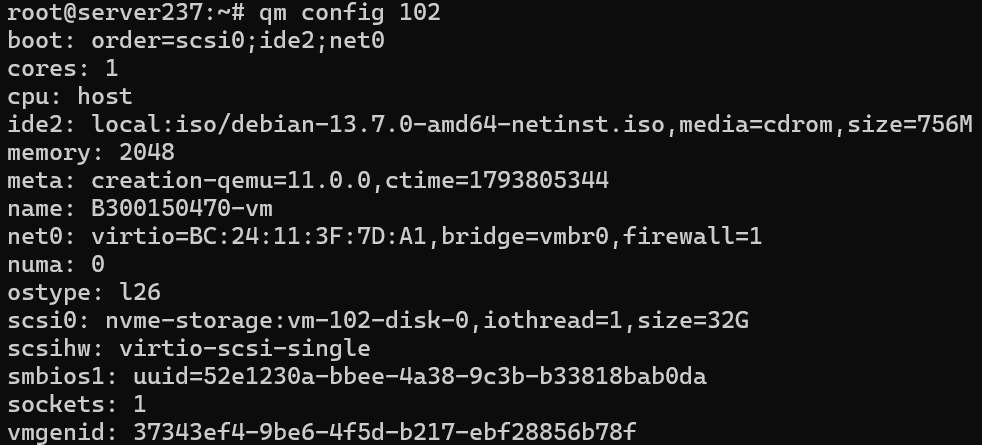
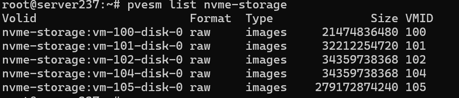
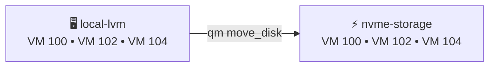

<div align="center">

# 🧪 5.Storage — Stockage NVMe

### Sous Linux et Proxmox VE

[](https://www.debian.org)
[](https://www.proxmox.com)
[](https://10.7.236.237:8006)
[](https://10.7.236.237:8006)

**Déplacer le disque d'une machine virtuelle vers `nvme-storage` pour booster les performances 🚀**

</div>

---

| 👤 Nom | 🎓 Matricule | 📚 Cours | 👥 Groupe | 🖥️ Serveur |
| --- | --- | --- | --- | --- |
| Ifticene Hacene | 300150470 | INF1085 — Administration Linux | 1 | server237 — 10.7.236.237 |

---

## 🎯 Objectif

> Ajouter un disque NVMe comme stockage pour les machines virtuelles, et déplacer le disque d'une machine virtuelle vers **`nvme-storage`** afin d'améliorer les performances.

## 🗺️ Vue d'ensemble

| VM | Nom | Disque | Taille | Stockage |
| --- | --- | --- | --- | --- |
| 100 | B300142542-vm | vm-100-disk-0 | 20 Go | ⚡ nvme-storage |
| **102** | **B300150470-vm** | **vm-102-disk-0** | **32 Go** | **⚡ nvme-storage** |
| 104 | B300150410-VM | vm-104-disk-0 | 32 Go | ⚡ nvme-storage |

---

## 1️⃣ 🧹 Nettoyer le disque NVMe

```bash
ssh root@10.7.236.237
umount /dev/nvme0n1p3
wipefs -a /dev/nvme0n1
vgchange -an pve-OLD-810787F6
vgremove -f pve-OLD-810787F6
wipefs -a /dev/nvme0n1
```

#### 📸 Capture 1 — Nettoyage du disque



*`/dev/nvme0n1p3` n'était pas monté. Premier `wipefs` en erreur (disque occupé), puis ancien groupe `pve-OLD-810787F6` supprimé et deuxième `wipefs` réussi (signatures GPT effacées).*

---

## 2️⃣ 🔍 Voir le disque vide

```bash
lsblk
```

#### 📸 Capture 2 — Disque NVMe vide



*nvme0n1 953,9 Go, disque vide, aucune partition.*

---

## 3️⃣ 💾 Créer le LVM et ajouter le stockage

```bash
pvcreate /dev/nvme0n1
vgcreate nvme-vg /dev/nvme0n1
lvcreate -l 100%FREE -T nvme-vg/data
pvesm add lvmthin nvme-storage --vgname nvme-vg --thinpool data --content images,rootdir
```

*Disque NVMe utilisé entier, sans partition. LVM créé entre les captures 2 et 3 (sans capture).*

```bash
pvesm status
```

#### 📸 Capture 3 — Stockage ajouté et début du déplacement



*nvme-storage (lvmthin) actif, 0,00 % utilisé. `lsblk` montre déjà le thin pool nvme-vg-data (953,6 Go). VM 100 encore sur local-lvm, déplacement lancé.*

---

## 4️⃣ 🚀 Déplacer le disque de la VM 100

```bash
qm move_disk 100 scsi0 nvme-storage
```

#### 📸 Capture 4 — Déplacement terminé



*20,0 Go transférés (100,00 %) en 1 min 4 s. `qm config 100` confirme : scsi0: nvme-storage:vm-100-disk-0, 20 Go.*

---

## 5️⃣ ✅ Vérifier les 3 VM déplacées

```bash
qm config 100 | grep scsi0
qm config 102 | grep scsi0
qm config 104 | grep scsi0
```

#### 📸 Capture 5 — Les 3 VM sur nvme-storage



*VM 100 : 20 Go, VM 102 : 32 Go, VM 104 : 32 Go, toutes sur nvme-storage.*

---

## 6️⃣ 🧹 Supprimer les anciens disques

```bash
qm set 100 --delete unused0
qm set 102 --delete unused0
qm set 104 --delete unused0
```

```bash
lsblk
```

#### 📸 Capture 6 — Anciens disques supprimés et lsblk final



*Anciens disques supprimés. `lsblk` final : nvme0n1 avec vm-100 (20 Go), vm-104 (32 Go) et vm-102 (32 Go).*

---

## 7️⃣ 🔍 Vérifier la VM 102

Afficher les VM :

```bash
qm list
```

#### 📸 Capture 7 — Liste des VM



*Ma VM 102 (B300150470-vm) tourne, 32 Go.*

```bash
qm config 102
```

#### 📸 Capture 8 — Disque actuel de la VM 102



*scsi0 : nvme-storage:vm-102-disk-0, 32 Go.*

---

## 8️⃣ 📋 Vérifier le stockage NVMe

```bash
pvesm list nvme-storage
```

#### 📸 Capture 9 — Contenu de nvme-storage



*Le disque vm-102-disk-0 apparaît sur nvme-storage.*

---

## 🔄 Avant → Après



---

## ✅ Résultat

| ✔️ | Résultat attendu |
| --- | --- |
| ✅ | Disque NVMe nettoyé et préparé en LVM |
| ✅ | Stockage nvme-storage ajouté à Proxmox |
| ✅ | VM identifiée |
| ✅ | Disque déplacé vers nvme-storage |
| ✅ | Configuration mise à jour |
| ✅ | VM opérationnelle |
| ✅ | Stockage NVMe utilisé |

---

<div align="center">

*INF1085 • Collège Boréal • 2026-11-18*

</div>
