# 💾 Storage - Déplacer ma VM vers le stockage NVMe

| Champ | Valeur |
|-------|--------|
| Nom | Arnauld Tchumno |
| Numéro étudiant | 300151483 |
| Groupe | 1️⃣ |
| Serveur Proxmox | `server237` - [10.7.236.237](https://10.7.236.237:8006) |
| Machine virtuelle | VM 106 - `B300151483-vm` (`10.7.236.209`) |
| Date | 18 novembre 2026 |

## 🎯 Objectif

Déplacer le disque de ma machine virtuelle de `local-lvm`, sur le disque système SAS de 273 Go, vers `nvme-storage`, sur le SSD NVMe de 1 To, afin d'améliorer les performances, puis libérer l'espace qu'elle occupait sur `local-lvm`.

## Travail réalisé

- [x] Stockage `nvme-storage` créé en groupe sur server237 : nettoyage du NVMe, LVM-Thin, `pvesm add` (🥉)
- [x] Disque de la VM 106 déplacé vers `nvme-storage` (🥈)
- [x] Espace `local-lvm` libéré : plus aucun volume de la VM 106 (🥇)

---

## 1. Les stockages de server237

```bash
pvesm status
```

| Stockage | Type | Contenu | Taille | Support physique |
|----------|------|---------|--------|------------------|
| `local` | dir | ISO, modèles, import, sauvegardes | 82 Go | `/var/lib/vz` sur le disque système |
| `local-lvm` | lvmthin | disques de VM et conteneurs | 179 Go | thin pool `pve/data` sur le disque SAS |
| `nvme-storage` | lvmthin | disques de VM et conteneurs | 1,02 To | thin pool `nvme-vg/data` sur `/dev/nvme0n1` |

### Préparation du NVMe en groupe (séance de laboratoire)

Le stockage `nvme-storage` a été créé **en groupe**, pendant la séance de laboratoire, avec le compte `root` du serveur, puisque `pvcreate`, `vgremove` et `pvesm add` demandent les droits root. Les captures ci-dessous viennent de cette séance de groupe. Elles montrent comment le stockage qu'utilise ma VM a été préparé.

**1. Nettoyer le disque NVMe.** Il contenait une ancienne installation de Proxmox (groupe de volumes `pve-OLD-810787F6`).

```bash
umount /dev/nvme0n1p3
wipefs -a /dev/nvme0n1           # échoue : disque occupé par l'ancien LVM
vgchange -an pve-OLD-810787F6     # désactiver l'ancien groupe de volumes
vgremove -f pve-OLD-810787F6      # le supprimer (data, swap, root)
wipefs -a /dev/nvme0n1           # réussit : signatures GPT et PMBR effacées
```

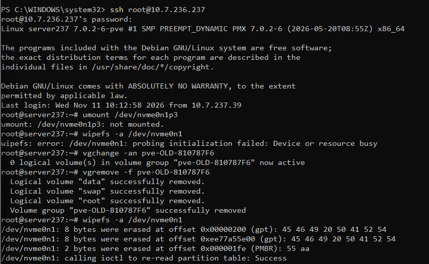

*Figure 1 : `/dev/nvme0n1p3` n'était pas monté. Le premier `wipefs` échoue (`Device or resource busy`), parce que l'ancien groupe `pve-OLD-810787F6` utilise encore le disque. Après `vgchange -an` et `vgremove -f`, ses volumes `data`, `swap` et `root` sont supprimés, et le second `wipefs` efface les signatures GPT et PMBR.*

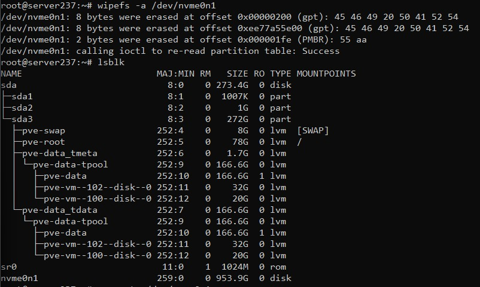

*Figure 2 : `lsblk` après le nettoyage : `nvme0n1` (953,9 Go) n'a plus aucune partition. Les VM 100 et 102 sont encore sur `local-lvm` (`pve-vm--100--disk--0`, `pve-vm--102--disk--0`), sur le disque SAS `sda`.*

**2. Créer le LVM-Thin et l'ajouter à Proxmox.**

```bash
pvcreate /dev/nvme0n1
vgcreate nvme-vg /dev/nvme0n1
lvcreate -l 100%FREE -T nvme-vg/data
pvesm add lvmthin nvme-storage --vgname nvme-vg --thinpool data --content images,rootdir
pvesm status
```

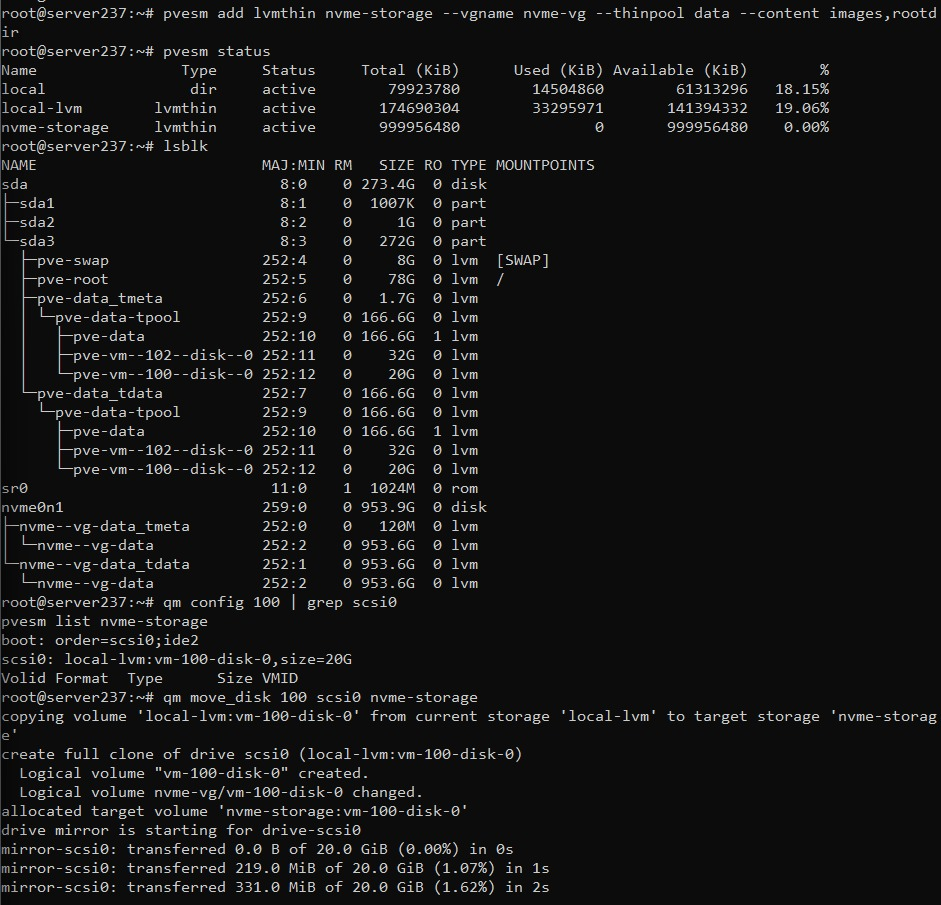

*Figure 3 : `pvesm status` affiche `nvme-storage` (lvmthin) `active`, avec 999 956 480 Kio et 0,00 % utilisés. `lsblk` montre le thin pool `nvme--vg-data` (953,6 Go) sur `nvme0n1`. Le premier déplacement commence ensuite : `qm move_disk 100 scsi0 nvme-storage`.*

**3. Déplacer les disques des premières VM du groupe** (100, 102 et 104).

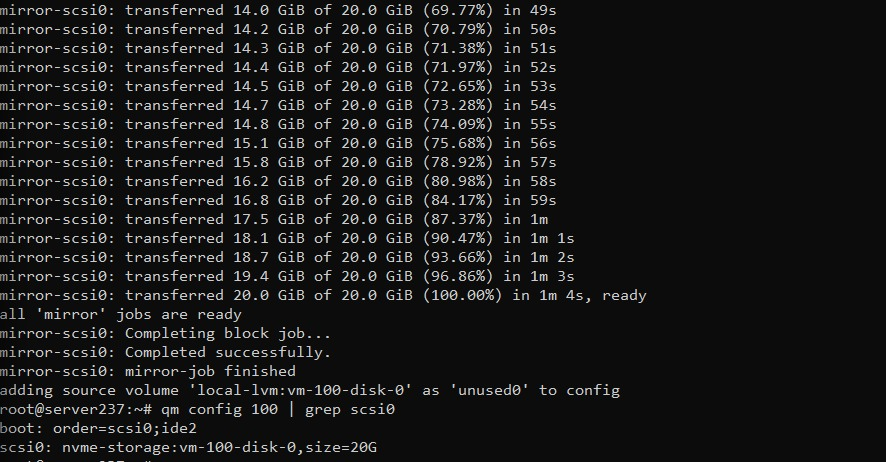

*Figure 4 : La VM 100 a été déplacée en 1 min 4 s (20,0 Gio). **Delete source** n'étant pas utilisé, Proxmox garde l'ancien disque : `adding source volume 'local-lvm:vm-100-disk-0' as 'unused0' to config`.*

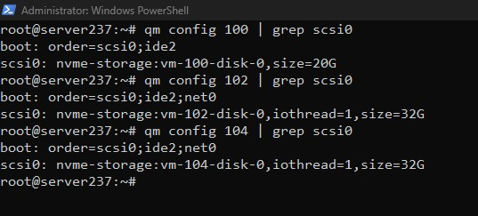

*Figure 5 : `qm config` confirme que les VM 100, 102 et 104 ont leur `scsi0` sur `nvme-storage`.*

**4. Libérer `local-lvm`.** Les anciens disques restés en `unused0` occupaient encore de l'espace sur le disque SAS :

```bash
qm set 100 --delete unused0
qm set 102 --delete unused0
qm set 104 --delete unused0
```

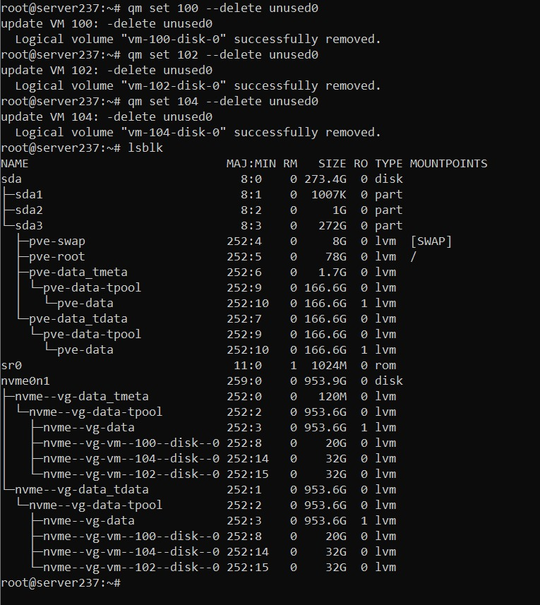

*Figure 6 : Les volumes `vm-100-disk-0`, `vm-102-disk-0` et `vm-104-disk-0` sont supprimés de `local-lvm`. Dans `lsblk`, le pool `pve-data` sur `sda` n'a plus aucun disque de VM, et les trois disques sont dans `nvme--vg` sur `nvme0n1`.*

> **Leçon retenue** : sans **Delete source** (ou `--delete 1`), `move_disk` garde une copie `unused0`, et `local-lvm` n'est pas libéré. C'est pour ça que, pour ma VM 106, j'ai coché **Delete source** dès le départ (section 3). Il n'a donc pas été nécessaire de nettoyer `unused0` ensuite.

Dans la fenêtre **Move disk** de ma VM, `nvme-storage` apparaît avec 915 Go disponibles sur 1,02 To (figure 8).

> **LVM-Thin** : le thin pool n'alloue l'espace qu'au fur et à mesure de l'écriture. Mon disque de 20 Go n'occupe donc que les ~860 Mo réellement utilisés par Debian.

---

## 2. Situation de départ

```bash
qm config 106 | grep -E 'scsi0|ide2'
scsi0: local-lvm:vm-106-disk-0,size=20G
ide2: local-lvm:vm-106-cloudinit,media=cdrom
```

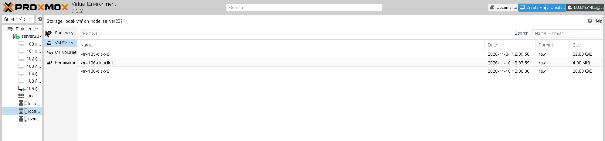

*Figure 7 : **local-lvm → VM Disks** avant le déplacement. On y voit `vm-106-disk-0` (20 Gio) et `vm-106-cloudinit` (4 Mio) de ma VM. `vm-103-disk-0` appartient à une autre VM.*

---

## 3. Déplacer le disque

Dans **VM 106 → Hardware**, je sélectionne **Hard Disk (scsi0)**, puis **Disk Action → Move Storage** :

- **Target Storage** : `nvme-storage`
- **Delete source** : coché, pour supprimer l'ancien volume sur `local-lvm` une fois la copie terminée

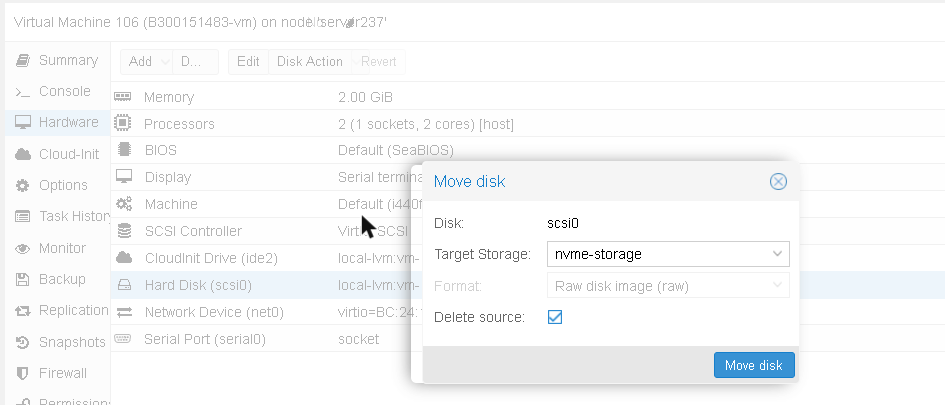

*Figure 8 : Fenêtre **Move disk** : disque `scsi0`, cible `nvme-storage`, format `raw` (imposé par LVM-Thin), **Delete source** coché.*

Commande équivalente :

```bash
qm disk move 106 scsi0 nvme-storage --delete 1
# ancienne syntaxe : qm move_disk 106 scsi0 nvme-storage --delete 1
```

La VM est restée **allumée** pendant toute l'opération. Proxmox utilise un *drive mirror* : il copie le disque pendant que la VM tourne, puis bascule sur la copie à la fin.

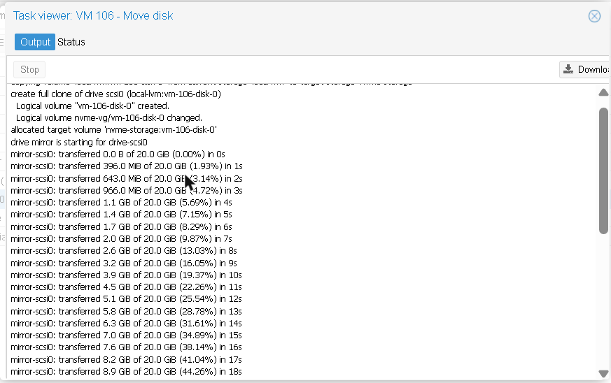

*Figure 9 : Début de la tâche : création du volume `vm-106-disk-0` dans `nvme-vg`, puis copie par `mirror-scsi0` (20 Gio en 36 s, soit environ 570 Mio/s en moyenne).*

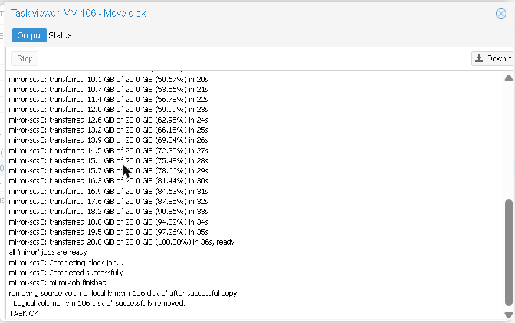

*Figure 10 : Fin de la tâche : 20,0 Gio sur 20,0 Gio copiés en **36 s**, `mirror-job finished`. Proxmox supprime ensuite la source : `removing source volume 'local-lvm:vm-106-disk-0' after successful copy`, `Logical volume "vm-106-disk-0" successfully removed`, puis `TASK OK`.*

---

## 4. Libérer complètement `local-lvm`

Le lecteur cloud-init (`ide2`) se trouvait encore sur `local-lvm`. Un lecteur cloud-init ne se déplace pas avec **Move disk**, parce que Proxmox le régénère à chaque fois. Je l'ai donc recréé sur le NVMe :

```bash
qm set 106 --delete ide2
qm set 106 --ide2 nvme-storage:cloudinit
pvesm free local-lvm:vm-106-cloudinit    # ancien volume de 4 Mio resté orphelin
```

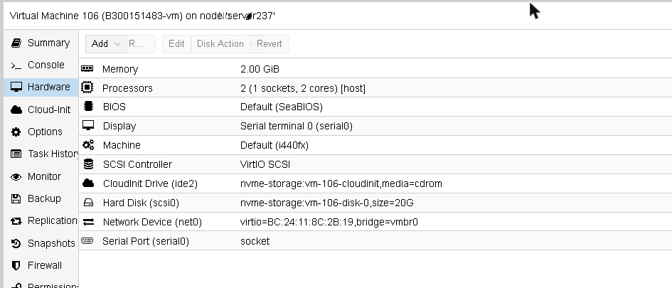

*Figure 11 : Onglet **Hardware** après l'opération : `scsi0` est sur `nvme-storage:vm-106-disk-0` (20 Go) et le lecteur cloud-init sur `nvme-storage:vm-106-cloudinit`.*

---

## 5. Vérifications

```bash
qm config 106 | grep -E 'scsi0|ide2|unused'
scsi0: nvme-storage:vm-106-disk-0,size=20G
ide2: nvme-storage:vm-106-cloudinit,media=cdrom
```

Pas de ligne `unused0` : l'ancien disque a bien été supprimé, pas seulement détaché.

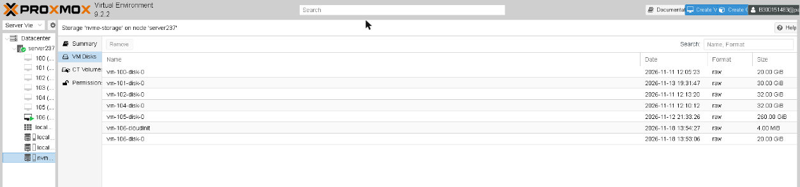

*Figure 12 : **nvme-storage → VM Disks** : `vm-106-disk-0` (20 Gio) et `vm-106-cloudinit` sont maintenant sur le NVMe, à côté des disques des autres VM du groupe (100 à 105).*

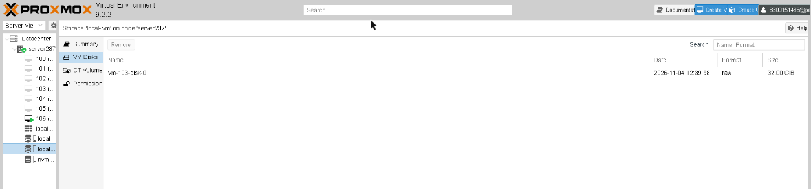

*Figure 13 : **local-lvm → VM Disks** après l'opération : il ne reste plus aucun volume de la VM 106. Seul `vm-103-disk-0` (une autre VM) y figure encore.*

Dans la VM, rien n'a changé pour le système : même disque, aucune interruption de service.

```text
$ ssh b300151483@10.7.236.209 'uptime -p; df -h /'
up 11 minutes
Filesystem      Size  Used Avail Use% Mounted on
/dev/sda1        20G  856M   18G   5% /
```

---

## 🧠 Résumé

```text
Avant                                 Après
local-lvm (SAS 273 Go)                nvme-storage (NVMe 1 To)
   ├── vm-106-disk-0   20G     ──►       ├── vm-106-disk-0   20G
   └── vm-106-cloudinit 4M     ──►       └── vm-106-cloudinit 4M
```

## 🧪 Questions de réflexion

- **Pourquoi le NVMe est-il plus rapide ?** Il passe directement par le bus PCI Express et gère des milliers de files de commandes en parallèle. Un disque SAS ou SATA passe par un contrôleur et n'a qu'une seule file.
- **Pourquoi « Delete source » ?** Sans cette option, l'ancien disque reste sur `local-lvm` sous le nom `unused0` et continue d'occuper de l'espace.
- **Pourquoi le format `raw` ?** Un stockage LVM-Thin contient des volumes logiques et non des fichiers, donc le format `qcow2` n'est pas possible. Les instantanés sont gérés par LVM-Thin lui-même.

## ✅ Bilan

| Critère | Résultat |
|---------|----------|
| 🥉 NVMe Storage créé | `nvme-storage` (lvmthin, `nvme-vg/data`, 1,02 To), actif |
| 🥈 VM Storage assigné à NVMe | `scsi0: nvme-storage:vm-106-disk-0,size=20G` |
| 🥇 Local LVM libéré | aucun volume de la VM 106 sur `local-lvm`, aucun `unused` |
