# 300151834
# INF1085 – Administration Linux

## Rapport de laboratoire – 5.Storage : Ajouter un disque NVMe à Proxmox et déplacer le disque de la VM 103


## 1. Présentation

Ce laboratoire avait deux objectifs. D'abord, ajouter un disque SSD NVMe au nœud Proxmox comme nouveau stockage. Ensuite, déplacer le disque de ma machine virtuelle vers ce stockage NVMe, plus rapide que le stockage local habituel, pour améliorer les performances.

La machine virtuelle utilisée est la VM 103, qui contient mon installation Debian 13.

## 2. Environnement

- Nœud Proxmox : server238
- Adresse Proxmox : https://10.7.236.235:8006
- Machine virtuelle : 103 (Lounaciamirouche)
- Système de la VM : Debian 13, 1 cœur, 2048 Mo de mémoire
- Disque à déplacer : scsi0, 32 Go
- Stockage de départ : local-lvm
- Stockage d'arrivée : nvme-storage
- Disque NVMe ajouté : /dev/nvme0n1, 953.9 Go

Je me suis connecté au nœud en SSH comme root :

```
ssh root@10.7.236.235
```

## 3. Voir les disques

J'ai d'abord affiché les disques présents sur le nœud avec :

```
lsblk
```

Le disque système est `sda` (273.4 Go) : `sda1` (1007 K), `sda2` (1 Go) et `sda3` (272.4 Go). Sur `sda3`, il y a le groupe de volumes `pve` avec le système (78.1 Go), le swap (8 Go) et le pool de données (166.9 Go) qui contient les disques des VM 100 à 106, de 32 Go chacun.

Le disque NVMe `nvme0n1` (953.9 Go) n'avait aucune partition : c'était un disque vide, prêt à utiliser.

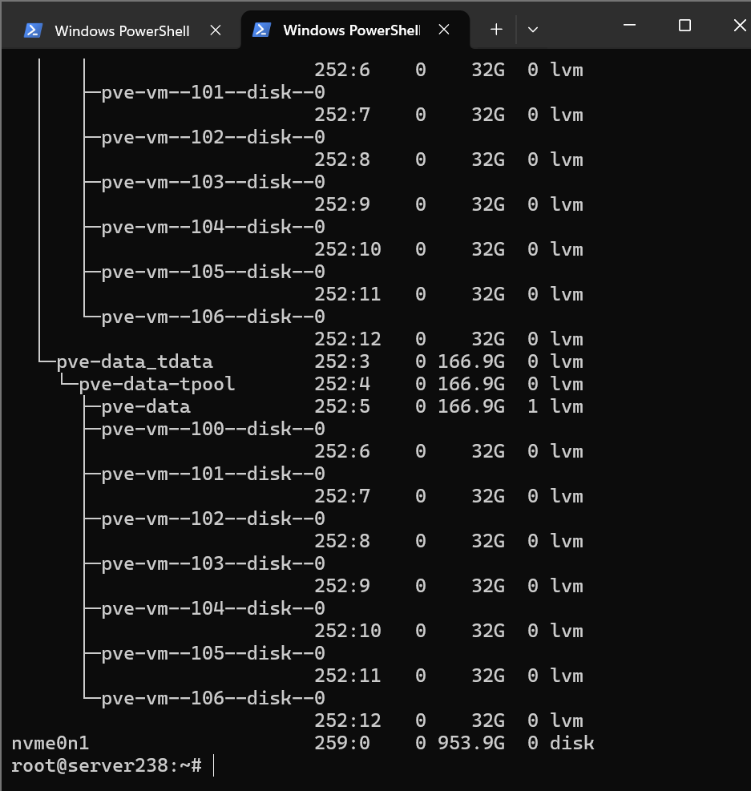

## 4. Nettoyer le disque

Avant de créer la partition, j'ai nettoyé les anciennes signatures du disque avec :

```
wipefs -a /dev/nvme0n1
```

La première tentative a échoué (« probing initialization failed »), mais la deuxième a fonctionné : 32 octets effacés (ancienne signature Intel RAID) et 2 octets effacés (PMBR), puis « calling ioctl to re-read partition table: Success ».

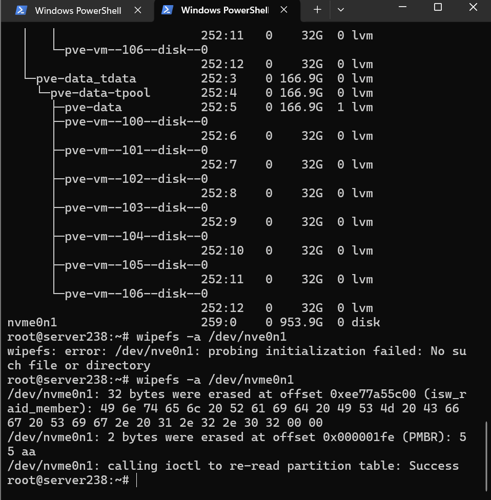

## 5. Créer la partition

J'ai ouvert le disque avec fdisk :

```
fdisk /dev/nvme0n1
```

Dans fdisk, j'ai fait :

- `g` : créer une nouvelle table GPT (GUID : C80B3EB2-D8A0-456F-A3AA-41715431A595).
- `n` : créer une nouvelle partition, en acceptant les valeurs par défaut (partition 1, du premier au dernier secteur).
- `w` : sauvegarder (« The partition table has been altered. Syncing disks. »).

La partition créée, `nvme0n1p1`, fait 953.9 Go.

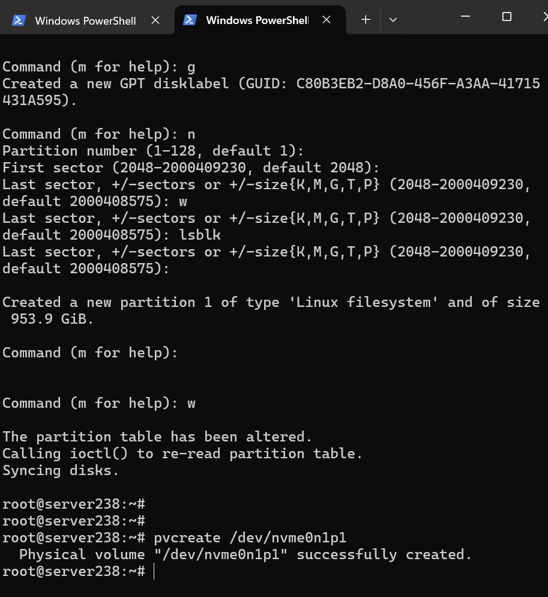

## 6. Créer le volume physique, le groupe de volumes et le Thin Pool

J'ai ensuite créé le volume physique (PV) sur la partition :

```
pvcreate /dev/nvme0n1p1
```

Résultat : « Physical volume "/dev/nvme0n1p1" successfully created. »

Puis le groupe de volumes (VG) :

```
vgcreate nvme-vg /dev/nvme0n1p1
```

Résultat : « Volume group "nvme-vg" successfully created ».

Puis le Thin Pool (LV) qui prend tout l'espace libre :

```
lvcreate -l 100%FREE -T nvme-vg/data
```

Résultat : « Logical volume "data" created. » (953.63 Go). La commande a affiché deux avertissements sur le zeroing et la taille de chunk (512 KiB), mais ce sont juste des avertissements : le pool a bien été créé.

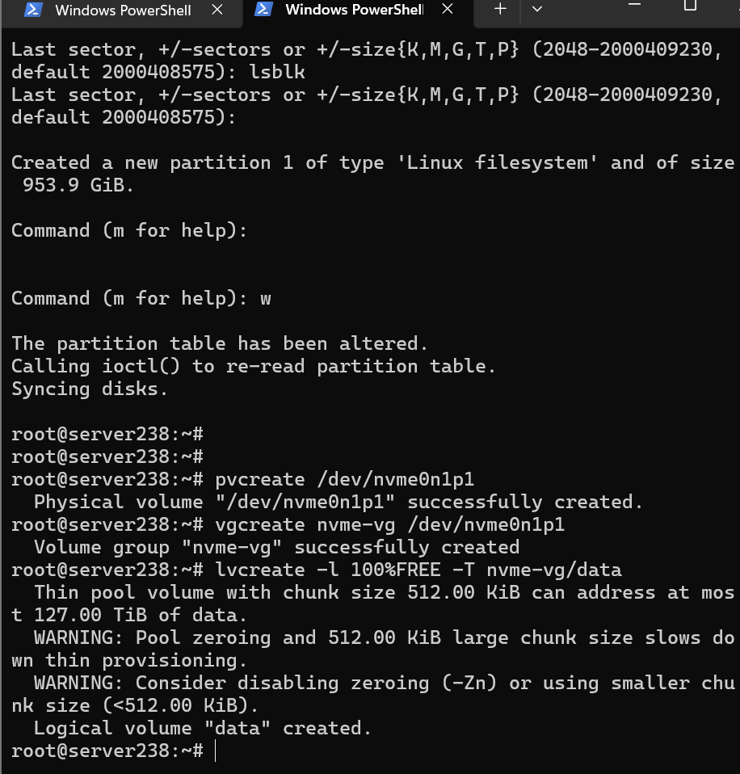

## 7. Ajouter le stockage à Proxmox

J'ai ajouté le stockage à Proxmox avec :

```
pvesm add lvmthin nvme-storage \
  --vgname nvme-vg \
  --thinpool data \
  --content images,rootdir
```

La commande n'a rien affiché, ce qui veut dire qu'elle a réussi.

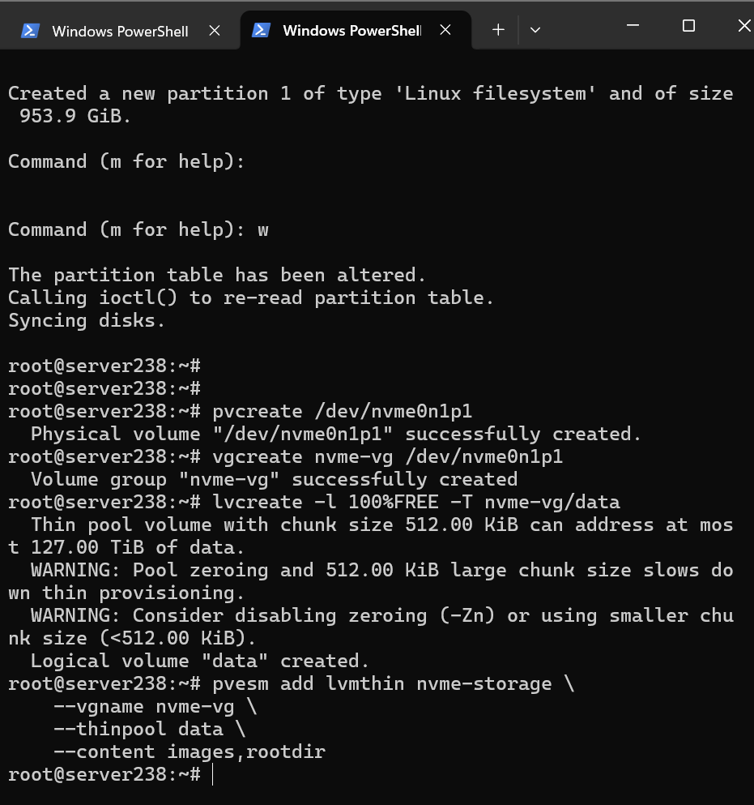

## 8. Vérifications du stockage

J'ai vérifié le résultat de plusieurs façons.

Avec `lsblk`, on voit la partition `nvme0n1p1` (953.9 Go) avec le Thin Pool `nvme-vg-data` (953.6 Go).

Avec `pvs`, le PV `/dev/nvme0n1p1` est bien dans le VG `nvme-vg` (moins de 953.87 Go). L'autre PV, `/dev/sda3`, est dans le VG `pve` (moins de 272.40 Go, 16.00 Go libres).

Avec `vgs`, le VG `nvme-vg` a 1 PV et 1 LV (moins de 953.87 Go), et le VG `pve` a 1 PV et 10 LV (moins de 272.40 Go).

Avec `lvs`, le Thin Pool `data` de `nvme-vg` fait 953.63 Go et il est vide (Data% 0.00), ce qui est normal : aucune VM n'est encore dessus. On voit aussi le pool `data` de `pve` (moins de 166.90 Go, 32.69 %), le système (78.10 Go), le swap (8.00 Go) et les disques des VM 100 à 106 (32.00 Go chacun).

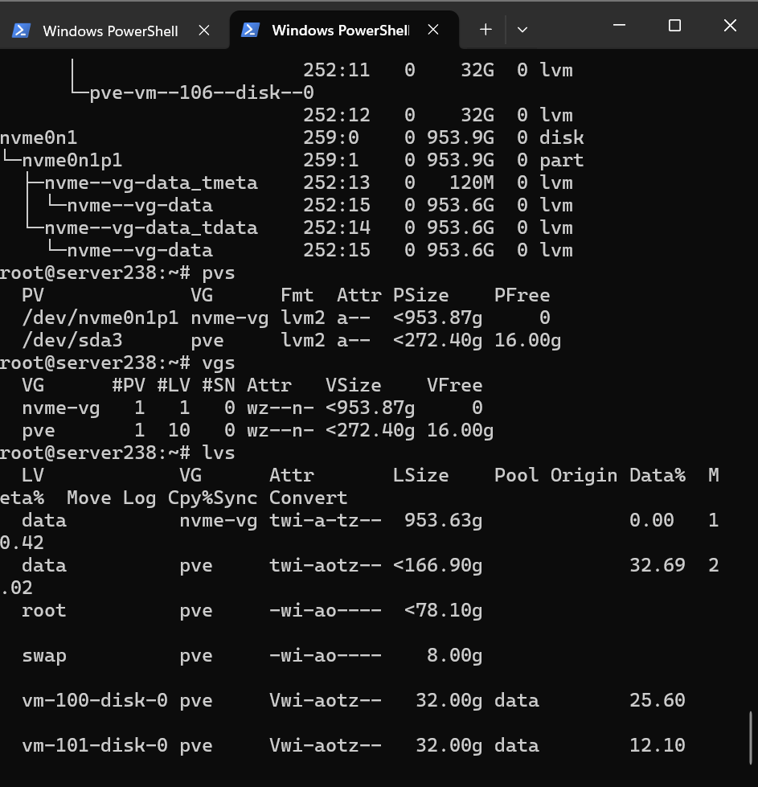

Avec `pvesm status`, les trois stockages sont actifs :

- `local` (dir) : 12.34 %
- `local-lvm` (lvmthin) : 32.69 %
- `nvme-storage` (lvmthin) : 999956480 KiB au total, 0.00 % utilisé

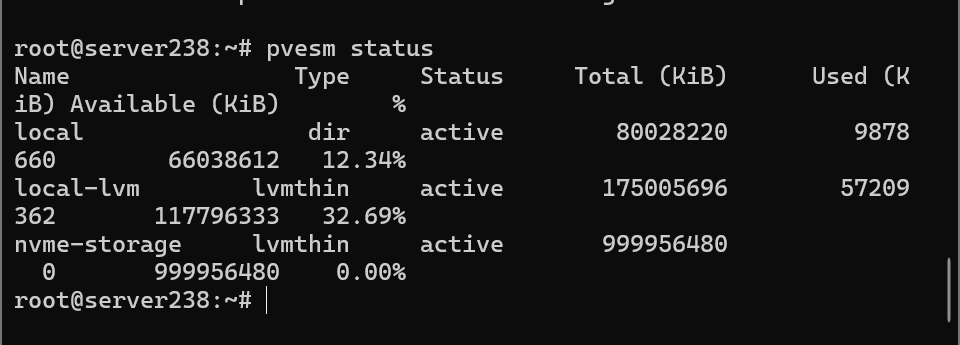

## 9. Vérifier la machine virtuelle

Avant de déplacer le disque, j'ai vérifié les VM avec :

```
qm list
```

Les 6 VM du nœud sont en cours d'exécution : 100 (Nassimidir), 101 (AnissCh), 102 (YounesChaghi), 103 (Lounaciamirouche), 104 (WalidDahmane), 105 (Kali-amine) et 106 (NoureddineKheloufi). Elles ont toutes 2048 Mo de mémoire et un disque de 32 Go.

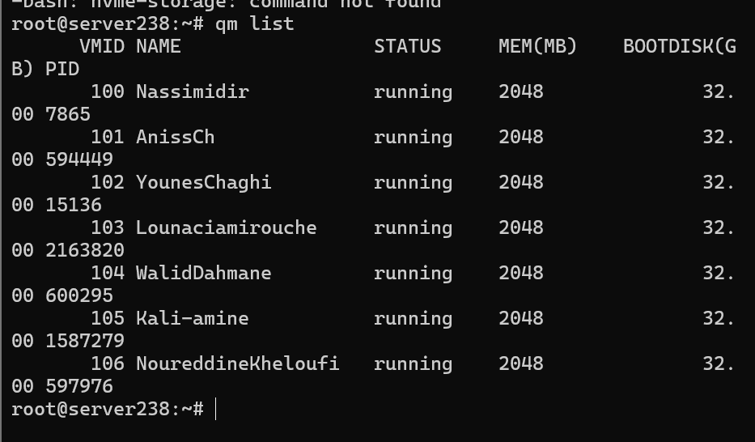

## 10. État initial du disque

J'ai vérifié la configuration de ma VM avec :

```
qm config 103
```

Le disque était bien sur le stockage local :

```
scsi0: local-lvm:vm-103-disk-0
```

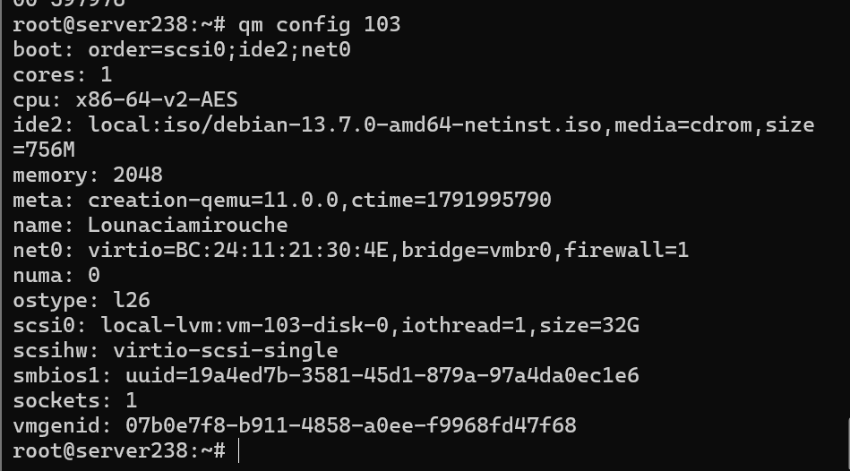

## 11. Arrêt de la machine virtuelle

Le disque ne peut pas être déplacé pendant que la VM tourne, donc je l'ai arrêtée avec :

```
qm stop 103
```

La commande n'a rien affiché, ce qui est normal : la VM était bien arrêtée.

## 12. Déplacement du disque

J'ai ensuite lancé le déplacement vers le stockage NVMe :

```
qm move-disk 103 scsi0 nvme-storage
```

La copie des 32 Go a pris environ une minute et s'est terminée à 100 %. L'ancien disque a été gardé dans la configuration comme `unused0`.

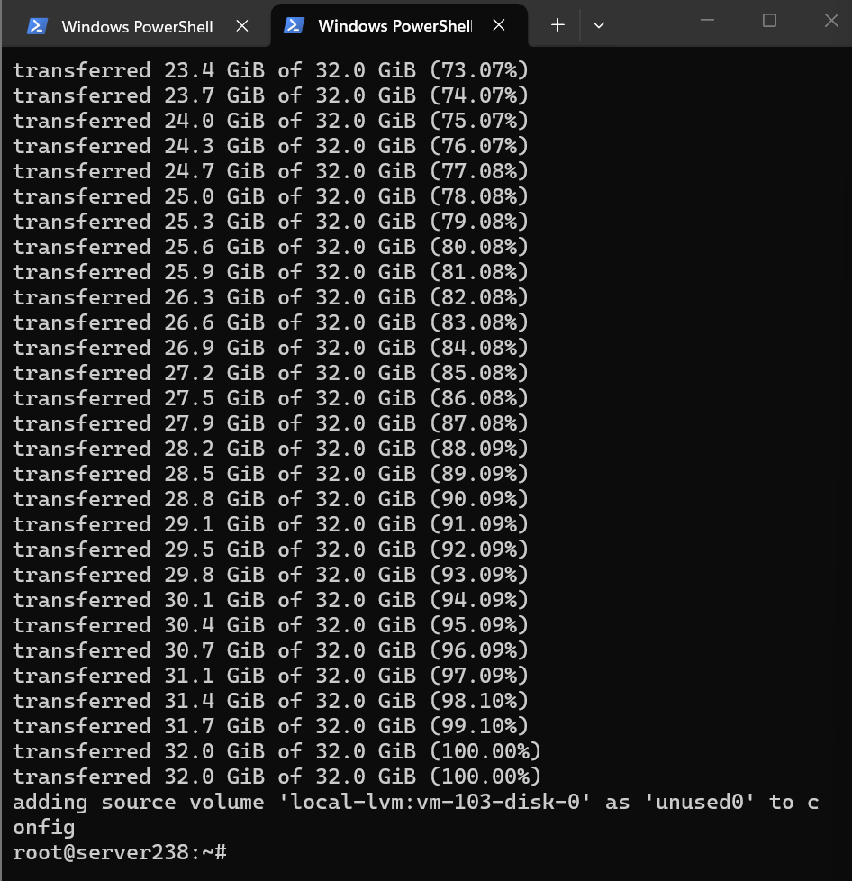

## 13. Vérifications après le déplacement

J'ai vérifié le déplacement de deux façons.

D'abord avec la configuration de la VM :

```
qm config 103
```

Le disque est maintenant sur le stockage NVMe :

```
scsi0: nvme-storage:vm-103-disk-0
```

L'ancien disque apparaît comme `unused0: local-lvm:vm-103-disk-0`.

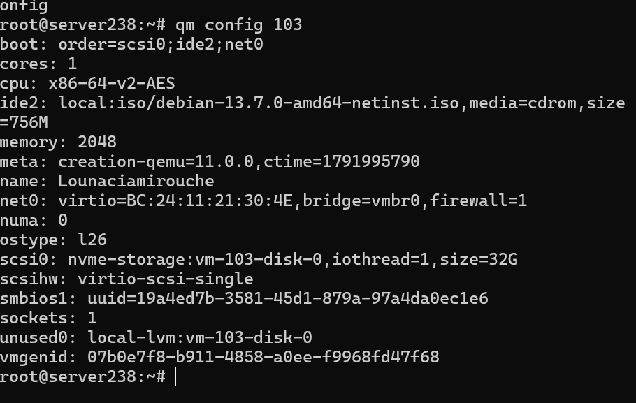

Ensuite avec la liste du stockage :

```
pvesm list nvme-storage
```

Mon disque `vm-103-disk-0` (34359738368 octets, soit 32 Go) apparaît bien dans la liste.

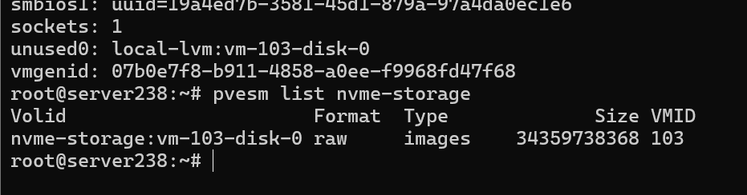

## 14. Redémarrage de la machine virtuelle

J'ai redémarré la VM avec :

```
qm start 103
```

Puis j'ai vérifié avec `qm list` qu'elle est bien `running`. Son PID a changé (2163820 avant, 2192895 après), ce qui confirme qu'elle vient bien de redémarrer.

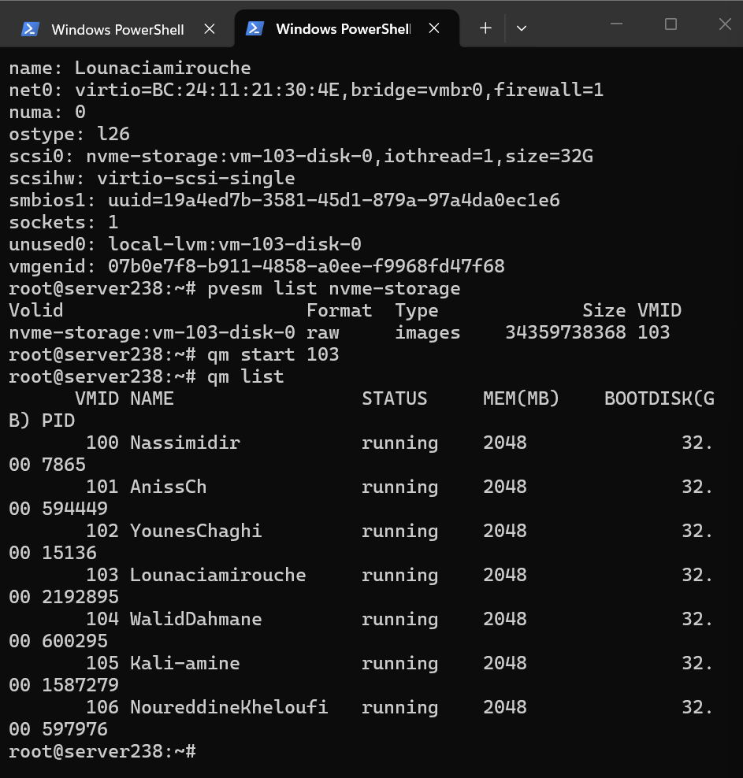

## 15. Ancien disque

Après le déplacement, l'ancien disque est resté dans la configuration comme `unused0`, sur `local-lvm`.

Je l'ai laissé en place pour l'instant : il ne gêne pas le fonctionnement de la VM, et il peut être supprimé plus tard si je veux récupérer les 32 Go.

## 16. Difficultés rencontrées

- La première connexion SSH a refusé mon mot de passe (« Permission denied »). La deuxième tentative a fonctionné.
- La première commande `wipefs` a échoué (« probing initialization failed »). Je l'ai relancée et elle a fonctionné.
- Dans `fdisk`, j'ai tapé `w` et `lsblk` à l'invite « Last sector » par erreur. fdisk a reposé la question et j'ai accepté la valeur par défaut avec Entrée. La partition a bien été créée.
- La commande `lvcreate` a affiché deux avertissements (zeroing et taille de chunk de 512 KiB). Ce sont juste des avertissements : le Thin Pool a bien été créé.

## 17. Conclusion

Le laboratoire est réussi. J'ai ajouté le disque NVMe à Proxmox (stockage `nvme-storage`, 953.6 Go, LVM-Thin), puis j'ai déplacé le disque de la VM 103 (32 Go, 100 %) vers ce stockage. Les vérifications sont bonnes et la VM a redémarré normalement.

J'ai appris à identifier les disques avec `lsblk`, à créer une partition avec `fdisk`, à créer un PV, un VG et un LV avec LVM, à comprendre le fonctionnement de LVM-Thin, et à déplacer le disque d'une VM vers un stockage NVMe.

---

