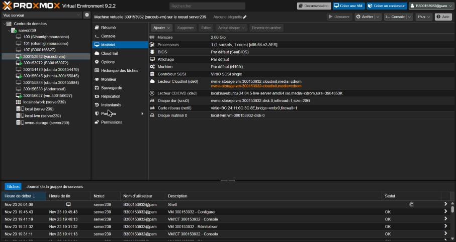

# 💾 Lab 5 - Déplacer ma VM vers le stockage NVMe

| Champ | Valeur |
|-------|--------|
| Nom | Yacoub Bâ |
| Numéro étudiant | 300153932 |
| Serveur | `server239` - [10.7.236.239](https://10.7.236.239:8006) (Proxmox VE 9.2.2) |
| VM | `300153932` (`yacoub-vm`), Ubuntu Server 24.04.5 LTS |
| Compte utilisé | `B300153932@pam` (pas `root`, voir [4.Root](../../4.Root/300153932/README.md)) |
| Date | 23 novembre 2026 |

## 🎯 Objectif

Déplacer le disque de ma VM de `local-lvm` (disque SAS du serveur) vers `nvme-storage` (SSD NVMe de 1 To) pour avoir de meilleures performances.

## 1. Les stockages du serveur

Le stockage `nvme-storage` (type LVM-Thin) avait déjà été créé sur `server239` par le groupe, avec les commandes de la partie théorique du lab :

```bash
pvcreate /dev/nvme0n1p1
vgcreate nvme-vg /dev/nvme0n1p1
lvcreate -l 100%FREE -T nvme-vg/data
pvesm add lvmthin nvme-storage --vgname nvme-vg --thinpool data --content images,rootdir
```

`pvesm status` sur le serveur :

| Stockage | Type | État | Total | Utilisé | Disponible | % |
|----------|------|------|------:|--------:|-----------:|--:|
| `local` | dir | active | 76.3 GiB | 10.7 GiB | 61.7 GiB | 14.02 % |
| `local-lvm` | lvmthin | active | 166.9 GiB | 33.9 GiB | 133.0 GiB | 20.33 % |
| `nvme-storage` | lvmthin | active | 953.6 GiB | 82.2 GiB | 871.4 GiB | 8.62 % |

## 2. Vérifier la VM et son disque

```bash
qm list | grep 300153932
qm config 300153932 | grep scsi0
```

Avant :

```text
scsi0: local-lvm:vm-300153932-disk-0,iothread=1,size=20G
```

## 3. Déplacer le disque

La VM est restée **allumée** pendant le déplacement : Proxmox copie le disque à chaud (« drive mirror »), puis bascule la VM sur la copie.

```bash
qm move_disk 300153932 scsi0 nvme-storage
```

Extrait du journal de la tâche :

```text
mirror-scsi0: transferred 7.5 GiB of 20.0 GiB (37.55%) in 51s
...
mirror-scsi0: transferred 17.5 GiB of 20.0 GiB (87.66%) in 1m 30s
...
TASK OK
```

Les 20 Go ont été copiés en environ **1 min 40 s**.

## 4. Vérifier le résultat

```bash
qm config 300153932 | grep -E 'scsi0|unused'
pvesm list nvme-storage | grep 300153932
```

Après :

```text
scsi0: nvme-storage:vm-300153932-disk-0,iothread=1,size=20G
unused0: local-lvm:vm-300153932-disk-0
```

```text
nvme-storage:vm-300153932-disk-0   raw   20G   300153932
```

J'ai gardé l'ancien disque (`unused0`) par sécurité, le temps de vérifier que la VM fonctionne bien sur le NVMe. Ensuite il peut être supprimé :

```bash
qm disk unlink 300153932 --idlist unused0 --force
```



*Figure 1 : Onglet Matériel de `yacoub-vm`. Le disque dur `scsi0` est sur `nvme-storage` et l'ancien disque apparaît en « Disque inutilisé 0 » sur `local-lvm`.*

## 🧠 Résumé

```text
Avant                         Après
local-lvm (SAS)               nvme-storage (NVMe)
   └── VM 300153932              └── VM 300153932
```

## 🧪 Questions de réflexion

1. **HDD, SSD SATA, NVMe ?** Un HDD a des plateaux qui tournent (grande capacité, pas cher, lent). Un SSD SATA n'a pas de pièces mobiles mais il est limité par le bus SATA (~550 Mo/s). Un NVMe est branché directement sur le PCI Express : il est beaucoup plus rapide (plusieurs Go/s) et gère beaucoup plus d'opérations en parallèle.
2. **Rôle d'une partition ?** Découper un disque en zones séparées, chacune avec son propre usage (système, données, LVM...).
3. **À quoi sert un système de fichiers ?** Organiser les données en fichiers et répertoires (ext4, xfs, ntfs...) pour pouvoir les retrouver.
4. **PV, VG, LV ?** *Physical Volume* (disque ou partition donné à LVM), *Volume Group* (groupe de PV qui forme un réservoir d'espace), *Logical Volume* (volume découpé dans le VG et utilisé comme un disque).
5. **Pourquoi LVM-Thin ?** L'espace est alloué seulement quand la VM écrit vraiment (provisionnement fin). On peut donc créer plus de disques que l'espace réel, et les snapshots sont rapides.
6. **Afficher les stockages ?** `pvesm status`
7. **Avantage du NVMe pour les VM ?** Beaucoup plus d'IOPS et une latence plus faible : les VM démarrent et répondent plus vite, même quand plusieurs tournent en même temps.

## ✅ Résultat

- ✅ VM identifiée (`300153932`)
- ✅ Disque déplacé vers `nvme-storage`, sans arrêter la VM
- ✅ Configuration mise à jour (`scsi0: nvme-storage:...`)
- ✅ VM toujours en marche
- ✅ Stockage NVMe utilisé
