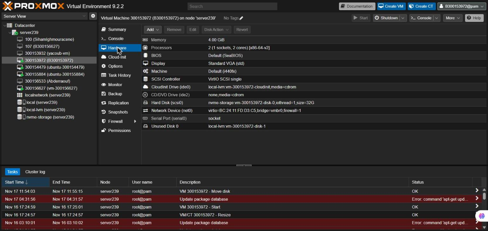
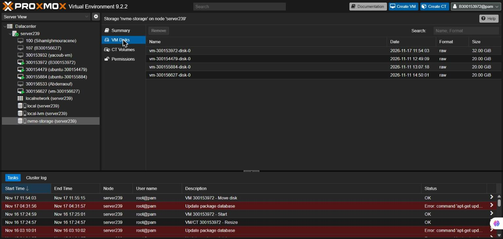

# Lab 5 – Déplacer une machine virtuelle vers le stockage NVMe

**Étudiant :** Karim – 300153972
**Serveur :** server239 (HP ProLiant G7, 10.7.236.239)
**VM :** 300153972 (B300153972, Ubuntu 24.04)

## 1. Le stockage du serveur

Avant de commencer, j'ai regardé les stockages configurés dans Proxmox :

```bash
pvesm status
```

```text
Name                Type     Status     Total (KiB)      Used (KiB) Available (KiB)        %
local                dir     active        80028220        11199604        64717668   13.99%
local-lvm        lvmthin     active       175005696        31431023       143574672   17.96%
nvme-storage     lvmthin     active       999956480        31698620       968257859    3.17%
```

Le serveur a trois stockages :

- `local` : un répertoire sur le disque système, pour les ISO, les modèles et les sauvegardes.
- `local-lvm` : un thin pool LVM sur le volume RAID 5 (`sda`). C'est là que ma VM avait été créée.
- `nvme-storage` : un thin pool LVM sur le SSD NVMe de 1 To.

Le NVMe était déjà préparé sur server239 (partition, PV, VG et thin pool). Je ne l'ai pas repartitionné, parce que des VM d'autres étudiants l'utilisent déjà. Je l'ai seulement vérifié :

```bash
pvs
vgs
```

```text
  PV             VG      Fmt  Attr PSize    PFree
  /dev/nvme0n1p1 nvme-vg lvm2 a--  <953.87g     0
  /dev/sda3      pve     lvm2 a--  <272.40g 16.00g
  VG      #PV #LV #SN Attr   VSize    VFree
  nvme-vg   1   4   0 wz--n- <953.87g     0
  pve       1  12   0 wz--n- <272.40g 16.00g
```

On voit la chaîne complète : la partition `/dev/nvme0n1p1` est le PV, `nvme-vg` est le VG, et dedans il y a le thin pool `data` qui prend tout l'espace (953,63 G). C'est pour ça que `PFree` et `VFree` sont à 0 : tout l'espace est donné au thin pool, et les disques des VM sont pris dedans au besoin.

## 2. Vérifier la VM et son disque

```bash
qm list
qm config 300153972
```

```text
 300153972 B300153972           running    4096              32.00 1183237
```

```text
boot: order=scsi0
scsi0: local-lvm:vm-300153972-disk-1,iothread=1,size=32G
```

Le disque de ma VM (32 G) était sur `local-lvm`, donc sur les disques SAS en RAID 5.

## 3. Déplacer le disque

J'ai lancé le déplacement pendant que la VM était allumée :

```bash
qm move_disk 300153972 scsi0 nvme-storage
```

```text
all 'mirror' jobs are ready
mirror-scsi0: Completing block job...
mirror-scsi0: Completed successfully.
mirror-scsi0: mirror-job finished
adding source volume 'local-lvm:vm-300153972-disk-1' as 'unused0' to config
```

Proxmox copie le disque en mode « mirror » : il recopie tout le disque vers le NVMe, et les écritures faites pendant la copie vont aux deux endroits. À la fin, la VM bascule sur la nouvelle copie sans être arrêtée.

## 4. Vérifier le résultat

```bash
qm config 300153972
pvesm list nvme-storage | grep 300153972
qm status 300153972
```

```text
scsi0: nvme-storage:vm-300153972-disk-0,iothread=1,size=32G
unused0: local-lvm:vm-300153972-disk-1
```

```text
nvme-storage:vm-300153972-disk-0 raw     images    34359738368 300153972
status: running
```

Le disque `scsi0` est maintenant sur `nvme-storage`. L'ancien disque n'a pas été supprimé : Proxmox l'a gardé en `unused0`, ce qui permet de revenir en arrière en cas de problème.

Ensuite je me suis connecté à la VM en SSH pour vérifier qu'elle marche toujours :

```bash
ssh B300153972@10.7.236.221
uptime
df -h /
```

```text
 16:55:29 up 18:30,  1 user,  load average: 0.00, 0.00, 0.00
/dev/sda1        30G  2.3G   28G   8% /
```

La VM n'a pas redémarré (18 h 30 de fonctionnement) et le système de fichiers est normal. Pour Ubuntu, rien n'a changé : le disque s'appelle toujours `/dev/sda`, seul l'endroit où il est stocké sur le serveur a changé.

## 5. Questions de réflexion

**1. Différence entre HDD, SSD SATA et NVMe ?**
Le HDD a des plateaux qui tournent : grande capacité, pas cher, mais lent. Le SSD SATA n'a pas de pièces mécaniques et il est beaucoup plus rapide, mais il est limité par l'interface SATA (environ 550 Mo/s). Le NVMe est branché directement sur le bus PCI Express, donc il est encore plus rapide et il gère beaucoup plus d'opérations en parallèle.

**2. Rôle d'une partition ?**
Elle découpe un disque en zones séparées, par exemple une pour le démarrage et une pour les données. Sur notre NVMe, il y a une seule partition (`nvme0n1p1`) qui sert de PV pour LVM.

**3. À quoi sert un système de fichiers ?**
Il organise les données sur la partition en fichiers et en dossiers (noms, tailles, droits, emplacement des blocs). Exemples : ext4, xfs, ntfs. Dans ma VM, `/` est en ext4.

**4. PV, VG et LV ?**
PV = Physical Volume (le disque ou la partition donnée à LVM), VG = Volume Group (le groupe qui réunit un ou plusieurs PV), LV = Logical Volume (le volume découpé dans le VG, utilisé comme un disque).

**5. Pourquoi Proxmox utilise-t-il LVM-Thin ?**
Avec le thin provisioning, un disque de VM ne prend que l'espace vraiment écrit. Par exemple, sur le NVMe, le pool de 953 G n'est utilisé qu'à environ 3 %, même si chaque VM a un disque de 20 ou 32 G. LVM-Thin permet aussi les snapshots.

**6. Commande pour afficher les stockages Proxmox ?**
`pvesm status`.

**7. Avantage du NVMe pour les VM ?**
Les VM font beaucoup de petites lectures et écritures en même temps. Le NVMe a une latence très basse et beaucoup d'IOPS, donc les VM démarrent et répondent plus vite que sur les disques SAS du RAID 5. En plus, ça libère de l'espace sur `local-lvm`, qui est plus petit (175 G).

## 6. Captures

Dans l'interface web, l'onglet Hardware de ma VM montre le Hard Disk (scsi0) sur `nvme-storage` et l'ancien disque en « Unused Disk 0 » sur `local-lvm`. En bas, la tâche « VM 300153972 - Move disk » est terminée avec le statut OK.



Dans nvme-storage > VM Disks, mon disque `vm-300153972-disk-0` (32 Go) apparaît avec les disques des autres VM qui sont déjà sur le NVMe.


