# 💾 Storage - Déplacer une machine virtuelle vers le stockage NVMe

| Champ | Valeur |
|-------|--------|
| Prénom | Joris Dylane |
| Nom | Touossock Ngabou |
| Numéro étudiant | 300154479 |
| Serveur | `server239` - [10.7.236.239](https://10.7.236.239:8006) (Rack 2, U32, S/N MXQ1170T6R) |
| VM | `300154479` - `ubuntu-300154479` |
| Accès | `ssh ubuntu@10.7.236.222` |
| Date du laboratoire | 11 novembre 2026 |

## 🎯 Objectif

1. Ajouter le SSD NVMe de 1 To du serveur comme stockage Proxmox `nvme-storage` (LVM-Thin).
2. Déplacer le disque de ma VM de `local-lvm` vers `nvme-storage` pour améliorer les performances.

```text
Avant                         Après
local-lvm (disque sda)        nvme-storage (disque nvme0n1)
   └── VM 300154479              └── VM 300154479
```

---

## 1. État initial du stockage

Connexion au nœud en `root` (`ssh root@10.7.236.239`), puis observation des disques.

```bash
lsblk /dev/nvme0n1
pvs
pvesm status
```

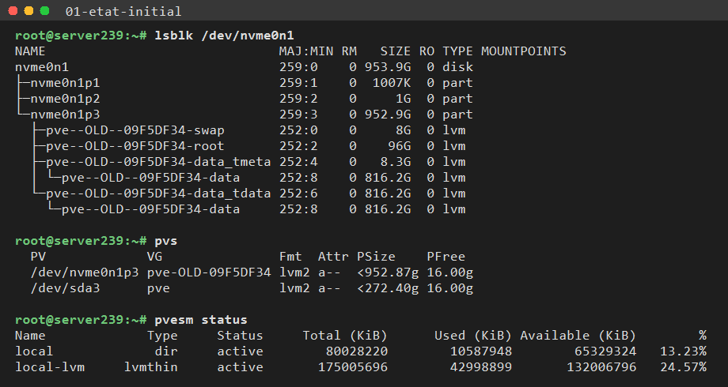

Ce que l'on constate :

- `sda` (273 Go) contient le Proxmox actuel : VG `pve` avec `root`, `swap` et le thin pool `data` utilisé par `local-lvm`.
- `nvme0n1` (953,9 Go, modèle **SK hynix PC811**) n'est **pas vide** : il contient une ancienne installation de Proxmox. Comme deux VG ne peuvent pas porter le même nom `pve`, LVM l'a renommé `pve-OLD-09F5DF34`.
- `pvesm status` ne montre que `local` et `local-lvm` : le NVMe n'est pas utilisé par Proxmox.

Ma VM et son disque actuel :

```bash
qm list
qm config 300154479
```

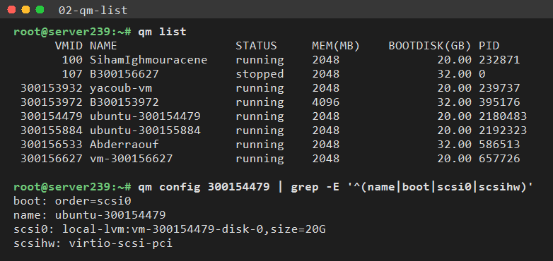

Le disque de ma VM est `scsi0: local-lvm:vm-300154479-disk-0,size=20G`, donc sur le disque `sda`.

### Vérifications avant d'effacer

Avant d'effacer le NVMe, j'ai vérifié que l'ancienne installation n'était plus utilisée :

| Vérification | Commande | Résultat |
|--------------|----------|----------|
| Rien de monté depuis le NVMe | `findmnt` | aucun montage |
| Le swap actif est celui de `sda` | `swapon --show` | `/dev/dm-1` = `pve-swap` |
| `/etc/fstab` | `cat /etc/fstab` | seulement `/dev/pve/root` et `/dev/pve/swap` |
| Mode de démarrage | `ls /sys/firmware/efi` | BIOS legacy, racine `root=/dev/mapper/pve-root` (sur `sda`) |
| Stockage Proxmox lié à l'ancien VG | `grep OLD /etc/pve/storage.cfg` | aucun |

---

## 2. Effacer l'ancienne installation du NVMe

```bash
vgchange -an pve-OLD-09F5DF34      # désactiver les LV de l'ancien VG
vgremove -y pve-OLD-09F5DF34       # supprimer le VG et ses LV (root, swap, data)
pvremove /dev/nvme0n1p3            # retirer l'étiquette PV
wipefs -a /dev/nvme0n1             # effacer la table de partitions
sgdisk -n 1:0:0 -t 1:8e00 /dev/nvme0n1   # 1 partition sur tout le disque, type Linux LVM
```

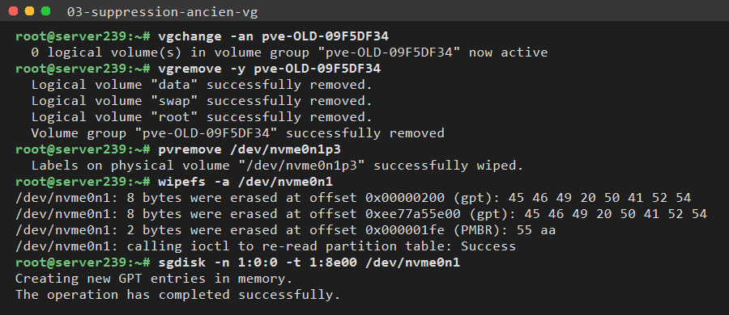

L'ancien disque avait 3 partitions (BIOS boot de 1 Mo, EFI de 1 Go, LVM). Le README du cours utilise `/dev/nvme0n1p1` comme PV : j'ai donc recréé une **seule** partition `nvme0n1p1` qui occupe tout le disque, de type `8e00` (Linux LVM).

---

## 3. Créer le PV, le VG, le thin pool et le stockage Proxmox

```bash
pvcreate /dev/nvme0n1p1
vgcreate nvme-vg /dev/nvme0n1p1
lvcreate -l 100%FREE -T nvme-vg/data
pvesm add lvmthin nvme-storage --vgname nvme-vg --thinpool data --content images,rootdir
```

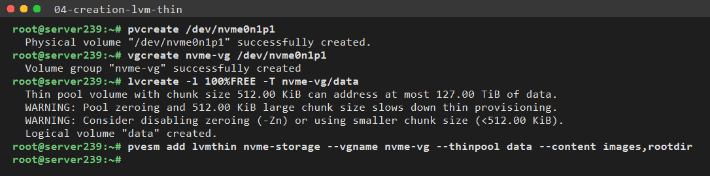

| Commande | Rôle |
|----------|------|
| `pvcreate` | Transforme la partition en **Physical Volume** utilisable par LVM |
| `vgcreate nvme-vg` | Crée le **Volume Group** `nvme-vg` qui regroupe l'espace du PV |
| `lvcreate -l 100%FREE -T nvme-vg/data` | Crée un **thin pool** `data` avec tout l'espace libre du VG |
| `pvesm add lvmthin nvme-storage` | Déclare le thin pool dans Proxmox sous le nom `nvme-storage`, pour les disques de VM (`images`) et de conteneurs (`rootdir`) |

Les deux `WARNING` de `lvcreate` ne sont pas des erreurs : LVM conseille seulement une taille de bloc plus petite ou de désactiver le zeroing pour de meilleures performances.

### Vérifications

```bash
lsblk /dev/nvme0n1
fdisk -l /dev/nvme0n1
```

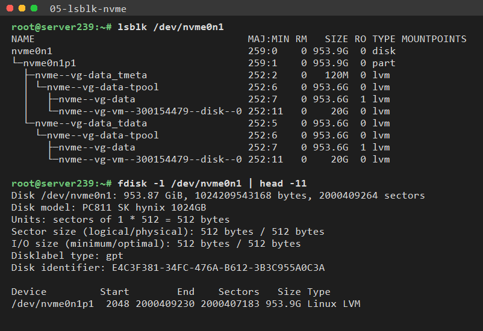

```bash
pvs
vgs
lvs nvme-vg
```

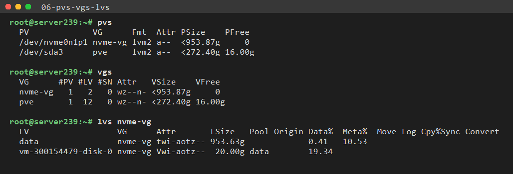

```bash
pvesm status
grep -A4 nvme-storage /etc/pve/storage.cfg
```

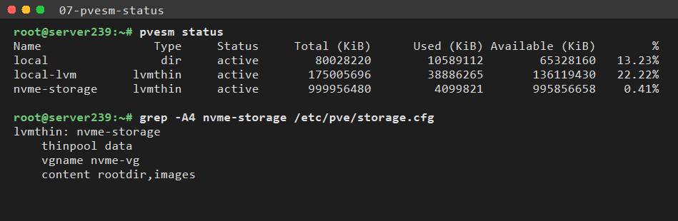

`nvme-storage` est `active`, de type `lvmthin`, avec environ 954 Go disponibles. La configuration est enregistrée dans `/etc/pve/storage.cfg` et a été conservée après un redémarrage du serveur.

---

## 4. Déplacer le disque de la VM

```bash
qm move_disk 300154479 scsi0 nvme-storage --delete 1
```

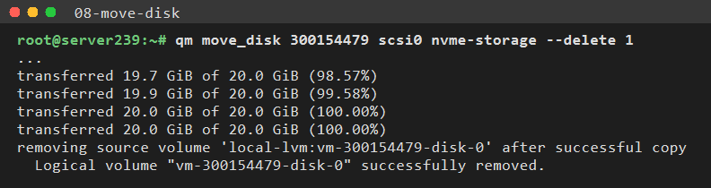

- `qm move_disk` copie le disque `scsi0` vers `nvme-storage` puis met à jour la configuration de la VM.
- `--delete 1` supprime l'ancienne copie sur `local-lvm` une fois la copie réussie. Sans cette option, l'ancien disque reste dans la config sous `unused0` et occupe encore 20 Go sur `local-lvm`.

> **Incident :** un premier essai, lancé pendant que la VM tournait, a été interrompu à 15 % : le serveur `server239` a été redémarré par une autre session pendant la copie. Ma VM n'a rien perdu, son disque était toujours sur `local-lvm`. Après le redémarrage, j'ai supprimé la copie incomplète avec `pvesm free nvme-storage:vm-300154479-disk-0`, puis j'ai relancé `qm move_disk` (VM arrêtée), qui a réussi.

---

## 5. Vérifier le résultat

```bash
qm config 300154479
pvesm list nvme-storage
```

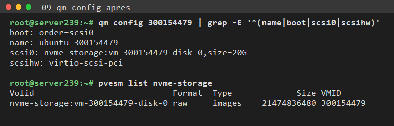

Le disque est maintenant `scsi0: nvme-storage:vm-300154479-disk-0,size=20G` et il apparaît dans `pvesm list nvme-storage`.

La VM redémarre et fonctionne depuis le NVMe :

```bash
qm start 300154479
ssh ubuntu@10.7.236.222
```

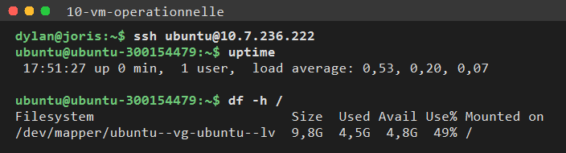

---

## 6. Vérification du storage

### En ligne de commande

```bash
pvesm status
pvesm list nvme-storage
lvs nvme-vg
```

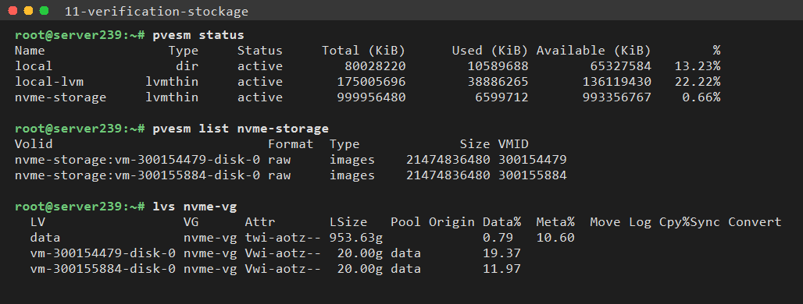

- `nvme-storage` est `active`, de type `lvmthin`, environ 1 To.
- Le stockage contient mon disque `vm-300154479-disk-0` et aussi celui de mon coéquipier `vm-300155884-disk-0` : `nvme-storage` sert à tout le serveur.
- Dans `lvs`, les disques des VM sont des volumes **thin** (`Vwi`) dans le pool `data` (`twi`). Mon disque de 20 Go n'occupe réellement que 19 % de sa taille.

```bash
qm config 300154479 | grep -E '^(name|scsi0)'
qm status 300154479
pvesm list local-lvm | grep 300154479
```

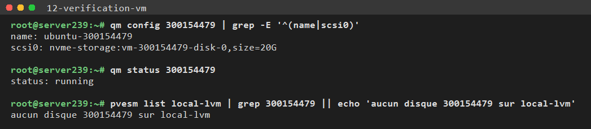

La VM utilise bien `nvme-storage`, elle est démarrée (`running`), et il ne reste plus aucun disque `300154479` sur `local-lvm`.

### Dans l'interface web de Proxmox

**server239 → nvme-storage → Summary** : le stockage est activé et actif, de type **LVM-Thin**, pour les disques de VM et de conteneurs.

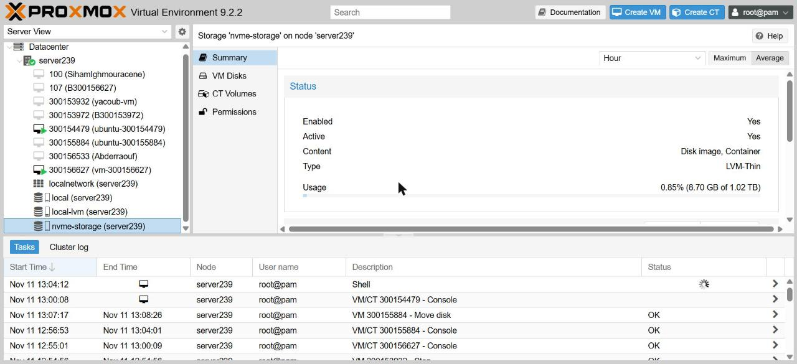

**server239 → nvme-storage → VM Disks** : on voit les disques stockés sur le NVMe.

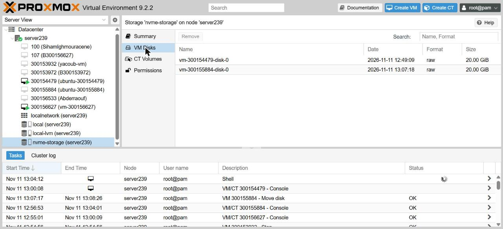

**VM 300154479 → Hardware** : le disque `scsi0` est `nvme-storage:vm-300154479-disk-0,size=20G`.

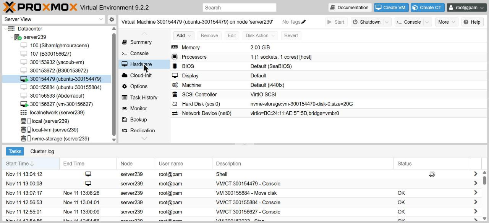

**Datacenter → Storage** : `nvme-storage` apparaît avec `local` et `local-lvm`, de type LVM-Thin et activé.

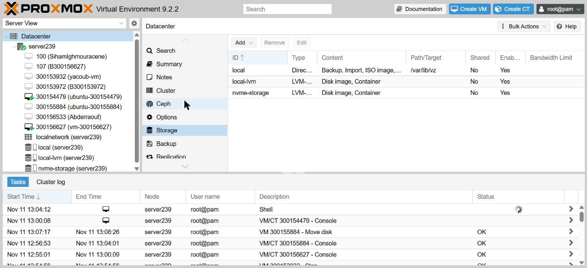

### ✅ Résultat

- ✅ VM identifiée (`qm list`, `qm config`)
- ✅ NVMe ajouté à Proxmox comme `nvme-storage` (LVM-Thin)
- ✅ Disque déplacé vers `nvme-storage`
- ✅ Configuration mise à jour
- ✅ VM opérationnelle (SSH OK)

---

## 🧪 Questions de réflexion

**1. Quelle est la différence entre un HDD, un SSD SATA et un NVMe ?**

Un **HDD** enregistre les données sur des plateaux magnétiques qui tournent, lus par une tête mécanique : grande capacité, faible coût, mais lent (environ 100 à 200 Mo/s, accès en millisecondes). Un **SSD SATA** utilise de la mémoire flash, sans pièce mécanique : beaucoup plus rapide en accès aléatoire, mais limité par l'interface SATA (environ 550 Mo/s). Un **SSD NVMe** utilise aussi de la flash, mais il est branché directement sur le bus **PCI Express** avec un protocole fait pour la flash (beaucoup de files de commandes en parallèle) : plusieurs Go/s et une latence très faible.

**2. Quel est le rôle d'une partition ?**

Une partition découpe un disque physique en zones indépendantes. Chaque zone peut avoir son propre usage : démarrage, système de fichiers, swap ou PV LVM. Sur `server239`, j'ai créé une seule partition `nvme0n1p1` de type Linux LVM sur tout le NVMe.

**3. À quoi sert un système de fichiers ?**

Il organise les données d'une partition en fichiers et en répertoires. Il garde la trace de l'emplacement des blocs, des noms, des tailles et des permissions. Exemples : `ext4` (la racine de Proxmox et de ma VM Ubuntu), `xfs`, `ntfs`, `vfat` (partition EFI). On l'identifie avec `blkid` ou `lsblk -f`.

**4. Que signifient les acronymes PV, VG et LV ?**

- **PV** (Physical Volume) : un disque ou une partition préparé pour LVM (`/dev/nvme0n1p1`).
- **VG** (Volume Group) : un ensemble d'un ou plusieurs PV qui forme une réserve d'espace (`nvme-vg`).
- **LV** (Logical Volume) : un volume découpé dans le VG et utilisé comme un disque (`data`, `vm-300154479-disk-0`).

**5. Pourquoi Proxmox utilise-t-il souvent LVM-Thin ?**

Avec le **thin provisioning**, un disque de VM n'occupe que l'espace réellement écrit. Mon disque de 20 Go n'utilise qu'une partie de cet espace dans le pool. On peut donc créer plus de disques virtuels que la taille physique, tant qu'ils ne sont pas pleins. LVM-Thin permet aussi les **snapshots** et les clones rapides des VM, et il est intégré directement à Proxmox (`local-lvm` est déjà un LVM-Thin).

**6. Quelle commande permet d'afficher les stockages configurés dans Proxmox ?**

`pvesm status`. On peut aussi lire `/etc/pve/storage.cfg`, et `pvesm list <stockage>` affiche le contenu d'un stockage.

**7. Quel est l'avantage d'utiliser un NVMe pour les machines virtuelles ?**

Plusieurs VM lisent et écrivent en même temps sur le même disque. Le NVMe supporte très bien ces accès parallèles grâce à sa faible latence et à ses nombreuses files de commandes. Les VM démarrent plus vite et restent fluides. Sur `server239`, le NVMe offre aussi 954 Go, contre 167 Go pour `local-lvm` sur le disque `sda`, déjà rempli à 25 % par les VM du groupe.
