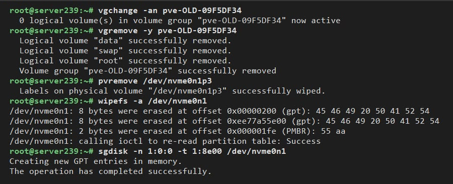
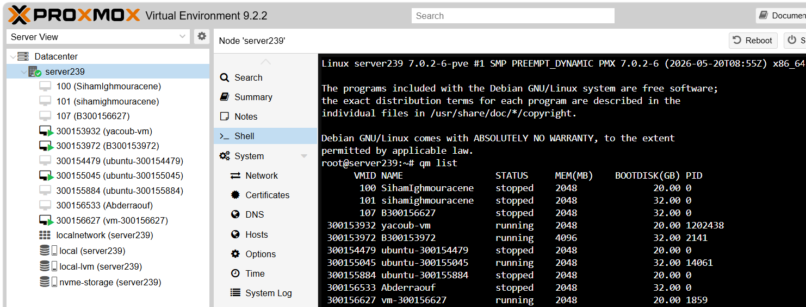
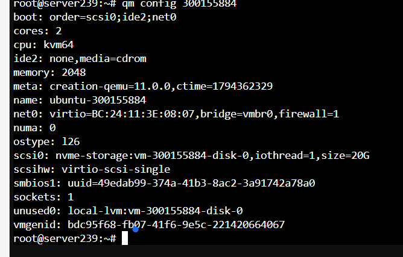
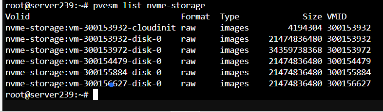
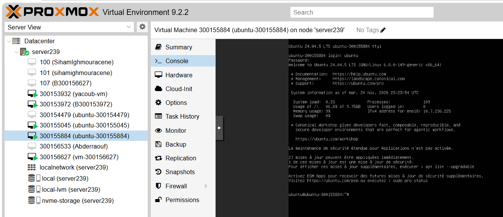
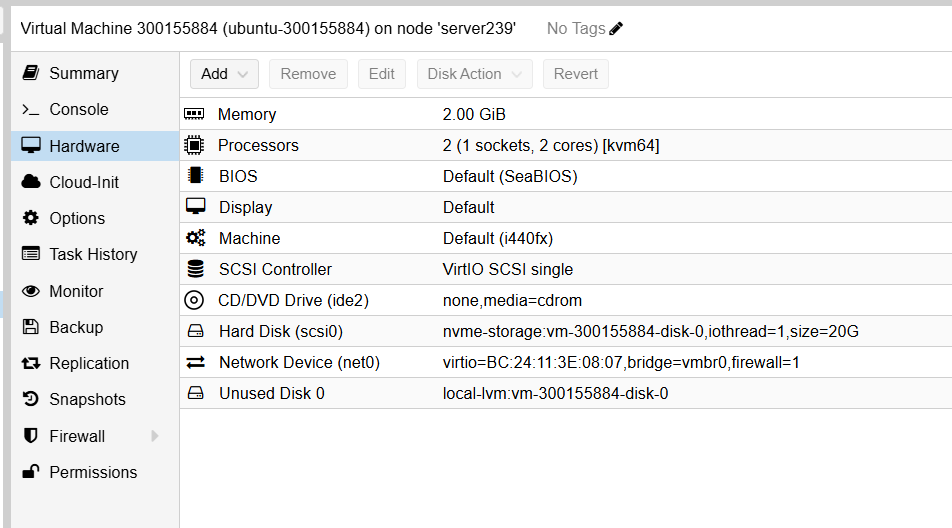
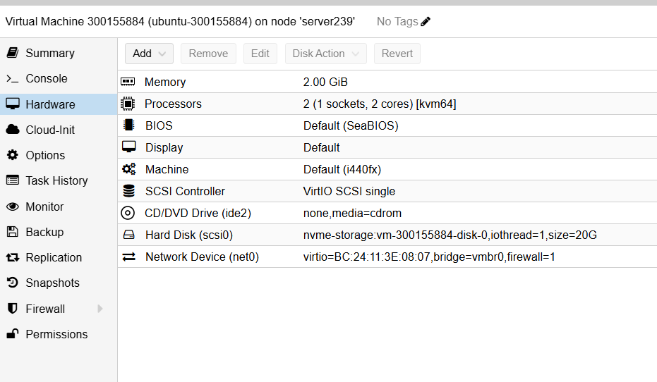
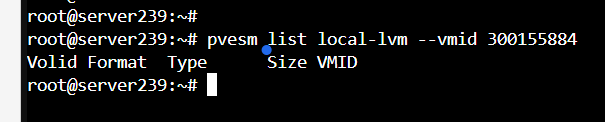

# 💾 Laboratoire 5 — Gestion du stockage sous Proxmox VE

## 1. Informations générales

| Information | Description |
|---|---|
| Établissement | Collège Boréal |
| Programme | Technologies des systèmes informatiques et de réseaux |
| Cours | INF1085 — Administration Linux |
| Identifiant étudiant | 300155884 |
| Serveur Proxmox | server239 |
| Version de Proxmox | 9.2.2 |
| Machine virtuelle | ubuntu-300155884 |
| Système d'exploitation | Ubuntu Server 24.04.5 LTS |

## 2. Introduction

Ce laboratoire porte sur la gestion du stockage sous Linux
et Proxmox VE, notamment sur les partitions, les volumes
logiques et le fonctionnement de LVM-Thin.

Le laboratoire est divisé en deux parties :

- Une partie collective consacrée à la préparation et à
  la configuration du disque NVMe sur le serveur Proxmox.
- Une partie individuelle consacrée à la migration du
  disque de ma machine virtuelle vers le stockage NVMe,
  ainsi qu'à la libération de son ancien stockage.

## 3. Objectifs du laboratoire

- Identifier les disques physiques présents sur le serveur.
- Comprendre les partitions et les systèmes de fichiers.
- Comprendre les concepts PV, VG et LV.
- Comprendre le fonctionnement de LVM-Thin.
- Configurer un stockage NVMe sous Proxmox VE.
- Migrer une machine virtuelle vers le stockage NVMe.
- Vérifier le fonctionnement de la VM après la migration.
- Libérer l'espace occupé sur l'ancien stockage local-lvm.

## 4. Environnement de travail

### 4.1. Serveur physique

| Élément | Caractéristiques |
|---|---|
| Serveur | server239 |
| Disque principal | sda — 273,4 Gio |
| Disque NVMe | nvme0n1 — 953,9 Gio |
| Modèle du NVMe | SK hynix PC811 1024GB |
| Hyperviseur | Proxmox VE 9.2.2 |

### 4.2. Machine virtuelle

| Élément | Caractéristiques |
|---|---|
| VMID | 300155884 |
| Nom | ubuntu-300155884 |
| Processeurs | 2 cœurs |
| Mémoire RAM | 2 Gio |
| Disque virtuel | 20 Gio |
| Stockage initial | local-lvm |
| Stockage final | nvme-storage |

## 5. Partie collective — Configuration du stockage NVMe

Cette partie concerne l'ensemble des membres du groupe
utilisant le serveur server239.

Les manipulations de préparation et de configuration
du disque NVMe ont été réalisées par un membre du groupe.
Les résultats ont ensuite été vérifiés sur le serveur
afin de confirmer que le stockage était correctement
configuré et disponible pour les machines virtuelles.

### 5.1. Identification des disques physiques

Avant de configurer le stockage NVMe, il était nécessaire
d'identifier les disques présents sur le serveur et de
vérifier leur organisation.

Commandes utilisées :

```bash
lsblk /dev/nvme0n1
pvs
pvesm status
```

- `lsblk` : affiche les disques, les partitions et les volumes.
- `pvs` : affiche les volumes physiques LVM.
- `pvesm status` : affiche les stockages configurés dans Proxmox.

#### Résultat obtenu

Le serveur dispose de deux disques principaux :

| Disque | Capacité | Utilisation |
|---|---|---|
| sda | 273,4 Gio | Système Proxmox et stockage local |
| nvme0n1 | 953,9 Gio | Futur stockage des machines virtuelles |

Le disque NVMe contenait initialement trois partitions
et un ancien groupe de volumes nommé `pve-OLD-09F5DF34`.



### 5.2. Préparation du disque NVMe

Avant de réutiliser le NVMe, le membre du groupe chargé
de cette configuration a supprimé son ancienne
organisation LVM.

Les opérations réalisées étaient les suivantes :

- Désactivation de l'ancien groupe de volumes.
- Suppression des anciens volumes logiques.
- Suppression de l'ancien groupe de volumes.
- Suppression des anciennes signatures de stockage.
- Création d'une nouvelle table de partitions GPT.
- Création d'une partition destinée à LVM.

La commande `wipefs` a notamment été utilisée pour
supprimer les anciennes signatures du disque.

La partition a été créée avec `sgdisk`, contrairement
à la méthode utilisant `fdisk` présentée dans le cours.

#### Résultat obtenu

L'ancienne configuration a été supprimée et une
nouvelle partition `/dev/nvme0n1p1` a été créée.


> **Attention :** ces opérations sont destructives.
> Elles ont été réalisées pendant la préparation collective
> du disque et ne doivent pas être répétées maintenant
> que des machines virtuelles utilisent ce stockage.

### 5.3. Création du volume physique (PV)

Le Physical Volume représente le disque ou la partition
physique utilisée par LVM.

Dans notre laboratoire, le PV correspond à :

`/dev/nvme0n1p1`

Cette partition constitue la base de notre architecture LVM.

### 5.4. Création du groupe de volumes (VG)

Le Volume Group permet de regrouper l'espace disponible
sur un ou plusieurs volumes physiques.

Le groupe créé dans notre laboratoire est :

`nvme-vg`

Il utilise l'espace disponible sur la partition du NVMe.

### 5.5. Création du Thin Pool

Le Thin Pool est un espace de stockage permettant
d'allouer progressivement de l'espace aux disques
virtuels en fonction de leur utilisation réelle.

Le Thin Pool créé est nommé `data` et appartient
au groupe de volumes `nvme-vg`.

Cette configuration permet une gestion plus flexible
de l'espace disque des machines virtuelles.

### 5.6. Ajout du stockage NVMe à Proxmox

Le stockage LVM-Thin a ensuite été enregistré dans
Proxmox sous le nom `nvme-storage`.

| Paramètre | Valeur |
|---|---|
| Storage ID | nvme-storage |
| Type | LVM-Thin |
| Volume Group | nvme-vg |
| Thin Pool | data |
| Content | images, rootdir |

Ce stockage peut accueillir les disques des machines
virtuelles et les volumes des conteneurs LXC.


### 5.7. Architecture finale du stockage

```text
Disque physique NVMe (953,9 Gio)
          |
          v
Partition /dev/nvme0n1p1
          |
          v
Physical Volume (PV)
          |
          v
Volume Group : nvme-vg
          |
          v
Thin Pool : data
          |
          v
Stockage Proxmox : nvme-storage
          |
          v
Disques des machines virtuelles
```

### 5.8. Vérification de la configuration collective

Commandes de vérification :

```bash
lsblk
pvs
vgs
lvs
pvesm status
```

| Commande | Utilité |
|---|---|
| lsblk | Afficher les disques et les partitions |
| pvs | Vérifier les volumes physiques |
| vgs | Vérifier les groupes de volumes |
| lvs | Vérifier les volumes logiques |
| pvesm status | Vérifier les stockages Proxmox |


Les vérifications ont confirmé la présence du groupe
`nvme-vg`, du Thin Pool `data` et du stockage
`nvme-storage`.

Le stockage NVMe est donc disponible pour accueillir
les disques des machines virtuelles.

### 5.9. Bilan de la partie collective

- [x] Identification des disques physiques
- [x] Préparation du disque NVMe
- [x] Création de la partition GPT
- [x] Création du volume physique (PV)
- [x] Création du groupe de volumes (VG)
- [x] Création du Thin Pool
- [x] Ajout du stockage NVMe à Proxmox
- [x] Vérification de la configuration

La configuration collective est opérationnelle.
Elle permet désormais à chaque membre du groupe de
migrer individuellement sa machine virtuelle vers
le stockage NVMe.

## 6. Partie individuelle — Migration de ma VM vers le NVMe

### 6.1. Objectif

L'objectif de cette partie individuelle est de déplacer
le disque de ma machine virtuelle Ubuntu vers le stockage
`nvme-storage`, afin de bénéficier des performances
du SSD NVMe.

### 6.2. Identification de ma machine virtuelle

J'ai utilisé la commande suivante pour afficher les
machines virtuelles présentes sur le serveur Proxmox :

```bash
qm list
```

Cette commande permet de connaître les identifiants,
les noms, les états et les ressources des machines
virtuelles.

#### Résultat obtenu

| Information | Valeur |
|---|---|
| VMID | 300155884 |
| Nom | ubuntu-300155884 |
| État avant la vérification finale | stopped |
| Mémoire RAM | 2048 Mio |
| Taille du disque | 20 Gio |



### 6.3. Vérification du stockage initial

Avant la migration, j'ai vérifié la configuration
de ma machine virtuelle avec la commande :

```bash
qm config 300155884
```

Le disque principal était initialement configuré
de la manière suivante :

```text
scsi0: local-lvm:vm-300155884-disk-0,iothread=1,size=20G
```

Cette ligne indique que le disque principal de ma VM
était hébergé sur le stockage `local-lvm`.

### 6.4. Arrêt de la machine virtuelle

Avant de déplacer le disque, j'ai vérifié les sessions
et les processus en cours dans Ubuntu.

J'ai ensuite arrêté proprement la machine virtuelle
afin de limiter les risques liés aux écritures sur
le disque pendant la migration.

J'ai vérifié son état depuis le Shell de Proxmox :

```bash
qm status 300155884
```

Résultat obtenu :

```text
status: stopped
```

### 6.5. Migration du disque vers le stockage NVMe

J'ai exécuté la commande suivante depuis le Shell
du serveur Proxmox :

```bash
qm move_disk 300155884 scsi0 nvme-storage
```

#### Explication de la commande

| Élément | Signification |
|---|---|
| qm | Gestionnaire des machines virtuelles QEMU |
| move_disk | Déplacement d'un disque virtuel |
| 300155884 | Identifiant de ma machine virtuelle |
| scsi0 | Disque principal à déplacer |
| nvme-storage | Stockage de destination |

Proxmox a créé un nouveau volume logique sur le
stockage NVMe, puis a effectué la copie du disque
virtuel de 20 Gio.

La progression du transfert a atteint 100 %.

À la fin de la migration, Proxmox a conservé
l'ancien disque sur `local-lvm` sous le nom `unused0`.

Cette copie permettait de conserver le disque initial
pendant les premières vérifications.

### 6.6. Vérification de la nouvelle configuration

Après la migration, j'ai exécuté de nouveau :

```bash
qm config 300155884
```

Résultat obtenu :

```text
scsi0: nvme-storage:vm-300155884-disk-0,iothread=1,size=20G
unused0: local-lvm:vm-300155884-disk-0
```

La ligne `scsi0` confirme que le disque principal
de ma machine virtuelle utilise désormais
le stockage `nvme-storage`.

La ligne `unused0` représente l'ancien disque,
qui n'est plus utilisé comme disque principal.



### 6.7. Vérification du stockage NVMe

Pour confirmer la présence de mon disque virtuel
sur le nouveau stockage, j'ai exécuté :

```bash
pvesm list nvme-storage
```

Le résultat contient le volume suivant :

```text
nvme-storage:vm-300155884-disk-0
```

| Information | Valeur |
|---|---|
| Stockage | nvme-storage |
| Format | raw |
| Type | images |
| Taille | 20 Gio |
| VMID | 300155884 |



### 6.8. Redémarrage et vérification d'Ubuntu

Après avoir confirmé la présence du disque sur
le NVMe, j'ai redémarré ma machine virtuelle :

```bash
qm start 300155884
```

J'ai ensuite ouvert la console Proxmox et effectué
une connexion avec mon utilisateur Ubuntu.

Les vérifications ont confirmé que :

- Ubuntu Server 24.04.5 LTS démarre correctement.
- La connexion à Ubuntu fonctionne.
- L'adresse IP 10.7.236.225 est conservée.
- La machine virtuelle est opérationnelle.



## 7. Libération de l'ancien stockage local-lvm

### 7.1. Identification de l'ancien disque

Après avoir vérifié le bon fonctionnement de ma VM,
j'ai consulté l'onglet Hardware dans Proxmox.

Deux disques étaient présents :

| Disque | Stockage | Rôle |
|---|---|---|
| Hard Disk (scsi0) | nvme-storage | Disque principal actif |
| Unused Disk 0 | local-lvm | Ancien disque inutilisé |



### 7.2. Suppression de l'ancien disque

Afin de libérer l'espace occupé sur `local-lvm`,
j'ai sélectionné uniquement le disque `Unused Disk 0`
dans l'interface Proxmox.

J'ai utilisé le bouton Remove, puis confirmé
la suppression de cet ancien disque.

Cette opération concernait uniquement le volume
inutilisé de ma machine virtuelle.

Le stockage partagé `local-lvm` ainsi que les disques
des autres machines virtuelles ont été conservés.

### 7.3. Vérification après suppression

J'ai vérifié la configuration de ma VM :

```bash
qm config 300155884
```

Résultat obtenu :

```text
scsi0: nvme-storage:vm-300155884-disk-0,iothread=1,size=20G
```

La ligne `unused0` a disparu de la configuration.

Le disque principal sur le NVMe est toujours présent.



### 7.4. Vérification de la libération du stockage

Pour confirmer que mon ancien volume avait réellement
été supprimé de `local-lvm`, j'ai exécuté :

```bash
pvesm list local-lvm --vmid 300155884
```

Résultat obtenu :

```text
Volid Format Type Size VMID
```

Aucun volume n'apparaît sous les en-têtes.

Cela confirme que ma machine virtuelle ne possède
plus de disque sur le stockage `local-lvm`.



## 8. Vérification finale

J'ai effectué une dernière vérification de l'état
de ma machine virtuelle :

```bash
qm status 300155884
```

Résultat obtenu :

```text
status: running
```

Ma machine virtuelle fonctionne toujours après
la suppression de son ancien disque.

### 8.1. Architecture avant la migration

```text
Disque physique sda
        |
        v
Volume Group : pve
        |
        v
Stockage local-lvm
        |
        v
VM 300155884 (20 Gio)
```

### 8.2. Architecture après la migration

```text
Disque physique nvme0n1
        |
        v
Volume Group : nvme-vg
        |
        v
Thin Pool : data
        |
        v
Stockage nvme-storage
        |
        v
VM 300155884 (20 Gio)
```

### 8.3. Bilan de la partie individuelle

- [x] Identification de ma machine virtuelle
- [x] Vérification du stockage initial
- [x] Arrêt propre de la machine virtuelle
- [x] Migration du disque vers nvme-storage
- [x] Vérification de la nouvelle configuration
- [x] Vérification du stockage NVMe
- [x] Redémarrage et connexion à Ubuntu
- [x] Suppression de l'ancien disque inutilisé
- [x] Libération de local-lvm pour ma VM
- [x] Vérification finale du fonctionnement

Toutes les manipulations techniques de la partie
individuelle ont été réalisées avec succès.

## 9. Questions de réflexion

### 1. Quelle est la différence entre un HDD, un SSD SATA et un NVMe ?

- HDD : disque mécanique, moins rapide et moins coûteux.
- SSD SATA : disque sans pièces mécaniques, plus rapide qu'un HDD.
- SSD NVMe : disque utilisant PCI Express, généralement plus rapide qu'un SSD SATA.

### 2. Quel est le rôle d'une partition ?

Une partition permet de diviser un disque physique en plusieurs espaces de stockage.

### 3. À quoi sert un système de fichiers ?

Il permet d'organiser, de stocker et de retrouver les fichiers sur un support de stockage.

### 4. Que signifient les acronymes PV, VG et LV ?

- PV : Physical Volume (volume physique).
- VG : Volume Group (groupe de volumes).
- LV : Logical Volume (volume logique).

### 5. Pourquoi Proxmox utilise-t-il souvent LVM-Thin ?

Parce qu'il permet d'allouer progressivement l'espace disque selon les besoins réels des machines virtuelles.

### 6. Quelle commande permet d'afficher les stockages configurés dans Proxmox ?

La commande `pvesm status`.

### 7. Quel est l'avantage d'utiliser un NVMe pour les machines virtuelles ?

Il permet d'améliorer la vitesse de lecture et d'écriture des données ainsi que les performances des machines virtuelles.

## 10. Conclusion

Ce laboratoire m'a permis de mieux comprendre la gestion
du stockage sous Linux et Proxmox VE, notamment les
partitions, les volumes physiques, les groupes de volumes
et le fonctionnement de LVM-Thin.

La partie collective a permis de configurer un nouveau
stockage NVMe sur le serveur server239.

Dans la partie individuelle, j'ai réussi à déplacer
le disque de ma machine virtuelle 300155884 vers
le stockage nvme-storage, à vérifier son fonctionnement
et à libérer son ancien espace sur local-lvm.

Les vérifications finales ont confirmé que ma machine
virtuelle est opérationnelle sur le nouveau stockage.

Les objectifs du laboratoire ont été atteints avec succès.
