# Introduction au stockage sous Linux et Proxmox VE

**Étudiant :** Ibrahim Hamdan Alhamed  
**Numéro étudiant :** 300157287  
**Cours :** INF1085 – Administration Linux  
**Date :** 11 novembre 2026

## 1. Introduction et objectifs

Ce laboratoire porte sur l’organisation du stockage sous Linux et son utilisation dans Proxmox VE. Il comprend une partie réalisée en groupe pour préparer un disque NVMe et l’ajouter comme stockage, puis une partie individuelle pour déplacer le disque de ma VM 101 vers ce stockage.

Les objectifs sont d’identifier les disques, de comprendre les partitions et LVM, de créer un volume physique, un groupe de volumes et un pool LVM-Thin, puis de vérifier le stockage dans Proxmox.

## 2. Notions de base

Une partition est une division logique d’un disque. Un système de fichiers organise les fichiers et les répertoires à l’intérieur d’un espace de stockage. LVM permet de gérer les volumes avec une couche supplémentaire de souplesse.

| Élément | Signification et rôle |
| --- | --- |
| PV | Physical Volume : volume physique initialisé pour LVM, sur un disque ou une partition. |
| VG | Volume Group : groupe qui rassemble l’espace d’un ou plusieurs PV. |
| LV | Logical Volume : volume logique créé à partir de l’espace d’un VG. |
| Pool LVM-Thin | Pool dans lequel les volumes utilisent les blocs physiques au fur et à mesure des écritures. |

Dans ce laboratoire, le pool LVM-Thin héberge des volumes de disques virtuels. Aucun formatage ext4 ou XFS de ce pool n’est montré ni nécessaire pour son utilisation comme stockage bloc LVM-Thin dans Proxmox.

## Partie A – Travail en groupe : préparation du stockage NVMe

### 3. Identification des disques

La commande suivante a permis d’observer l’organisation du stockage :

```bash
lsblk
```

| Périphérique ou volume | Taille affichée | Observation |
| --- | --- | --- |
| `/dev/sda` | 273,4 Gio | Disque présenté à Linux, contenant le stockage Proxmox existant. |
| `/dev/sda3` | 272,4 Gio | Partition utilisée par le groupe LVM `pve`. |
| `pve-root` | 78,1 Gio | Volume monté sur `/`. |
| `pve-swap` | 8 Gio | Espace d’échange. |
| Pool `pve/data` | Environ 166,9 Gio | Stockage des disques existants des VM 100 à 105. |
| `/dev/nvme0n1` | 953,9 Gio | Disque NVMe à préparer. |

Avant la préparation, le NVMe possédait deux partitions : `nvme0n1p1` de 16 Mio et `nvme0n1p2` d’environ 953,9 Gio. Les volumes répétés dans l’arbre `lsblk` correspondent aux dépendances du pool LVM ; il ne faut pas les compter comme des disques supplémentaires.

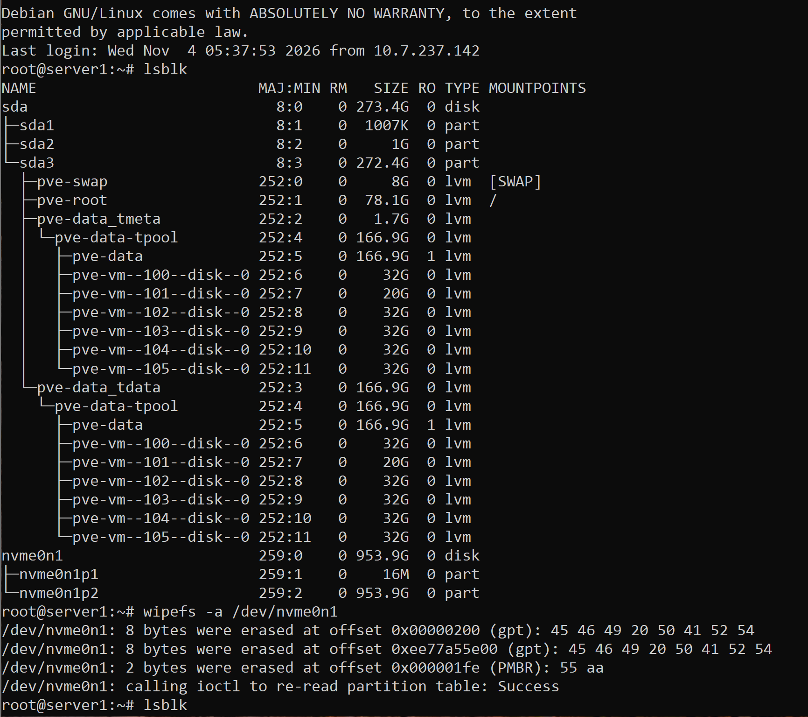

### 4. Retrait des anciennes signatures

La commande exécutée sur le NVMe était :

```bash
wipefs -a /dev/nvme0n1
```

La sortie indique le retrait des signatures GPT et PMBR, puis la réussite de la relecture de la table de partitions. Cette opération retire les signatures reconnues ; elle ne constitue pas un effacement sécurisé de tous les octets du disque.

Un nouveau `lsblk` montre ensuite le NVMe sans partitions enfants. Le stockage existant sur `sda` apparaît toujours dans la sortie.

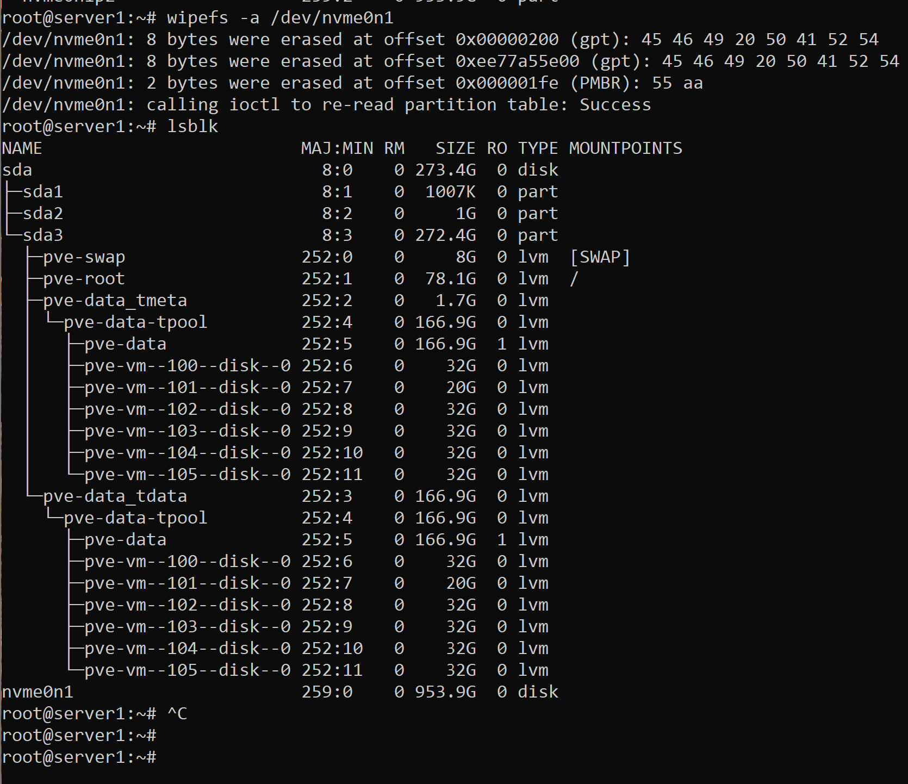

### 5. Création de la partition GPT

Une première tentative de `pvcreate /dev/nvme0n1p1` a échoué avec le message `No device found`, car cette partition n’existait plus après le nettoyage.

Le disque a ensuite été ouvert avec :

```bash
fdisk /dev/nvme0n1
```

Les choix visibles dans la capture sont :

1. `g` pour créer une table GPT ;
2. `n` pour créer la partition numéro 1 en conservant les valeurs proposées ;
3. `w` pour écrire les modifications.

La partition créée occupe environ 953,9 Gio. Son type initial affiché par `fdisk` est `Linux filesystem`. La capture suivante confirme que `pvcreate` a ensuite pu l’initialiser pour LVM.

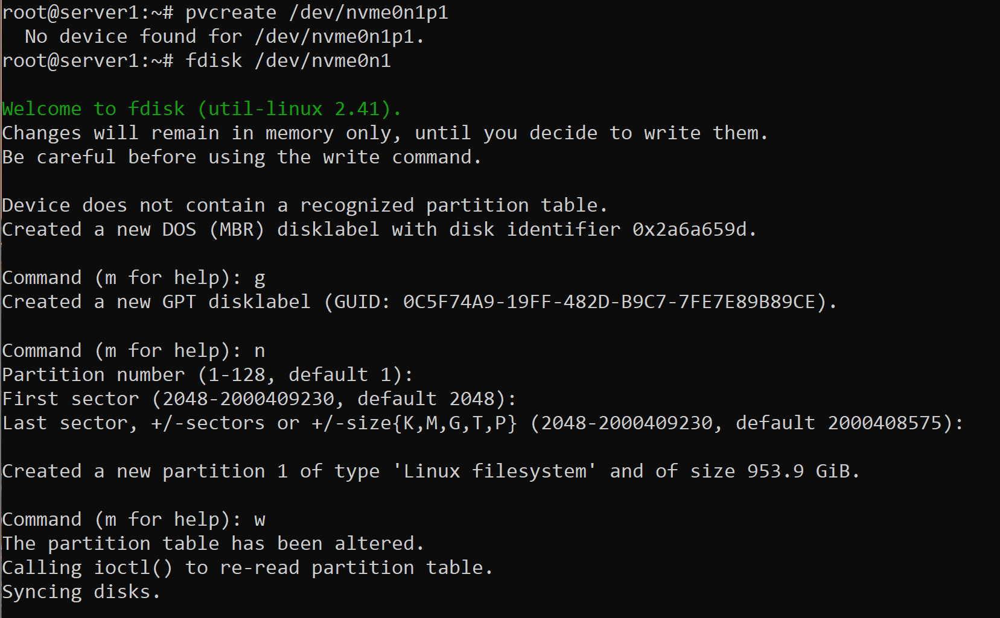

### 6. Création du PV, du VG et du pool LVM-Thin

Les commandes suivantes sont visibles dans les captures :

```bash
pvcreate /dev/nvme0n1p1
vgcreate nvme-vg /dev/nvme0n1p1
lvcreate -l 100%FREE -T nvme-vg/data
```

Le volume physique et le groupe `nvme-vg` ont été créés avec succès. La dernière commande a créé le volume logique `data` de type thin pool. L’outil a affiché des avertissements concernant la taille des chunks et le zeroing, puis a confirmé `Logical volume "data" created`.

Une deuxième exécution de `vgcreate` a simplement signalé que le groupe existait déjà. La ligne `Type : LVM-Thin`, saisie dans le terminal, a produit `command not found` : il s’agissait d’une indication de type de stockage, pas d’une commande.

### 7. Ajout du stockage dans Proxmox

Une première tentative d’ajout a échoué à cause de la faute de frappe `rootdirt`. La commande corrigée a été :

```bash
pvesm add lvmthin nvme-storage --vgname nvme-vg --thinpool data --content images,rootdir
```

Le stockage porte donc le nom `nvme-storage`, utilise le VG `nvme-vg` et le thin pool `data`. Les contenus demandés sont les disques de VM (`images`) et les volumes racines de conteneurs (`rootdir`).

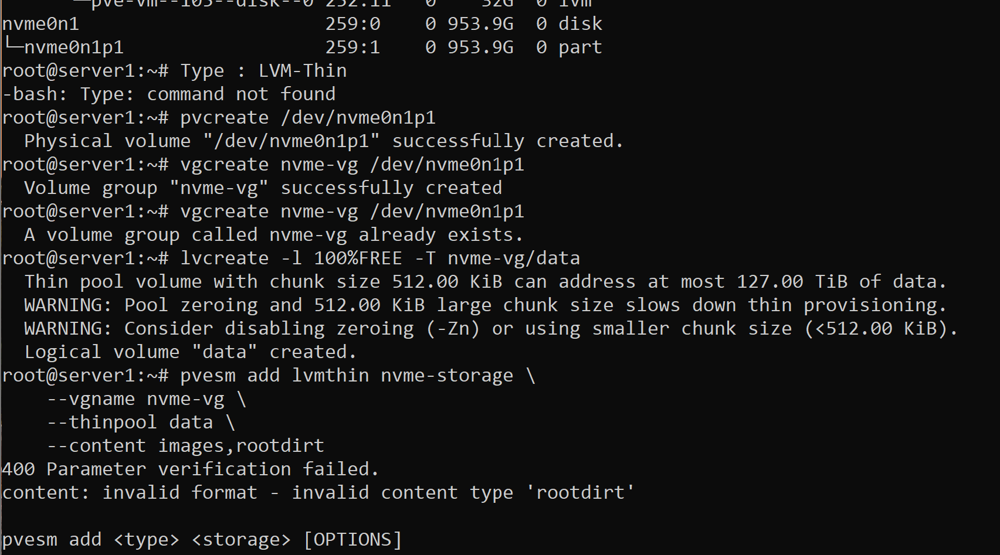

### 8. Vérifications du stockage en groupe

Les commandes de contrôle utilisées étaient :

```bash
lsblk
pvs
vgs
lvs
pvesm status
```

`lsblk` montre la partition NVMe reliée aux volumes de données et de métadonnées du pool.

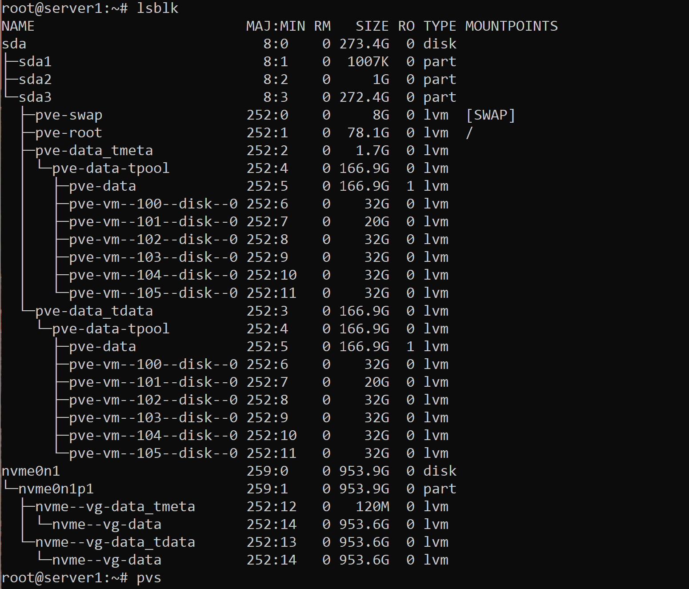

| Contrôle | Résultat observé |
| --- | --- |
| `pvs` | `/dev/nvme0n1p1` appartient à `nvme-vg`. |
| `vgs` | `nvme-vg` contient un PV et un LV, avec environ 953,87 Gio au total. |
| `lvs` | Le thin pool `data` de `nvme-vg` mesure environ 953,63 Gio ; `Data%` vaut 0,00 à ce moment. |
| `pvesm status` | `nvme-storage` apparaît avec le type `lvmthin` et l’état `active`. |

Le VG affiche zéro espace non alloué parce que l’espace a été affecté au pool. Cela ne signifie pas que le pool contient déjà des données de VM : sa colonne `Data%` est à 0,00 avant le transfert.

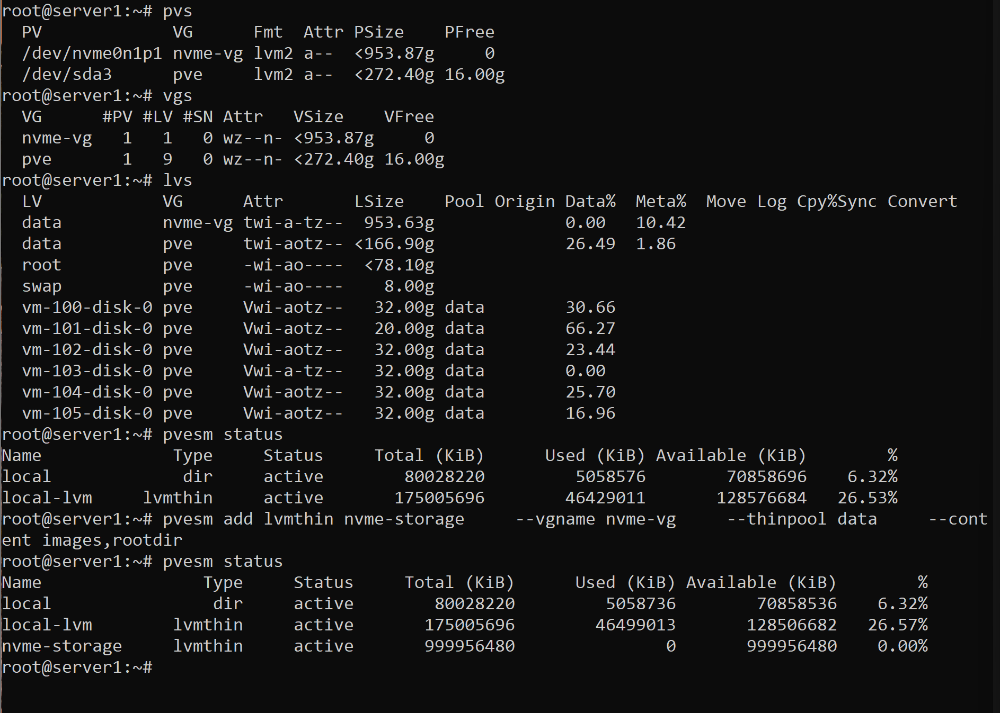

## Partie B – Travail individuel : déplacement du disque de ma VM 101

### 9. VM et disque concernés

Ma partie individuelle concerne la **VM 101 – Ibrahim-Debian**. Le disque concerné est `scsi0`, d’une capacité virtuelle de **20 Gio**. Le volume source identifié dans le journal est `local-lvm:vm-101-disk-0` et le volume d’arrivée est `nvme-storage:vm-101-disk-0`.

### 10. Transfert du disque

Le journal montre la progression du transfert jusqu’à **20,0 Gio sur 20,0 Gio, soit 100 %**, en environ **1 minute et 5 secondes**. Il affiche ensuite :

```text
mirror-scsi0: Completed successfully.
mirror-scsi0: mirror-job finished
adding source volume 'local-lvm:vm-101-disk-0' as 'unused0' to config
```

Le transfert a donc réussi. Le volume source a été conservé dans la configuration sous le nom `unused0` ; aucune suppression de ce volume n’est montrée.

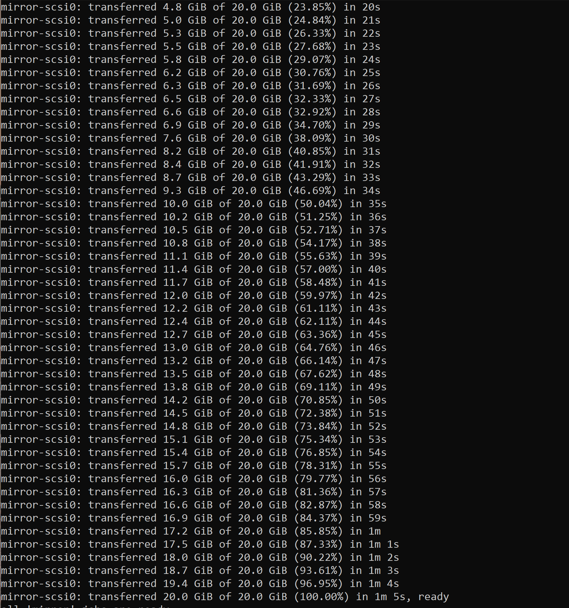

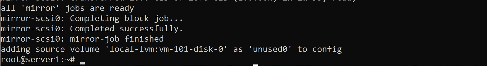

### 11. Vérification du disque sur le NVMe

La commande exécutée après le transfert était :

```bash
pvesm list nvme-storage
```

| Champ | Valeur observée |
| --- | --- |
| Volume | `nvme-storage:vm-101-disk-0` |
| Format | `raw` |
| Type | `images` |
| Taille | 21 474 836 480 octets, soit 20 Gio |
| VMID | 101 |

Cette sortie confirme la présence du disque de la VM 101 sur le nouveau stockage. La taille indiquée est la capacité virtuelle du disque ; cette commande seule ne mesure pas l’espace physique réellement occupé dans le thin pool.

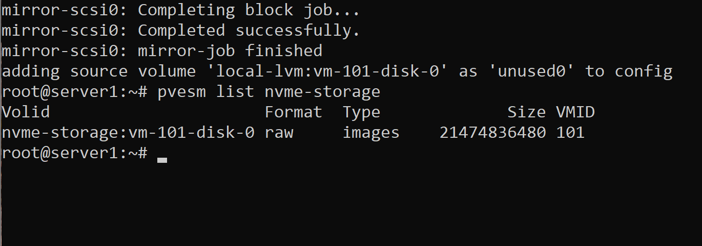

### 12. Bilan par rapport aux résultats attendus

| Résultat attendu | État d’après les preuves fournies |
| --- | --- |
| Identifier les disques Linux | Confirmé par `lsblk`. |
| Créer un PV, un VG et un LV | Confirmé par les messages de création et les sorties LVM. |
| Ajouter le NVMe à Proxmox | Confirmé : `nvme-storage` est actif. |
| Identifier ma VM | VM 101, disque de 20 Gio. |
| Déplacer le disque vers `nvme-storage` | Confirmé par le journal de transfert et `pvesm list`. |
| Mettre à jour la configuration | Confirmé par `qm config 101` : `scsi0` utilise `nvme-storage` et le démarrage vise `scsi0`. |
| VM opérationnelle après déplacement | Confirmé par la session Debian, le nom `ibrahim` et les partitions du disque système affichés dans le terminal. |
| Stockage NVMe utilisé | Le volume de la VM 101 est bien présent sur `nvme-storage`. |

### Validation finale de la configuration et de Debian

Sur l’hôte Proxmox, la commande suivante a été exécutée :

```bash
qm config 101
```

Les lignes importantes sont :

```text
boot: order=scsi0
name: Ibrahim-Debian
scsi0: nvme-storage:vm-101-disk-0,size=20G
unused0: local-lvm:vm-101-disk-0
```

La VM utilise donc le disque NVMe comme `scsi0`, et son ordre de démarrage vise ce disque. L’ancien volume est conservé comme disque inutilisé. La configuration indique aussi deux cœurs, un socket et 2048 Mio de mémoire.

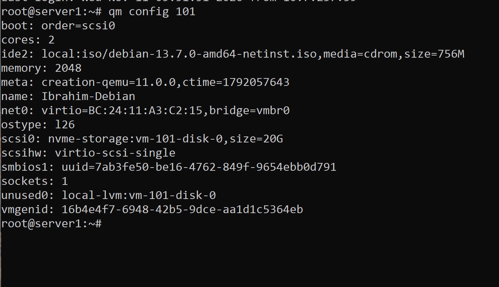

Dans le terminal Debian, les commandes `hostname` et `lsblk` ont ensuite confirmé une session fonctionnelle : le nom d’hôte est `ibrahim`, le disque virtuel `sda` mesure 20 Gio, la partition `sda1` de 18,9 Gio est montée sur `/` et `sda5` fournit environ 1,1 Gio de swap. Le nom `sda` dans Debian désigne le disque virtuel présenté au système invité ; le stockage physique NVMe est vérifié côté Proxmox.

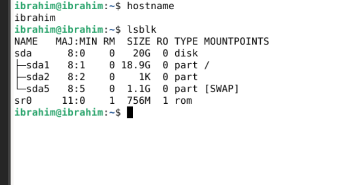

Ces deux captures complètent les preuves du transfert et de la présence du volume sur le NVMe. Elles confirment les résultats attendus de la partie individuelle.

## 13. Questions de réflexion

### 1. Quelle est la différence entre un HDD, un SSD SATA et un NVMe ?

Un HDD stocke les données sur des plateaux magnétiques avec des pièces mécaniques. Un SSD SATA utilise de la mémoire flash et communique par l’interface SATA. Un SSD NVMe utilise également de la mémoire flash, mais communique généralement par PCI Express avec le protocole NVMe. Il offre habituellement une latence plus faible et davantage de performances pour les accès simultanés. Les performances réelles dépendent du matériel et de la charge.

### 2. Quel est le rôle d’une partition ?

Une partition délimite une zone d’un disque pour un usage précis. Elle peut accueillir un système de fichiers, un espace d’échange ou un volume physique LVM. Dans ce laboratoire, `nvme0n1p1` accueille le PV LVM.

### 3. À quoi sert un système de fichiers ?

Il organise les fichiers, les répertoires et leurs métadonnées, et permet au système de les retrouver et de gérer leurs accès. Ext4 et XFS en sont des exemples. Un pool LVM-Thin constitue une autre couche : les systèmes de fichiers des machines virtuelles peuvent se trouver à l’intérieur de leurs disques virtuels.

### 4. Que signifient les acronymes PV, VG et LV ?

**PV** signifie Physical Volume, ou volume physique. **VG** signifie Volume Group, ou groupe de volumes. **LV** signifie Logical Volume, ou volume logique. Dans notre réalisation, la partition `nvme0n1p1` est le PV, `nvme-vg` est le VG et `data` est un LV de type thin pool.

### 5. Pourquoi Proxmox utilise-t-il souvent LVM-Thin ?

LVM-Thin alloue l’espace physique selon les écritures plutôt que de réserver immédiatement toute la capacité virtuelle annoncée. Il permet aussi des instantanés et des clones efficaces. La capacité du pool doit être surveillée pour éviter sa saturation.

### 6. Quelle commande permet d’afficher les stockages configurés dans Proxmox ?

```bash
pvesm status
```

Elle affiche notamment le nom, le type, l’état et l’occupation des stockages. Pour lister les volumes d’un stockage particulier, nous avons également utilisé `pvesm list nvme-storage`.

### 7. Quel est l’avantage d’utiliser un NVMe pour les machines virtuelles ?

Un NVMe peut accélérer les lectures et écritures, réduire les temps d’attente et mieux gérer plusieurs accès simultanés de machines virtuelles. Dans ce laboratoire, le transfert et la présence du disque ont été vérifiés, mais aucun test comparatif ne permet de chiffrer un gain de performances.

## 14. Conclusion

La partie en groupe a permis de préparer un NVMe d’environ 953,9 Gio, de créer son organisation LVM-Thin et de l’enregistrer comme stockage actif dans Proxmox. Dans ma partie individuelle, le disque de 20 Gio de la VM 101 a été transféré avec succès vers `nvme-storage`, puis retrouvé avec `pvesm list`. La configuration finale confirme que `scsi0` utilise ce stockage et la session Debian confirme que le système invité fonctionne après le déplacement. Les résultats attendus de la partie individuelle sont ainsi validés.

