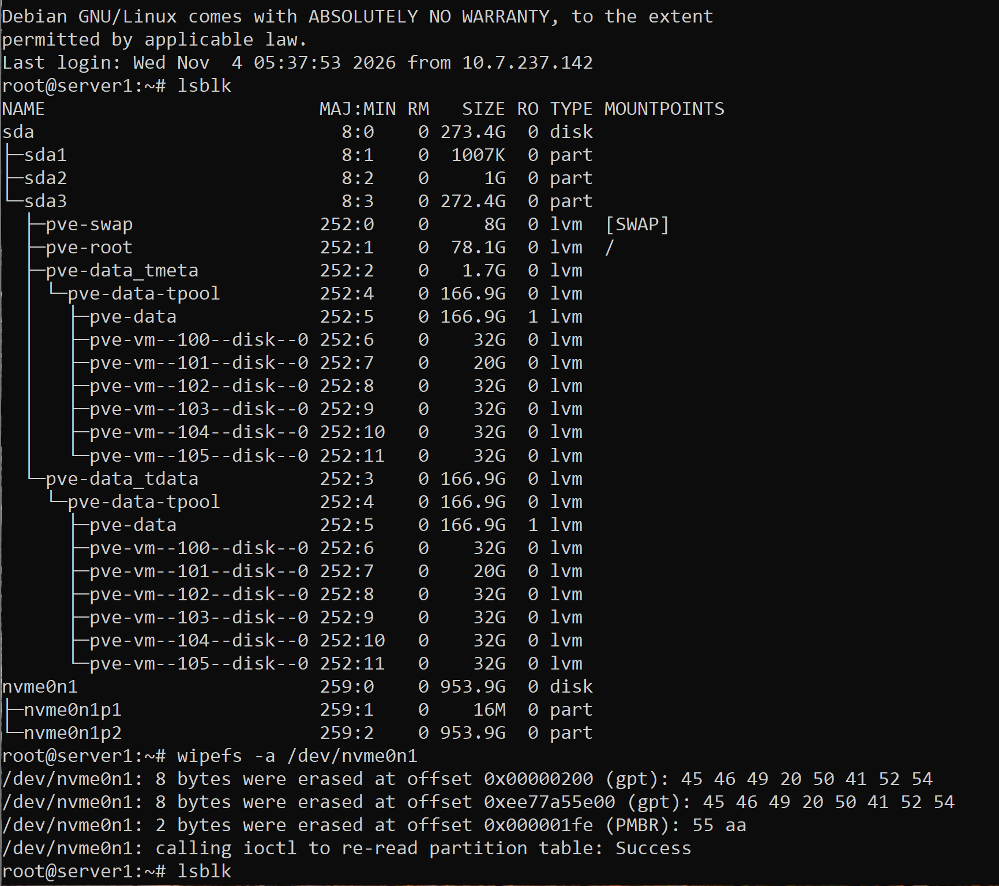
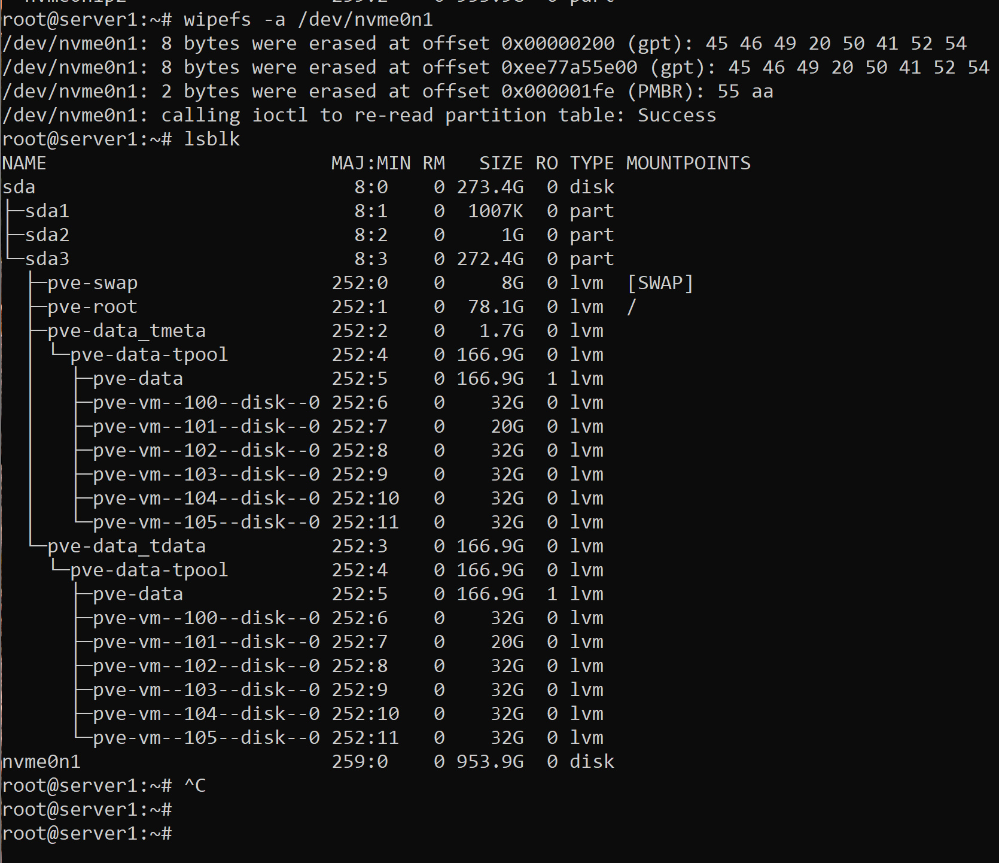
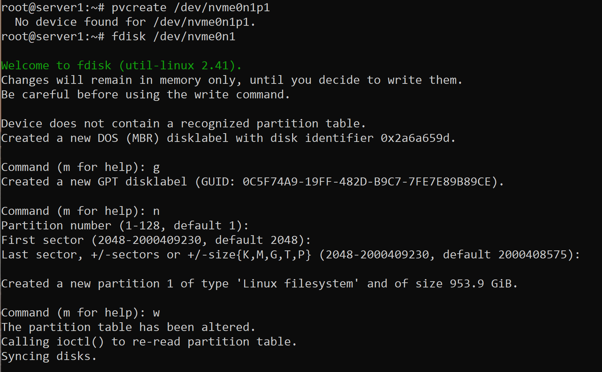
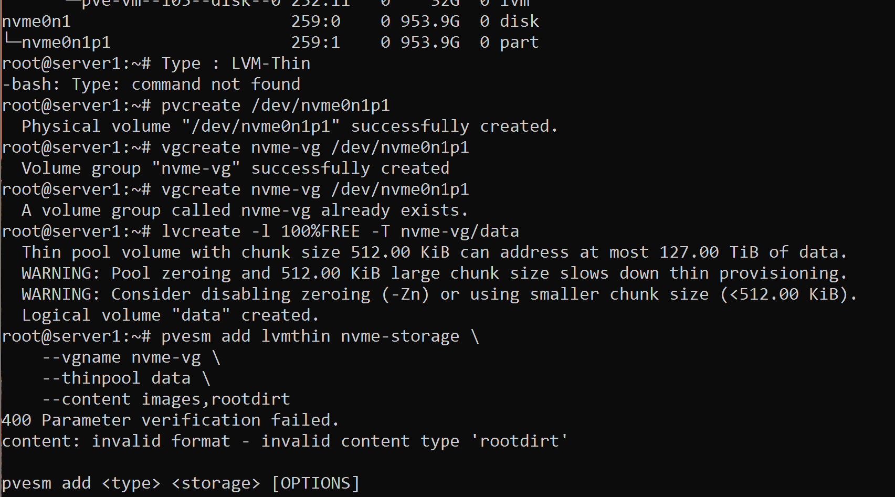
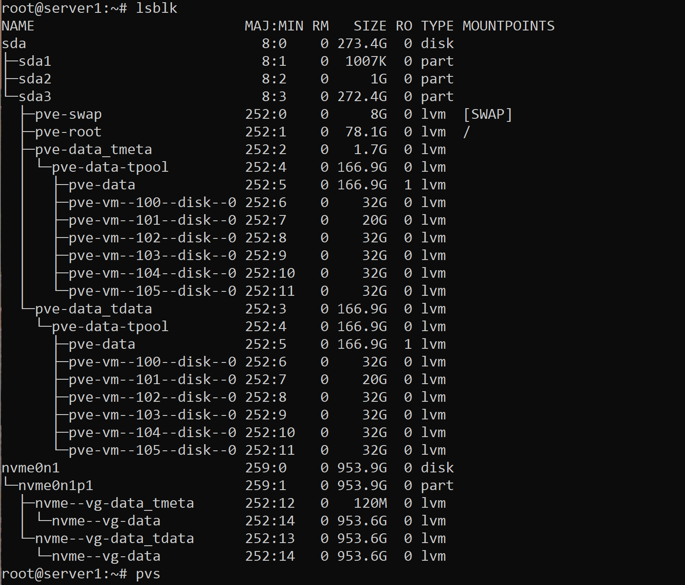
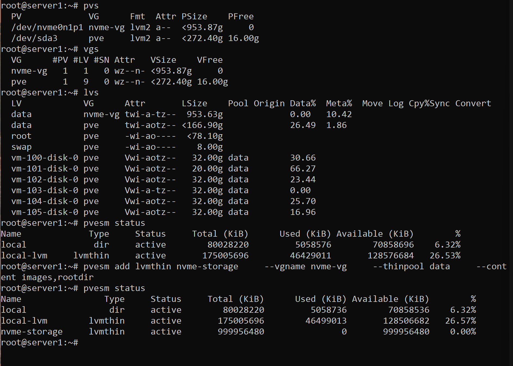

# Gestion du stockage sous Proxmox VE : NVMe, LVM-Thin et déplacement d'une VM

| | |
|---|---|
| **Cours** | INF1085-201-26A-04 — 5. Storage |
| **Étudiante** | Salma Baali (300158383) |
| **Groupe** | 2-31 |
| **Serveur** | HP ProLiant DL360 G7 — S/N USE044N2AL — étiquette S20 — nœud `server1` — `10.7.236.240` |
| **Ressources du serveur** | 64 Go de RAM, 16 CPU, disque `sda` de 273,4 Go, NVMe de 1 To |
| **Ma VM** | `104` |

> **Note :** la partie 1 (préparation du NVMe) a été réalisée en équipe (groupe 2-31) sur `server1` : les captures sont celles du groupe.

---

## Table des matières

1. [Objectifs](#1-objectifs)
2. [Notions importantes](#2-notions-importantes)
3. [Partie 1 — Préparer le NVMe et créer `nvme-storage`](#3-partie-1--préparer-le-nvme-et-créer-nvme-storage)
4. [Partie 2 — Déplacer le disque de la VM 104 vers le NVMe](#4-partie-2--déplacer-le-disque-de-la-vm-104-vers-le-nvme)
5. [Problèmes rencontrés](#5-problèmes-rencontrés)
6. [Questions de réflexion](#6-questions-de-réflexion)
7. [Conclusion](#7-conclusion)

---

## 1. Objectifs

- Identifier les disques présents dans un système Linux.
- Comprendre partition, système de fichiers et LVM.
- Créer un PV, un VG et un thin pool sur un disque NVMe.
- Ajouter ce disque comme stockage Proxmox (`nvme-storage`).
- Déplacer le disque d'une VM vers le stockage NVMe.

## 2. Notions importantes

```text
Disque physique → Partition → PV → VG → Thin Pool → Disques des VM
```

| Terme | Signification | Rôle |
|---|---|---|
| **PV** | Physical Volume | Disque ou partition utilisé par LVM |
| **VG** | Volume Group | Regroupe un ou plusieurs PV |
| **LV** | Logical Volume | Volume logique créé dans un VG |
| **Thin pool** | LVM-Thin | L'espace est alloué seulement quand il est utilisé |

Commandes utiles : `lsblk`, `fdisk -l`, `blkid`, `pvs`, `vgs`, `lvs`, `pvesm status`.

Stockages Proxmox :

| Stockage | Type | Contenu |
|---|---|---|
| `local` | dir | ISO, sauvegardes, templates |
| `local-lvm` | LVM-Thin | Disques des VM et conteneurs |
| `nvme-storage` | LVM-Thin | Créé sur le NVMe (partie 1) |

## 3. Partie 1 — Préparer le NVMe et créer `nvme-storage`

### 3.1 Disques avant l'opération

Sur `server1`, `lsblk` montre :
- `sda` de 273,4 G : système Proxmox (`pve-swap`, `pve-root`, `pve-data`) et les disques des VM 100 à 105 ;
- `nvme0n1` de 953,9 G, qui contient encore deux anciennes partitions (`nvme0n1p1` de 16 M et `nvme0n1p2` de 953,9 G), restes d'une ancienne installation.

On efface les signatures du NVMe :

```bash
wipefs -a /dev/nvme0n1
```



*Figure 1 — `lsblk` montrant les anciennes partitions du NVMe, puis `wipefs -a /dev/nvme0n1` (signatures GPT et PMBR effacées).*

### 3.2 Disques après l'opération

Après `wipefs`, `lsblk` montre `nvme0n1` (953,9 G) **sans aucune partition**. Le disque est propre.



*Figure 2 — `lsblk` après `wipefs` : `nvme0n1` n'a plus de partitions.*

### 3.3 Créer la partition GPT

Un premier `pvcreate /dev/nvme0n1p1` échoue (`No device found`) : la partition n'existe pas encore. On la crée avec `fdisk`.

```bash
fdisk /dev/nvme0n1
# g  → nouvelle table GPT
# n  → nouvelle partition (valeurs par défaut)
# w  → écrire
```

Résultat : une partition 1 de type Linux filesystem de **953,9 GiB**.



*Figure 3 — `fdisk /dev/nvme0n1` : table GPT et partition de 953,9 GiB.*

### 3.4 Créer le PV, le VG, le thin pool et ajouter le stockage

```bash
pvcreate /dev/nvme0n1p1
vgcreate nvme-vg /dev/nvme0n1p1
lvcreate -l 100%FREE -T nvme-vg/data
pvesm add lvmthin nvme-storage --vgname nvme-vg --thinpool data --content images,rootdir
```

Le PV et le VG `nvme-vg` sont créés. `lvcreate` crée le thin pool `data` avec deux avertissements : le *zeroing* du pool et la taille de chunk de 512 KiB, qui ralentissent un peu le thin provisioning. Ils n'empêchent pas la création.



*Figure 4 — `pvcreate`, `vgcreate`, `lvcreate -T` et première tentative de `pvesm add` (voir la section 5).*

### 3.5 Arbre LVM

`lsblk` montre maintenant `nvme0n1p1` (953,9 G) avec le thin pool `nvme--vg-data` de 953,6 G (métadonnées `tmeta` de 120 M).



*Figure 5 — `lsblk` : `nvme0n1p1` et le thin pool `nvme--vg-data`.*

### 3.6 Validation

```bash
pvs
vgs
lvs
pvesm status
```

- `pvs` : `/dev/nvme0n1p1` (`nvme-vg`, < 953,87 g, 0 libre) et `/dev/sda3` (`pve`, < 272,40 g, 16 g libres).
- `vgs` : `nvme-vg` (1 PV, 1 LV) et `pve` (1 PV, 9 LV).
- `lvs` : thin pool `data` de `nvme-vg` (953,63 g, 0,00 % utilisé), et les disques `vm-100` à `vm-105` dans `pve`.
- `pvesm status` : `nvme-storage`, type **lvmthin**, statut **active**, 999 956 480 KiB, 0,00 % utilisé.



*Figure 6 — `pvs`, `vgs`, `lvs` puis `pvesm status` : `nvme-storage` est actif.*

## 4. Partie 2 — Déplacer le disque de la VM 104 vers le NVMe

Ma VM est la VM `104` (`salma`). Son disque `vm-104-disk-0` fait 32 G et se trouve sur `local-lvm` (thin pool `pve-data`, visible à la figure 6).

```bash
qm list
qm config 104 | grep scsi0
qm move_disk 104 scsi0 nvme-storage
qm config 104 | grep scsi0
pvesm list nvme-storage
```

**Résultat attendu :**
- avant : `scsi0: local-lvm:vm-104-disk-0,size=32G` ;
- après : `scsi0: nvme-storage:vm-104-disk-0,size=32G` ;
- `pvesm list nvme-storage` affiche le disque de la VM.

[À COMPLÉTER : exécuter ces commandes sur `server1` et ajouter les captures ci-dessous.]

[CAPTURE 7 : `qm list` et `qm config 104` (avant)]

[CAPTURE 8 : `qm move_disk 104 scsi0 nvme-storage` (déplacement terminé)]

[CAPTURE 9 : `qm config 104` (après) et `pvesm list nvme-storage`]

Après un `move_disk`, Proxmox garde l'ancien volume sous le nom `unused0`. Pour libérer l'espace sur `local-lvm` :

```bash
qm set 104 --delete unused0
```

[CAPTURE 10 : suppression de `unused0` et `lsblk` final avec `nvme--vg`]

## 5. Problèmes rencontrés

| Problème | Cause | Correction |
|---|---|---|
| `pvcreate /dev/nvme0n1p1` → `No device found` | Après `wipefs`, le NVMe n'a plus de partition | Créer la partition avec `fdisk` (`g`, `n`, `w`) |
| `Type : LVM-Thin` → `command not found` | Ligne de texte tapée comme commande par erreur | Ignorée : ce n'était pas une commande |
| `vgcreate` une 2ᵉ fois → `A volume group called nvme-vg already exists` | Le VG existait déjà (créé à la commande précédente) | Aucune : le VG était bon |
| `pvesm add` → `400 Parameter verification failed … invalid content type` | Faute de frappe dans la valeur de `--content` (`rootdirt` au lieu de `rootdir`, d'après le groupe) | Commande refaite avec `--content images,rootdir` : `nvme-storage` apparaît ensuite dans `pvesm status` |
| Avertissements `lvcreate` (zeroing, chunk 512 KiB) | Réglages par défaut du thin pool | Pas bloquants ; on peut utiliser `-Zn` ou un chunk plus petit |

## 6. Questions de réflexion

**1. Différence entre HDD, SSD SATA et NVMe ?**
Le HDD est un disque mécanique : grande capacité, faible coût, plus lent. Le SSD SATA n'a pas de pièces mécaniques et est plus rapide. Le NVMe passe par le bus PCI Express et est le plus rapide.

**2. Rôle d'une partition ?**
Elle divise un disque en zones indépendantes pour organiser l'espace.

**3. À quoi sert un système de fichiers ?**
Il organise les données sur la partition (fichiers, dossiers, droits). Exemples : ext4, xfs, ntfs, fat32.

**4. Que signifient PV, VG et LV ?**
PV = Physical Volume, VG = Volume Group, LV = Logical Volume.

**5. Pourquoi Proxmox utilise-t-il souvent LVM-Thin ?**
Parce que l'espace est alloué seulement quand il est utilisé, ce qui permet de créer plusieurs disques de VM, de réserver plus que l'espace physique et de faire des instantanés.

**6. Quelle commande affiche les stockages Proxmox ?**
`pvesm status`

**7. Avantage d'un NVMe pour les VM ?**
Il est beaucoup plus rapide (débit et latence), ce qui améliore les performances des machines virtuelles.

## 7. Conclusion

Le disque NVMe de `server1` a été nettoyé (`wipefs`), partitionné en GPT, puis transformé en PV, VG `nvme-vg` et thin pool `data`. Le stockage `nvme-storage` (lvmthin) est actif dans Proxmox (`pvesm status`).

[À COMPLÉTER APRÈS LA PARTIE 2 : confirmer que le disque de la VM 104 est sur `nvme-storage`, que la VM fonctionne et que `unused0` a été supprimé.]
