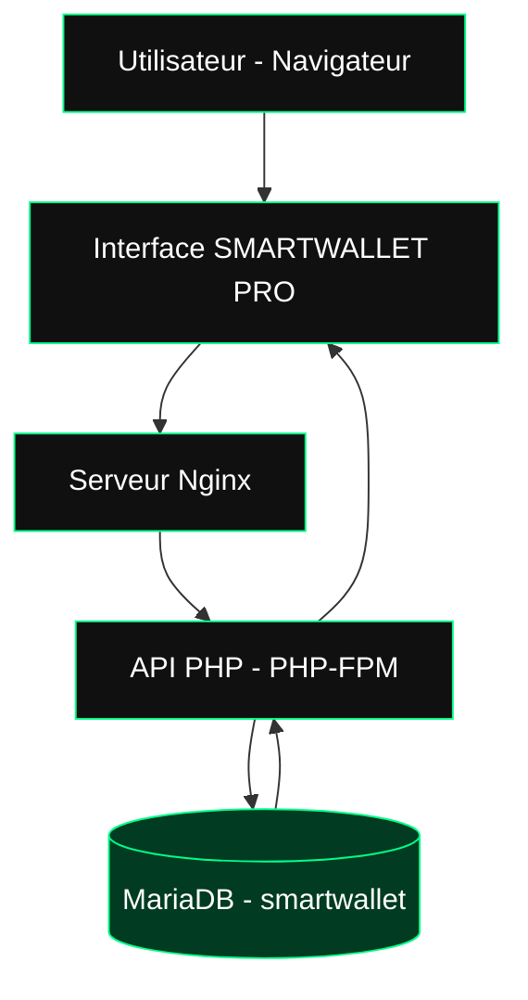
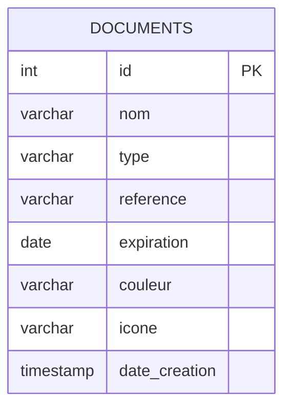

<div align="center">


# 💳 SMARTWALLET // PRO

### DIGITAL DOCUMENT MANAGEMENT SYSTEM


**Une nouvelle expérience de gestion numérique des documents personnels.**

</div>

---

## 01 — Présentation du projet

SMARTWALLET PRO est une application web permettant de centraliser et de gérer des documents personnels fictifs dans un portefeuille numérique interactif.

Le projet combine une interface moderne en trois dimensions, un serveur web Nginx, une API PHP et une base de données relationnelle MariaDB.

L'application est hébergée sur une machine virtuelle Debian 13 dans un environnement Proxmox VE.

Ce projet a été réalisé dans le cadre du cours INF1085 — Administration Linux au Collège Boréal, campus de Toronto.

---

## 02 — Objectifs

- Déployer une application web sous Linux.
- Configurer un serveur web Nginx.
- Administrer une machine virtuelle Debian.
- Concevoir une interface interactive et responsive.
- Installer et configurer MariaDB.
- Développer une API PHP.
- Assurer la persistance des données.
- Sécuriser les identifiants de connexion.
- Documenter et publier le projet sur GitHub.

---

## 03 — Fonctionnalités

| Fonctionnalité | Description | État |
|---|---|---|
| Portefeuille numérique | Interface interactive en 3D | ✅ |
| Animation des cartes | Ouverture, fermeture et rotation | ✅ |
| Recherche | Recherche des documents | ✅ |
| Ajout | Création de nouvelles cartes | ✅ |
| Suppression | Suppression des documents | ✅ |
| Expiration | Affichage des dates d'expiration | ✅ |
| Responsive Design | Adaptation aux différentes tailles d'écran | ✅ |
| Base de données | Stockage permanent dans MariaDB | ✅ |
| API PHP | Communication avec la base de données | ✅ |
| Sécurité SQL | Requêtes préparées PDO | ✅ |

---

## 04 — Technologies utilisées

<div align="center">


</div>

| Technologie | Utilisation |
|---|---|
| HTML5 | Structure de l'application |
| CSS3 | Design, animations et effets 3D |
| JavaScript | Interactions et requêtes HTTP |
| PHP 8.4 | Traitement des requêtes côté serveur |
| PDO | Connexion et requêtes SQL préparées |
| MariaDB | Stockage permanent des documents |
| Nginx | Serveur web |
| Debian 13 | Système d'exploitation |
| Proxmox VE | Virtualisation |
| SSH | Administration à distance |
| SCP | Transfert sécurisé des fichiers |
| GitHub | Gestion du code source |

---

## 05 — Architecture du système



L'utilisateur interagit avec l'interface web. JavaScript transmet les requêtes HTTP à l'API PHP, qui communique avec MariaDB à l'aide de PDO.

Les résultats sont retournés au format JSON et affichés dynamiquement dans l'application.

---

## 06 — Environnement de déploiement

| Paramètre | Configuration |
|---|---|
| Hyperviseur | Proxmox VE |
| Système | Debian 13 |
| Adresse IP | 10.7.236.205 |
| Serveur web | Nginx |
| Port HTTP | 80 |
| Port SSH | 22 |
| Backend | PHP 8.4-FPM |
| Base de données | MariaDB |
| Nom de la base | smartwallet |
| Répertoire web | /var/www/smartwallet |

### Accès à l'application

http://10.7.236.205

L'adresse est privée et accessible depuis un réseau disposant d'une route vers la machine virtuelle.

---

## 07 — Structure du projet

```text
300150410/
│
├── assets/
│   └── banner.svg
│
├── api/
│   └── documents.php
│
├── config/
│   ├── database.example.php
│   └── nginx.conf
│
├── database/
│   └── smartwallet.sql
│
├── images/
│   └── .gitkeep
│
├── .gitignore
├── index.html
└── README.md
```

---

## 08 — Installation des services

### Mise à jour du système

```bash
apt update
apt upgrade -y
```

### Installation des composants

```bash
apt install nginx mariadb-server php-fpm php-mysql -y
```

### Activation des services

```bash
systemctl enable --now nginx
systemctl enable --now mariadb
systemctl enable --now php8.4-fpm
```

### Vérification

```bash
systemctl status nginx
systemctl status mariadb
systemctl status php8.4-fpm
```

---

## 09 — Base de données MariaDB

La base de données `smartwallet` permet de conserver les documents de manière permanente.

Contrairement à la première version utilisant LocalStorage, les informations sont désormais enregistrées directement sur le serveur.

### Structure de la table documents

| Champ | Type | Description |
|---|---|---|
| id | INT | Identifiant unique |
| nom | VARCHAR(100) | Nom du document |
| type | VARCHAR(100) | Catégorie du document |
| reference | VARCHAR(100) | Référence du document |
| expiration | DATE | Date d'expiration |
| couleur | VARCHAR(50) | Couleur de la carte |
| icone | VARCHAR(20) | Icône du document |
| date_creation | TIMESTAMP | Date de création |

### Modèle relationnel



### Importation de la base

Depuis le répertoire du projet :

```bash
mariadb < database/smartwallet.sql
```

### Vérification des données

```bash
mariadb -e "SELECT id, nom, reference FROM smartwallet.documents;"
```

### Documents de démonstration

| ID | Document | Référence |
|---|---|---|
| 1 | Desjardins | DEMO-001 |
| 2 | RAMQ | DEMO-002 |
| 3 | SAAQ | DEMO-003 |
| 4 | Collège Boréal | DEMO-004 |
| 5 | Immatriculation | DEMO-005 |

Toutes les informations utilisées sont fictives.

---

## 10 — API PHP

L'API est disponible dans le fichier :

`api/documents.php`

Elle permet la communication entre JavaScript et MariaDB.

| Méthode HTTP | Endpoint | Action |
|---|---|---|
| GET | /api/documents.php | Afficher les documents |
| POST | /api/documents.php | Ajouter un document |
| DELETE | /api/documents.php?id=ID | Supprimer un document |

### Exemple de réponse JSON

```json
{
  "id": 1,
  "nom": "Desjardins",
  "type": "Assurance automobile",
  "reference": "DEMO-001",
  "expiration": "2027-12-31",
  "couleur": "vert",
  "icone": "🚗"
}
```

### Test de l'API

```bash
curl http://localhost/api/documents.php
```

Résultat obtenu : les cinq documents sont retournés au format JSON.

---

## 11 — Configuration de Nginx

```nginx
server {
    listen 80 default_server;
    listen [::]:80 default_server;

    server_name _;

    root /var/www/smartwallet;
    index index.html index.php;

    location / {
        try_files $uri $uri/ /index.html;
    }

    location ~ \.php$ {
        include snippets/fastcgi-php.conf;
        fastcgi_pass unix:/run/php/php8.4-fpm.sock;
    }

    add_header X-Content-Type-Options "nosniff" always;
    add_header X-Frame-Options "SAMEORIGIN" always;
    add_header Referrer-Policy "no-referrer" always;
}
```

### Déploiement des fichiers

Depuis le répertoire du projet, en tant que root :

```bash
mkdir -p /var/www/smartwallet/api

cp index.html /var/www/smartwallet/
cp api/documents.php /var/www/smartwallet/api/

cp config/nginx.conf /etc/nginx/sites-available/smartwallet

ln -sfn /etc/nginx/sites-available/smartwallet /etc/nginx/sites-enabled/smartwallet

rm -f /etc/nginx/sites-enabled/default
```

### Validation de la configuration

```bash
nginx -t
systemctl reload nginx
```

---

## 12 — Sécurisation

Plusieurs mesures de sécurité ont été appliquées :

- Utilisation d'un compte MariaDB dédié.
- Limitation des privilèges SQL.
- Utilisation de requêtes préparées PDO.
- Génération d'un mot de passe aléatoire de 48 caractères.
- Stockage des identifiants en dehors du répertoire web.
- Restriction des permissions du fichier de connexion.
- Utilisation de SSH et SCP.
- Exclusion des fichiers sensibles avec `.gitignore`.
- Configuration d'en-têtes de sécurité HTTP.
- Validation des données reçues par l'API.

### Création du compte MariaDB

Dans MariaDB :

```sql
CREATE USER 'smartwallet_user'@'localhost'
IDENTIFIED BY 'VOTRE_MOT_DE_PASSE';

GRANT SELECT, INSERT, UPDATE, DELETE
ON smartwallet.*
TO 'smartwallet_user'@'localhost';
```

Remplacer le mot de passe d'exemple par un mot de passe sécurisé.

### Configuration de la connexion PHP

```bash
mkdir -p /etc/smartwallet

cp config/database.example.php /etc/smartwallet/database.php

nano /etc/smartwallet/database.php
```

Renseigner le véritable mot de passe MariaDB dans ce fichier.

### Permissions du fichier

```bash
chown root:www-data /etc/smartwallet/database.php
chmod 640 /etc/smartwallet/database.php
```

Le véritable fichier de connexion n'est pas publié sur GitHub.

### Fichier .gitignore

```gitignore
database.php
.env
*.bak
*.log
```

---

## 13 — Tests et validation

| Test | Résultat |
|---|---|
| Connexion SSH | ✅ Réussi |
| Serveur Nginx | ✅ Opérationnel |
| Accès HTTP | ✅ Réussi |
| Configuration Nginx | ✅ Valide |
| Connexion PHP à MariaDB | ✅ Réussie |
| Lecture des documents | ✅ Réussie |
| Ajout d'un document | ✅ Réussi |
| Suppression d'un document | ✅ Réussie |
| Persistance des données | ✅ Confirmée |
| Exportation SQL | ✅ Réussie |
| Syntaxe PHP | ✅ Aucune erreur |
| Changement du mot de passe | ✅ Réussi |
| Transfert SCP | ✅ Réussi |
| Publication GitHub | ✅ Réussie |

### Test de persistance

Une carte nommée `TEST MARIADB` a été créée depuis l'interface web.

Une requête SQL a confirmé son enregistrement dans la base de données.

La carte a ensuite été supprimée depuis l'application.

Une nouvelle vérification SQL a confirmé que seuls les cinq documents originaux étaient présents.

### Résultat final

```text
+----+------------------+-----------+
| id | nom              | reference |
+----+------------------+-----------+
|  1 | Desjardins       | DEMO-001  |
|  2 | RAMQ             | DEMO-002  |
|  3 | SAAQ             | DEMO-003  |
|  4 | Collège Boréal   | DEMO-004  |
|  5 | Immatriculation  | DEMO-005  |
+----+------------------+-----------+
```

---

## 14 — Sauvegarde de la base de données

La base MariaDB a été exportée avec la commande :

```bash
mariadb-dump --databases smartwallet > smartwallet.sql
```

Le fichier SQL est disponible dans :

`database/smartwallet.sql`

Cette sauvegarde permet de restaurer la structure de la base et les documents de démonstration.

---

## 15 — Améliorations futures

- Authentification des utilisateurs.
- Mise en place du protocole HTTPS.
- Modification des documents existants.
- Gestion de plusieurs utilisateurs.
- Chiffrement des données sensibles.
- Notifications avant expiration.
- Sauvegardes automatiques avec CRON.
- Importation de documents PDF.

---

## 16 — Limites et avertissement

SMARTWALLET PRO est un projet pédagogique.

Les cartes présentées sont des représentations fictives et ne constituent pas des documents officiels.

L'application ne dispose pas encore d'authentification ni de chiffrement HTTPS. Elle ne doit pas être utilisée pour stocker de véritables informations personnelles ou confidentielles.

---

## 17 — Documentation technique

- [Debian](https://www.debian.org/doc/)
- [Proxmox VE](https://pve.proxmox.com/pve-docs/)
- [Nginx](https://nginx.org/en/docs/)
- [MariaDB](https://mariadb.com/docs/)
- [PHP PDO](https://www.php.net/manual/fr/book.pdo.php)
- [GitHub](https://docs.github.com/fr)

---

## 18 — Conclusion

La réalisation du projet SMARTWALLET PRO m'a permis de mettre en pratique les connaissances acquises en administration Linux, virtualisation, développement web et gestion des bases de données.

J'ai installé et configuré un environnement Debian sur Proxmox, déployé un serveur Nginx et développé une application web interactive.

L'intégration de PHP et MariaDB a permis de remplacer le stockage local par une véritable base de données relationnelle, assurant ainsi la persistance des documents.

Les tests réalisés ont confirmé le bon fonctionnement de la lecture, de l'ajout et de la suppression des documents.

Ce projet représente une solution fonctionnelle de démonstration combinant administration système, développement web, gestion des données et sécurité informatique.

---

## 19 — Auteur

<div align="center">

### LACHI LAHLOU

**Collège Boréal — Campus Toronto**

Techniques des systèmes informatiques — TSIQ

**Cours : INF1085 — Administration Linux**

**Matricule : 300150410**

**Année : 2026**


---

**SMARTWALLET // PRO**

`DESIGN • TECHNOLOGY • SECURITY`

© 2026 — Projet pédagogique

</div>
