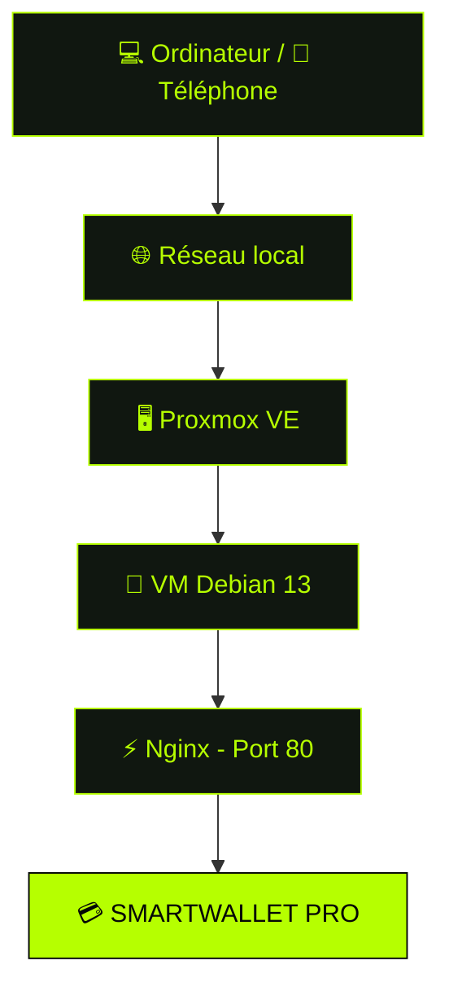

<div align="center">


### 🔥 YOUR LIFE. ONE WALLET. 🔥

[🚀 Lancer SmartWallet PRO](http://10.7.236.205)

</div>

---
## ⚡ Présentation du projet

**SMARTWALLET // PRO** est une application web interactive de gestion de documents personnels dans un portefeuille numérique en 3D.

Son design futuriste combine le noir carbone, le vert néon, des reflets métalliques et des animations fluides inspirées des portefeuilles numériques modernes.

L'application est hébergée sur une machine virtuelle Debian via Proxmox VE et propulsée par Nginx.

---

## 🛠️ Technologies utilisées

<div align="center">


</div>

---

## 🔥 Fonctionnalités principales

| Fonctionnalité | Description |
| :--- | :--- |
| 💳 Wallet 3D | Portefeuille numérique interactif |
| 🔥 Animation | Ouverture et fermeture des cartes |
| 🔄 Flip 3D | Retournement à 180 degrés |
| 💎 Premium Design | Noir carbone et vert néon |
| ✨ Effets visuels | Reflets métalliques |
| 📱 Responsive | Interface mobile et ordinateur |
| 🔍 Recherche | Recherche instantanée |
| ➕ Ajout | Création de documents |
| 🗑️ Suppression | Gestion des documents |
| 💾 LocalStorage | Sauvegarde locale |
| 📊 Dashboard | Statistiques des documents |
| ⏳ Expiration | Suivi des renouvellements |

---

## 💳 Collection de cartes

| Carte | Document | Couleur |
| :--- | :--- | :---: |
| Desjardins | Assurance automobile | 🟢 |
| RAMQ | Assurance maladie | 🔵 |
| SAAQ | Permis de conduire | 🟠 |
| Collège Boréal | Carte étudiante | 🟣 |
| Immatriculation | Certificat du véhicule | ⚫ |

> Toutes les cartes sont fictives et non officielles.

---

## 📸 Aperçu de l'application

<!-- Ajouter ici les images de l'application si nécessaire -->

---

## 🖥️ Architecture et infrastructure

| Composant | Configuration |
| :--- | :--- |
| Hyperviseur | Proxmox VE |
| Système | Debian 13 |
| Serveur web | Nginx |
| Adresse IP | 10.7.236.205 |
| Port | 80 |
| Protocole | HTTP |
| Administration | PowerShell via SSH |
| Frontend | HTML5, CSS3, JavaScript |
| Stockage | LocalStorage |
| Répertoire | /var/www/smartwallet |
| Fichier principal | index.html |



---

## 🚀 Installation et déploiement

### 01 — Connexion SSH depuis PowerShell

```powershell
ssh lahloulachi@10.7.236.205
```

Connexion en administrateur :

```bash
su -
```

### 02 — Installation de Nginx

```bash
apt update
apt install -y nginx curl ca-certificates
systemctl enable --now nginx
```

Vérification :

```bash
systemctl is-active nginx
```

Résultat obtenu :

```text
active
```

### 03 — Création du répertoire web

```bash
mkdir -p /var/www/smartwallet
cd /var/www/smartwallet
nano index.html
```

Le fichier `index.html` contient le code HTML, CSS et JavaScript de l'application.

### 04 — Configuration de Nginx

```bash
nano /etc/nginx/sites-available/smartwallet
```

Configuration :

```nginx
server {
    listen 80 default_server;
    listen [::]:80 default_server;

    server_name _;
    root /var/www/smartwallet;
    index index.html;

    location / {
        try_files $uri $uri/ /index.html;
    }

    add_header X-Content-Type-Options "nosniff" always;
    add_header X-Frame-Options "SAMEORIGIN" always;
    add_header Referrer-Policy "no-referrer" always;
}
```

### 05 — Activation du site

```bash
rm -f /etc/nginx/sites-enabled/default
ln -sf /etc/nginx/sites-available/smartwallet /etc/nginx/sites-enabled/smartwallet
nginx -t
systemctl reload nginx
```

Résultat obtenu :

```text
nginx: the configuration file /etc/nginx/nginx.conf syntax is ok
nginx: configuration file /etc/nginx/nginx.conf test is successful
```

### 06 — Test HTTP

```bash
curl -I http://10.7.236.205
```

Résultat obtenu :

```text
HTTP/1.1 200 OK
Server: nginx
Content-Type: text/html
Content-Length: 51097
Connection: keep-alive
X-Content-Type-Options: nosniff
X-Frame-Options: SAMEORIGIN
Referrer-Policy: no-referrer
```

---

## 🟢 État du déploiement

| Vérification | Résultat |
| :--- | :---: |
| Installation de Nginx | ✅ |
| Connexion SSH | ✅ |
| Création du répertoire web | ✅ |
| Configuration Nginx | ✅ |
| Déploiement de l'application | ✅ |
| Réponse HTTP 200 OK | ✅ |

<div align="center">


[](http://10.7.236.205)

</div>

L'application est accessible sur le réseau local autorisé.

---

## 🛡️ Sécurité et bonnes pratiques

- Administration distante via SSH.
- Utilisation d'une adresse IP privée.
- Configuration des en-têtes de sécurité HTTP.
- Utilisation exclusive de documents fictifs.
- Aucun stockage de véritables informations sensibles.
- Accès limité aux réseaux autorisés.

Le stockage LocalStorage n'est pas chiffré.

---

## 🔮 Améliorations futures

- [ ] Installation d'un certificat HTTPS.
- [ ] Authentification des utilisateurs.
- [ ] Intégration d'une base de données.
- [ ] Notifications de renouvellement.
- [ ] Transformation en application PWA.
- [ ] Accès distant sécurisé via VPN.

---

## 📚 Documentation officielle

- [Proxmox VE](https://pve.proxmox.com/pve-docs/)
- [Debian](https://www.debian.org/doc/)
- [Nginx](https://nginx.org/en/docs/)
- [MDN Web Docs](https://developer.mozilla.org/fr/)
- [OpenSSH](https://www.openssh.com/)

---

## 🎯 Conclusion

Ce projet m'a permis de mettre en pratique mes connaissances en administration Linux, virtualisation, administration distante et configuration de serveurs web.

J'ai installé et configuré Nginx sur une machine virtuelle Debian hébergée dans Proxmox VE, puis déployé une application web interactive de gestion de documents personnels.

Les tests effectués confirment la validité de la configuration Nginx et la disponibilité du serveur web avec une réponse HTTP 200 OK.

---

<div align="center">

## 👨‍💻 Auteur

### LACHI LAHLOU

**Collège Boréal | Campus Toronto | TSIQ**


---

### 🔥 YOUR LIFE. ONE WALLET. 🔥

**SMARTWALLET // PRO**

</div>
