# Projet « 6.Projects » — Wiki Polyglotte

**Hacene Ifticene — 300150470 — 25 novembre 2026 — INF1085**

🌐 **Wiki en ligne : http://10.7.236.207/mediawiki/**

---

## 1. Présentation

Pour le projet « 6.Projects » du cours INF1085, j'ai installé **MediaWiki**, le logiciel qui fait tourner Wikipédia, sur ma propre VM, pour créer mon propre site wiki : **« Wiki Polyglotte »**.

Mon wiki parle de **Sudbury**, la ville où j'étudie, en **5 langues** : français, anglais, espagnol, arabe et tamazight. Chaque langue a sa propre page, et les pages sont liées entre elles.

**Ma VM :**

- VM 102, Debian 13, sur le nœud server237 (10.7.236.237)
- Adresse IP : **10.7.236.207**
- Nom d'utilisateur : `b300150470`

---

## 2. Mise à jour du système

Avant d'installer quoi que ce soit, j'ai mis à jour la liste des paquets avec `apt update`. 27,7 Mo reçus, 92 paquets à mettre à jour.

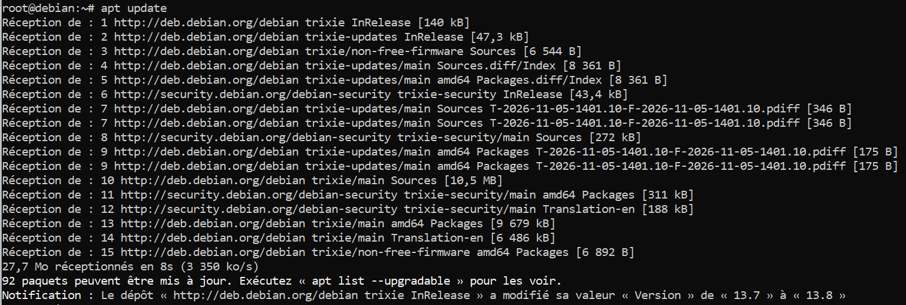

---

## 3. Installation d'Apache, MariaDB et PHP

MediaWiki a besoin d'un serveur web (Apache), d'une base de données (MariaDB) et de PHP. Je les ai installés en une seule commande, en root :

```bash
apt install -y apache2 mariadb-server php php-mysql libapache2-mod-php php-xml php-mbstring php-intl php-gd php-curl php-zip
```

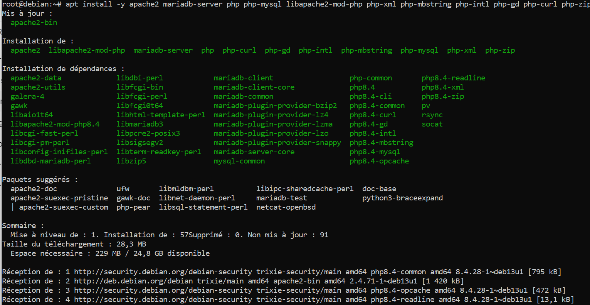

---

## 4. Vérification des services

J'ai vérifié qu'Apache et MariaDB tournent bien avec `systemctl is-active apache2 mariadb`. Les deux ont répondu « active ».

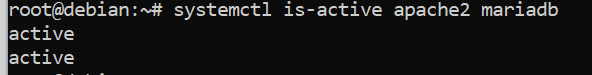

---

## 5. Téléchargement de MediaWiki

J'ai téléchargé **MediaWiki 1.43.12**, la version LTS (support à long terme), depuis le site officiel, avec `wget`. Le fichier fait environ 89 Mo.

```bash
wget https://releases.wikimedia.org/mediawiki/1.43/mediawiki-1.43.12.tar.gz
```

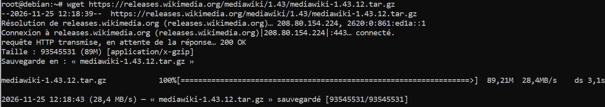

---

## 6. Décompression et permissions

J'ai décompressé l'archive dans `/var/www/html/` (le dossier d'Apache) et renommé le dossier en « mediawiki ». Ensuite, j'ai donné le dossier à l'utilisateur `www-data` (Apache) avec `chown`, pour que le site puisse écrire ses fichiers.

```bash
tar -xzf mediawiki-1.43.12.tar.gz -C /var/www/html/
mv /var/www/html/mediawiki-1.43.12 /var/www/html/mediawiki
chown -R www-data:www-data /var/www/html/mediawiki
```

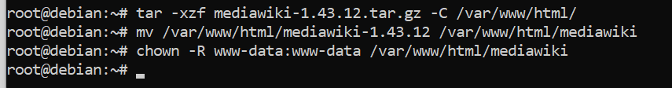

---

## 7. Création de la base de données

J'ai créé la base de données **« polyglotte_db »** et un utilisateur **« polyglotte »** pour le wiki, avec `mysql`, puis je lui ai donné tous les droits sur la base :

```sql
CREATE DATABASE polyglotte_db;
CREATE USER 'polyglotte'@'localhost' IDENTIFIED BY '***';
GRANT ALL PRIVILEGES ON polyglotte_db.* TO 'polyglotte'@'localhost';
FLUSH PRIVILEGES;
SHOW DATABASES;
```

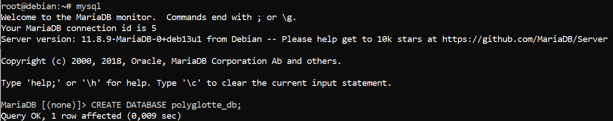

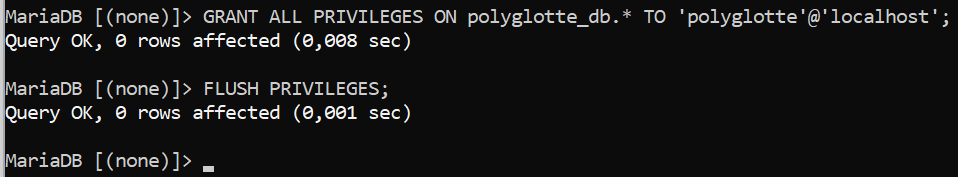

J'ai vérifié avec `SHOW DATABASES` que la base existe bien dans la liste.

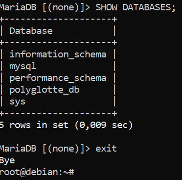

---

## 8. L'installateur web

J'ai ouvert http://10.7.236.207/mediawiki/ dans mon navigateur et suivi l'installateur web de MediaWiki, en français : langue, vérification de l'environnement, paramètres de la base de données (`polyglotte_db`, utilisateur `polyglotte`), nom du wiki **« Wiki Polyglotte »**, compte administrateur **« Admin »**, et habillage **Vector** par défaut, le thème de Wikipédia.

L'installateur a créé toutes les tables. Toutes les étapes sont marquées « terminé », et le message « La base de données a été bien installée » s'est affiché.

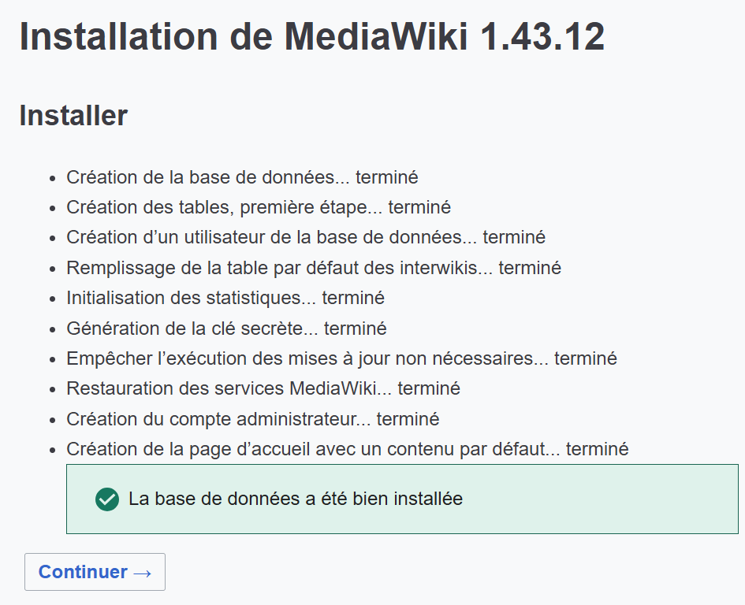

---

## 9. Le fichier LocalSettings.php

L'installateur a généré le fichier de configuration `LocalSettings.php`. Je l'ai téléchargé, puis envoyé sur ma VM avec `scp`, depuis PowerShell, sur mon PC :

```bash
scp C:\Users\hp\Downloads\LocalSettings.php b300150470@10.7.236.207:/tmp/LocalSettings.php
```

Le transfert est arrivé à 100 % (4 379 octets).

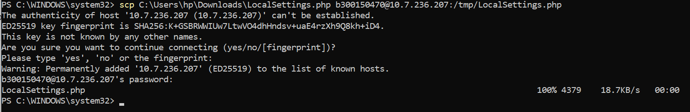

Puis, en root dans ma session SSH, je l'ai copié dans le dossier du wiki :

```bash
cp /tmp/LocalSettings.php /var/www/html/mediawiki/ && chown www-data:www-data /var/www/html/mediawiki/LocalSettings.php
```

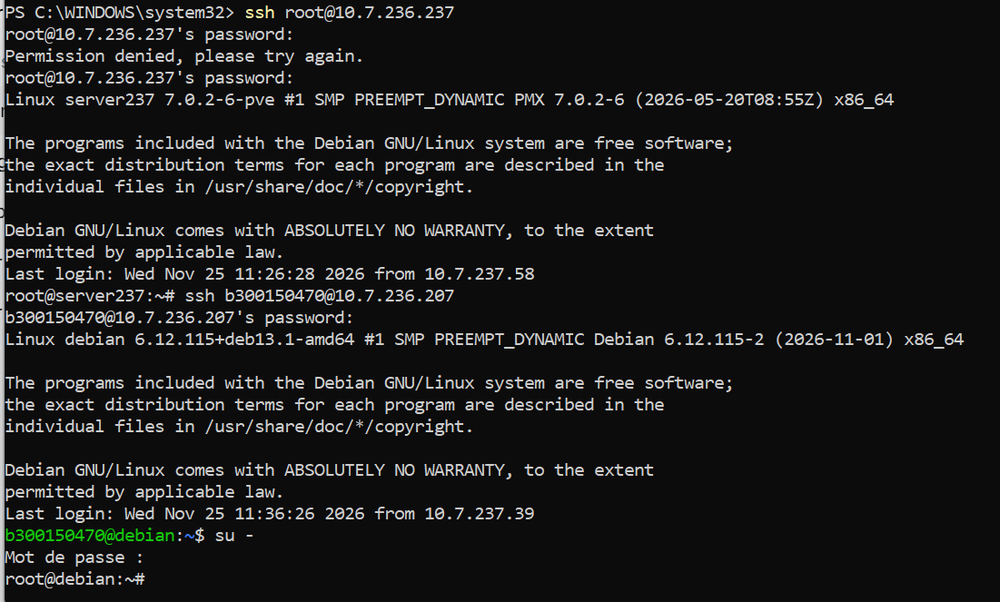

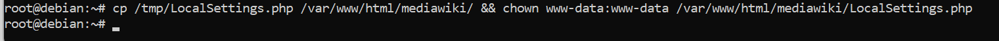

---

## 10. La page Sudbury, en français

✅ J'ai rouvert http://10.7.236.207/mediawiki/ dans mon navigateur : la page d'accueil du wiki s'affiche, avec le nom « Wiki Polyglotte ». **Mon wiki marche.** Je me suis connectée en Admin.

Ensuite, j'ai créé ma première page : **Sudbury**, en français. Elle a 5 sections : Histoire, Les mines, Les lacs, Le Collège Boréal, et « Sudbury en d'autres langues », avec des liens vers les 4 autres langues. Le message « La page a été créée » s'est affiché.

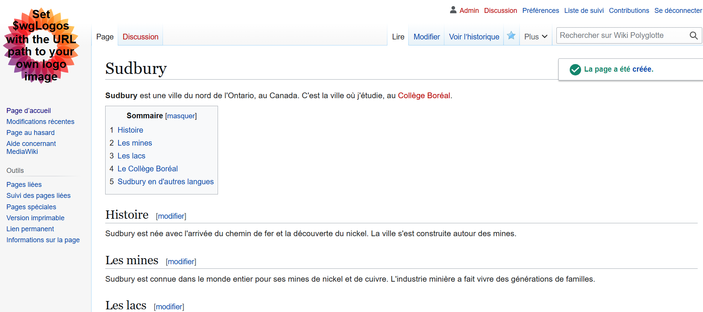

> **Sudbury** est une ville du nord de l'Ontario, au Canada. C'est la ville où j'étudie, au Collège Boréal. Sudbury est née avec l'arrivée du chemin de fer et la découverte du nickel. La ville s'est construite autour des mines. Sudbury est connue dans le monde entier pour ses mines de nickel et de cuivre. La région compte plus de 300 lacs. Le lac Ramsey, au centre-ville, est un des plus connus. Le Collège Boréal est un collège francophone de l'Ontario.

---

## 11. La suite : Sudbury en 5 langues

La page en français est faite. Les 4 autres pages sont liées depuis elle, à créer ensuite, avec le même plan (histoire, mines, lacs, Collège Boréal) :

- **Sudbury in English** — anglais
- **Sudbury en español** — espagnol
- **Sudbury en arabe** — arabe
- **Sudbury en tamazight** — tamazight

L'interface du wiki reste en français, et c'est le contenu qui est multilingue : c'est ça, mon « Wiki Polyglotte ».

---

## 12. Conclusion

Ce projet m'a appris à installer une vraie application web complète : un serveur web (Apache), une base de données (MariaDB) et PHP, puis à configurer l'application avec son installateur web, et à créer mes propres pages dans un wiki que j'ai installé moi-même.

---

## Informations techniques

| Élément | Valeur |
|---|---|
| VM | 102 (Debian 13), nœud server237 |
| Adresse IP de la VM | 10.7.236.207 |
| Serveur web | Apache 2.4.71 |
| Base de données | MariaDB 11.8.9 |
| PHP | 8.4.28 |
| MediaWiki | 1.43.12 LTS |
| Dossier du wiki | `/var/www/html/mediawiki` |
| Base de données | polyglotte_db, utilisateur polyglotte |
| URL du wiki | http://10.7.236.207/mediawiki/ |
| Nom du wiki | Wiki Polyglotte |
| Compte administrateur du wiki | Admin |
| Habillage par défaut | Vector |
| Langue de l'interface | Français (fr) |
| Page créée | Sudbury (français, 5 sections) |
| Pages à créer | Sudbury in English, Sudbury en español, Sudbury en arabe, Sudbury en tamazight |
