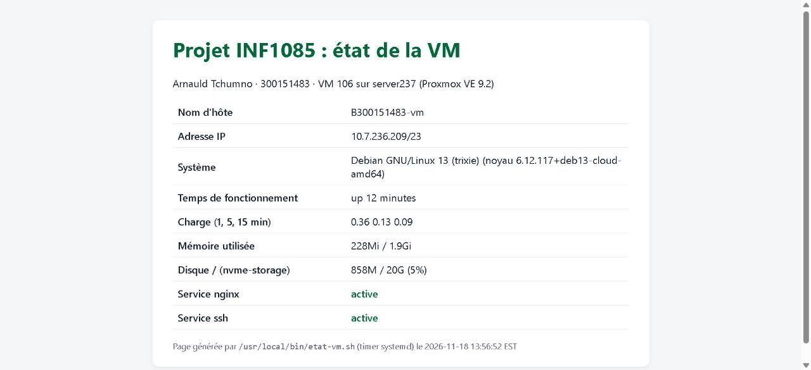

# 🥣 Projects - Page d'état de ma VM avec Nginx et systemd

| Champ | Valeur |
|-------|--------|
| Nom | Arnauld Tchumno |
| Numéro étudiant | 300151483 |
| Groupe | 1️⃣ |
| Machine virtuelle | VM 106 - `B300151483-vm` sur `server237` |
| Adresse du projet | **http://10.7.236.209** |
| Date | 18 novembre 2026 |

## 🎯 Objectif

Créer un projet sur ma machine virtuelle. J'ai choisi un petit **tableau de bord web**. Nginx sert une page qui affiche l'état de la VM : IP, système, mémoire, disque et services. Un **timer systemd** régénère cette page chaque minute.

Ce projet réutilise les notions des chapitres précédents :
- la VM et son IP fixe (3.VMs) ;
- le disque sur `nvme-storage` (5.Storage) ;
- l'administration Linux : paquets, services, scripts Bash et `systemd`.

## Architecture

```text
 Navigateur ──HTTP:80──►  nginx  ──►  /var/www/html/index.html
                                              ▲
                                              │ réécrite chaque minute
 etat-vm.timer ──(60 s)──► etat-vm.service ──► /usr/local/bin/etat-vm.sh
```

---

## 1. Installer Nginx

```bash
sudo apt-get update
sudo apt-get install -y nginx
systemctl is-active nginx      # active
```

Debian active et démarre le service automatiquement à l'installation.

---

## 2. Le script de génération

`/usr/local/bin/etat-vm.sh` lit les informations du système puis écrit la page HTML :

```bash
#!/bin/bash
# Projet INF1085 - 300151483 : page d'état de la VM, régénérée chaque minute
OUT=/var/www/html/index.html
HOTE=$(hostname)
IP=$(ip -4 -o addr show eth0 | awk '{print $4}')
OS=$(. /etc/os-release; echo "$PRETTY_NAME")
NOYAU=$(uname -r)
UPTIME=$(uptime -p)
CHARGE=$(cut -d' ' -f1-3 /proc/loadavg)
MEM=$(free -h | awk '/^Mem/{print $3" / "$2}')
DISQUE=$(df -h / | awk 'NR==2{print $3" / "$2" ("$5")"}')
NGINX=$(systemctl is-active nginx)
SSH=$(systemctl is-active ssh)
DATE=$(date '+%Y-%m-%d %H:%M:%S %Z')
cat > "$OUT.tmp" <<HTML
... (page HTML : un tableau avec les variables ci-dessus) ...
HTML
mv "$OUT.tmp" "$OUT"
```

| Commande | Information affichée |
|----------|----------------------|
| `ip -4 -o addr show eth0` | adresse IP et masque |
| `/etc/os-release`, `uname -r` | distribution et noyau |
| `uptime -p`, `/proc/loadavg` | temps de fonctionnement et charge |
| `free -h` | mémoire utilisée / totale |
| `df -h /` | espace disque utilisé |
| `systemctl is-active` | état des services nginx et ssh (vert si `active`, rouge sinon) |

> **Écriture atomique** : le script écrit d'abord dans `index.html.tmp`, puis fait un `mv`. Un visiteur ne voit donc jamais une page à moitié écrite.

```bash
sudo chmod 755 /usr/local/bin/etat-vm.sh
```

---

## 3. Automatiser avec un timer systemd

Plutôt que `cron`, j'ai utilisé un **timer systemd** :
- les exécutions sont visibles dans `journalctl` ;
- la commande `systemctl list-timers` montre la prochaine exécution.

`/etc/systemd/system/etat-vm.service` :

```ini
[Unit]
Description=Génère la page d etat de la VM (projet INF1085)

[Service]
Type=oneshot
ExecStart=/usr/local/bin/etat-vm.sh
```

`/etc/systemd/system/etat-vm.timer` :

```ini
[Unit]
Description=Met a jour la page d etat chaque minute

[Timer]
OnBootSec=30s
OnUnitActiveSec=60s

[Install]
WantedBy=timers.target
```

Activation :

```bash
sudo systemctl daemon-reload
sudo systemctl enable --now etat-vm.timer
sudo systemctl start etat-vm.service      # première génération immédiate
```

J'ai aussi réglé le fuseau horaire pour que l'heure affichée soit celle de Sudbury :

```bash
sudo timedatectl set-timezone America/Toronto
```

---

## 4. Vérifications

```text
$ systemctl is-active nginx etat-vm.timer
active
active
$ systemctl list-timers etat-vm.timer
NEXT                        LEFT LAST                         PASSED UNIT          ACTIVATES
Wed 2026-11-18 13:57:52 EST  18s Wed 2026-11-18 13:56:37 EST 56s ago etat-vm.timer etat-vm.service
```

Depuis mon navigateur, à l'adresse **http://10.7.236.209** :



*Figure 1 : La page servie par Nginx depuis ma VM. On y voit le nom d'hôte `B300151483-vm`, l'IP `10.7.236.209/23`, Debian 13 (trixie) avec le noyau `6.12.117+deb13-cloud-amd64`, 228 Mio de RAM utilisés sur 1,9 Gio, 858 Mo utilisés sur les 20 Go du disque (sur `nvme-storage`), et les services nginx et ssh `active`. La date en bas de page, générée à 13:56:52 EST, change chaque minute.*

---

## 🛠️ Problèmes rencontrés

| Problème | Cause | Solution |
|----------|-------|----------|
| `nginx: command not found` en vérifiant la version | `nginx` est dans `/usr/sbin`, qui n'est pas dans le `PATH` d'un utilisateur normal | `sudo nginx -v` ou `/usr/sbin/nginx -v` |
| Heure affichée en UTC | Les images cloud Debian sont en UTC par défaut | `timedatectl set-timezone America/Toronto` |

## 🚀 Améliorations possibles

- Ajouter un historique de la charge, par exemple en ajoutant une ligne à un fichier CSV à chaque exécution.
- Passer en HTTPS avec un certificat auto-signé.
- Limiter l'accès au réseau du collège avec `nftables`.

## ✅ Bilan

- [x] Projet créé sur ma VM (VM 106, `10.7.236.209`)
- [x] Serveur web Nginx installé et actif
- [x] Script Bash qui collecte l'état du système
- [x] Mise à jour automatique chaque minute par un timer systemd
- [x] Page accessible depuis le réseau du collège
