# Projet — Installation de MediaWiki sur ma VM Debian

**Amirouche — 300151834 — 25 novembre 2026 — INF1085**

🌐 **Wiki en ligne : http://10.7.236.215/mediawiki/**

---

## 1. Présentation du projet

Pour le projet « 6.Projects » du cours INF1085, le professeur nous a demandé de créer un projet sur notre propre VM. J'ai choisi d'installer **MediaWiki**, le logiciel qui fait tourner Wikipédia, pour créer mon propre site wiki. Mon wiki s'appelle **« Wiki Amirouche »**.

**Ma VM :**

- VM 103, Debian 13, sur le nœud server238 (10.7.236.235)
- Adresse IP de ma VM : **10.7.236.215**
- Nom d'utilisateur : `amirouche`

---

## 2. Connexion à ma VM

Je me suis connecté à ma VM en SSH depuis le terminal de mon PC (PowerShell) avec la commande `ssh amirouche@10.7.236.215`. Ensuite, je suis passé en root avec `su -`, parce que l'installation demande les droits d'administrateur.

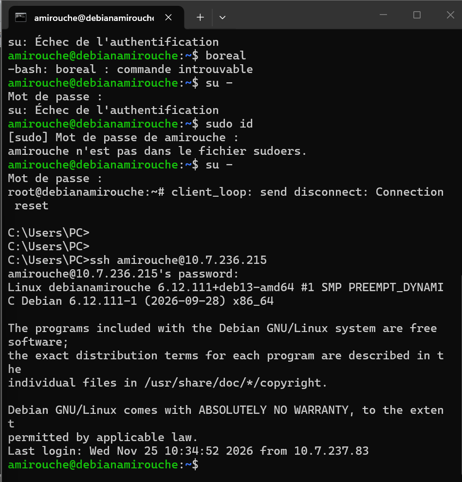

---

## 3. Mise à jour du système

Avant d'installer quoi que ce soit, j'ai mis à jour la liste des paquets avec la commande `apt update`.

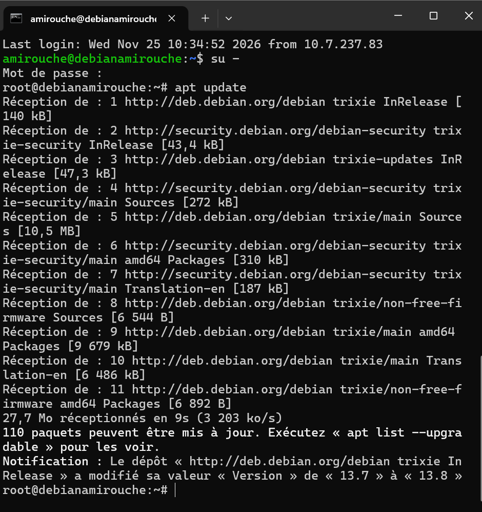

---

## 4. Installation d'Apache, MariaDB et PHP

MediaWiki a besoin d'un serveur web (Apache), d'une base de données (MariaDB) et de PHP. Je les ai installés en une seule commande :

```bash
apt install -y apache2 mariadb-server php php-mysql libapache2-mod-php php-xml php-mbstring php-intl php-gd php-curl php-zip
```

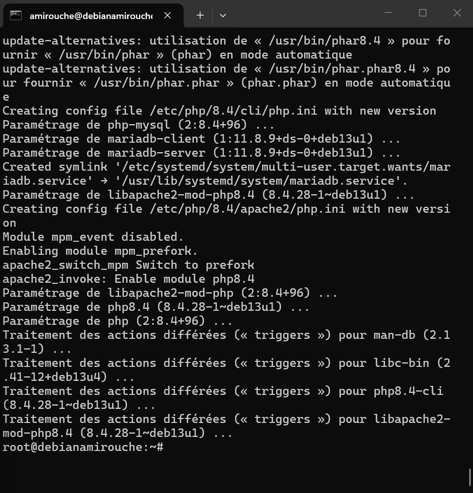

---

## 5. Vérification des services

J'ai vérifié qu'Apache et MariaDB tournent bien avec la commande `systemctl is-active apache2 mariadb`. Les deux ont répondu « active ».

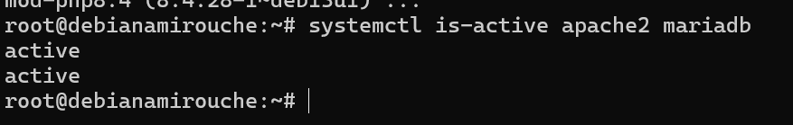

---

## 6. Téléchargement de MediaWiki

J'ai téléchargé **MediaWiki 1.43.12**, la version LTS (support à long terme), depuis le site officiel, avec la commande `wget`. Le fichier fait environ 89 Mo.

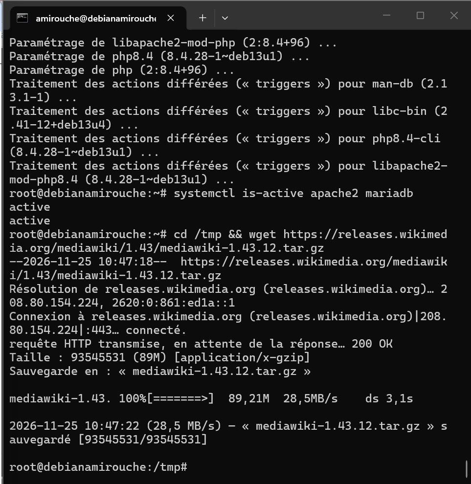

---

## 7. Décompression et permissions

J'ai décompressé l'archive dans `/var/www/html/` (le dossier d'Apache) et renommé le dossier en « mediawiki ». Ensuite, j'ai donné le dossier à l'utilisateur `www-data` (Apache) avec la commande `chown -R www-data:www-data /var/www/html/mediawiki`, pour que le site puisse écrire ses fichiers.

---

## 8. Création de la base de données

J'ai créé la base de données **« wikidb »** et un utilisateur **« wikiuser »** pour le wiki, avec la commande `mysql`. J'ai vérifié avec `SHOW DATABASES` que la base existe bien.

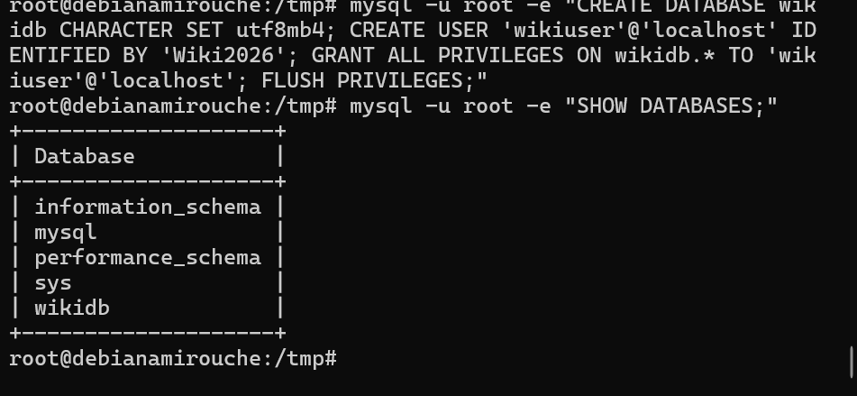

---

## 9. Premier accès au wiki

Quand j'ai ouvert http://10.7.236.215/mediawiki/ dans mon navigateur, MediaWiki m'a dit que le fichier `LocalSettings.php` n'existait pas encore et qu'il fallait lancer l'installation. C'était normal : c'est la première étape.

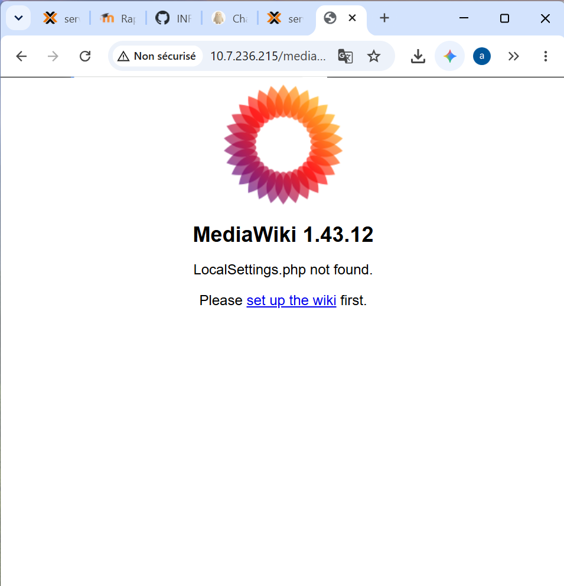

---

## 10. L'installateur web : la base de données

L'installateur web de MediaWiki est en français. J'ai suivi les étapes : langue, bienvenue, puis les paramètres de la base de données. J'ai mis le nom de la base (`wikidb`), l'utilisateur (`wikiuser`) et son mot de passe. J'ai aussi coché d'utiliser le même compte pour l'accès web.

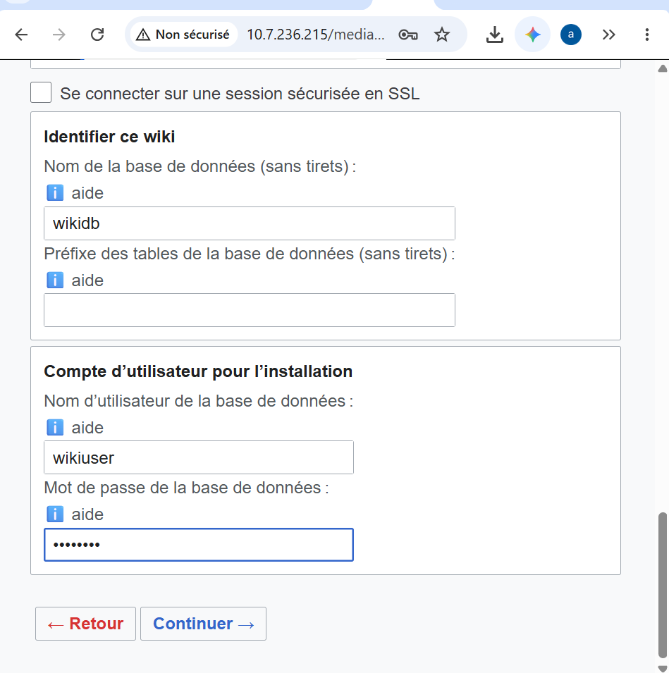

> ⚠️ **Premier problème :** à la première tentative, l'installateur a refusé la connexion avec le message « Access denied for user 'wikiuser'@'localhost' ». J'ai testé le mot de passe dans le terminal (`mysql -u wikiuser -p`) et il marchait. Le compte était bien configuré avec le bon plugin (`mysql_native_password`). C'était donc une faute de frappe dans le formulaire. Je l'ai retapé doucement et ça a marché.

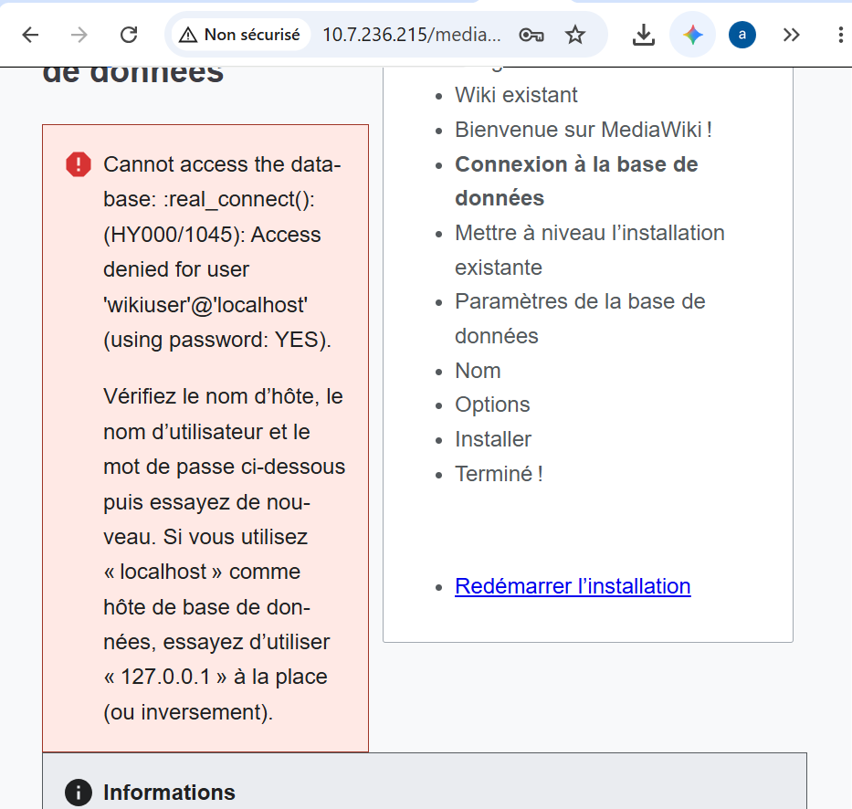

---

## 11. Nom du wiki et compte administrateur

J'ai donné un nom à mon wiki : **« Wiki Amirouche »**. J'ai aussi créé le compte administrateur du wiki, avec le nom **« Admin »**.

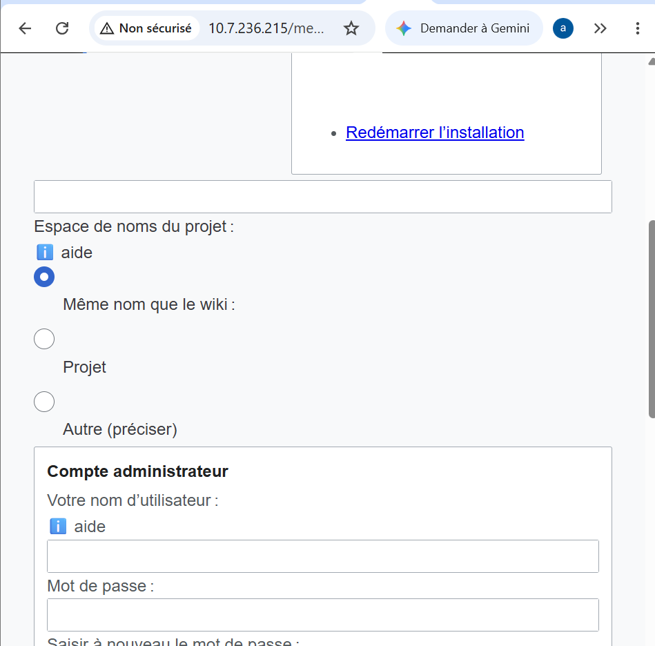

> ⚠️ **Problème :** l'installateur a refusé mon premier mot de passe parce qu'il doit faire au moins 10 caractères. Mon premier mot de passe n'en avait que 8. J'en ai choisi un plus long.

---

## 12. Options et habillage

J'ai laissé le profil « Wiki ouvert » (tout le monde peut lire le wiki). Ensuite, l'installateur a refusé de continuer avec le message « L'habillage choisi par défaut doit être activé » : aucun habillage (thème) n'était choisi par défaut. J'ai coché « Utiliser cet habillage par défaut » sous **Vector**, le thème classique de Wikipédia.

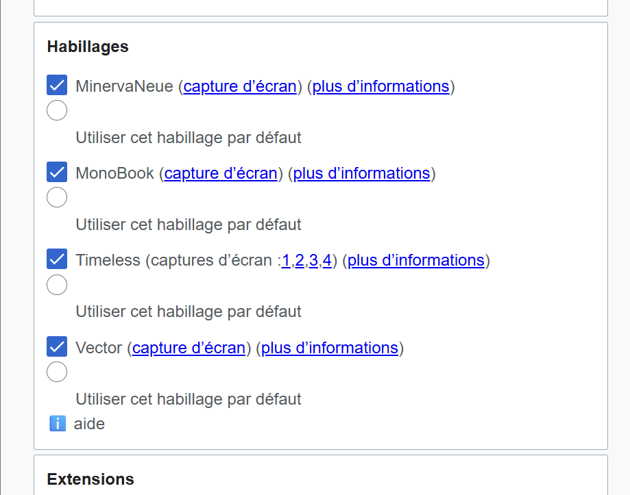

---

## 13. Fin de l'installation

J'ai cliqué sur « Continuer » et l'installateur a créé toutes les tables. Toutes les étapes sont marquées « terminé », et le message « La base de données a été bien installée » s'est affiché. La page « Terminé ! » m'a confirmé que MediaWiki était installé.

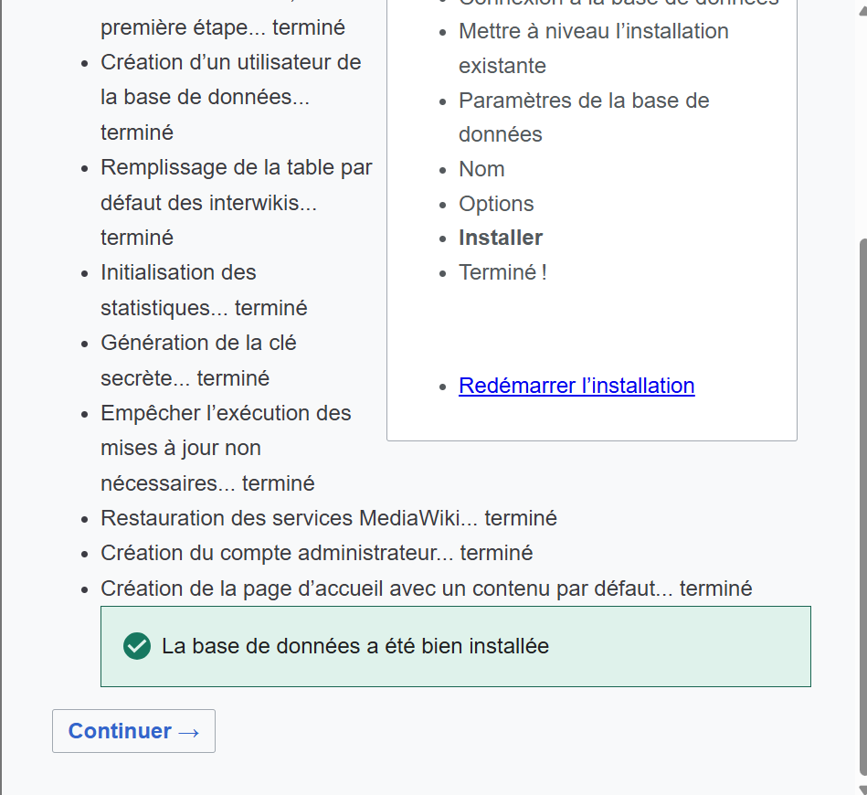

---

## 14. Le fichier LocalSettings.php

L'installateur a généré le fichier de configuration `LocalSettings.php`. Je devais le télécharger et le mettre à la racine du wiki (dans le même dossier que `index.php`).

> ⚠️ **Problème :** Chrome a bloqué le téléchargement avec le message « Téléchargement non sécurisé bloqué », parce que mon site est en HTTP (non sécurisé). J'ai cliqué sur « Enregistrer » pour autoriser le téléchargement.

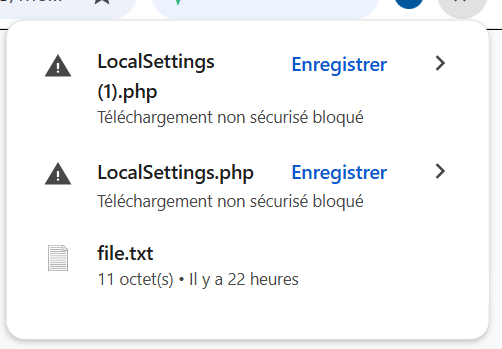

Ensuite, j'ai envoyé le fichier sur ma VM avec la commande `scp`, depuis une nouvelle fenêtre PowerShell de mon PC :

```bash
scp "C:\Users\PC\Downloads\LocalSettings (2).php" amirouche@10.7.236.215:/tmp/LocalSettings.php
```

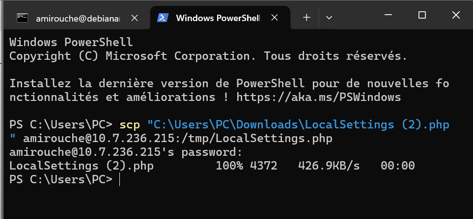

Puis, en root dans ma session SSH, je l'ai copié dans le dossier du wiki :

```bash
cp /tmp/LocalSettings.php /var/www/html/mediawiki/ && chown www-data:www-data /var/www/html/mediawiki/LocalSettings.php
```

---

## 15. Vérification finale

✅ J'ai rouvert http://10.7.236.215/mediawiki/ dans mon navigateur. La page d'accueil du wiki s'affiche : « MediaWiki a été installé », avec le nom « Wiki Amirouche ». **Mon wiki marche.**

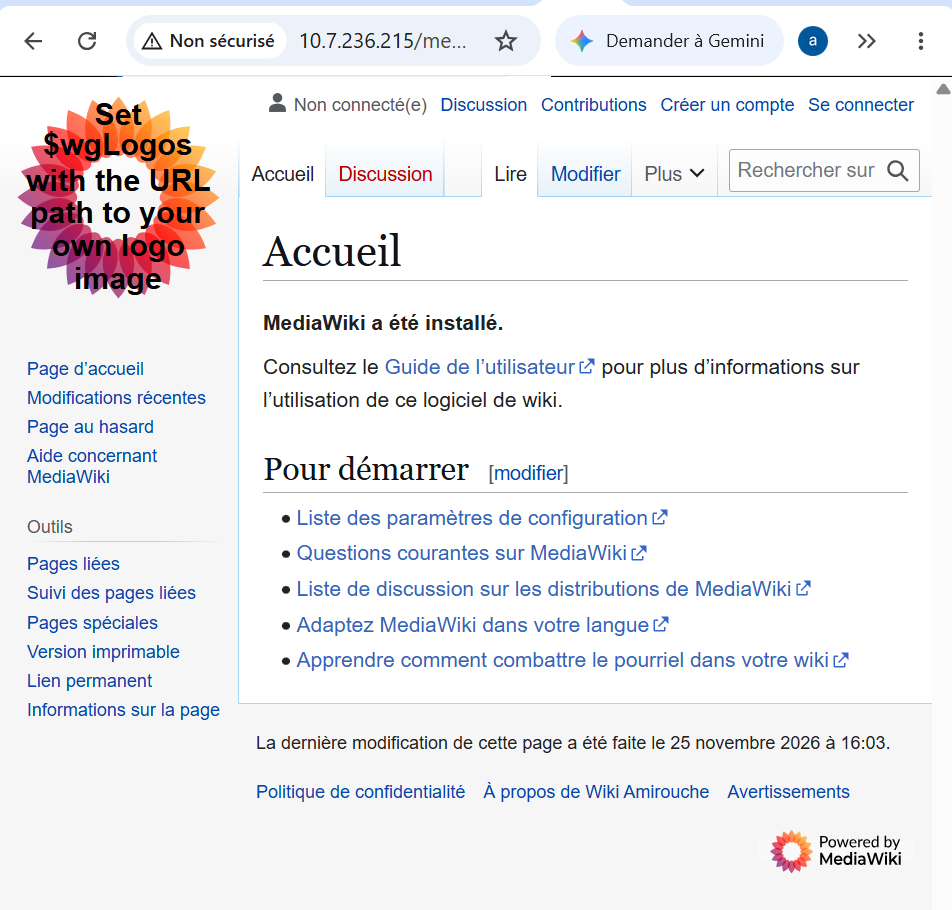

---

## 16. La page en tamazight sur la Kabylie

Après l'installation, le professeur m'a demandé d'installer la langue amazigh sur mon wiki et de faire une page avec. J'ai choisi le **tamazight (tifinagh)**. J'ai créé la page avant de changer la langue, pour que les menus soient encore en français pendant la création. Je me suis connecté en Admin, j'ai cherché le titre **ⵜⴰⵎⴰⵣⵉⵖⵜ**, puis j'ai créé la page avec un texte en tifinagh qui présente la Kabylie : ses montagnes, ses habitants, sa langue (taqbaylit), ses villes (Tizi Ouzou et Béjaïa), le Djurdjura et sa culture. Le message « La page a été créée » s'est affiché et le texte s'affiche correctement en tifinagh.

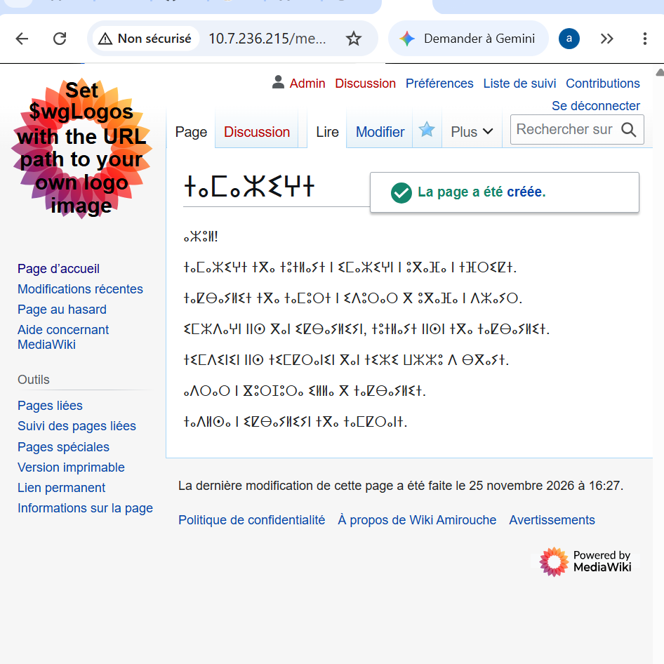

---

## 17. Installation de la langue tamazight

Pour changer la langue du wiki, j'ai modifié le fichier `LocalSettings.php` avec la commande `sed`, en root :

```bash
sed -i 's/$wgLanguageCode = "fr";/$wgLanguageCode = "zgh";/' /var/www/html/mediawiki/LocalSettings.php
```

J'ai vérifié avec `grep` : la ligne montre bien `$wgLanguageCode = "zgh";`. Après avoir actualisé le navigateur, toute l'interface du wiki s'affiche en tifinagh : les menus, la recherche et la date.

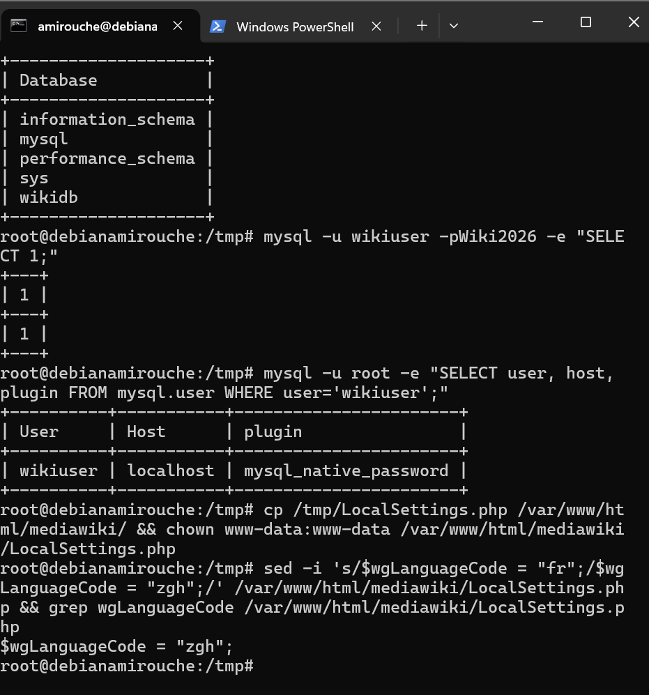

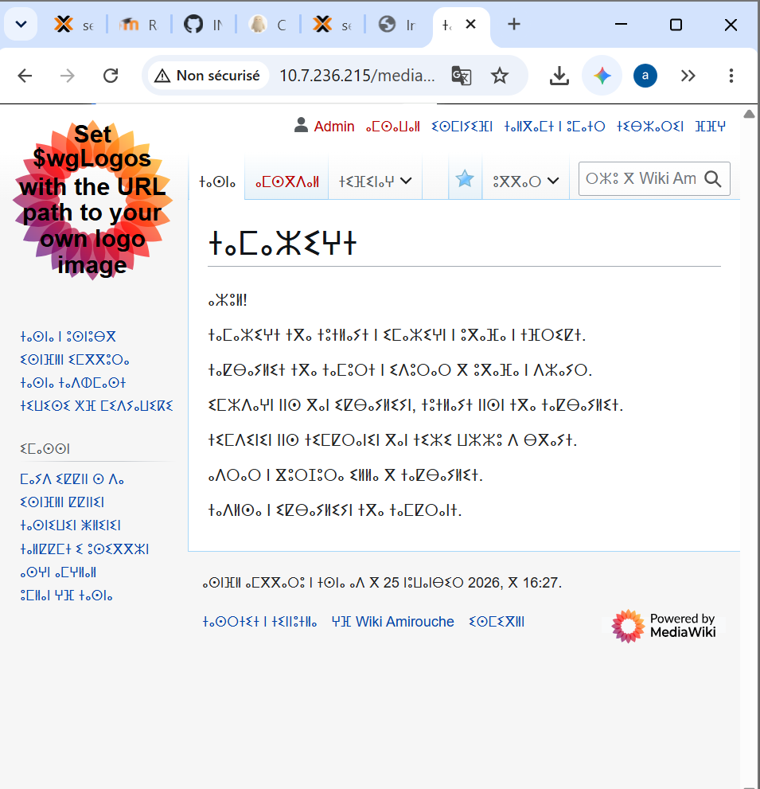

---

## 18. Conclusion

Ce projet m'a appris à installer une vraie application web complète : un serveur web (Apache), une base de données (MariaDB) et PHP, puis à configurer l'application avec son installateur web. J'ai aussi appris à chercher l'origine d'une erreur au lieu de recommencer au hasard : tester le mot de passe dans le terminal, vérifier le plugin de l'utilisateur, lire le message d'erreur jusqu'au bout. Chaque problème avait une cause simple : une faute de frappe, un mot de passe trop court, une case non cochée, un téléchargement bloqué par le navigateur.

---

## Informations techniques

| Élément | Valeur |
|---|---|
| VM | 103 (Debian 13), nœud server238 |
| Adresse IP de la VM | 10.7.236.215 |
| Serveur web | Apache |
| Base de données | MariaDB 11.8 |
| PHP | 8.4 |
| MediaWiki | 1.43.12 LTS |
| Dossier du wiki | `/var/www/html/mediawiki` |
| Base de données | wikidb, utilisateur wikiuser |
| URL du wiki | http://10.7.236.215/mediawiki/ |
| Nom du wiki | Wiki Amirouche |
| Compte administrateur du wiki | Admin |
| Langue du wiki | Tamazight (zgh, tifinagh) |
| Page en tamazight | ⵜⴰⵎⴰⵣⵉⵖⵜ (la Kabylie) |

