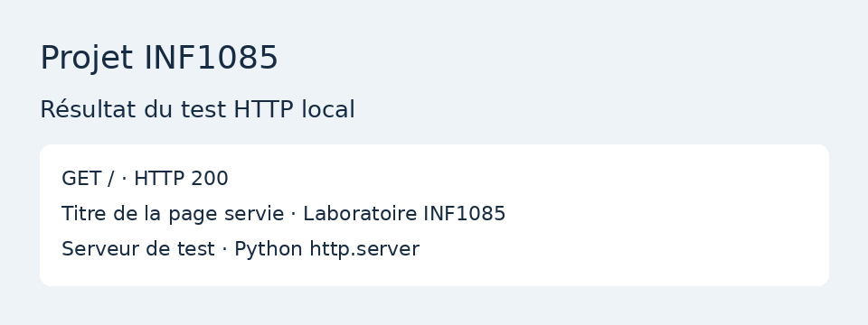

# Projet sur VM Linux — service web de documentation

Le sujet choisi est un mini-site interne qui présente les activités du cours. Le service est exécuté dans une VM Debian ou Ubuntu sur le réseau du laboratoire.

## Installation

```bash
sudo apt update
sudo apt install -y nginx
sudo install -m 0644 index.html /var/www/html/index.html
sudo nginx -t
sudo systemctl enable --now nginx
```

## Tests

```bash
systemctl is-active nginx
curl -fsS http://localhost/ | grep -F "Laboratoire INF1085"
ip -br address
```

Depuis un poste du même réseau, ouvrir `http://ADRESSE_DE_LA_VM/` et vérifier que le titre et le tableau des activités s’affichent. En cas d’erreur, vérifier l’adresse utilisée, l’état du service et les journaux avec `sudo journalctl -u nginx -n 30 --no-pager`.

## Critères de validation du projet

| Vérification | Résultat attendu |
|---|---|
| `sudo nginx -t` | La syntaxe de la configuration est valide. |
| `systemctl is-active nginx` | La commande affiche `active`. |
| Requête HTTP locale | La page renvoie le titre « Laboratoire INF1085 ». |
| Ouverture dans le navigateur | Le titre et le tableau des activités s’affichent depuis un poste du labo. |

## Exemple de déploiement

Le rapport d’un collègue décrit un autre site servi par Nginx. Ses vérifications concernent sa propre VM.

[Projet Nginx de référence](https://github.com/CollegeBoreal/INF1085-201-26A-04/tree/main/6.Projects/300151483)

## Vérification HTTP locale

Le serveur HTTP de test a répondu avec le statut **200**. La réponse correspond au fichier `index.html` et contient le titre **Laboratoire INF1085**. La validation de Nginx sur la VM du labo reste à effectuer.


