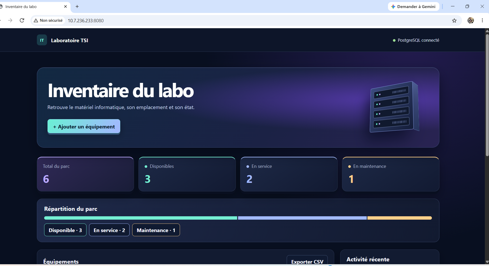
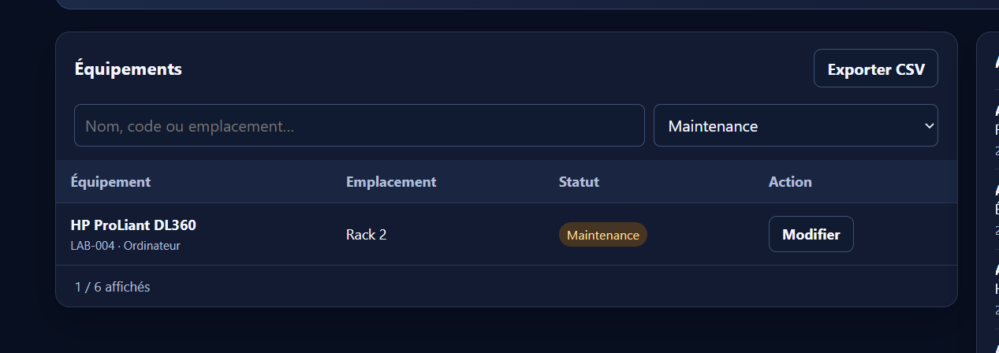

# Inventaire du labo

**Auteur** — Mohammed Mati  
**Programme** — Techniques des systèmes informatiques, Collège Boréal  
**Date** — 25 novembre 2026

[Ouvrir l’application sur le réseau du labo](http://10.7.236.233:8080)

## Présentation

J’ai déployé une application web de gestion du matériel informatique sur ma VM Debian dans Proxmox. Elle permet de trouver un équipement, de voir où il se trouve et de connaître son état. Par exemple, lorsqu’un serveur est en maintenance, on peut retrouver sa fiche en cliquant sur le statut correspondant.



## Fonctionnalités

- Ajouter, modifier ou supprimer une fiche d’équipement.
- Rechercher un équipement par nom, code, catégorie ou emplacement.
- Filtrer le tableau par statut avec le menu ou les boutons de la barre **Répartition du parc**.
- Consulter l’activité récente et exporter les résultats affichés au format CSV.
- Afficher un rack serveur en 3D réalisé en CSS. Il s’incline au mouvement de la souris sur les appareils compatibles.

## Architecture

| Composant | Rôle |
| --- | --- |
| Proxmox VE | Héberge la machine virtuelle Debian. |
| HTML, CSS et JavaScript | Affichent le tableau de bord, le rack 3D et les filtres. |
| Nginx | Sert l’interface sur le port `8080` et transmet les requêtes `/api/` à Node.js. |
| Node.js et Express | Exécutent l’API sur `127.0.0.1:3000`. |
| PostgreSQL | Conserve les fiches d’équipement et l’historique des changements. |
| systemd | Gère le service `inventaire-labo` et le lance au démarrage. |

## Étapes du déploiement

1. J’ai transféré les fichiers du projet vers ma VM Debian avec SCP.
2. J’ai extrait l’archive et exécuté l’installateur depuis le dossier `projet-inventaire`.

   ```bash
   sudo bash installer.sh
   ```

3. J’ai chargé les six équipements de démonstration dans PostgreSQL.

   ```bash
   sudo runuser -u inventaire -- psql -X -v ON_ERROR_STOP=1 -d inventaire < demo.sql
   ```

   PostgreSQL a affiché `INSERT 0 6`.

4. J’ai ouvert l’application à l’adresse `http://10.7.236.233:8080`, puis ajouté le thème sombre, le rack 3D et la barre de répartition. Les fichiers de l’interface déployée se trouvent dans `/opt/inventaire-labo/public/`.

## Vérifications

### Connexion à PostgreSQL

L’API a répondu `{"database":"ok"}` pendant l’installation et le tableau de bord affiche **PostgreSQL connecté**. Les six équipements de démonstration sont répartis entre trois statuts.

| Disponible | En service | Maintenance | Total |
| :---: | :---: | :---: | :---: |
| 3 | 2 | 1 | 6 |

La commande suivante permet de refaire le test depuis la VM.

```bash
curl -fsS http://127.0.0.1:8080/api/health
```

### Filtre Maintenance

Après avoir sélectionné **Maintenance**, le tableau affiche seulement le **HP ProLiant DL360** (`LAB-004`), situé dans le **Rack 2**. Le compteur affiche **1 / 6 affichés**.



